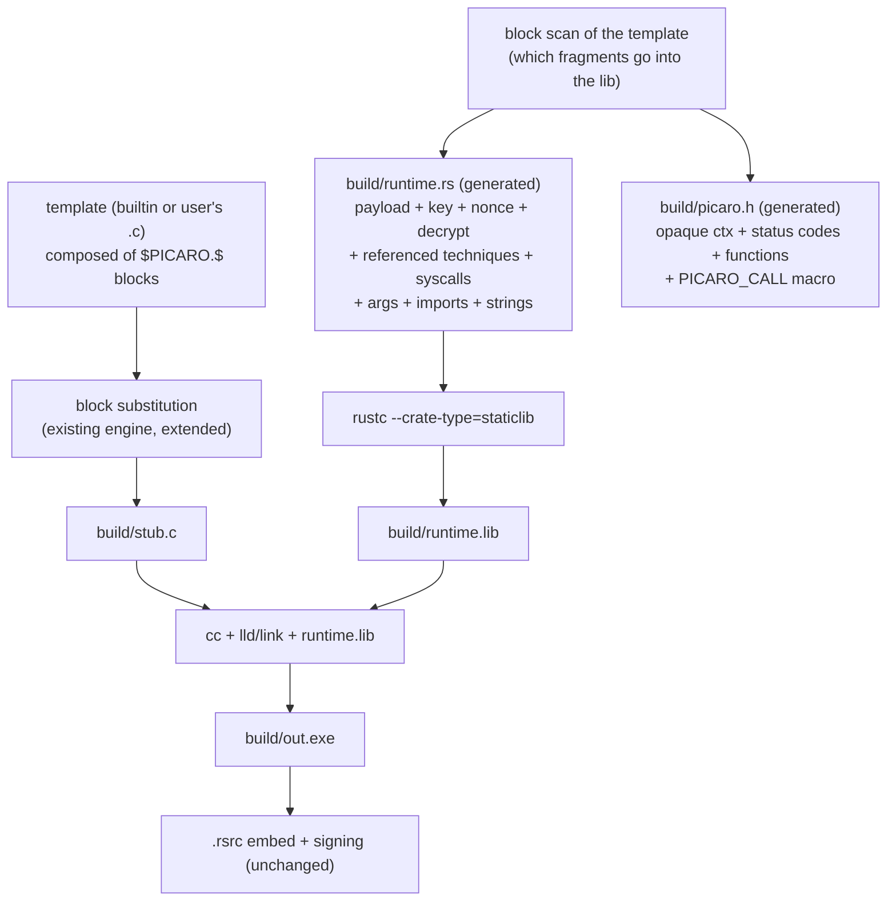

# FUTURE — C stubs via a Rust runtime library (Way B)

Status: **design revised 2026-09-27 — block-catalog interface; still not
scheduled.** Nothing described here is implemented and nothing else in the repo
depends on it. When it is picked up, work phase by phase; tick the checkboxes as
phases close and keep the "Decision log" current.

This page is deliberately not in the site navigation.

Goal: let an operator write **their own loader stub in C**, calling the
techniques that already exist in Rust (reflective loading, process hollowing,
AMSI/ETW patching, anti-debug, bouncer, sleep obfuscation) plus the syscall
layer, the import resolver, the argument block and the string obfuscation —
**without reimplementing any of them**.

Mechanism: the code that is generated per build becomes a **Rust `staticlib`
with a C ABI**; the C stub links it and calls it. The C operator composes their
stub with **two interchangeable styles** over that same library:

- `$PICARO.RUNTIME$` — the plan drives everything (parity with today).
- granular blocks, one per technique — the C code drives selection and order.

---

## 1. Scope

### In scope

- `build.stub.language: rust | c` (`rust` default; the Rust path must not
  change behaviour).
- A per-build generated Rust **runtime library** (`staticlib`) exposing a stable
  C ABI, containing: payload + key + nonce + decryption, the technique fragments
  referenced by the stub, the syscall layer, the args block, the imports block,
  and the string-obfuscation helper.
- A generated C header (`picaro.h`) describing exactly the ABI of that build,
  including the `PICARO_CALL` composition macro.
- A **block catalog**: `$PICARO.RUNTIME$` plus one `$PICARO.<TECHNIQUE>$` block
  per technique, with an optional `(FORMAT)` assertion on execution techniques.
- A builtin C stub template (uses `$PICARO.RUNTIME$`) plus support for a
  user-supplied `.c` template via `build.stub.path`.
- C toolchain discovery (compilers live in PATH, explicit config as an escape
  hatch, clear errors when missing).
- Static-profile parity with the Rust path, measured with `picaro audit`.

### Non-goals (explicitly rejected)

- **No per-language reimplementation of techniques** (the "SDK per language"
  design). One implementation, in Rust, behind an ABI. This is the whole point.
- **No Nim / C++ / Go / asm / `.obj`-linking path.** If a second language is ever
  wanted, the ABI is already the answer.
- **No plugin system for the packer**, no out-of-process technique runners.
- **No DLL shipped next to the artifact.** A loader runtime as a `.dll` on disk
  is an IoC (disk artifact, module list, image-load events). The runtime is
  always statically linked into the artifact.
- **No multi-payload builds.** A build carries exactly one payload format; the
  `(FORMAT)` block argument asserts it, never selects between embedded payloads.
- **No ABI stability promise across picaro versions.** Header and library are
  generated together per build; `PICARO_ABI_VERSION` exists only to catch a
  cached/stale library.
- **No x86 support.** Unchanged from today (`arch: x64` only).

---

## 2. Architecture

### Today

```
build/main.rs   (generated: template + technique fragments + blocks)
      │
      └─ rustc  ──────────────────────────────►  build/out.exe
                                                     │
                                       .rsrc embed ──►│──► signtool
```

One binary crate. Every fragment is injected at the crate root, which is why
fragments address everything as `crate::nt_alloc_vm`, `crate::dec_xor`,
`crate::KEY_HEX`, `crate::resolve_imports`, `crate::build_command_line`,
`crate::tech_dbg!`, `crate::ImportError`.

### Target (`language: c`)



The generated `runtime.rs` is today's generated stub **minus `main()`**, plus a
generated FFI wrapper layer. The payload stays in the library
(`include_bytes!`), so the C side never handles the ciphertext, the key or
nonce — this keeps decryption, syscall init and obfuscation in one place and
avoids emitting multi-megabyte C byte arrays.

**The template scan decides what the library contains** (see §5): a block
referenced by the template pulls its technique fragment (and its syscall /
import / args dependencies) into the build; nothing else is compiled in. This
preserves today's per-build minimality and dead-code elimination.

### Ownership split

| Concern | Rust runtime lib | C stub |
|---|---|---|
| Payload ciphertext, key, nonce, decryption | ✅ | — |
| Technique bodies | ✅ | — |
| Syscall layer (`nt_*`, SSN resolution, trampoline) | ✅ | — |
| Args block, imports resolver | ✅ | — |
| String obfuscation / deobfuscation | ✅ | — |
| Which technique runs when; abort decisions | `$PICARO.RUNTIME$` (per `runtime:`) | ✅ (granular blocks) |
| Process exit codes | only where a technique contract demands it (see D-1) | ✅ |
| Anything the operator adds | — | ✅ |

### The two stub styles

Plan-driven (the builtin template):

```c
main() {
    $PICARO.RUNTIME$
}
```

Stub-driven (a custom `loader.c`):

```c
main() {
    $PICARO.PATCH_AMSI$
    $PICARO.REFLECTIVE_LOADING(SHELLCODE)$
}
```

Both are **textual substitution** — the same mechanism the Rust path uses.
After substitution:

```c
main() {
    PICARO_CALL(picaro_patch_amsi);
    PICARO_CALL(picaro_reflective_load);
}
```

with, from the generated `picaro.h`:

```c
#define PICARO_CALL(fn) do {                                    \
    picaro_ctx *ctx = picaro_init(); /* process-wide singleton */ \
    if (!ctx) return 1;           /* the lib printed the reason */ \
    int rc = (fn)(ctx);                                          \
    if (rc == PICARO_DECLINED) return 0;                         \
    if (rc != PICARO_OK) { picaro_print_error(ctx); return 1; }  \
} while (0)
```

Contract: a block is a compound statement whose `return`s return from the
enclosing function — use blocks in `main()` or an `int`-returning function.
Documented, not machine-validated (we do not parse C, same policy as the
regex-based `fn main(` check today).

---

## 3. The ABI (v1)

Normative sketch. The real header is **generated per build** and lists only the
techniques that build selected.

```c
/* picaro.h — generated by picaro; do not edit */
#define PICARO_ABI_VERSION 1

typedef struct picaro_ctx picaro_ctx;   /* opaque to C */

enum {
    PICARO_OK       =  0,   /* success */
    PICARO_DECLINED =  1,   /* a gate said "do not run the payload" */
    PICARO_ERR      = -1    /* see picaro_last_error() */
};

/* Lifecycle. picaro_init is idempotent: it returns the same process-wide
   context on every call and decrypts the embedded payload once. */
picaro_ctx *picaro_init(void);
void          picaro_free(picaro_ctx *ctx);
const char   *picaro_last_error(const picaro_ctx *ctx);  /* never NULL */
void          picaro_print_error(const picaro_ctx *ctx);
const char   *picaro_marker(const picaro_ctx *ctx);

/* Pipeline parity with the Rust stub's run(): preparations in YAML order,
   then the execution technique. Prints the marker after decryption. */
int picaro_run(picaro_ctx *ctx);

/* Granular entry points — emitted only for referenced techniques. */
int picaro_patch_amsi(picaro_ctx *ctx);
int picaro_patch_etw(picaro_ctx *ctx);
int picaro_anti_debug(picaro_ctx *ctx);
int picaro_bouncer(picaro_ctx *ctx);
int picaro_sleep_obfuscation(picaro_ctx *ctx);
int picaro_reflective_load(picaro_ctx *ctx);
int picaro_process_hollowing(picaro_ctx *ctx);

#define PICARO_CALL(fn) /* as in §2 */
```

Rules:

- Every function returns `int`; never a Rust `Result`, never a panic. Errors are
  a status plus a message retrievable from the context (valid until the next
  call on that context or `picaro_free`).
- Error messages are **runtime reconstructions of obfuscated literals**, exactly
  like today's fragments (`MESSAGES` table + `nt_error`). No new cleartext.
- Single-threaded contract: the context and the library are used from one
  thread. The syscall layer keeps process-global `OnceLock` state; document it.
- `picaro_run` is the parity entry point (the Rust `run()` moved into the
  library); the granular functions are the composition surface.
- `picaro_free` exists for completeness and future non-singleton use; the
  blocks never call it in v1 (the process exit cleans up).

Optional, later: `int picaro_run_image(picaro_ctx *, const uint8_t *image,
size_t len, int format)` for a C stub that supplies its own payload.

---

## 4. Build flow

| Step | Today | With `language: c` |
|---|---|---|
| 1 | read + encrypt payload | unchanged |
| 2 | render `build/main.rs` | render `build/runtime.rs` (lib template) |
| 3 | — | scan template for `$PICARO.$` blocks; render `build/stub.c` + `build/picaro.h` |
| 4 | `rustc` → `build/out.exe` | `rustc --crate-type=staticlib` → `build/runtime.lib` |
| 5 | — | `cc` link `stub.c` + `runtime.lib` → `build/out.exe` |
| 6 | `.rsrc` embed | unchanged |
| 7 | signing | unchanged |
| 8 | manifest | + `stub.language`, C compiler version/path |

Illustrative commands (exact flags are pinned in **Phase 0**, not guessed here):

```sh
rustc --crate-type=staticlib --edition 2021 -O \
      -C panic=abort -C codegen-units=1 -C target-feature=+crt-static \
      -L dependency=<deps> -L native=<windows-import-lib-dir> \
      --extern chacha20poly1305=<..> --extern hex=<..> \
      --extern windows=<..> --extern thiserror=<..> \
      build/runtime.rs -o build/runtime.lib

clang --target=x86_64-pc-windows-msvc -O2 -MT -c build/stub.c -o build/stub.obj
lld-link /SUBSYSTEM:CONSOLE /ENTRY:mainCRTStartup /OUT:build/out.exe \
         build/stub.obj build/runtime.lib /LIBPATH:<..>
```

Filename rule: keep `build/main.rs` for `language: rust` (the crate name feeds
symbol names and panic paths — do not perturb the existing path).

---

## 5. Plan surface and block catalog

```yaml
build:
  stub:
    language: c              # rust (default) | c
    path: loader.c           # custom template; .rs or .c per language
    toolchain:               # optional; auto-detected when absent
      cc: clang              # clang | cl | mingw
      path: null             # explicit compiler path
      lib_dirs: []           # extra /LIBPATH: dirs for the link step
```

- No schema bump: `build.stub` gains optional keys with defaults, so schema 4
  documents keep working.
- Environment overrides mirror the `signtool` philosophy
  (`PATH` → `PICARO_SIGTOOL` → known location → explicit config):
  `PICARO_CC` and `PICARO_CC_LIB_DIRS`.
- `language: c` + `arch: x86` → rejected, like today's x86 rejection.
- Validation errors name what to install, like `RustcNotFound` /
  `MissingCrossTarget` do.

### Block catalog

Block names are the **registry technique names** (`src/techniques/mod.rs`) —
one naming source for YAML, `techniques list` and the blocks.

| Block | `(FORMAT)` assertion | Category |
|---|---|---|
| `$PICARO.RUNTIME$` | none | the whole `runtime:` pipeline, in YAML order |
| `$PICARO.PATCH_AMSI$` | — | Preparation |
| `$PICARO.PATCH_ETW$` | — | Preparation |
| `$PICARO.ANTI_DEBUG$` | — | Preparation |
| `$PICARO.BOUNCER$` | — | Preparation (DECLINED → `return 0`) |
| `$PICARO.SLEEP_OBFUSCATION$` | — | Preparation |
| `$PICARO.REFLECTIVE_LOADING$` | `(PE)`, `(DLL)`, `(SHELLCODE)` | Execution |
| `$PICARO.PROCESS_HOLLOWING$` | `(PE)` only | Execution |

Rules (all decided; see §10):

- The `(FORMAT)` argument is optional and is **an assertion, not a selector**:
  when present it must equal `build.payload.format`, otherwise a hard error.
  Without it, the plan's format applies. `PROCESS_HOLLOWING` rejects any format
  other than `PE`, mirroring today's validation.
- **Template scan** → library contents: only the fragments referenced by blocks
  (or the whole pipeline for `$PICARO.RUNTIME$`) are compiled into the lib.
- **`runtime:` semantics per style** (D-9):
  - `$PICARO.RUNTIME$`: exactly like today — the plan drives selection, order
    and parameters, one Execution technique required.
  - Granular blocks: selection and order live in the C code. `runtime:` entries
    become **optional parameter providers** for the referenced techniques;
    a referenced technique without an entry uses its defaults; an entry whose
    technique is never referenced raises a warning (symmetric to today's
    "stub ignores a block" warnings).
- Mixing `$PICARO.RUNTIME$` with granular blocks in one template is a **hard
  error** (D-12): pick one style; anything expressible is expressible with
  granular blocks alone.
- A template that references **no** `$PICARO.$` block warns that the payload
  will not run (same spirit as the custom-Rust-stub warnings today).
- Distinct Execution techniques both referenced → **warning** citing the
  registry conflict; decrypt happens once, the payload may run N times (D-10).
- Material placeholders (`$KEY_HEX$`, `$NONCE_HEX$`, `$PAYLOAD_BYTES$`,
  `$ARG_<name>$`) remain available in C templates as plain C literals for power
  users; the blocks themselves need none of them.

### Substitution-engine change

`src/engine/stub.rs::substitute_template` + `is_placeholder_name` currently
accept only `[A-Za-z0-9_.]` inside `$…$`. `$PICARO.RUNTIME$` already parses
(dots are allowed); `$PICARO.REFLECTIVE_LOADING(SHELLCODE)$` needs the tokenizer
extended to the `$NAME(args)$` form. Strict errors stay: an unknown block or a
leftover `$` is an error, exactly like today's unsubstituted-placeholder error.

---

## 6. Phases

### Phase 0 — Spike, pin the toolchain (no product code) ⬜

Do this by hand, outside the packer, before writing any Rust. This is the gate
for the whole plan.

- Take a generated `build/main.rs`, remove `main()`, add two
  `#[no_mangle] pub extern "C"` exports, build it as `staticlib`.
- Write a ~20-line `main.c` that calls them; link with `clang` (preferred) and,
  separately, with `cl`/`lld-link`.
- Hand-expand the `PICARO_CALL` style (singleton init + status handling) and
  evaluate the ergonomics and error semantics of the blocks.
- Run it; `picaro audit` both artifacts and compare against the Rust path.

Exit criteria (all measured, recorded in `docs/` or `.memory.md`):

- [ ] The exe runs, the marker prints, a test payload runs.
- [ ] Exit code propagates; no PDB required at run time; no extra runtime DLL.
- [ ] The exact link line and library set are known for **MSVC-ABI clang** and
      for **cl** on the dev machine.
- [ ] `std::env::args_os()` **verified from a staticlib** (see R-1) — and if it
      returns nothing, the `GetCommandLineW` replacement is prototyped.
- [ ] The hand-expanded block style feels right; `PICARO_DECLINED` → `return 0`
      and `PICARO_ERR` → print + `return 1` behave as intended.
- [ ] `picaro audit` shows no new static tells versus the Rust path.
- [ ] Cross-compile path (`x86_64-pc-windows-gnu` from Linux) either works or is
      declared unsupported for `language: c` in v1 (D-6).

**If this phase fails, stop and re-plan. Everything below assumes it passed.**

### Phase 1 — Toolchain discovery ⬜

- New `src/engine/cc.rs`: `find_cc() -> Result<Cc>`, `cc_version()`,
  `link_lib_dirs()`, with `PICARO_CC` / `build.stub.toolchain.*`.
- Discovery order (pin after Phase 0): `toolchain.path` → `PICARO_CC` →
  `clang`/`clang-cl` in PATH → `cl` (VS install via `vswhere`) →
  `x86_64-w64-mingw32-gcc` when targeting the GNU triple.
- New `BuildError` variants mirroring `RustcNotFound`.
- Unit tests with a fake PATH (same style as `find_executable_in_path` tests).

Exit criteria: a clear error when nothing is found; the chosen compiler and lib
dirs are printed under `-v`; no technique code touched yet.

### Phase 2 — Runtime as a library ⬜

- New `templates/runtime/lib.rs.tpl` (today's `main.rs.tpl` minus `main`, plus
  the FFI layer and `picaro_run`).
- `compiler.rs`: `compile_runtime_lib()` (`--crate-type=staticlib`) and
  `link_c_stub()`; `compile_stub()` stays for `language: rust`.
- Minimal ABI first: `picaro_init` (singleton), `picaro_marker`,
  `picaro_last_error`, `picaro_print_error`, `picaro_free`, `picaro_run`.
  No granular wrappers yet.
- Builtin C template `templates/stub/main.c.tpl` = `$PICARO.RUNTIME$`.

Exit criteria: a C stub built end to end from a YAML, running a test payload,
with the same observable behaviour as the Rust path (marker + exit code).

### Phase 3 — Granular ABI + generated header ⬜

- Generated `#[no_mangle] pub extern "C"` wrappers, one per referenced
  technique, with names from the table below; `picaro.h` generated from the
  same list (plus `PICARO_CALL`) so header and library cannot drift.
- Context carries the last error; `PICARO_DECLINED` for gates.
- Diagnostics stay obfuscated across the boundary.

| Technique | Wrapper |
|---|---|
| `patch_amsi` | `picaro_patch_amsi` |
| `patch_etw` | `picaro_patch_etw` |
| `anti_debug` | `picaro_anti_debug` |
| `bouncer` | `picaro_bouncer` |
| `sleep_obfuscation` | `picaro_sleep_obfuscation` |
| `reflective_loading` | `picaro_reflective_load` |
| `process_hollowing` | `picaro_process_hollowing` |

Exit criteria: a custom C stub that composes `bouncer` → `patch_amsi` →
`reflective_load` builds, runs, and declines correctly on a failing gate.

### Phase 4 — Blocks, templates, validation ⬜

- `build.stub.language` in `src/config/schema.rs`; validation in
  `src/config/validate.rs`.
- `stub.rs`: the block catalog (§5). `$X$` substitution is already
  language-agnostic; the engine gains the `$NAME(args)$` token form and the
  `PICARO_CALL`-based block renderers.
- **Template scan → library contents**: block references decide which fragments
  the runtime lib compiles (minimality).
- `runtime:` semantics per style (D-9), mixing rejection (D-12), the
  "no blocks referenced" warning, format assertion (D-8), distinct-Execution
  warning (D-10).
- `validate_custom_stub_template` becomes language-dispatched (`fn main(` vs
  `int main(`).
- `apply_subsystem` → `/SUBSYSTEM` + `/ENTRY:mainCRTStartup` for the Windows
  subsystem (a C `main()` under `/SUBSYSTEM:WINDOWS` needs the explicit entry).
- `--dry-run` and the build echo print the language, the compiler and its
  version, mirroring how `sign` is reported today.

Exit criteria: `language: c` with no `path` produces a working artifact; a
custom C stub composes granular blocks; every validation rule above has a test.

### Phase 5 — Stealth parity and hardening ⬜

- `build.output.strip` for the C path (D-2).
- `trim_paths` still applies to the runtime lib (`--remap-path-prefix`).
- Key/nonce obfuscation in the C template (closes the existing custom-stub
  cleartext debt for this path too).
- Extend `no_sensitive_literals_in_generated_stubs` to cover the C path.
- Parity measurement: build the same plan both ways and diff
  `picaro audit --baseline`; any regression is a bug in this phase.

Exit criteria: the audit report of the C artifact matches the Rust artifact on
technique keywords, imports, strings and entropy within noise.

### Phase 6 — DX and docs ⬜

- `examples/stubs/loader.c` showing both styles (+ a YAML using it).
- `docs/` page: the ABI, the block catalog, a worked C example, toolchain
  requirements; nav entry in `mkdocs.yml`.
- Manifest fields (`stub.language`, compiler version/path) in
  `engine/manifest.rs`.
- Wizard: prompt for the language (only after the C path is proven).
- Update `AGENTS.md` (see §9) and `.memory.md`.

---

## 7. File-by-file change map

| File | Change |
|---|---|
| `src/engine/cc.rs` | **new** — C compiler discovery, version, lib dirs |
| `src/engine/compiler.rs` | `compile_runtime_lib`, `link_c_stub`; `compile_stub` unchanged for Rust |
| `src/engine/stub.rs` | block catalog renderers; `$NAME(args)$` tokenizer; template scan; C warnings; FFI wrapper + header renderers |
| `src/engine/mod.rs` | export `cc`; new `BuildError` variants |
| `src/engine/manifest.rs` | `stub.language`, C compiler provenance |
| `src/engine/obfuscation.rs` | render obfuscated literals as C arrays (Phase 5) |
| `src/config/schema.rs` | `build.stub.language`, `build.stub.toolchain` |
| `src/config/validate.rs` | language/arch/toolchain validation; block-catalog rules (§5) |
| `src/main.rs` | dispatch on language in `build()` and `dry_run()`; subsystem for C |
| `templates/runtime/lib.rs.tpl` | **new** — generated runtime library template |
| `templates/stub/main.c.tpl` | **new** — builtin C stub (`$PICARO.RUNTIME$`) |
| `templates/stub/main.rs.tpl` | unchanged |
| `src/techniques/**` | fragment text unchanged (verify per technique) |
| `src/engine/resources/`, `signing.rs` | unchanged (PE post-processing) |
| `src/audit/**` | unchanged; used as the parity gate |

---

## 8. Risks and must-verify items

| # | Risk | Mitigation | Verified in |
|---|---|---|---|
| R-1 | `std::env::args_os()` may be uninitialised in a `staticlib` (no `lang_start`). The args block depends on it. | Verify first; else read `GetCommandLineW` directly (also stealthier: drops the std arg cache). | Phase 0 |
| R-2 | C toolchain + link lib dirs on Windows (VS env vars, MSVC/UCRT libs). The most likely source of pain. | `vswhere` discovery + `PICARO_CC`/`lib_dirs` escape hatch; explicit errors; prefer clang + lld-link. | Phase 0/1 |
| R-3 | `strip`: a staticlib cannot be stripped at lib stage (the linker needs its symbol table), and `build.output.strip` currently maps to `-C strip=symbols`. | Strip at link (`/DEBUG:NONE`, `/RELEASE`), `llvm-strip --strip-all` if available; measure with `audit`. | Phase 5 |
| R-4 | CRT mismatch: `+crt-static` (Rust) vs `/MD` (C). | Compile the C stub `/MT`; validate the flag combination; document. | Phase 0 |
| R-5 | Panic or unwinding across the FFI boundary. | Keep `-C panic=abort`; wrappers convert `Result` → status; never `unwrap` at the boundary. | Phase 2 |
| R-6 | Symbol leakage: a Rust staticlib exports a large symbol surface. | Measure with `audit`; strip; consider `-C symbol-mangling-version` only if needed. | Phase 5 |
| R-7 | ABI/header drift if the lib is cached. | Generate both per build; `PICARO_ABI_VERSION`; do not document the ABI as stable. | Phase 3 |
| R-8 | Cross-compile from Linux (`x86_64-pc-windows-gnu`). | D-6: Windows host only for v1 unless Phase 0 proves the GNU line. | Phase 0 |
| R-9 | `on_fail: exit` inside a library exits the host process. | D-1: keep parity in v1; the block maps only `DECLINED` → `return 0`. | Phase 3 |
| R-10 | Scope creep (SDK, other languages, plugin system). | §1 non-goals; any new language goes through this ABI, not a new renderer. | — |
| R-11 | The `$NAME(args)$` tokenizer extension could regress the existing `$X$` engine (which keeps literal `$` in strings). | Extend `is_placeholder_name` minimally; unit-test every legacy case (`{{..}}` rejection, literal `$`, unknown placeholders). | Phase 4 |
| R-12 | Symbol/name collision between user C code and the `picaro_*` namespace. | Reserve the `picaro_` prefix (header + doc); the generated header is the only contract; link errors surface collisions loudly. | Phase 3 |
| R-13 | Blocks `return` from the enclosing function — misuse inside `void`/wrong-typed functions breaks compilation. | Documented contract; not machine-validated (we do not parse C, same policy as today's regex check). | Phase 0/3 |
| R-14 | Granular mode can run the payload N times. | D-10: distinct Executions warn; decrypt happens once; semantics documented. | Phase 4 |

---

## 9. Policy changes

`AGENTS.md` currently states a non-negotiable: *"Everything in Rust. No C, no
C++, no Nim. The stub is also Rust."* This plan does not implement techniques in
C — it exposes the Rust ones through a C ABI — but the wording still has to be
re-scoped, e.g.:

> **Techniques are implemented once, in Rust.** A stub may be written in C and
> call them through the generated C ABI (`build.stub.language: c`); the runtime
> it links (`staticlib`) is generated Rust. No technique is ever reimplemented
> in another language, and no compiler toolchain is embedded in the repo.

Also record: the C path must not regress the Rust path; `language: rust` stays
the default and stays byte-comparable.

---

## 10. Decision log

| # | Decision | Resolution | Status |
|---|---|---|---|
| D-1 | `bouncer` `on_fail: exit` from inside the library | v1 keeps parity (the fragment exits); the block maps only `DECLINED` → `return 0`; revisit a status-returning variant later | decided |
| D-2 | `strip` implementation for the C path | `llvm-strip --strip-all` when available + `/DEBUG:NONE`; measured with `audit` | decided |
| D-3 | Preferred C compiler | clang (+ lld-link) first, `cl` fallback, MinGW only for the GNU triple | decided (Phase 0 confirms) |
| D-4 | Ship a builtin `main.c.tpl` | Yes — `language: c` with no `path` must just work; it uses `$PICARO.RUNTIME$` | agreed |
| D-5 | Library compiled per build vs cached | Per build (keeps the per-build minimal binary and dead-code elimination) | agreed |
| D-6 | Cross-compile support in v1 | Windows host only unless Phase 0 proves the GNU line | decided |
| D-7 | Payload ownership | Library (no C byte arrays); `picaro_run_image` as a later escape hatch | agreed |
| D-8 | Block `(FORMAT)` argument | Optional **assertion**; must equal `build.payload.format` or hard error; not a selector | decided |
| D-9 | `runtime:` in granular mode | Optional per-technique parameter provider; C owns selection/order; unused entries warn; absent entries use technique defaults | decided |
| D-10 | Multiple / distinct Execution techniques | Distinct Executions → warning (registry conflict); decrypt once, payload may run N times | decided |
| D-11 | `$PICARO.$` blocks in Rust custom stubs | Not in v1 (defer) — the Rust path already has its builtin + block mechanism | decided |
| D-12 | Mixing `$PICARO.RUNTIME$` with granular blocks | Hard error: pick one style | decided |
| D-13 | Block expansion | `PICARO_CALL` macro from the generated header; contract: blocks live in `main()` or an `int`-returning function | decided |
| D-14 | Context lifecycle | `picaro_init` is an idempotent process-wide singleton (decrypt once); `picaro_free` exists but blocks never call it in v1 | decided |

---

## 11. Verification strategy

- `cargo test` and the Rust-path integration tests must stay green unchanged.
- New unit tests (no toolchain needed): block renderers, the `$NAME(args)$`
  tokenizer (including every legacy case), header generation, template-scan →
  fragment-selection mapping, the validation rules (§5), compiler discovery
  with a fake PATH.
- New `#[ignore]` end-to-end tests (Windows + C toolchain), mirroring
  `full_pipeline_generates_exe` and `custom_stub_compiles_to_pe`:
  `c_stub_compiles_to_pe`, `c_stub_runs_and_exits_with_payload_code`,
  `c_stub_granular_blocks_compose_and_decline`,
  `c_path_audit_matches_rust_path`.
- `no_sensitive_literals_in_generated_stubs` extended to the C path.
- `cargo clippy --all-targets` clean and `cargo fmt` clean before each commit
  (repo rule).
- Parity is measured, not assumed: same plan, both languages, diff the
  `audit --baseline` output.

---

## 12. Definition of done

- `build.stub.language: c` with no `path` builds and runs a payload end to end
  via `$PICARO.RUNTIME$`.
- A hand-written `loader.c` composes techniques with granular blocks, declines
  correctly on a failing `bouncer` gate, and the format assertion rejects a
  mismatched `(FORMAT)`.
- The audit profile matches the Rust path; no new static tells.
- `language: rust` artifacts are unchanged from before this work.
- Docs (`docs/` + `AGENTS.md`) describe the ABI, the block catalog, the
  toolchain requirement and the non-goal of per-language reimplementation.
