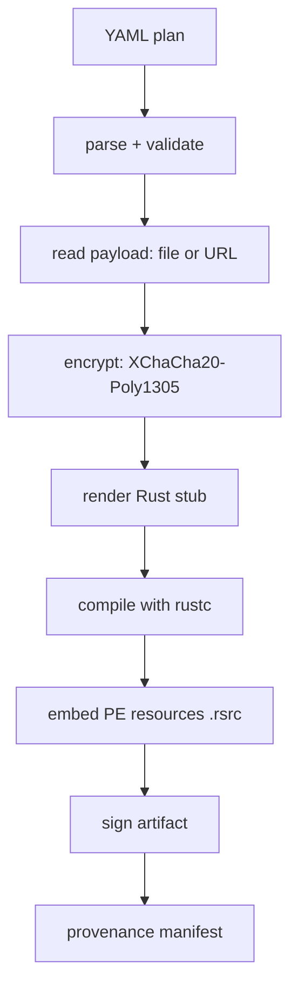
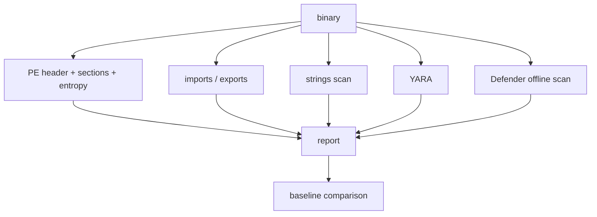

# Architecture

<p align="center">
  
</p>

## What this project is

A malware loader packer for authorized red team engagements and security
research. It takes a PE (or a DLL, or raw shellcode) and a YAML plan and
produces a packed PE with the selected evasion techniques applied.

## Pipeline (build)



`picaro build plan.yaml --dry-run` stops after step 2 (no encryption,
compilation or output).

The generated stub decrypts the payload in memory and runs it. No cleartext
payload touches disk.

## Build bundle

Every build writes one self-contained bundle (`src/paths.rs::BundleLayout`):

```text
packed/<plan>-<run>/
├── plan.yaml      the resolved plan (skipped with --no-save-plan)
├── build/         main.rs + payload_N.bin (include_bytes! inputs), out.exe, out.pdb
├── dist/          the canonical artifact: signed and hashed here
└── artifacts/     manifest, exported lab CA, .picaro/lab identity
```

`<run>` is `--build-name` or `<pid>-<nanos>`, so two runs never share a folder.
`output.path` only decides where the delivered copy goes; the bundle is always
complete, which makes it the archive as well as the working directory. A
reused `--build-name` bundle has `build/`, `dist/` and `artifacts/` recreated;
the `plan.yaml` a previous run wrote is left alone.

## Technique pipeline model

Each technique is Preparation, Execution or Control (`src/techniques/mod.rs`):

- **Preparation** — modifies the current process state (e.g. `patch_amsi`) but
  never runs the payload.
- **Execution** — runs a payload (`process_hollowing`, `reflective_loading`,
  `dotnet_hosting`, `execution_callbacks`, `module_stomping`, `fibers`).
- **Control** — orchestrates the chain without touching the payload
  (`living_off_the_land`, `sleep`).

The plan is a flat `runtime:` list of steps; `src/plan/steps.rs` resolves it and
`src/plan/validate/mod.rs` checks the per-step rules (the terminal-step rule above
all, plus format/arch/capability checks).

The stub renders the steps into three placeholders:

- `$STEP_MODULES$` — one `mod step_<i>` per step (a Preparation exposes
  `run() -> Result<bool, _>`, an Execution `payload(image)`, a Control
  `run() -> Result<i32, _>`), so two steps can reuse a technique without
  colliding on top-level names.
- `$STEP_RUNNER_BODY$` — the generated straight-line runner that walks the steps
  in order, decrypting each payload and applying the declared gating.
- `$STUB_HELPERS$` — the shared `dec_xor` / `decrypt_step` helpers.

`run()` calls `init_syscalls()?`, then the runner. A terminal step
(`reflective_loading` of a PE executable *without* `patch_exit`,
`dotnet_hosting`, `process_ghosting` of a PE executable) must be last.

## Syscall layer (`build.stub.syscalls`)

Not a pipeline technique: a loader configuration that changes how the stub
invokes the kernel. `mode` is `none` (default) or `indirect`; `resolver` is
`hells_gate`, `tartarus_gate`, `api_hash` or `halos_gate`.

The stub template renders the layer into `$SYSCALLS_BLOCK$` (a no-op
`init_syscalls` when nothing needs it), generated by `src/engine/syscalls/`:

- Every technique fragment calls the `nt_*` helpers (`src/engine/syscalls/`:
  `nt_alloc_vm`, `nt_write_vm`, `nt_read_vm`, `nt_protect_vm`,
  `nt_create_thread_ex`, `nt_wait_for_single_object`, `nt_get_context_thread`,
  …) and never the Win32 APIs directly. With `mode: none`
  the helpers map to the Win32 APIs; with `mode: indirect` they resolve SSNs at
  runtime and invoke the kernel through the first `syscall; ret` gadget in
  ntdll's `.text` (a `global_asm!` trampoline, `nt_invoke`). The `api_hash`
  resolver matches each export by a precomputed FNV-1a hash, so no Nt* name
  string (and no `GetProcAddress`) is involved at all.
- `TechniqueDef::syscalls` lists each technique's Nt* requirements; the block
  only resolves the union of the active pipeline's requirements.
- All Nt*/DLL names go through `StringsConfig` (or are replaced by hash
  constants), so they never appear in the binary. See
  [Syscall layer](features/ref/syscalls.md) and
  [Measurements](measurements.md).

## API resolution (`build.stub.api_resolution`)

Also a loader configuration, not a pipeline technique: it decides *who serves
the payload's imports*. With `mode: proxy`, `patch_imports` rewrites the
payload's IAT so the selected calls land on proxies generated in the loader, and
the intercepted names never enter the loader's own import table
(`verify_no_intercepted_imports` fails the build if one does). The catalogue
(`src/engine/api_resolution/mod.rs`) has two layers:

- **Direct `ntdll!Nt*` routes** — a proxy is generated for every syscall-layer
  function, and `apis: ntdll:*` selects them all (all 24). The proxy is an
  `extern "system"` wrapper with the export's native signature that forwards to
  the `nt_*` helper, so it needs no per-API code. Where the technique helper is a
  lossy convenience wrapper (`NtCreateThreadEx`, `NtWaitForSingleObject`), the
  proxy calls a native-signature variant of the helper instead.
- **Hand-written Win32 entries** — process memory (`VirtualAlloc`,
  `VirtualProtect`, `VirtualFree`, `VirtualQuery`, `ReadProcessMemory`), handles
  (`CloseHandle`), threads (`CreateThread`, `WaitForSingleObject`) and tokens
  (`OpenProcess`, `DuplicateTokenEx`, `OpenThreadToken`, `ImpersonateLoggedOnUser`)
  are rebuilt on the `Nt*` calls through the syscall layer (with
  `NTSTATUS`→`BOOL`/`GetLastError` translation), and `GetProcAddress` is a handler
  that answers catalogue hits with the matching proxy (ordinals and misses fall
  through to the original). These carry per-API semantics and are added by hand.

`apis: all` selects the whole catalogue plus every direct route; individual
`dll!function` selectors still work.

`hooks:` adds behavior that is not a route. `hooks.sleep` replaces the payload's
`Sleep` slot with a proxy that runs the shared ekko runtime over the mapped
payload (the region `reflective_loading` records in `payload_region`) for the
duration of the sleep, with a min/max window, a one-at-a-time guard and an
`NtDelayExecution` fallback. The `sleep_obfuscation` step calls the same
`sleep_runtime` block over the loader image; the block is trace-free because the
proxy runs on payload threads. See the design doc, section 13.

Two couplings, both hard validation errors: `mode: proxy` needs
`syscalls.mode: indirect` (otherwise the re-routed calls fall back to the Win32
APIs and the imports reappear in the stub's IAT), and it needs a `pe`/`dll`
payload (there is no IAT to rewrite otherwise). It is rejected with
`process_hollowing`, because the proxies live in the loader image, which is not
mapped in the target. `unmatched` decides what a non-catalogue import does:
`forward` (default) resolves it normally, `abort` fails the load. Design, phases
and limitations: [API resolution design](design/api-resolution.md).

## Polymorphism (`build.polymorphism`)

A loader configuration, not a pipeline technique: it makes the generated stub's
**code** a function of a per-build seed, so two builds of one plan do not share a
byte-identical `.text` (previously only `.rdata`, the encrypted payload and
re-rolled strings, differed). It is **on by default** (`mode: full`, a random
seed — no flag needed) and is forced off for a debug build (`build.stub.debug`
or `--debug`).

Two behavior-preserving layers: a **seeded codegen profile** (`codegen-units`,
`opt-level`, `llvm-args=--inline-threshold` and `mir-opt-level` drawn from small
pools, plus an opt-in `randomize-layout`) and a **per-build source entropy**
function whose immediates land inside instructions. The knobs change the emitted
instructions (inlining, MIR lowering) but not the control flow, so this is build
code diversity, not control-flow obfuscation. The resolved profile is recorded in
the manifest, and the seed is derived from the build's master entropy, so a
replay reproduces it together with the payload key and nonce, the strings key,
the icon seed, the identity values and the scrub filler. Measurements,
limitations and the planned premium layers (PE cosmetics, a self-encrypting
loader, LLVM obfuscation): [Polymorphism](design/polymorphism.md); the replay
contract: [Reproduction](design/reproduction.md).

## Payload formats (`build.payloads.<name>.format`)

`format` describes the input and defaults to `auto`: before validation, the
packer reads the source and sets the concrete format, so a plan does not need to
repeat what the file already says.

| Detected from | Format |
|---|---|
| a PE image with a CLR header | `dotnet` |
| a PE image whose file header sets `IMAGE_FILE_DLL` (or named `.dll`) | `dll` |
| any other PE image | `pe` |
| a `.ps1` / `.psm1` | `powershell` |
| anything else | `shellcode` |

`auto` needs a local source: a remote (`http(s)://`) payload cannot be sniffed
at plan-load time, so it must state its `format`. Writing the format explicitly
(`format: exe`, which is an alias for `pe`, and so on) skips detection.

- `pe` — a PE32/PE32+ executable. Validated as such; run by either native
  execution technique.
- `dll` — a PE32/PE32+ library (`IMAGE_FILE_DLL`). The packer rejects a DLL
  declared as `pe` and vice versa. The payload's `export` optionally names an
  exported function to call after `DllMain(DLL_PROCESS_ATTACH)`.
- `shellcode` — a raw, position-independent code blob with no PE headers. The
  packer only checks that it is non-empty; `reflective_loading` copies the bytes
  into an executable allocation and runs them on a thread.
- `dotnet` — a managed assembly (a non-null CLR header / COM descriptor). The
  stub hosts the CLR and loads the assembly from memory; `dotnet_hosting` is the
  matching execution technique and the two imply each other. A managed image
  declared as `pe`/`dll` is rejected at build time (mapping it would fail inside
  the CLR), and the assembly's bitness must match `output.arch` (a
  `32BITREQUIRED` assembly needs `arch: x86`).
- `powershell` — a `.ps1`/`.psm1` text script, compiled into a managed launcher
  at build time and hosted like a `dotnet` payload (`powershell_hosting`).
- `plain` — opaque data with no execution semantics (a `bouncer` decoy or a
  `drop` asset); no Execution technique accepts it.

`process_hollowing` replaces a suspended process's image, so it only runs
`format: pe` today and `plan::validate` rejects the other formats with a
pointer to `reflective_loading`. The format reaches the Execution fragment
through `TechniqueKind::render_fragment`, which selects the technique's
format-specific fragment.

## Output kind (`build.output.kind`)

The artifact is a PE **executable**: `compile_stub` compiles the rendered stub
as a binary through `rustc` and the builtin template ends in `fn main()`.

A host-loaded **DLL** output (`kind: dll`, for hosts that application
whitelisting already allows — a JVM, CPython, .NET, `rundll32`) is implemented
in `src/engine/entry.rs` (the entry block) and `src/engine/compiler/mod.rs`
(`cdylib`); its phases, couplings and limitations are in
[DLL output design](design/dll-output.md). The lab verification of the host
matrix (the design's Phase D) is still pending.

A **shellcode** output (`kind: shellcode`) compiles that same DLL and wraps it
in a reflective loader (`src/engine/shellcode.rs` shells out to sRDI), so the
chain runs without a PE on disk; see [Shellcode output
design](design/shellcode-output.md). The reflective loader is vendored and its
blob is built in the Docker image (`vendor/srdi/`); execution of the packed
Rust-std stub is verified on the lab host.

## Payload arguments (`build.payloads.<name>.args`)

A packed binary is a stub, so the payload does not inherit the operator's command
line by itself. `args` fixes arguments at build time; `args_mode` is `join`
(default) or `override`.

The stub embeds the YAML args as runtime-reconstructed strings (through
`StringsConfig`) and builds the final command line from them plus the args the
operator passes to the packed binary (`argv[1..]`):

- `join`: YAML args first, then the runtime args.
- `override`: the runtime args replace the YAML ones; with no runtime args the
  YAML ones are used.

The logic is rendered once into `$ARGS_BLOCK$` (`src/engine/args.rs`) and both
execution techniques use it: `process_hollowing` passes the line as
`lpCommandLine` to `CreateProcessA`, while `reflective_loading` calls
`patch_command_line()` before mapping. Token 0 is always the executable name, so
the payload's `argv[0]` is the exe and its args start at `argv[1]`. See
[Payload arguments](features/ref/args.md).

## Pipeline (audit)



`--json` emits the same data as a serializable `audit::model::Report`;
`--baseline` compares it against a saved report and fails (exit 3) on a
regression. `--focus` only affects the pretty output.

## PE resources (`build.output.resources`)

Icon, `VERSIONINFO` and the Windows application manifest are built in Rust
(`src/engine/resources/`), not by `rc.exe`: `tree.rs` emits the `.rsrc`
directory, `icon.rs`/`version.rs`/`manifest.rs` produce the three payload types,
and `inject.rs` appends the result as a new section to the already-compiled stub,
patching `SizeOfImage` and the `RESOURCE` data directory. `icon: random` is
served by `icon_gen.rs`, a pure-`std`, seed-deterministic renderer that emits the
same `Icon` shape `icon.rs` parses (the seed goes to the manifest). Offsets in the
directory tree are section-relative, while
`IMAGE_RESOURCE_DATA_ENTRY.OffsetToData` is an image RVA — the one detail that
has to be right for Windows to load the resources.

## Architecture support (`build.output.arch`)

The packer emits one architecture at a time, and `arch` decides all of it: the
stub's `rustc` target, the dependency set it links, and the payload's expected
architecture.

| `arch` | Stub target (Windows / cross) | Payload | `windows` import lib |
| --- | --- | --- | --- |
| `x64` (default) | `x86_64-pc-windows-msvc` / `-gnu` | PE32+ | `windows_x86_64_msvc` / `_gnu` |
| `x86` | `i686-pc-windows-msvc` / `-gnu` | PE32 | `windows_i686_msvc` / `_gnu` |

Two rules follow from the architecture being *shared* between the stub and the
payload:

- **The payload must match `arch`.** A 32-bit payload cannot run in a 64-bit
  stub (or the reverse), so `build` rejects a mismatch before encrypting or
  compiling anything.
- **A technique must declare the architecture capability** it supports
  (`TechniqueDef::requires`), and `plan::validate` checks it against `arch`.
  Both execution techniques and `anti_debug`/`patch_amsi`/`patch_etw`/`bouncer`
  declare `WindowsX64 | WindowsX86`; `sleep_obfuscation` stays `WindowsX64`, so
  an `arch: x86` pipeline that uses it fails with a message naming the technique
  (see [x86 support](x86.md)). For `process_hollowing`, a target that resolves to
  a local file is checked too — mapped the way WOW64 would resolve it.

The shared stub blocks are already architecture-aware: the import resolver reads
the image's optional-header magic (4-byte thunks and `IMAGE_ORDINAL_FLAG32` for
PE32, 8-byte and `IMAGE_ORDINAL_FLAG64` for PE32+), the payload-argument block
uses the right PEB offsets (`fs:[0x30]`/`+0x10`/`+0x40` on x86,
`gs:[0x60]`/`+0x20`/`+0x70` on x64), the resource injector handles both
optional-header layouts and `audit` parses both. `syscalls.mode: indirect` is
x64-only for now — x86 has no `syscall; ret` gadget and the WOW64 SSNs differ —
so it is rejected on x86.

## Cross-compilation from Linux

When Picaro runs on Linux/WSL the stub is cross-compiled to
`x86_64-pc-windows-gnu`. Two `-L` flags are required and easy to forget:

- `-L native=<...>/windows_x86_64_gnu-<ver>/lib` — `windows-rs` links via
  `raw-dylib` against `libwindows.0.52.0.a`, provided by the `windows_x86_64_gnu`
  crate (on Windows: `windows_x86_64_msvc`).
- `-L dependency=<target/{debug,release}/deps>` — the `windows-rs` proc-macros
  are compiled for the host, not the cross target.

Without the first, linking fails with `cannot find -lwindows.0.52.0`; without the
second, compilation fails with `can't find crate for windows_implement`.

## Repo layout

```text
src/
  lib.rs      library crate: exposes the modules to the binary and the tests
  main.rs     thin binary entry point (`picaro::cli::main_entry`)
  cli/        clap tree, dispatch, build/dry-run orchestration and helpers
  plan/       YAML schema, format resolution and validation
  engine/     crypto, pe parsing, stub generation, compilation, polymorphism,
              syscall layer, imports, api_resolution, args, resources (icon/
              VERSIONINFO/manifest), identity, signing, manifest, hash, builtin
              stub template, splitmix64 mixer
  audit/      static measurement (pe_info, strings, yara, defender, report)
  features/   loader-feature registry (metadata for the CLI and docs)
  techniques/ one directory per technique + the registry (mod.rs)
  paths.rs    shared PATH and file-URL helpers
  error.rs    top-level error types
  ui/         terminal output: palette, banner, Markdown renderer, pager
examples/
  plans/    example YAMLs
  payloads/   test payloads
docs/         this file + the rest of the book; the navigation is docs/nav.yml
docs/site/    the Starlight site project (assembler, config, Dockerfile)
build/        (gitignored) intermediate artifacts from ad-hoc builds
dist/         (gitignored) artifacts delivered outside a bundle
packed/       (gitignored) build bundles: `packed/<plan>-<run>/` with `plan.yaml`,
              `build/` (sources + compiler output), `dist/` (artifact) and
              `artifacts/` (manifest, CA, lab state)
```
