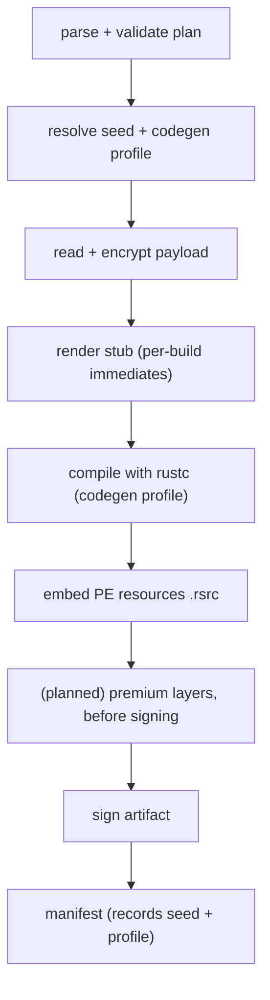

# Polymorphism

Picaro makes every release build of a plan emit **different code**. Two artifacts
packed from the same plan do not share a byte-identical `.text`, so a YARA rule
over the loader's code bytes, a `.text` fuzzy hash, or a code-similarity cluster
does not group the family.

**It is on by default and needs no flag.** The only things you ever write are an
optional block to reproduce a build or narrow a pool, and `mode: none` to turn it
off. This page is the whole feature: how to use it (section 2), what it does
(3), what it moves (4), how it is measured (5), and what is still planned (8).

---

## 1. The problem

`rustc` is deterministic for a given source and flag set. Without this feature,
`compile_stub` (`src/engine/compiler.rs`) pins every flag, and the generated stub
varies across builds only in its **data** (encrypted payload, fresh key/nonce,
re-rolled string obfuscation) — all of which lands in `.rdata`. The code stayed
identical. Measured on the `dist/` artifacts (SHA-256 truncated to 16 hex chars):

| Artifact | `.text` | `.rdata` |
|---|---|---|
| `test_packed_reflective1.exe` | `e79d56670f7a1090` | `61e34bfb…` |
| `test_packed_reflective2.exe` | `e79d56670f7a1090` | `e1c66f73…` |
| `test_packed_reflective.exe` (different plan) | `879460cd7d538a2c` | `144bc133…` |

Same plan ⇒ same `.text`. The file hash already differed (`.rdata`), so hash-only
AV was never the concern; **code signatures and clustering** are.

---

## 2. How to use it

Nothing to do. A build applies the default — `mode: full`, a random seed — so two
runs of `picaro build plan.yaml` already produce different code. The block exists
only to reproduce a build or to change the pools.

```yaml
build:
  polymorphism:
    # Cumulative: each level includes the one above. Default `full`.
    mode: none | codegen | source | full
    # `random` (default) or a fixed `literal:<u64>` (decimal or 0x hex). The
    # resolved seed is recorded in the manifest, so a build is reproduced by
    # reusing it.
    seed: random | literal:<u64>
    # Optional pools; each draws one value per build.
    codegen:
      codegen_units: [1, 2, 4, 8]        # -C codegen-units
      opt_level: [z, s, 2]               # -C opt-level
      lto: [off]                         # -C lto; needs bitcode-bearing .rlibs
      inline_threshold: [25, 100, 300]   # -C llvm-args=--inline-threshold
      mir_opt_level: [1, 2, 3]           # -Z mir-opt-level (0..=4); needs bootstrap
      randomize_layout: false            # -Z randomize-layout; opt-in
```

- A missing block means the defaults above. You do not have to write any of it.
- `mode` is cumulative:

  | `mode` | Applies |
  |---|---|
  | `none` | Nothing. Byte-identical, reproducible (labs, regression) |
  | `codegen` | The compiler profile only |
  | `source` | `codegen` + the per-build source immediates |
  | **`full`** *(default)* | `source` + the future premium layers (section 8) |

- `seed` accepts `random`, `literal:<decimal>` or `literal:0x<hex>`. Reuse the
  recorded seed to reproduce an artifact byte-for-byte.
- Pools are validated before the build: `codegen_units >= 1`, `inline_threshold
  >= 0`, `mir_opt_level` in `0..=4`, and `opt_level`/`lto` non-empty.
  `codegen_units` may be omitted (falls back to `1`).

### Turning it off

A **debug build** — `build.stub.debug: true` or `--debug` — always forces
`mode: none`: a debug artifact exists to stay reproducible and debuggable, and
codegen variation defeats that. `plan::validate::advisories` warns when a plan
asks for polymorphism and a debug build overrides it. For a single release build,
set `mode: none`.

`-C target-cpu` variation and section reordering are deliberately **not** exposed:
`target-cpu` shrinks the set of machines the artifact runs on, and reordering is a
loadability risk (notably for `kind: dll`).

---

## 3. What it does

Two behavior-preserving layers, both part of the seeded profile:

1. **A seeded codegen profile.** The build seed draws `-C codegen-units`,
   `-C opt-level`, `-C lto`, a `-C llvm-args=--inline-threshold`, a
   `-Z mir-opt-level`, and (opt-in) `-Z randomize-layout` + `-Z layout-seed` from
   the pools, so `rustc` emits **different instructions** each build.
2. **Per-build source entropy.** A generated `poly_seed_mix()` function, whose
   body holds four immediates drawn from the seed (`splitmix64`), is appended to
   `$STUB_HELPERS$` and called once at the top of the runner:

   ```rust
   #[inline(never)]
   fn poly_seed_mix() -> u64 {
       let a: u64 = 0x…;            // four immediates derived from the seed
       let b: u64 = 0x…;
       let mut x = a ^ core::hint::black_box(b);
       x = x.wrapping_mul(0x…) ^ 0x…;
       core::hint::black_box(x)
   }
   ```

   The immediates land *inside instructions*, so `.text` differs even when the
   codegen profile matches. `#[inline(never)]` + `black_box` keep the optimizer
   from folding it away, the result is unused, and it is deterministic in the
   seed.

`codegen` uses `StdRng::seed_from_u64(seed)`, so the same seed always yields the
same profile (`PolymorphismConfig::from_yaml`); the resolved `CodegenProfile` is
carried on `CompileOptions`, so the compiler stays a pure function of its inputs.
The `-Z` flags need `RUSTC_BOOTSTRAP=1`, which the packer sets itself when the
profile uses them (see [Limitations](#7-limitations)).

**What this is not.** It is not a metamorphic engine. The knobs go beyond layout —
`opt-level`, `--inline-threshold` and `mir-opt-level` change which functions are
inlined and how the MIR is lowered, so the instruction sequences and their lengths
differ between builds. But they are ordinary compiler optimizations, not an
adversarial transform: the **control-flow structure is unchanged**, so a
CFG-aware comparison or a patient analyst still recognises the loader.
Instruction-level *restructuring* needs a different mechanism (section 8).

### Where it acts



---

## 4. Which detectors it moves

Measured on two builds of `mimikatz` (`dist/`, `.text` ≈ 300 KB, ≈ 74 000
instructions):

| Detector | Effect |
|---|---|
| File hash (MD5/SHA) | Changes — already true before this feature (`.rdata`) |
| `.text` SHA-256 | Changes — always |
| Byte-level fuzzy hash of `.text` (`ssdeep`/`TLSH`) | Moves — ~95% of the bytes shift when the profile differs |
| Instruction stream (mix, lengths) | Moves — the knobs change inlining and MIR lowering (section 5) |
| Function-level similarity / clustering | Weakens, does not vanish — the sequences differ but the control flow is unchanged (section 3) |
| `imphash` | Unchanged (see [Limitations](#7-limitations)) |

The honest bottom line: this is **build-time code diversity**, not control-flow
obfuscation. It defeats hashes and byte-level fuzzy matching outright, and it
genuinely changes the instruction stream, but a CFG-aware comparison can still
match the loader.

---

## 5. Measurement

Repeated builds of `examples/plans/shellcode.yaml` on `x86_64-pc-windows-msvc`
(SHA-256 of the `.text` raw section, truncated to 16 hex chars):

| Scenario | Builds | Distinct `.text` |
|---|---|---|
| `mode: none` (baseline) | 2 | **1** (byte-identical) |
| `mode: codegen` (profile only, before the knobs) | 4 | **3** (one collision) |
| `mode: full` (default, before the knobs) | 6 | **6** |
| `mode: full`, `seed: literal:0xdeadbeef` | 2 | **1** (reproducible) |
| `mode: full` (default, **with** `inline_threshold`/`mir_opt_level`) | 10 | **10** |

### Each knob, isolated

With the seed and every pool pinned so exactly one knob differs between the two
builds, `.text` disassembled with Capstone (x86-64); the last column is the share
of `(address, mnemonic, operands)` tuples that appear at the same address with the
same operands:

| Knob varied | `.text` A → B (bytes) | Instructions A → B | Identical tuples |
|---|---|---|---|
| `inline_threshold` (`25` vs `300`) | 309 248 → 310 272 | 73 896 → 74 037 | **0.64%** |
| `mir_opt_level` (`0` vs `3`) | 309 760 → 307 712 | 67 951 → 67 432 | **1.08%** |
| `randomize_layout` (on vs off) | 309 760 → 309 760 | 74 020 → 74 020 | **100%** (no-op) |

`inline_threshold` and `mir_opt_level` change the instruction stream, so two
default builds that hit the same `opt-level`/`codegen-units`/immediates still
differ. `randomize_layout` is a no-op for this stub (section 7) and is off by
default.

The regression guard is the `#[ignore]` test
`two_polymorphism_seeds_differ_in_the_text_section` (`src/engine/steps.rs`); it
compiles the same stub with two seeds and asserts the `.text` sections differ. Run
it with `cargo test --features live-tests -- --ignored`.

---

## 6. Interaction with existing features

| Feature | Interaction |
|---|---|
| `build.stub.debug` / `--debug` | Forces polymorphism off (`mode: none`) |
| `output.sign` | Unaffected; the planned premium layers run **before** signing |
| `kind: dll` | Codegen and source phases apply unchanged |
| `output.resources` | Unaffected (the source phase runs before the `.rsrc` embed) |
| `output.subsystem` | Independent; applied while rendering the stub |
| Custom stubs (`build.stub.path`) | The codegen profile applies to the compile; a stub that omits `$STUB_HELPERS$`/`$STEP_RUNNER_BODY$` simply gets no source entropy |
| Manifest | Records `polymorphism.{mode, seed, codegen_units, opt_level, lto, inline_threshold, mir_opt_level, randomize_layout, layout_seed}` |

---

## 7. Limitations

- **`imphash` is unchanged.** The import-table shape is out of scope.
- **Control-flow structure is unchanged.** The knobs move instructions, not the
  call graph; a CFG-aware comparison still recognises the loader (section 8).
- **The source phase is not configurable.** It is on whenever `mode` is `source`
  or `full`; there is no per-item toggle.
- **`target-cpu` is not varied** (portability) and section reordering is not done
  (loadability). Both are deliberate.
- **`lto` is effectively unused** with the current dependency rlibs (no bitcode),
  so the effective pools are `codegen-units` × `opt-level` × `inline_threshold`
  × `mir_opt_level`.
- **The `-Z` knobs need `RUSTC_BOOTSTRAP=1`.** `mir-opt-level` (on by default) and
  `randomize-layout` (opt-in) are unstable flags; the packer sets the escape hatch,
  which is defensible only because the toolchain is pinned. A toolchain bump must
  re-check that the flags still exist.
- **`randomize-layout` is a no-op for the canonical stub** (measured: identical
  `.text` with it on and off), because the stub keeps almost no layout-sensitive
  `repr(Rust)` types in memory at `opt-level >= s`. It can still help a plan that
  keeps such types.
- **Reproducibility depends on the recorded seed.** A fresh build is not
  byte-reproducible unless its `polymorphism.seed` is reused; `mode: none` or
  `--debug` restore the old guarantee.
- **Not behavioral evasion.** AMSI, ETW and behavioral detection are untouched;
  this is a static-similarity measure.

---

## 8. Roadmap (not implemented)

`mode: full` reserves room for premium layers that are not built yet. They are
documented here so the page stays the single source for how Picaro does
polymorphism.

### 8.1 Cosmetic PE mutation

Randomize `TimeDateStamp`, `CheckSum`, the COFF Rich header and inter-section
padding between the resource embed and signing, so the file-level fuzzy hash
(`ssdeep`/`TLSH`) moves too. Implemented in Rust (reusing `src/engine/pe.rs` /
`src/engine/resources/inject.rs`), not via `LIEF`/`pefile`. Section **reordering**
stays off (loadability). Optional PATH-detected tools (`sgn` for `format:
shellcode` payloads) follow the same `yara`/`signtool` pattern.

### 8.2 Self-encrypting loader ("stub crypt")

The loader's `.text` becomes **ciphertext at rest**; a per-build decoder section
decrypts it in memory and jumps to the real entry point. Two builds then expose no
same instructions *on disk*. Shape: variant A encrypts `.text` in place (RVAs
unchanged, so `.pdata`/`.xdata` stay valid), appends the decoder and patches
`AddressOfEntryPoint`; variant B (a self-mapping image) is parked for the
relocation case. The decoder runs before `.text`/CRT, so it is self-contained
machine code with a small built-in cipher, not the payload's XChaCha20. Pipeline
slot: after `scrub` + resources, before signing.

The cost, stated plainly: an encrypted `.text` has entropy ≈ 8.0 — the classic
"packed" signal. That is **accepted, not avoided**: a section that is both
low-entropy and unreadable needs different instructions, not different bytes.
`crypt_section: data` and a per-build decoder are the mitigations. The open risk
is relocations inside `.text`; x64 `kind: exe` comes first.

### 8.3 Instruction-level diversity (LLVM obfuscation)

The only route that changes the instructions **and holds in memory** is a compiler
that rewrites them. Measured constraint: the pinned `rustc` statically links LLVM
(no `libLLVM` in the sysroot), so `-Z llvm-plugins` cannot load a plugin against
it; a plugin-loadable `rustc` must be built from source with `[llvm]
link-shared = true`. The obfuscation passes (control-flow flattening, bogus
control flow, instruction substitution) are legacy-PM and must be ported to LLVM
20's new pass manager — real compiler engineering, self-contained in the
container. A spike (build the shared-LLVM `rustc`, load a trivial pass) decides
go/no-go. A Rust-native alternative is a post-link mutator driven by `iced-x86`
(no toolchain, harder correctness: RIP-relative operands, branch displacement,
`.pdata`/`.xdata`).

Hand-written source variants (N equivalent bodies per fragment) were considered
and rejected: keeping N copies of every technique, and applying every later fix N
times, is a maintenance trap.

---

## 9. Decision log

| # | Decision | Rationale | Status |
|---|---|---|---|
| D-1 | `build.polymorphism` is top-level, not under `build.stub` | Spans the stub compile *and* the final artifact | accepted |
| D-2 | Cumulative `mode: none \| codegen \| source \| full` | One knob, incremental adoption, mirrors `syscalls.mode` | accepted |
| D-3 | Default `mode: full`; `none` is the opt-out | The safe measures ship on: no reason to leave static similarity in place | accepted |
| D-4 | One seed drives every choice, recorded in the manifest | Reproducibility; mirrors the icon-seed precedent | accepted |
| D-5 | Vary `codegen-units`/`opt-level`; keep `lto` opt-in and `target-cpu` fixed | The first two are semantically neutral; `lto` needs bitcode rlibs; `target-cpu` trades portability | accepted |
| D-6 | Per-build **immediates** are the decisive source measure | The codegen profile alone has too few combinations (~1/12 collision) | accepted |
| D-7 | The entropy function is `black_box`ed and `#[inline(never)]` | `if false` is folded away and changes nothing | accepted |
| D-8 | Cosmetic PE mutation is implemented in Rust, no `LIEF`/`pefile` | Cross-platform, no new dependency or toolchain | accepted |
| D-9 | Section reordering stays off | Loadability risk, notably for `kind: dll` | accepted |
| D-10 | All artifact mutation runs before `output.sign` | A signature must cover the final bytes | accepted |
| D-11 | External tools are PATH-detected and degradable | Matches `yara`/`signtool` handling; no embedded toolchain | accepted |
| D-12 | Polymorphism is a release-only feature | Debug builds exist to stay reproducible and debuggable | accepted |
| D-13 | No `-C target-cpu` pool on `CodegenProfile` | Keeps `CompileOptions: Copy` and avoids a portability regression | accepted |
| D-14 | The codegen profile also draws `-C llvm-args=--inline-threshold` and `-Z mir-opt-level` | Measured to change the instruction stream (0.6–1.1% identical instruction tuples), unlike the layout-only measures | accepted |
| D-15 | `-Z randomize-layout` is opt-in, off by default | Measured a no-op for the canonical stub, and it forces the unstable-flag bootstrap | accepted |
| D-16 | Hand-written source variants are not the default path | Keeping N copies of every technique (and applying every fix N times) is a maintenance trap | accepted |
| D-17 | The premium layers live in this page, not separate design docs | One source of truth for "how Picaro does polymorphism" | accepted |

---

## 10. References

- Code: `src/engine/polymorphism.rs` (`PolymorphismConfig`, `CodegenProfile`,
  `PolymorphismRecord`), `src/engine/compiler.rs` (flags),
  `src/engine/steps.rs` (`poly_helpers`, `render_runner_body`),
  `src/engine/manifest.rs` (record), `src/plan/schema.rs`, `src/plan/validate.rs`.
- Sibling loader configs: [Syscall layer design](syscalls.md),
  [API resolution design](api-resolution.md).
- `rustc` codegen options:
  <https://doc.rust-lang.org/rustc/codegen-options/index.html>.
- `-Z llvm-plugins` (section 8.3): the Rust Unstable Book,
  `compiler-flags/llvm-plugins`; `iced-x86` (<https://github.com/icedland/iced>).
