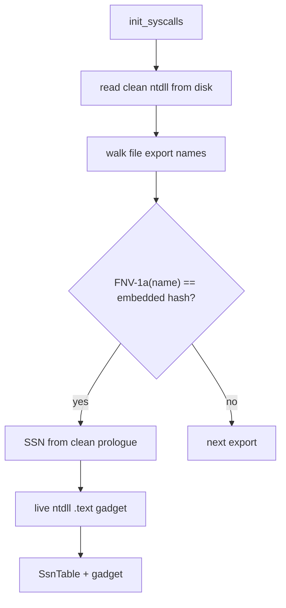

# API hashing

*Resolve each SSN by matching a precomputed FNV-1a hash of the export name, so
neither `GetProcAddress` nor any name string is needed.*

## What it does

API hashing is Tartarus Gate without the names. It reads the same clean on-disk
copy of `ntdll`, but instead of comparing export names by string it compares a
precomputed 64-bit FNV-1a hash of each name. The packer computes the hash of
every required function at build time and emits it as a numeric constant; the
stub only ever matches numbers, so the `Nt*` names never appear in the binary
and `GetProcAddress` is never called for them.

## How it works

### 1. Build time

The packer hashes every required function name (`engine::syscalls` /
`resolvers::api_hash::api_hash`) and injects the constants into the stub as
`table.<field> = resolve_ssn(&file, 0x…)?;`.

### 2. Runtime

1. `std::fs::read` loads the clean `ntdll`.
2. `export_rva_by_hash` walks the export name table, hashing each name on the
   fly, and matches against the embedded constant.
3. The SSN is read from the clean prologue; the gadget still comes from the live
   `ntdll`.

## Integration

Selected with `build.stub.syscalls: { mode: indirect, resolver: api_hash }`.
Same placement rules as the other resolvers; x64-only.

## What it evades

- **Static name strings**: no `Nt*` name ever reaches the binary — not even
  obfuscated — so a signature built from those strings cannot match.
- **`GetProcAddress`-based resolution signatures**: none is used for the Nt\*.
- Hooked `Nt*` prologues, like Tartarus Gate (the SSN comes from disk).

## What detects it

- The same on-disk read as Tartarus Gate.
- **The hash constants themselves**: a fixed offset basis would make the FNV-1a
  of a known name a stable constant across builds. The packer seeds the basis
  per build (`API_HASH_SEED`), so the constants vary between artifacts and are
  not a static signature.
- Concurrency/standard EDR telemetry, as with the other resolvers.

## Implementation notes

- The FNV-1a 64-bit offset basis is a per-build seed (`API_HASH_SEED`), emitted
  by the packer (`rand::random` in `render_common`) and used by the stub's
  `api_hash`, so the hash constants are unique to the artifact. The seed is not
  recorded in the build manifest; it is readable from the emitted `const`.
- `api_hash_with(name, basis)` is the packer-side hash; it is mirrored by the
  stub's `api_hash` over `API_HASH_SEED`, and the reference-value tests guard
  the two against drift.
- Shares the PE-file helpers (`src/engine/syscalls/pe_file.rs`) with Tartarus
  Gate; the export walk is `export_rva_where` in that file.

## References

- Tartarus' Gate (trickster0): https://github.com/trickster0/TartarusGate
- FNV hash: http://www.isthe.com/chongo/tech/comp/fnv/
