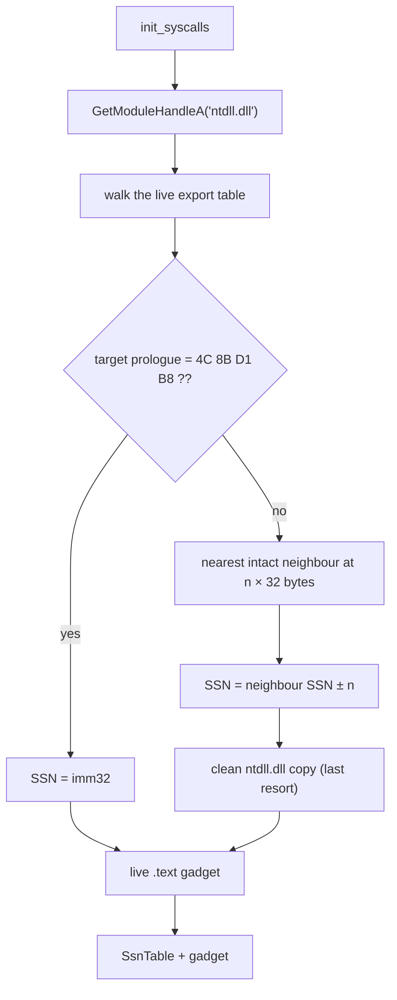

# Halo's Gate

*Derive a hooked syscall stub's SSN from its intact neighbours in the live
`ntdll` export table, so one EDR hook no longer hides it.*

## What it does

Halo's Gate resolves the SSN of every `Nt*` function the active pipeline needs
from the **live** `ntdll` export table. When the target's prologue is intact it
reads the SSN directly; when an EDR replaced the prologue with a hook, it
derives the SSN from the nearest intact export instead: the x64 `Nt*` stubs sit
32 bytes apart and are ordered by SSN, so a neighbour `n × 32` bytes away is
exactly `n` SSNs away.

It is the hook-resilient version of Hell's Gate: no disk read on the normal
path, no `GetProcAddress`, and no hardcoded SSN table.

## How it works

### 1. Resolve the target without `GetProcAddress`

1. `GetModuleHandleA` returns the live `ntdll` base.
2. The stub walks `IMAGE_EXPORT_DIRECTORY` in the mapped image and matches the
   required name. Every read is bounds-checked through the syscall layer's
   in-memory PE helpers.
3. When the prologue is the canonical `4C 8B D1 B8 ?? ?? ?? ??`
   (`mov r10, rcx; mov eax, <SSN>`), the immediate is the SSN.

### 2. Derive the SSN when the stub is hooked

4. The resolver walks the whole export table once and records every export
   whose prologue is intact as an anchor `(address, SSN)`.
5. It picks the nearest anchor whose distance is a whole multiple of 32 bytes,
   in either direction, and computes `ssn ± distance / 32`. Candidates outside
   the plausible SSN range are discarded, and the closest consistent anchor
   wins.

### 3. Fall back only when the live module cannot help

6. If no anchor is usable (a hook that also covers the neighbours, a stripped
   module), the resolver reads a clean on-disk copy of `ntdll` and walks its
   export directory, exactly like Tartarus Gate. The live `.text` gadget is
   still used for the `syscall; ret`.

## Integration

Selected with `build.stub.syscalls: { mode: indirect, resolver: halos_gate }`.
It shapes the `nt_*` helpers every technique fragment calls, so it is
orthogonal to the `runtime:` chain order. `mode: indirect` is x64-only (see
`docs/x86.md`).

## What it evades

- **Userland hooks in `ntdll`**: the call reaches the kernel through the
  `ntdll` gadget, not through the hooked exported stub.
- **Hooked SSN prologues**: a hook on the target no longer fails the table; the
  SSN comes from an intact neighbour.
- **`GetProcAddress`-based resolution signatures**: the resolver walks the live
  export directory itself.
- **Static SSN tables**: nothing about the SSNs is embedded in the artifact.

## What detects it

- **Neighbour consistency**: a checker can compare the derived SSN against the
  export ordering; a hook that is not a simple prologue replacement can make
  the arithmetic point at the wrong neighbour, so the fallback is observable as
  a disk read.
- **A canonical prologue whose immediate was rewritten.** The resolver trusts
  the live `mov eax, <SSN>` bytes; a hook that keeps the prologue canonical and
  changes only the immediate is not detected. Measured on the lab host: forcing
  the immediate to `0x2000` made the stub call SSN 8192 and abort
  (`0xc0000409`) instead of resolving the real SSN 24. Validating the immediate
  against the neighbour-derived SSN and falling back to the clean copy on a
  mismatch is a deferred hardening, not implemented.
- **The on-disk read** on the fallback path, the same signal Tartarus Gate
  carries.
- **Stack inspection**: the call stack does not show the expected `ntdll`
  frames (mitigated by `build.stub.syscalls.stack_spoofing`).
- **SSN anomalies / kernel callbacks** that inspect the syscall number rather
  than the user-mode prologue.

## Implementation notes

- The stub walks the live export table (`live_export_tables` /
  `live_export_at`) and never calls `GetProcAddress` for the Nt\* functions;
  the `ntdll.dll` name still comes from `StringsConfig`.
- The neighbour arithmetic assumes 32-byte syscall stubs, which is the Windows
  10/11 x64 layout. A build whose stubs differ falls back to the clean copy
  instead of guessing.
- `resolve_ssn_from_file` and `$FILE_PE_HELPERS$` are shared with Tartarus Gate
  and the Hell's Gate fallback, so the on-disk semantics stay identical.
- Stability stays `Experimental`: the generated stub's neighbour walk and the
  clean-copy fallback were measured on the lab host on 2026-10-24 (see
  `docs/measurements.md`), but the SSN-rewrite blind spot above remains.

## Measurements

With a transparent trampoline hook on `NtAllocateVirtualMemory` (RVA
`0x162040`, ntdll SSN 24), the stub logged `SSN 24 (neighbour)` and ran the
payload (exit `0`); the anchors were SSN 23 and 25, one 32-byte stub away in
each direction. A breakpoint on `read_clean_ntdll` did not fire, while the same
hook on Hell's Gate did. With all `489` canonical `Nt*`/`Zw*` exports hooked,
the resolver logged `no live neighbour yields an SSN, falling back to the clean
copy` for both required functions and still ran the payload. The full run,
including the stack-spoofing control and Moneta scan, is in
`docs/measurements.md`.

## References

- Halo's Gate (the neighbour-SSN technique popularised by Rekall/`SysWhispers`
  variants): <https://github.com/am0nsec/HellsGate>
- Hell's Gate prologue and SSN layout: <https://redops.at/research/exploring-hells-gate/>
- Tartarus' Gate (clean-copy fallback): <https://github.com/trickster0/TartarusGate>
- Direct vs indirect syscalls (Outflank):
  <https://www.outflank.nl/blog/2023/12/13/direct-syscalls-vs-indirect-syscalls/>
