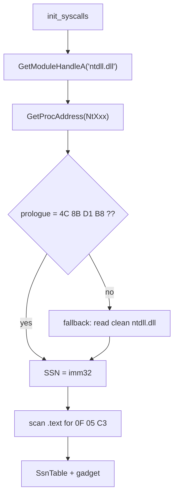

# Hell's Gate

*The original indirect-syscall technique: read each system service number
(SSN) straight out of the live Nt stub in `ntdll` and jump to the `syscall`
gadget next to it.*

## What it does

Hell's Gate resolves the SSN of every `Nt*` function the active pipeline needs
by parsing the function's prologue **in the loaded `ntdll`**. It is the default
`build.stub.syscalls.resolver` and the smallest of the three: it reads only the
module that is already mapped, so it needs no disk access, no hardcoded path and
no PE-file walking.

## How it works

### 1. Resolve each SSN

1. `GetModuleHandleA` returns the live `ntdll` base.
2. For each required function, `GetProcAddress` gives the export address.
3. The first eight bytes are checked against the canonical prologue
   `4C 8B D1 B8 ?? ?? ?? ??` (`mov r10, rcx; mov eax, <SSN>`); the little-endian
   immediate is the SSN.

### 2. Find the gadget

The in-memory section table locates `.text`, which is scanned for the first
`0F 05 C3` (`syscall; ret`). The trampoline jumps there, so the `syscall`
executes **inside `ntdll`** rather than in the loader's private code.

## Integration

Selected with `build.stub.syscalls: { mode: indirect, resolver: hells_gate }`.
It shapes the `nt_*` helpers every technique fragment calls, so it is orthogonal
to the `runtime:` chain order. `mode: indirect` is x64-only (see `docs/x86.md`).

## What it evades

- Userland hooks in `ntdll`: the call reaches the kernel through the `ntdll`
  gadget, not through the hooked exported stub.
- Static IAT analysis: the suspicious Win32 imports leave the import table.

## What detects it

- A hooked prologue triggers the per-function fallback, which reads `ntdll.dll`
  from disk — the same file-open signal Tartarus Gate carries. On a clean host
  only the live module is read, so there is no file-open telemetry.
- If the fallback file itself is unreadable the load still fails
  (`SyscallError::NtdllNotFound`).
- Stack inspection: the call stack does not show the expected `ntdll` frames
  (mitigated by the `stack_spoofing` technique).

## Implementation notes

- The packer mirrors the stub's prologue parser in
  `engine::syscalls::parse_ssn_prologue` (unit-tested) so the parsing logic is
  covered without a live `ntdll`.
- The `Nt*` names never reach the binary: they are rebuilt at runtime from
  obfuscated bytes injected by `StringsConfig`.
- A hooked live prologue falls back **per function** to a clean on-disk copy of
  `ntdll` (the Tartarus Gate walk), so one EDR hook no longer fails the whole
  table. A missing live export does **not** fall back (only a non-canonical
  prologue does).

## References

- https://redops.at/research/exploring-hells-gate/
