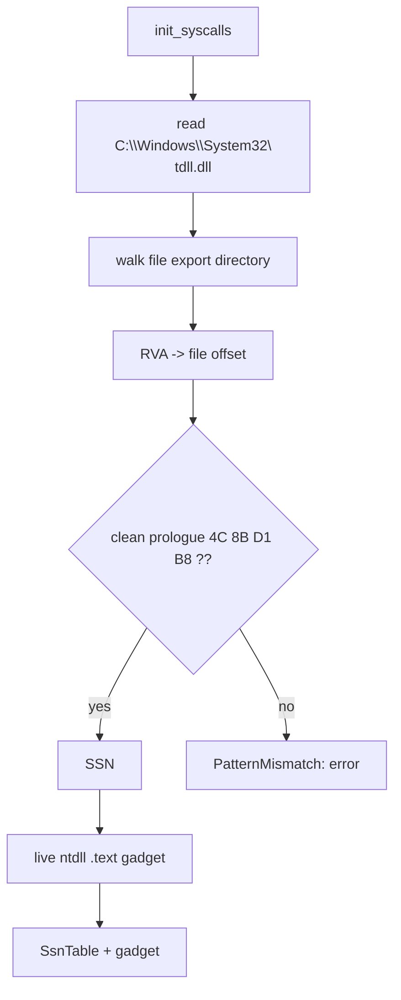

# Tartarus Gate

*Read each SSN from a clean copy of `ntdll` on disk, so an EDR that hooks the
live export stubs cannot hide the number Hell's Gate would have read.*

## What it does

Tartarus Gate is Hell's Gate's answer to hooked prologues. Instead of trusting
the live `Nt*` stub, it opens its own copy of `C:\Windows\System32\ntdll.dll`
from disk and walks the **file's** export directory to find each function, then
parses the SSN from the clean prologue. The `syscall; ret` gadget still comes
from the live `ntdll`, whose `.text` is not hooked.

## How it works

### 1. Read the clean copy

1. `std::fs::read` loads the on-disk `ntdll.dll` into a buffer.
2. `export_rva` walks the PE export directory (names, ordinals, function table)
   to find each required function's RVA.
3. `rva_to_offset` (a helper shared with API hashing) converts the RVA to a
   file offset using the section table.

### 2. Read the SSN and the gadget

The SSN comes from the clean file's prologue; the gadget is still located in the
live `ntdll` (`find_gadget`), because the kernel needs the `syscall` to execute
from a mapped, Microsoft-signed module.

## Integration

Selected with
`build.stub.syscalls: { mode: indirect, resolver: tartarus_gate }`. Same
placement rules as Hell's Gate: it shapes the `nt_*` helpers and is x64-only.

## What it evades

- **Hooked `Nt*` prologues**: the SSN is read from disk, so a hook in the live
  stub does not hide it. This is the improvement over Hell's Gate.
- Static IAT analysis: as with every `mode: indirect` resolver.

## What detects it

- **The on-disk read itself**: opening `ntdll.dll` from `%SystemRoot%\System32`
  is a well-known unhooking / SSN-scanning signal that an EDR can log. Hell's
  Gate makes no such file access.
- Fileless or locked-down environments where the read fails
  (`SyscallError::NtdllNotFound`).
- Stack inspection, as with Hell's Gate.

## Implementation notes

- The clean-copy path comes from the live module (`GetModuleFileNameW`), so a
  non-default Windows directory works and the file read matches the loaded
  module.
- The file's PE `TimeDateStamp` is checked against the live module's, so a
  Windows update that replaced `ntdll.dll` after boot is caught
  (`SyscallError::NtdllMismatch`) instead of yielding stale SSNs.
- The shared clean-copy reader and the export walk live in
  `src/engine/syscalls/pe_file.rs` and are shared with API hashing and with the
  Hell's Gate fallback.

## References

- Tartarus' Gate (trickster0): https://github.com/trickster0/TartarusGate
