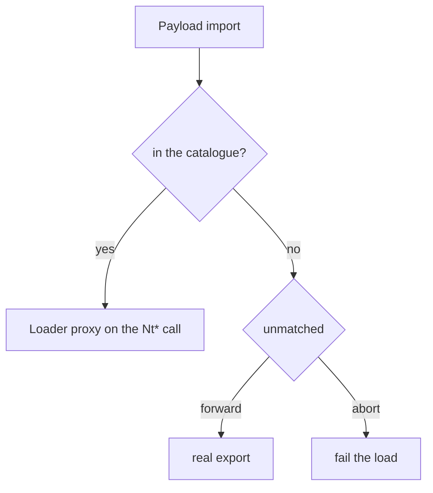

# API resolution

## What it does

In `mode: proxy` the loader serves selected payload imports from proxies
generated in the stub, instead of letting the payload reach the real export. A
proxy is rebuilt on the native `Nt*` call through the syscall layer, so the
shadowed functions never enter the loader's IAT and the payload's calls are
answered from loader code.

## How it works

1. The selected `Nt*` names are merged into the syscall block, so `Nt*` proxies
   call through the same `nt_*` helpers everything else uses.
2. After the payload's relocations are applied and before its imports are
   resolved, the shared `patch_imports` walk serves each catalogue hit with the
   matching proxy (RVA, not pointer).
3. Every non-catalogue import is forwarded (resolved against the real export) or,
   with `unmatched: abort`, refused, failing the load.
4. A build-time check (`verify_no_intercepted_imports`) confirms the shadowed
   names never entered the loader's IAT.

## Integration

Configured under `build.stub.api_resolution`. It needs `syscalls.mode: indirect` and a
`pe`/`dll` payload, and is rejected with `process_hollowing` — the proxies live in the
loader image, which is not mapped in the target.

## What it evades

- Static IAT analysis of the loader: the shadowed names are not imported; the
  loader's import table never lists `ReadProcessMemory`/`OpenProcess` (or the
  `Nt*` pair) even though the payload uses them.
- Userland hooks on the shadowed Win32 APIs: the payload's calls reach the
  proxy, which re-implements them on the native call rather than through the
  hooked export.

## What detects it

- Kernel callbacks and ETW-TI: the proxy eventually calls the kernel, which sees
  a legitimate-looking `Nt*` call.
- A payload that reads its own IAT and checks where the pointers live (the
  proxies are in the loader image, not in `kernel32`/`ntdll`).

## Implementation notes

- The catalogue, the semantics and the phase/decision log live in
  `docs/design/api-resolution.md`; this page is the operator reference.
- `mode: proxy` requires `syscalls.mode: indirect` (the proxies are rebuilt on the
  syscall layer) and a `pe`/`dll` payload (there is no IAT to rewrite otherwise).
  It is rejected with `process_hollowing`, because the proxies live in the loader
  image, which is not mapped in the target.
- `Strategy::Forward` (call the original, resolved dynamically) exists in the
  catalogue vocabulary but no shipped entry uses it today; it is reserved for
  "thick" APIs that cannot be re-implemented on a syscall.
- The catalogue has two layers: hand-written Win32 entries (the wrappers, the
  rebuild and the `GetProcAddress` handler) and **generated direct `ntdll!Nt*`
  routes**. Every syscall-layer function gets a proxy for free; `apis: ntdll:*`
  selects all of them, and `apis: all` selects the catalogue plus every direct
  route. Where the technique helper is a lossy convenience wrapper
  (`NtCreateThreadEx`, `NtWaitForSingleObject`), the proxy uses a
  native-signature variant of the helper.
- Reentrancy, a multi-page IAT and `OpenProcess` equality with the real export
  are covered by runtime tests under
  `src/techniques/reflective_loading/tests.rs` (see the design doc's
  limitations for what is still open, e.g. CFG enforcement).

## References

- MITRE ATT&CK T1106 — Native API.
- `docs/design/api-resolution.md` — spike evidence, scope, phases and
  limitations.
