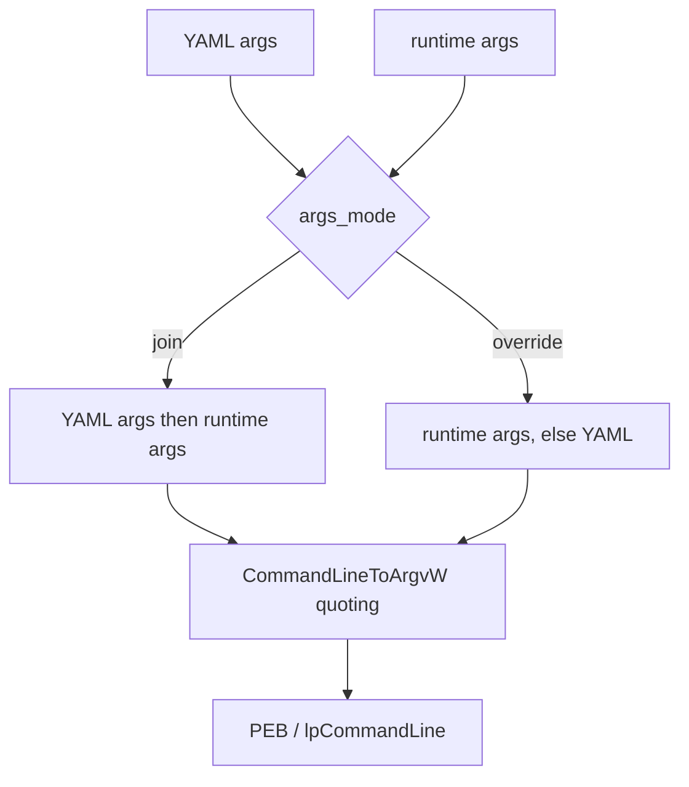

# Payload arguments

## What it does

A packed binary is a stub, not the payload: the operator runs the stub, which
decrypts the payload and hands control to it. The payload therefore needs an
explicit command line. `args` fixes arguments at build time and `args_mode`
decides how they combine with the arguments the operator passes to the packed
binary.

## How it works

`src/engine/args.rs` renders `$ARGS_BLOCK$` once, and both execution techniques
consume it:

- the YAML args are embedded as runtime-reconstructed strings (through
  `StringsConfig`), so a mimikatz module name never lands in cleartext;
- `resolve()` / `build_command_line(exe)` apply `args_mode` and Windows quoting;
- `patch_command_line()` rewrites the *current* process's command line for
  reflective loading.

`process_hollowing` passes the built line as `lpCommandLine` to `CreateProcessA`.
For `reflective_loading`, repointing `PEB->ProcessParameters->CommandLine` alone
is **not** enough on modern Windows: `kernelbase.dll` caches the command-line
pointer at process start and `GetCommandLineW` returns it. `patch_command_line()`
therefore repoints the PEB field **and** finds `kernelbase`'s cached pointer by
value (the original buffer address) and repoints it too. The scan uses
`SizeOfImage` from `kernelbase`'s PE header, so no version-specific offset is
hardcoded.

## Integration

Configured per payload under `build.payloads.<name>`; every Execution step builds its
command line from it, so it is part of the payload's configuration, not a `runtime:` step.

## What it evades

- Naive process monitors that compare the payload's apparent command line against
  the stub the operator launched: the payload sees its own intended arguments.

## What detects it

- `kernelbase`'s cached command line and the PEB can both be read by userland
  tooling; cross-checking them against the image path / parent's command line
  exposes the mismatch.
- ETW-TI reports the memory writes into `kernelbase` (a signed module).

## Implementation notes

- Fragments call `crate::build_command_line` / `crate::patch_command_line` and
  never touch the arguments themselves.
- `format: dll`/`shellcode` run in the current process under
  `reflective_loading`, so the same PEB patch runs before they start; a DLL
  `export` invoked with no arguments reads the command line from the PEB.
- The new command-line buffer is intentionally leaked: the PEB and `kernelbase`'s
  cache must keep pointing at live memory.
- The stub's IAT is unchanged by this feature; the YAML args stay encrypted.

## References

- MITRE ATT&CK T1036 — Masquerading.
- Windows internals: `RTL_USER_PROCESS_PARAMETERS`, `GetCommandLineW`.
