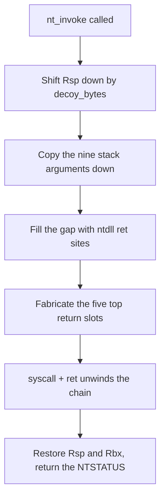

# Stack spoofing

*Fabricates ntdll-shaped frames on the stack around every syscall, so a stack
walk sees ntdll instead of the loader while the kernel runs.*

## What it does

Fabricates the top of the thread's stack for the duration of every syscall, so a
checker that walks the stack while the kernel is running sees ntdll code
addresses instead of the loader's own frames. Indirect syscalls put the
*instruction pointer* inside ntdll; this block is the other half — the *stack*
half.

It is not a `runtime:` step: nothing runs at pipeline time. It rewrites the
syscall layer's trampoline, so every `nt_*` helper in the stub goes through it.

## How it works



The syscall layer's trampoline (`nt_invoke`) is replaced at link time by a
sequence that runs *before* every syscall:

### 1. Shift the stack and move the arguments

1. **Move the stack down** by `decoy_bytes` and **copy the syscall's stack
   arguments** (arguments 5-13) so they still sit at `[rsp+0x28]` …
   `[rsp+0x70)` — the offsets the kernel reads them from and the raw trampoline
   reads the SSN and the gadget from. Arguments 1-4 stay in
   `rcx`/`rdx`/`r8`/`r9`, untouched.

### 2. Fabricate the frames and the return chain

2. **Fill the gap** between the new stack pointer and the caller's — a page by
   default, about 4 KB — with ntdll code addresses: real `ret` bytes, taken from
   the live ntdll, cycled through 16 slots. A walker reading upward walks through
   them before it reaches anything of the loader's.
3. **Build the return chain** in the five slots directly above the new stack
   pointer: four fabricated ntdll addresses and a hop back into the loader. The
   `ret` of the `syscall; ret` gadget unwinds through them one by one, so the
   stack is fabricated for as long as the syscall lasts and then unwinds itself.

### 3. Restore and return

4. **Return normally.** The restore label puts `Rsp` and the caller's `Rbx` back
   exactly where they were and returns the NTSTATUS in `eax`, so the Rust helper
   that called `nt_invoke` cannot tell the difference.

The hop is `jmp rbx`/`push rbx; ret` found in ntdll when the machine has one;
when it does not, the load-time scan puts the loader's restore label in that slot
instead. Either way the addresses are resolved from the live ntdll at
initialization (`init_stack_spoofing`, called from `init_syscalls`), so nothing
about them is embedded in the artifact.

### The floor on `decoy_bytes` is measured, not derived

Structurally the shift only has to be large enough for the fabricated frames
plus the nine copied argument slots: `0x70`. That value does not work. A real
build/run sweep on the verification host gives a sharp edge:

| `decoy_bytes` | Result |
|---------------|--------|
| 112, 116, 120, 124 | `0xC0000005` in the first spoofed syscall |
| 128, 132, 144, 192, 256, 512, 1024, 4096 | exit code `42` relayed (the payload ran) |

The sweep script is committed as `code_examples/stack_spoofing/bisect.py`, so the
floor can be re-measured on another host instead of trusted. `0x80` is therefore
the clamp, and the smallest working shift still fabricates the five top frames —
what it loses is the long decoy run above them.

### What it does and does not hide

| Visibility | Effect |
|------------|--------|
| Immediate return address of the syscall | ntdll |
| Top five frames during the syscall | ntdll |
| First ~4 KB of a stack scan | a run of ntdll `ret` sites |
| The loader's own frames further up | **still there** — the decoy buries them, it does not remove them |
| The instruction pointer at the syscall | ntdll (that is `indirect` mode, not this block) |

A full stack walk that reaches the whole thread stack still finds the loader.
Defeating *that* needs a synthetic unwind chain (SilentMoonwalk-style gadget
synthesis) rather than a fabricated region — a known improvement, not a defect
of this block. It is meant to be combined with `unhook_ntdll` and
`sleep_obfuscation` rather than to replace them.

## Integration

Configured under `build.stub.syscalls.stack_spoofing`; it requires
`mode: indirect` and is x86_64 only. It is installed with the syscall layer
(`init_stack_spoofing`, called from `init_syscalls`) before the runner starts, so
it has no position in `runtime:` and no `on_fail`/`delay_ms`. Its parameters live
in the loader-feature registry: `picaro techniques show stack_spoofing`.

```yaml
build:
  stub:
    syscalls:
      mode: indirect
      resolver: hells_gate
      stack_spoofing:
        decoy_bytes: 4096
```

## What it evades

- **"The syscall was issued from a non-module address."** The most common
  user-mode stack heuristic.
- **Cheap frame scanning.** Most userland stack checks read a bounded number of
  frames from the current stack pointer; the first page of them are ntdll
  return sites now.
- **Frame-shape checks.** The fabricated addresses are `ret` bytes that follow a
  `call` inside the same function, so they look like genuine return sites.

## What detects it

- **Full-stack walks.** A kernel-side walker that reads the whole thread stack
  finds the loader's frames below the decoy.
- **Unwind-info consistency.** The fabricated frames have plausible addresses
  but no consistent call chain; a checker that unwinds with `RtlVirtualUnwind`
  and validates the result gets nowhere sensible. (This cuts both ways: it is
  also what makes the block detectable as *inconsistent* rather than
  merely hidden.)
- **The stack pointer itself.** During the syscall `Rsp` points far below where
  the thread's frames are; a heuristic that compares `Rsp` against the thread's
  stack usage or against the caller's expected depth notices the gap.
- **CET / shadow stacks.** Hardware-enforced shadow stacks reject a `ret` whose
  target was never `call`ed, which breaks the fabric outright (and breaks
  indirect syscalls' gadget jump as well).
- **The written region.** Writing a page of addresses below `Rsp` on every
  syscall is a detectable pattern in memory-integrity monitoring.

## Measurements

Measured on the packing host (`x86_64-pc-windows-msvc`, release and debug stubs,
indirect syscalls with `resolver: tartarus_gate`), a loader whose payload
allocates, writes and runs a shellcode blob through the `nt_*` helpers:

| Quantity | Value |
|----------|-------|
| Fabricated frames resolved from ntdll | 16 |
| Decoy written per syscall | 4 KB (at the default) |
| Syscalls completed with the spoof active | all of them; the payload ran and relayed exit code `42` |
| Smallest working `decoy_bytes` | `128` (112–124 fault, see the bisect table above) |
| Largest clamped `decoy_bytes` | `32768`, also verified |

The runtime probe is the proof: the payload's exit code only comes back if every
argument arrived exactly where the kernel expected it, which is precisely what
the stack shift could break. The self-check that made the difference visible was
adding and removing the shift: with the shift and without the argument copy, the
first syscall in the chain (`NtAllocateVirtualMemory`) faults (`0xC0000005`).

## Implementation notes

- **The arguments have to move with the stack.** The x64 syscall convention has
  the kernel read arguments 5+ from the user stack at fixed offsets from `Rsp`,
  so shifting the stack without copying the nine argument slots would corrupt
  every wide call (`NtCreateThreadEx` and friends). That copy is the reason
  `decoy_bytes` has a minimum of `0x80` (measured; `0x70` would be the structural
  minimum but faults on the verification host).
- **Only `rax`, `r10`, `r11` and `rbx` are used as scratch.** `rcx`, `rdx`,
  `r8` and `r9` carry syscall arguments into the kernel; `rax` and `r11` are set
  by the raw trampoline after the spoof code runs, so they are free before it.
  `rbx` carries the hop target and is saved and restored.
- **The save slots are process-global.** `SPOOF_STACK` and `SPOOF_RBX` are
  statics, so a payload that drives the loader's `nt_*` helpers from two threads
  at the same time can corrupt them. The builtin techniques are single-threaded;
  a multi-threaded custom stub should not enable this block. This also applies to
  API-resolution proxies: a multi-threaded payload calling a proxied API
  concurrently can race the slots.
- **The decoy needs free stack.** Writing `decoy_bytes` below `Rsp` grows the
  thread's stack by that much. The loader's own call depth is shallow, so a page
  is nothing; a caller that is already near the stack limit would fault.
- **x86_64 only.** The block opens with a `compile_error!` on other targets
  instead of failing to link.
- The block is emitted next to the helpers it drives, inside the syscall layer's
  module; its `nt_invoke` is a global symbol, which is why the raw trampoline is
  renamed to `nt_invoke_raw` when this block is selected.

## References

- MITRE ATT&CK T1036 — Masquerading.
- namazso, *Spoofing call stacks with a synthetic call chain* (the reference
  write-up for the deeper variant this block approximates).
- SilentMoonwalk (klezvirus) and Vulcan (SpiderLabs): ROP-based synthetic frame
  chains, the natural next step for the "full stack walk" gap.
- `code_examples/stack_spoofing/refs/` (local references).
