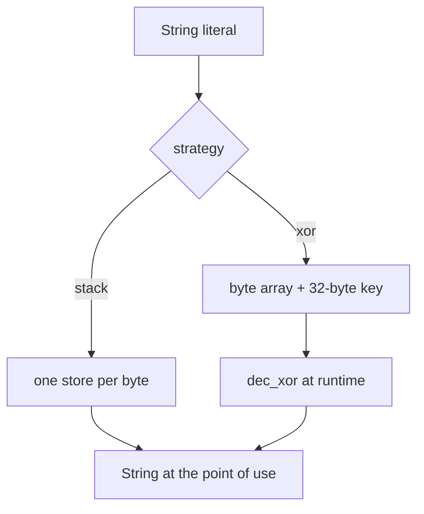

# String obfuscation

## What it does

Obfuscates every sensitive string literal the packer embeds into the generated
stub and emits code that rebuilds the string at runtime, so the literals do not
sit in cleartext in `.rdata`.

## How it works

The packer intercepts each literal, obfuscates it according to the configured
strategy and substitutes the result into a placeholder
(e.g. `$STUB_MARKER_DEF$`, `HOLLOW_TARGET_DEF`) as a Rust expression; the stub
binds it at runtime and uses the reconstructed `String` normally. All
obfuscation flows through `src/engine/obfuscation.rs`.

- **`xor`** — each literal is XORed with a repeating 32-byte key and embedded as
  a byte-array literal plus the key; the stub decodes it with a small runtime
  loop (`dec_xor`).
- **`stack`** — the literal is emitted as one byte store per character into a
  local stack array, then converted to a `String` at the point of use. No
  decoder, no key.

## Integration

Configured under `build.stub.strings`; it applies to every literal the packer embeds into
the stub, independent of the `runtime:` steps.

## What it evades

- Static `strings` scans for the per-build marker and, for process hollowing, the
  target path (`system32`, `svchost.exe`, …).

## What detects it

- Entropy anomalies: `xor` raises `.rdata` entropy in theory, but the embedded
  XChaCha20 ciphertext already dominates it, so the marginal effect is
  negligible (`docs/measurements.md`).
- Decoder patterns: `xor`'s `dec_xor` loop (byte array XORed with a key) is a
  classic tell a heuristic or ML classifier can flag. `stack` has no decoder, at
  the cost of more code.
- Runtime reconstruction: both strategies must materialize the string before
  use, so a hook on `LoadLibraryA`/`CreateProcessA` or a memory scan still sees
  it.

## Implementation notes

- Every literal that reaches the generated stub goes through
  `StringsConfig::obfuscate`; the `no_sensitive_literals_in_generated_stubs`
  guardrail fails the build when a runtime literal leaks.
- `stack` wraps each byte store in `std::hint::black_box` so LLVM does not fold
  the stores back into a constant.
- The `key` is per-build (`random`) by default; a fixed `literal:` key is
  reproducible but shared across builds.

## References

- `docs/measurements.md` — phase 6 string-obfuscation baseline.
- litcrypt / litcrypt2 — Rust crates that encrypt string literals at compile time
  and decrypt them lazily.
