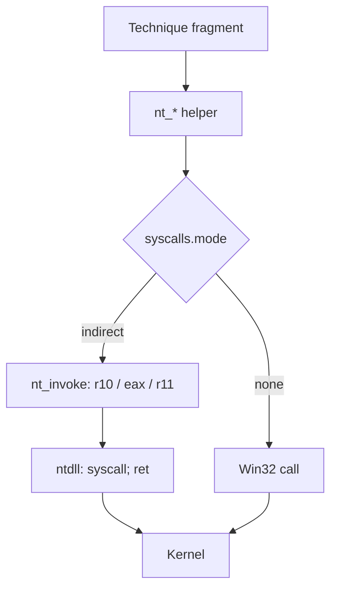

# Syscall layer

## What it does

Replaces the stub's suspicious Win32 API calls with NT syscalls whose SSN is
resolved at runtime. In `mode: indirect` the `syscall` instruction executes from
a `syscall; ret` gadget inside `ntdll`, so the call always appears to originate
in `ntdll` (not in private stub code), userland hooks in `ntdll` are bypassed,
and the stub's IAT no longer contains the suspicious imports.

## How it works

1. **Fragment contract.** Technique fragments always call the `nt_*` helpers
   (`nt_alloc_vm`, `nt_write_vm`, `nt_read_vm`, `nt_resume_thread`,
   `nt_unmap_view`, `nt_protect_vm`, `nt_suspend_thread`,
   `nt_query_info_process`, `nt_query_info_thread`, `nt_get_context_thread`,
   `nt_set_context_thread`, `nt_create_thread_ex`, `nt_wait_for_single_object`,
   `nt_close`) and never the Win32 APIs directly. `$SYSCALLS_BLOCK$` gives each
   helper two implementations — a direct Win32 call for `mode: none`, a syscall
   through the ntdll gadget for `mode: indirect` — so the fragment code is
   identical in both modes.
2. **SSN resolution.** `init_syscalls()` runs once, before the techniques, for
   the deduplicated union of the active pipeline's `TechniqueDef::syscalls`.
   Hell's Gate reads the canonical prologue `4C 8B D1 B8 ?? ?? ?? ??`
   (`mov r10, rcx; mov eax, <SSN>`); Tartarus Gate and API hashing walk a clean
   on-disk copy's export directory, converting each RVA to a file offset.
3. **The gadget.** The in-memory PE section table locates `.text`, which is
   scanned for the first `0F 05 C3` (`syscall; ret`).
4. **Trampoline (`nt_invoke`).** A `core::arch::global_asm!` shim with eleven
   argument slots plus the SSN and the gadget. `syscall` pushes no return
   address, so the kernel reads arguments 5+ from exactly the slots the Windows
   x64 ABI already put them in: the shim only sets `r10` (argument 1), `eax`
   (SSN) and `r11` (gadget) and `jmp`s, and the gadget's trailing `ret` returns
   straight to the Rust caller.
5. **Helpers.** Each `nt_*` helper wraps `nt_invoke` with the NT function's
   signature and returns `NTSTATUS` (`i32`); fragments treat `< 0` as an error.

## Resolvers

`build.stub.syscalls.resolver` selects how the SSNs are learned. Four are
implemented; each is a self-contained module under
`src/engine/syscalls/resolvers/<name>/` with its own page:

| Resolver | Phase | Reads the SSN from |
| --- | --- | --- |
| `hells_gate` | 6a | the live `Nt*` stub prologue (falls back to the on-disk copy if hooked) |
| `tartarus_gate` | 6b | a clean on-disk copy of `ntdll` |
| `api_hash` | 6c | the clean copy, matching exports by a per-build FNV-1a hash |
| `halos_gate` | 6d | the live export table; a hooked stub's SSN comes from an intact neighbour |

## Integration

Configured under `build.stub.syscalls` (loader-wide), **not** in `runtime:`. It shapes the
`nt_*` helpers the technique fragments call, so it is orthogonal to the chain order;
`mode: indirect` is x64-only (see `docs/x86.md`).

## What it evades

- Userland hooks in `ntdll`: the call reaches the kernel without passing through
  the hooked exported stub.
- Static IAT analysis: `VirtualAllocEx`, `WriteProcessMemory`,
  `ReadProcessMemory`, `ResumeThread`, `Get`/`SetThreadContext`,
  `CreateRemoteThread`, `WaitForSingleObject`, `GetExitCodeProcess` and
  `CloseHandle` leave the import table, and the `NtUnmapViewOfSection` string no
  longer appears in the binary (`docs/measurements.md`).
- `GetProcAddress`-based resolution and name strings: with `resolver: api_hash`
  the stub never calls `GetProcAddress` for the Nt* functions and never contains
  their names — only the precomputed hash constants.

## What detects it

- Kernel callbacks (PsSetCreateProcessNotifyRoutine, ObRegisterCallbacks) and
  ETW-TI: the syscall is indistinguishable from a legitimate `ntdll` call.
- Stack inspection / stack-spoofing detectors (the call stack does not show
  `ntdll`). Mitigated by the `stack_spoofing` loader feature
  (`build.stub.syscalls.stack_spoofing`); otherwise pending.
- SSN anomalies: signatures built from SSNs that change between Windows builds.

## Implementation notes

- **Why indirect over direct.** A direct syscall fails the syscall-origin check
  (the instruction must reside in a Microsoft-signed module); jumping to a
  `syscall; ret` gadget inside `ntdll` passes it.
- Rendering is programmatic (`src/engine/syscalls/`): a new technique only
  declares its Nt* functions in `TechniqueDef::syscalls`, and its helpers are
  emitted only when needed.
- The Nt* names never reach the binary: Hell's/Tartarus Gate rebuild them at
  runtime via `StringsConfig`; API hashing never emits them. The
  `no_sensitive_literals_in_generated_stubs` guardrail covers these strings.
- Each resolver is a self-contained module under
  `src/engine/syscalls/resolvers/<name>/`; its README is rendered into
  `docs/features/ref/syscalls/<name>.md`.
- `mode: indirect` is x64-only; see `docs/x86.md`. The
  PE-file walk helpers (`rva_to_offset`, `pe16_at`, `pe32_at`) are shared between
  the Tartarus Gate and API-hashing resolvers via `$FILE_PE_HELPERS$`.

## Adding a resolver

A resolver is a deliberate code change, not a config-only edit:

1. Create `src/engine/syscalls/resolvers/<name>/` with a `mod.rs` (a
   `ResolverDef` and the stub fragment) and a `README.md`.
2. Register it in `src/engine/syscalls/resolvers/mod.rs` (`ALL`).
3. Add the matching arm to the `Resolver` enum and `SyscallsConfig::from_yaml`.

The docs page and the feature sub-tree are generated from the registry at
assemble time; the test `every_resolver_is_documented` checks the page exists.

## References

- Hell's Gate (am0nsec, RtlMateusz — VX-Underground):
  https://vxug.fakedoma.in/papers/VXUG/Exclusive/HellsGate.pdf
- Tartarus' Gate (trickster0): https://github.com/trickster0/TartarusGate
- Direct vs indirect syscalls (Outflank):
  https://www.outflank.nl/blog/2023/12/13/direct-syscalls-vs-indirect-syscalls/
- Syscall detection / instrumentation callbacks (n4r1b):
  https://github.com/Deputation/instrumentation_callbacks
