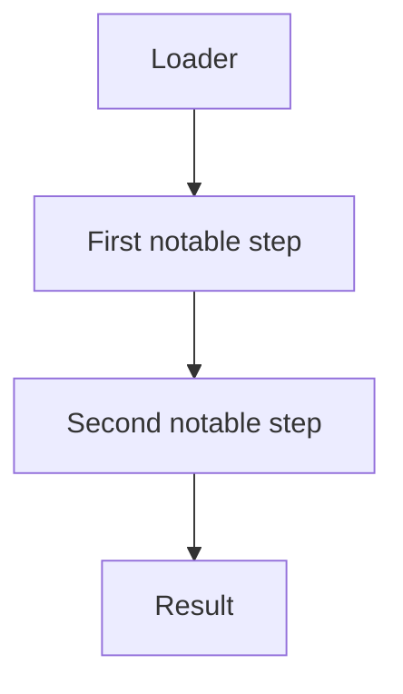

# <Technique name>

*<One-line TL;DR: what the technique does and why it exists — one sentence, in
the present tense.>*

<!--
The technique's metadata is NOT written here. It lives in `DEF` in `mod.rs`
(category, stability, ATT&CK, requires, conflicts, syscalls, `params_example`)
and is rendered from the registry by `picaro techniques show` and the docs site.
This README is the explanation only.
-->

## What it does

<One paragraph: what the technique modifies or runs, in which process, and why
it falls in the category above. For a Preparation, say explicitly that it never
runs the payload. For an Execution, name the payload format(s) it accepts.>

## How it works

### 1. <First phase>

1. <Step one.>
2. <Step two.>

### 2. <Second phase>

1. <Step one.>
2. <Step two.>

## Integration

Say where the technique belongs in `runtime:` (Preparation before the Execution, a
Control step between others), which payload formats an Execution accepts, and how it
interacts with the steps around it.

## What it evades

- <Evasion one.>

## What detects it

- <Detection one.>

## Measurements

- See `docs/measurements.md`.

## Implementation notes

- <Note one.>

## References

- <Reference one.>
