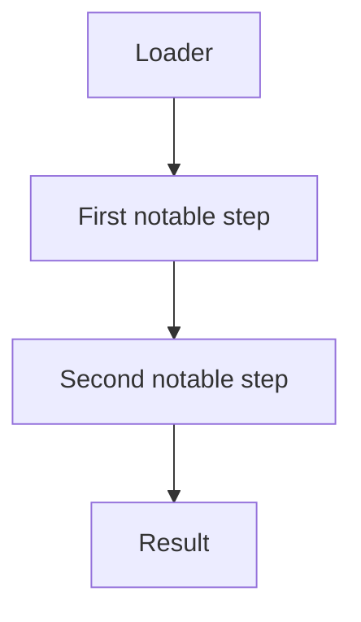

# <Technique name>

*<One-line TL;DR: what the technique does and why it exists — one sentence, in
the present tense.>*

## Metadata

| | |
|---|---|
| **ATT&CK** | T0000.000 (<technique name>) |
| **Stability** | Stable / Experimental / Unimplemented / Deprecated |
| **Category** | Preparation / Execution / Control |
| **YAML key** | `<technique_key>` |
| **Introduced in** | <phase or version> |

## What it does

<One paragraph: what the technique modifies or runs, in which process, and why
it falls in the category above. For a Preparation, say explicitly that it never
runs the payload. For an Execution, name the payload format(s) it accepts.>

## YAML parameters

| Parameter | Type | Required | Default | Description |
|-----------|------|----------|---------|-------------|
| `<name>`  | <type> | <yes/no> | <default> | <description> |

`None.` if the technique takes no parameters.

## YAML example

```yaml
runtime:
  - technique: <technique_key>
    params:
      <param>: <value>
```

## How it works



### 1. <First phase>

1. <Step one.>
2. <Step two.>

### 2. <Second phase>

1. <Step one.>
2. <Step two.>

## What it evades

- <Evasion one.>

## What detects it

- <Detection one.>

## Measurements

- See `docs/measurements.md`.

## Implementation notes

- <Note one.>

## References

- <Reference one.>
- MITRE ATT&CK T0000.000 — <technique name>.
