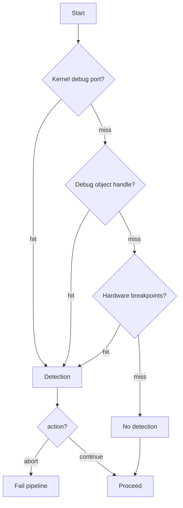

# Anti-Debug

*Checks the current process for signs of a debugger and, by default, aborts the
preparation so the payload never runs.*

## What it does

Checks the current process for signs of a debugger and, by default, aborts the
preparation so the payload never runs. It does not execute the payload, which is
why it is a Preparation technique. The goal is to stop interactive analysis of
the packed binary: a debugger that is attached when the stub starts makes the
stub fail closed instead of handing over a decrypted payload.

## How it works

### 1. Signals checked

Three independent signals are combined; a positive result from any of them is a
detection:

1. **Kernel debug port** — `NtQueryInformationProcess(ProcessDebugPort)` returns
   the debug port the OS assigns when a debugger attaches (the check
   `CheckRemoteDebuggerPresent` wraps).
2. **Debug object handle** — `NtQueryInformationProcess(ProcessDebugObjectHandle)`
   returns a non-null handle when the process is being debugged (the native
   analog of the PEB `BeingDebugged` flag).
3. **Hardware breakpoints** — `NtGetContextThread` with
   `CONTEXT_DEBUG_REGISTERS_AMD64` reads DR0–DR3 of the current thread; a
   non-zero register means a debugger set a hardware breakpoint (typical for
   single-step / watchpoint based reversing).

### 2. Outcome and `action`

A check that cannot be *read* (an error, rather than a positive hit) is treated
as "not detected", so an unavailable check never aborts the pipeline on its own.

With `action: abort`, a detection makes the preparation return an error, which
fails the run before the payload is executed. With `action: continue`, the run
proceeds regardless — useful when the packed binary is itself being tested under
a debugger.

## Integration

A **Preparation** step: the stub runs it before the Execution and it never
receives the payload. Place it earlier in `runtime:` than the Execution step.

## What it evades

- Interactive user-mode debugging (WinDbg, x64dbg, Visual Studio) of the packed
  stub, both attached at launch and attached after it starts.
- Automated sandboxes that run samples under a debugger for API tracing.

## What detects it

- A defensive analyst simply disabling the debugger sees the stub run normally;
  the technique is bypassable by patching out the checks. It raises cost, it does
  not prevent analysis.
- The checks go through the syscall layer's `nt_query_info_process` /
  `nt_get_context_thread`, so with `mode: indirect` the classic anti-analysis
  imports (`IsDebuggerPresent`, `CheckRemoteDebuggerPresent`, `GetThreadContext`)
  do not appear in the import table.
- A detection with `action: abort` surfaces as a stub error before the payload
  runs (the error path prints the message to stderr and exits non-zero), which is
  itself an observable signal.

## Measurements

- See `docs/measurements.md`.

## Implementation notes

- The techniques map to ATT&CK T1622; the sub-signals are the three checks above.
- The `windows` `CONTEXT` binding only guarantees 8-byte alignment, so the
  fragment wraps it in a `#[repr(align(16))]` struct, as x64 `GetThreadContext`
  requires. This mirrors the process-hollowing fragment.
- No string literals: every check is a direct `nt_*` call, so nothing needs to
  go through `StringsConfig`. The `ProcessDebugPort` / `ProcessDebugObjectHandle`
  information-class values are compile-time constants, not runtime strings.
- The checks resolve through the syscall layer (`NtQueryInformationProcess` for
  the debug-port / debug-object checks, `NtGetContextThread` for the hardware
  breakpoints), mirroring the `patch_amsi`/`patch_etw` migration.
- `action: continue` still runs all checks (so the code path stays identical);
  it only changes whether a detection is turned into an error. A future
  parameter could add a delay action to defeat automated sandboxes.

## References

- Anti-debugging check catalogue (PEB flag, debug port, hardware breakpoints).
- MITRE ATT&CK T1622 — Debugger Evasion.
