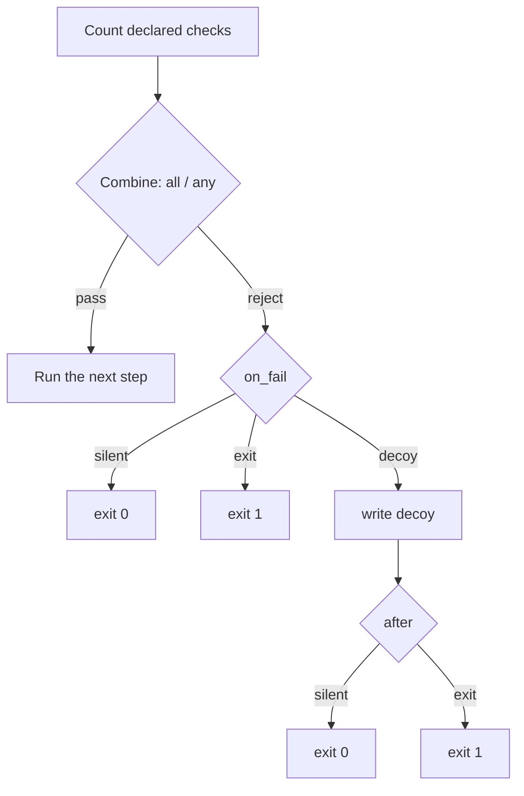

# Bouncer

*Checks the host against declared requirements and, when the target does not
match, either aborts the pipeline before the payload runs or drops a decoy file.*

## What it does

Checks the current host against a set of declared requirements and, when the
host does not satisfy them, reacts **before** the payload is decrypted-and-run.
It is the runtime counterpart of a targeting decision: run only on the machine
the engagement was scoped to, not on an analyst's sandbox, a research VM, or the
wrong workstation. On rejection it either aborts the chain (`on_fail: silent` /
`exit`) or writes a **decoy** file and then exits (`on_fail: decoy`), so a host
that fails a check sees a plausible document instead of a loader that simply
does nothing.

Every field is optional and activates one check; undeclared checks are skipped.
With no field declared the technique is a no-op (it always lets the payload
run), which `picaro build` reports as a warning.

## How it works

### 1. The gate

The gate counts how many checks are declared and how many pass, then applies
`mode` (`all`: `passed == declared`; `any`: `passed > 0`). No declared check is
always a pass. On rejection the stub does not run the payload; `on_fail`
chooses between *silent* (`0`), *exit* (`1`) and *decoy* (write a file, then
`after` picks the exit code).

### 2. The checks

- **`hostname`** — `GetComputerNameW`, matched with a case-insensitive glob.
- **`username`** — `GetUserNameW`, same matcher.
- **`domain`** — `GetComputerNameExW(ComputerNameDnsDomain)`. Not domain-joined
  hosts return an empty string, so the check fails rather than erroring.
- **`language`** — `GetUserDefaultLocaleName`, compared exactly (case
  insensitively) against the accepted locales.
- **`keyboard`** — collects the 4-digit language id of every active layout
  (`GetKeyboardLayout` for the calling thread, `GetKeyboardLayoutNameW` for its
  KLID string, `GetKeyboardLayoutList` for every loaded layout) and passes when
  one matches an accepted code.
- **`not_in_vm`** — reads the standard hypervisor leaves: `CPUID.1:ECX[31]`
  (hypervisor present) and `CPUID.0x40000000` (12-byte vendor string). The
  vendor is compared against `VMwareVMware`, `VBoxVBoxVBox`, `Microsoft Hv`,
  `KVMKVMKVM`, `XenVMMXenVMM` and `TCGTCGTCGTCG` (QEMU). A CPU that claims a
  hypervisor but does not expose a usable vendor leaf is treated as a failure.
- **`not_in_sandbox`** — an aggregate heuristic. Five indicators each score one
  point: a known analysis process is running (`vboxservice`, `vmwaretray`,
  `vmtoolsd`, `wireshark`, `procmon`/`procmon64`, `x64dbg`, `x32dbg`); fewer
  than 2 processors; less than 2 GiB of RAM; less than 10 minutes of uptime; or
  an image path / user name containing `sandbox`, `malware`, `test` or
  `analysis`. A score of **3 or more** rejects the host.
- **`processes`** — arbitrary, configurable process-existence checks. Each entry
  is `{ name, state }`: `state: present` passes when the process is running,
  `state: absent` passes when it is not. `name` is a case-insensitive glob,
  matched against the running process's file name and its `.exe`-stripped stem.
  The whole list is **one** check: it passes only when every entry holds. The
  two polarities are the same requirement with the sign flipped, so one list
  covers both *"run the decoy if `X` is missing"* (`state: present`) and *"run
  the decoy if `X` is present"* (`state: absent`).
- **`min_uptime_min`** — `GetTickCount64() / 60000`.
- **`min_ram_mb`** — `GlobalMemoryStatusEx().ullTotalPhys / 1024 / 1024`.

### 3. The decoy

With `on_fail: decoy` the stub writes an embedded asset before exiting:

1. `params.decoy.path` is the destination, rebuilt at runtime through
   `StringsConfig`. `%NAME%` references are expanded from the environment
   (`%TEMP%\report.docx`), and an unknown name is left as written.
2. `params.decoy.payload` names a `build.payloads` entry with `format: plain`:
   raw bytes the packer embeds and XChaCha20-encrypts like any other payload,
   but that no Execution technique runs. The stub decrypts it with the same
   per-step key and writes it out.
3. `params.after` chooses the exit code (`silent`, `0`, the default; or `exit`,
   `1`).

A write that fails is an error (the runner takes the step's `on_fail` action);
nothing else about the reject path changes.

### Why the `not_in_sandbox` threshold is 3

Sandbox detection is inherently fragile, and the cost of a mistake is
asymmetric: a false negative (the payload runs where it should not) is
recoverable, while a false positive (the payload does not run on the intended
target) breaks the engagement. At 3 coincident indicators a bare-metal analyst
workstation with a Sysinternals tool open, a 4 GiB VM, or a freshly booted
machine is very unlikely to be rejected by accident. The threshold is a
constant in the fragment (`ENV_SCORE_THRESHOLD`) and is deliberately not a YAML
option yet.

## Integration

A **Preparation** step: the stub runs it before the Execution and it never
receives the payload. Place it earlier in `runtime:` than the Execution step.
When a declared check fails it reacts per `on_fail`, so the payload never runs.
With `on_fail: decoy`, the step also carries an embedded `format: plain` asset
(the decoy) that the build decrypts and embeds like a payload.

## What it evades

- Automated **sandboxes** whose short uptime, small CPU/RAM footprint, guest
  tools and instrumented user path make them recognisable.
- **Research VMs** that advertise a hypervisor vendor through CPUID.
- Running on the **wrong machine**: a missing host/user/domain/locale/keyboard
  match, or a missing/extra `processes` entry, keeps the payload dormant.
- A failed check that would otherwise leave a silent no-op: `on_fail: decoy`
  leaves a plausible document behind instead of nothing.

## What detects it

There is no direct detection: the gate only reads the environment. An analyst
who inspects the binary can see the checks, but the strings that would give them
away are not in the file:

- The configured patterns (`hostname`, `username`, `domain`, the locale and
  keyboard lists) and the built-in environment names (analysis processes, path
  tokens, hypervisor vendor tokens) are all rebuilt at runtime through
  `StringsConfig`, so none appears in `.rdata` in cleartext. The
  `no_sensitive_literals_in_generated_stubs` guardrail test covers the analysis
  names and is extended for this technique.
- What remains observable without unpacking is the set of Win32 imports the
  technique adds (`GetUserDefaultLocaleName`, `GetKeyboardLayout*`,
  `CreateToolhelp32Snapshot`, `GetComputerNameW`, `GetUserNameW`,
  `GetComputerNameExW`, `GlobalMemoryStatusEx`, `GetTickCount64`). A static
  signature built from that combination is the realistic detection.
- Indirect detection is possible in principle via ETW-TI on
  `CreateToolhelp32Snapshot`, but the calls are ordinary and low-signal.
- With `on_fail: decoy` the write itself is observable: a file appears in the
  configured directory and its name is the configured (obfuscated) path. The
  decoy's bytes are `format: plain` data, so they are embedded and encrypted
  like a payload and do not show up in cleartext.

## Measurements

- See `docs/measurements.md`: ~+28 KB and one import for a
  host-name-only gate, ~+56 KB and 13 imports (two extra DLLs) for the full
  gate, `sensitive 0` in the audit, and the runtime block/allow result.
- The `processes` check reuses the process snapshot the `not_in_sandbox`
  heuristic already takes, so it adds no import of its own. The `on_fail: decoy`
  path adds no import either (standard-library file I/O) and grows the stub by
  the size of the encrypted decoy asset.

## Implementation notes

- **Preparation contract.** Preparations return `Result<bool, E>`:
  `Ok(true)` continues the pipeline, `Ok(false)` aborts it before the payload
  runs. See `src/techniques/README.md`. The `bouncer` and `guardrail` gates
  return `Ok(false)`; every other Preparation returns `Ok(true)`.
- `on_fail: exit` is handled inside the fragment (`std::process::exit(1)`), so
  the exit code is preserved even though the dispatcher's `false` means "exit
  silently" in the builtin template. `on_fail: decoy` writes the file inside the
  fragment too, then obeys `after`.
- The decoy asset is an injected step-module constant (`ASSET_ENC` /
  `ASSET_NONCE` / `ASSET_KEY` / `ASSET_LEN`) plus an `asset_bytes()` helper the
  engine renders; the fragment calls it only on rejection. A `bouncer` without a
  decoy gets a dead `asset_bytes()` stub so the fragment type-checks either way.
- `decoy.payload` must name a `format: plain` payload; `plan::validate` rejects
  any other format, and no Execution technique accepts `plain`, so the asset can
  never be run by mistake.
- A failing *API read* (not a failed check) propagates as an obfuscated message
  string and the stub reports it and exits `1`; only a policy rejection obeys
  `on_fail`.
- The glob matcher in the fragment mirrors `bouncer::glob_match` in the packer
  (kept for unit tests). A fragment cannot call back into the packer, so the
  two copies are intentional and small.
- The technique can be the first (or only) Preparation in the pipeline; there is
  no ordering restriction between preparations.
- Checks beyond the documented list (MAC address, IP ranges, …) are future
  phases.

## References

- MITRE ATT&CK T1497.001 — Virtualization/Sandbox Evasion: System Checks.
- MITRE ATT&CK T1614.001 — System Location Discovery: System Language Discovery.
- Al-Khaser (https://github.com/LordNoteworthy/al-khaser) — a catalogue of
  environment checks, including the CPUID hypervisor leaves and the well-known
  sandbox process/doc paths.
- Intel SDM, CPUID leaf `0x40000000` ("hypervisor CPUID information leaf") and
  `CPUID.1:ECX[31]` (hypervisor present).
- Cuckoo/CAPE sandbox documentation on the indicators of an analysis
  environment (uptime, resources, guest tools, instrumentation).
