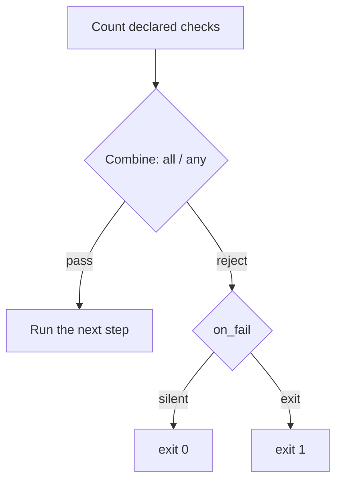

# Bouncer

*Checks the host against declared requirements and aborts the pipeline before
the payload runs when the target does not match.*

## Metadata

| | |
|---|---|
| **ATT&CK** | T1497.001 (Virtualization/Sandbox Evasion: System Checks), T1614.001 (System Location Discovery: System Language Discovery) |
| **Stability** | Stable |
| **Category** | Preparation |
| **YAML key** | `bouncer` |
| **Introduced in** | Phase 8 |

## What it does

Checks the current host against a set of declared requirements and, when the
host does not satisfy them, aborts the pipeline **before** the payload is
decrypted-and-run. It is the runtime counterpart of a targeting decision: run
only on the machine the engagement was scoped to, not on an analyst's sandbox,
a research VM, or the wrong workstation.

Every field is optional and activates one check; undeclared checks are skipped.
With no field declared the technique is a no-op (it always lets the payload
run), which `picaro build` reports as a warning.

## YAML parameters

| Parameter | Type | Required | Default | Description |
|-----------|------|----------|---------|-------------|
| `mode` | `all` \| `any` | no | `all` | How the declared checks combine. `all`: every check must pass. `any`: at least one must pass. |
| `on_fail` | `silent` \| `exit` | no | `silent` | What the stub does when the gate rejects the host. `silent`: exit code `0`, no message. `exit`: exit code `1`. |
| `hostname` | string (glob) | no | – | Required computer name. `*`/`?` make it a case-insensitive glob; otherwise an exact (case-insensitive) match. |
| `username` | string (glob) | no | – | Required user name. Same matching rules as `hostname`. |
| `domain` | string (glob) | no | – | Required DNS domain. A host outside a domain reports an empty domain, so the check then fails. |
| `language` | list of strings | no | – | Accepted BCP-47 locales (e.g. `en-US`, `es-ES`). Passes if the host locale is one of them. |
| `keyboard` | list of strings | no | – | Accepted 4-digit keyboard layout codes (e.g. `0409`, `0C0A`). Passes if any active layout matches. |
| `not_in_vm` | bool | no | – | `true` requires that CPUID reports no known hypervisor vendor. `false`/absent skips the check. |
| `not_in_sandbox` | bool | no | – | `true` requires that the aggregate sandbox heuristic stays below its threshold. `false`/absent skips the check. |
| `min_uptime_min` | u32 | no | – | Minimum system uptime in minutes. |
| `min_ram_mb` | u32 | no | – | Minimum physical memory in MiB. |

## YAML example

Minimal (a single check):

```yaml
runtime:
  - technique: bouncer
    params:
      hostname: "WORKSTATION-*"
  - technique: reflective_loading
```

Full:

```yaml
runtime:
  - technique: bouncer
    params:
      mode: all
      on_fail: silent
      hostname: "WORKSTATION-*"
      username: "admin"
      domain: "CORP"
      language: ["en-US", "es-ES"]
      keyboard: ["0409", "0C0A"]
      not_in_vm: true
      not_in_sandbox: true
      min_uptime_min: 10
      min_ram_mb: 4096
  - technique: reflective_loading
```

## How it works



### 1. The gate

The gate counts how many checks are declared and how many pass, then applies
`mode` (`all`: `passed == declared`; `any`: `passed > 0`). No declared check is
always a pass. On rejection the stub does not run the payload; `on_fail`
chooses between a silent exit (`0`) and an explicit one (`1`).

### 2. The checks

- **`hostname`** — `GetComputerNameW`, matched with a case-insensitive glob.
- **`username`** — `GetUserNameW`, same matcher.
- **`domain`** — `GetComputerNameExW(ComputerNameDnsDomain)`. Not domain-joined
  hosts return an empty string, so the check fails rather than erroring.
- **`language`** — `GetUserDefaultLocaleName`, compared exactly (case
  insensitively) against the accepted locales.
- **`keyboard`** — collects the 4-digit language id of every active layout
  (`GetKeyboardLayout` for the calling thread, `GetKeyboardLayoutNameW` for its
  KLID string, `GetKeyboardLayoutList` for every loaded layout) and passes when
  one matches an accepted code.
- **`not_in_vm`** — reads the standard hypervisor leaves: `CPUID.1:ECX[31]`
  (hypervisor present) and `CPUID.0x40000000` (12-byte vendor string). The
  vendor is compared against `VMwareVMware`, `VBoxVBoxVBox`, `Microsoft Hv`,
  `KVMKVMKVM`, `XenVMMXenVMM` and `TCGTCGTCGTCG` (QEMU). A CPU that claims a
  hypervisor but does not expose a usable vendor leaf is treated as a failure.
- **`not_in_sandbox`** — an aggregate heuristic. Five indicators each score one
  point: a known analysis process is running (`vboxservice`, `vmwaretray`,
  `vmtoolsd`, `wireshark`, `procmon`/`procmon64`, `x64dbg`, `x32dbg`); fewer
  than 2 processors; less than 2 GiB of RAM; less than 10 minutes of uptime; or
  an image path / user name containing `sandbox`, `malware`, `test` or
  `analysis`. A score of **3 or more** rejects the host.
- **`min_uptime_min`** — `GetTickCount64() / 60000`.
- **`min_ram_mb`** — `GlobalMemoryStatusEx().ullTotalPhys / 1024 / 1024`.

### Why the `not_in_sandbox` threshold is 3

Sandbox detection is inherently fragile, and the cost of a mistake is
asymmetric: a false negative (the payload runs where it should not) is
recoverable, while a false positive (the payload does not run on the intended
target) breaks the engagement. At 3 coincident indicators a bare-metal analyst
workstation with a Sysinternals tool open, a 4 GiB VM, or a freshly booted
machine is very unlikely to be rejected by accident. The threshold is a
constant in the fragment (`ENV_SCORE_THRESHOLD`) and is deliberately not a YAML
option yet.

## What it evades

- Automated **sandboxes** whose short uptime, small CPU/RAM footprint, guest
  tools and instrumented user path make them recognisable.
- **Research VMs** that advertise a hypervisor vendor through CPUID.
- Running on the **wrong machine**: a missing host/user/domain/locale/keyboard
  match keeps the payload dormant.

## What detects it

There is no direct detection: the gate only reads the environment. An analyst
who inspects the binary can see the checks, but the strings that would give them
away are not in the file:

- The configured patterns (`hostname`, `username`, `domain`, the locale and
  keyboard lists) and the built-in environment names (analysis processes, path
  tokens, hypervisor vendor tokens) are all rebuilt at runtime through
  `StringsConfig`, so none appears in `.rdata` in cleartext. The
  `no_sensitive_literals_in_generated_stubs` guardrail test covers the analysis
  names and is extended for this technique.
- What remains observable without unpacking is the set of Win32 imports the
  technique adds (`GetUserDefaultLocaleName`, `GetKeyboardLayout*`,
  `CreateToolhelp32Snapshot`, `GetComputerNameW`, `GetUserNameW`,
  `GetComputerNameExW`, `GlobalMemoryStatusEx`, `GetTickCount64`). A static
  signature built from that combination is the realistic detection.
- Indirect detection is possible in principle via ETW-TI on
  `CreateToolhelp32Snapshot`, but the calls are ordinary and low-signal.

## Measurements

- See `docs/measurements.md`: ~+28 KB and one import for a
  host-name-only gate, ~+56 KB and 13 imports (two extra DLLs) for the full
  gate, `sensitive 0` in the audit, and the runtime block/allow result.

## Implementation notes

- **Preparation contract.** Preparations now return `Result<bool, E>`:
  `Ok(true)` continues the pipeline, `Ok(false)` aborts it before the payload
  runs. See `src/techniques/README.md`. The existing preparations
  (`patch_amsi`, `patch_etw`, `anti_debug`, `sleep_obfuscation`) return
  `Ok(true)`; only the bouncer gate returns `Ok(false)`.
- `on_fail: exit` is handled inside the fragment (`std::process::exit(1)`), so
  the exit code is preserved even though the dispatcher's `false` means "exit
  silently" in the builtin template.
- A failing *API read* (not a failed check) propagates as a `BouncerError` and
  the stub reports it and exits `1`; only a policy rejection obeys `on_fail`.
- The glob matcher in the fragment mirrors `bouncer::glob_match` in the packer
  (kept for unit tests). A fragment cannot call back into the packer, so the
  two copies are intentional and small.
- The technique can be the first (or only) Preparation in the pipeline; there is
  no ordering restriction between preparations.
- `on_fail: decoy` and checks beyond the documented list (MAC address, IP
  ranges, …) are future phases.

## References

- MITRE ATT&CK T1497.001 — Virtualization/Sandbox Evasion: System Checks.
- MITRE ATT&CK T1614.001 — System Location Discovery: System Language Discovery.
- Al-Khaser (https://github.com/LordNoteworthy/al-khaser) — a catalogue of
  environment checks, including the CPUID hypervisor leaves and the well-known
  sandbox process/doc paths.
- Intel SDM, CPUID leaf `0x40000000` ("hypervisor CPUID information leaf") and
  `CPUID.1:ECX[31]` (hypervisor present).
- Cuckoo/CAPE sandbox documentation on the indicators of an analysis
  environment (uptime, resources, guest tools, instrumentation).
