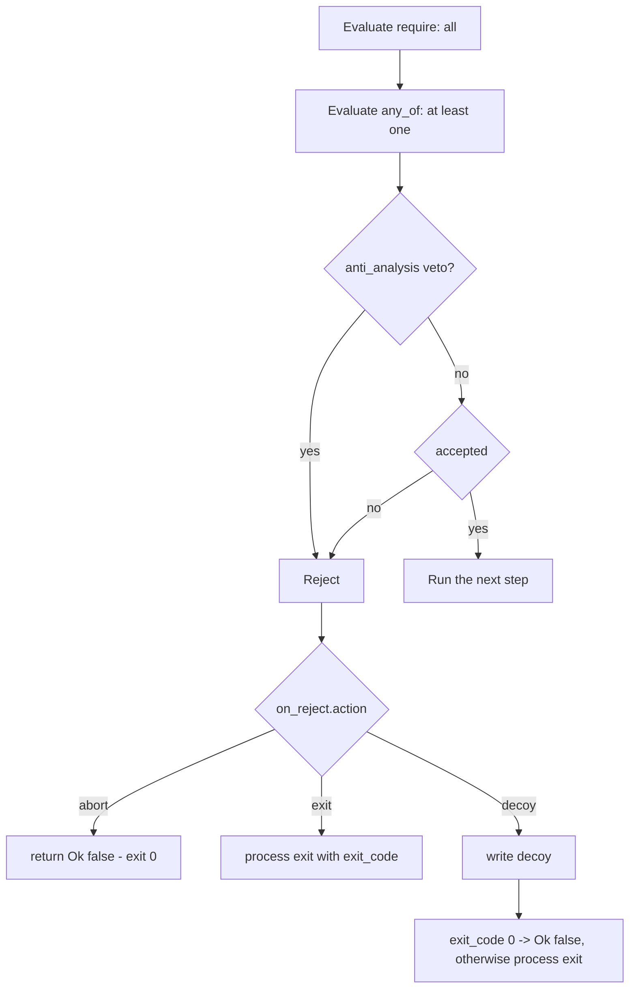

# Bouncer

*Checks the host against declared requirements and, when it does not match,
either aborts the pipeline before the payload runs or drops a decoy file.*

## What it does

Checks the current host against a list of requirements and, when the host does
not satisfy them, reacts **before** the payload is decrypted-and-run. It is the
runtime counterpart of a targeting decision: run only on the machine the
engagement was scoped to, not on an analyst's sandbox, a research VM, or the
wrong workstation. On rejection it either aborts the chain (`action: abort`),
exits with a chosen code (`action: exit`), or writes a **decoy** file and then
exits (`action: decoy`), so a host that fails a requirement sees a plausible
document instead of a loader that simply does nothing.

The requirements live in two lists with a uniform shape:

- `require` — every entry must pass (AND).
- `any_of` — at least one entry must pass (OR). Empty means "no constraint".

Each entry is one vote and one type (`hostname`, `ip`, `privilege`, …), so the
combinator never depends on the sign of the predicate. Any entry can be
negated with `not` (see below). `anti_analysis` is a separate, hard veto: it
applies even when an `any_of` entry passes.

With no requirement and no `anti_analysis` flag the technique is a no-op (it
always lets the payload run), which `picaro build` reports as a warning.

## How it works



### 1. The gate

The stub counts how many `require` entries were declared and how many passed;
the group passes when `declared == 0` or `passed == declared`. `any_of` uses the
same counters and passes when its group is empty or at least one entry passed.
The host is accepted when both groups pass and no `anti_analysis` veto fires.

The rejection path is one decision:

| `action` | Behaviour |
| --- | --- |
| `abort` (default) | return `Ok(false)`; the runner exits `0` |
| `exit` | `std::process::exit(exit_code)`, default code `1` |
| `decoy` | write the decoy, then exit with `exit_code` (default `0`; a nonzero code uses `process::exit`) |

`exit_code` is `0..=255`, only valid with `exit` and `decoy`; `abort` must leave
it unset or `0`. A DLL build rejects any action that exits the process, because
it would kill the host.

### 2. The requirements

- **`hostname`** — `GetComputerNameW`, matched with a case-insensitive glob.
- **`username`** — `GetUserNameW`, same matcher.
- **`domain`** — `GetComputerNameExW(ComputerNameDnsDomain)`. Not domain-joined
  hosts return an empty string, so the requirement fails rather than erroring.
- **`locale`** — `GetUserDefaultLocaleName`, compared exactly (case
  insensitively) against any accepted BCP-47 locale.
- **`keyboard`** — collects the 4-digit language id of every active layout
  (`GetKeyboardLayout` for the calling thread, `GetKeyboardLayoutNameW` for its
  KLID string, `GetKeyboardLayoutList` for every loaded layout) and passes when
  one matches an accepted code.
- **`process`** — `{ name, state }`. `present` requires the process to be
  running, `absent` requires it not to be. `name` is a case-insensitive glob,
  matched against the process's file name and its `.exe`-stripped stem.
- **`ip`** — enumerates the unicast addresses of every adapter that is up
  (`GetAdaptersAddresses`, IPv4 and IPv6) and passes when one is inside any of
  the configured CIDRs. A bare address is a host route (`/32` or `/128`). CIDRs
  are validated and normalized to their network address at build time, so the
  stub compares integers and the CIDR text never reaches the artifact.
- **`elevation`** — `GetTokenInformation(TokenElevation)`: `elevated` or
  `unelevated`.
- **`integrity`** — `GetTokenInformation(TokenIntegrityLevel)`: the mandatory
  label SID's last sub-authority, compared against `low` (`0x1000`), `medium`
  (`0x2000`), `high` (`0x3000`) and `system` (`0x4000`).
- **`privilege`** — `LookupPrivilegeValueW` + `PrivilegeCheck`: the named
  privilege must exist **and** be enabled in the current token (an
  administrator's disabled `SeDebugPrivilege` does not pass).
- **`uptime_min`** — `GetTickCount64() / 60000`.
- **`ram_mb`** — `GlobalMemoryStatusEx().ullTotalPhys / 1024 / 1024`.

### 3. Negation

Any requirement can be negated with `not`, which is the general escape hatch for
blocklists and exclusions:

```yaml
require:
  - not: { hostname: "ANALYST-*" }
  - not: { ip: ["10.0.0.0/8"] }
  - not: { privilege: SeDebugPrivilege }   # it must not be enabled
  - not: { locale: ["en-US", "es-ES"] }   # neither locale
```

`not` negates the requirement *as a whole*: the inner `locale` entry means "any
of these", so the negated form accepts a host whose locale is neither. The two
checks whose negative form is common enough to have a first-class spelling keep
it (`process.state: absent`, `elevation: unelevated`); `not` works on them too.
`not` cannot wrap another `not` (validation rejects it).

Because `require` is an AND list, a list of negated entries reads as "none of
these". De Morgan: `not (A or B)` is
`require: [{ not: A }, { not: B }]`, and `not (A and B)` is
`any_of: [{ not: A }, { not: B }]`.

### 4. Anti-analysis

- **`anti_analysis.hypervisor`** — reads `CPUID.1:ECX[31]` (hypervisor present)
  and `CPUID.0x40000000` (12-byte vendor string). The vendor is compared against
  `VMwareVMware`, `VBoxVBoxVBox`, `Microsoft Hv`, `KVMKVMKVM`, `XenVMMXenVMM` and
  `TCGTCGTCGTCG` (QEMU). A CPU that claims a hypervisor but does not expose a
  usable vendor leaf is treated as a failure.
- **`anti_analysis.sandbox`** — an aggregate heuristic. Five indicators each
  score one point: a known analysis process is running (`vboxservice`,
  `vmwaretray`, `vmtoolsd`, `wireshark`, `procmon`/`procmon64`, `x64dbg`,
  `x32dbg`); fewer than 2 processors; less than 2 GiB of RAM; less than 10
  minutes of uptime; or an image path / user name containing `sandbox`,
  `malware`, `test` or `analysis`. A score of **3 or more** rejects the host.

### 5. The decoy

With `action: decoy` the stub writes an embedded asset before exiting:

1. `on_reject.decoy.path` is the destination, rebuilt at runtime through
   `StringsConfig`. `%NAME%` references are expanded from the environment
   (`%TEMP%\report.docx`), and an unknown name is left as written.
2. `on_reject.decoy.payload` names a `build.payloads` entry with `format: plain`:
   raw bytes the packer embeds and XChaCha20-encrypts like any other payload, but
   that no Execution technique runs. The stub decrypts it with the same
   per-step key and writes it out.
3. `on_reject.exit_code` chooses the exit code (`0` by default; any other value
   calls `std::process::exit`).

A write that fails is an error (the runner takes the step's `on_fail` action);
nothing else about the reject path changes.

### Why the sandbox threshold is 3

Sandbox detection is inherently fragile, and the cost of a mistake is
asymmetric: a false negative (the payload runs where it should not) is
recoverable, while a false positive (the payload does not run on the intended
target) breaks the engagement. At 3 coincident indicators a bare-metal analyst
workstation with a Sysinternals tool open, a 4 GiB VM, or a freshly booted
machine is very unlikely to be rejected by accident. The threshold is a
constant in the fragment (`ENV_SCORE_THRESHOLD`) and is deliberately not a YAML
option.

## Integration

A **Preparation** step: the stub runs it before the Execution and it never
receives the payload. Place it earlier in `runtime:` than the Execution step.
When a requirement fails it reacts per `on_reject`, so the payload never runs.
With `action: decoy`, the step also carries an embedded `format: plain` asset
(the decoy) that the build decrypts and embeds like a payload.

`params` is checks plus the rejection policy; the loader's own `on_fail` /
`on_success` stay on the step (`runtime[].on_fail`), so the two never collide.

## What it evades

- Automated **sandboxes** whose short uptime, small CPU/RAM footprint, guest
  tools and instrumented user path make them recognisable.
- **Research VMs** that advertise a hypervisor vendor through CPUID.
- Running on the **wrong machine**: a missing host/user/domain/locale/keyboard/
  process/IP/elevation/integrity/privilege match keeps the payload dormant.
- A failed check that would otherwise leave a silent no-op: `action: decoy`
  leaves a plausible document behind instead of nothing.

## What detects it

There is no direct detection: the gate only reads the environment. An analyst
who inspects the binary can see the checks, but the strings that would give them
away are not in the file:

- The configured values (hostname, user, domain, locales, keyboards, process
  names, CIDRs, privilege names, decoy path) and the built-in environment names
  (analysis processes, path tokens, hypervisor vendor tokens) are all rebuilt at
  runtime through `StringsConfig`, so none appears in `.rdata` in cleartext. The
  CIDRs are not even rebuilt: they become integer masks at build time. The
  `no_sensitive_literals_in_generated_stubs` guardrail test covers the analysis
  names and is extended for this technique.
- What remains observable without unpacking is the set of Win32 imports the
  technique adds (`GetUserDefaultLocaleName`, `GetKeyboardLayout*`,
  `CreateToolhelp32Snapshot`, `GetComputerNameW`, `GetUserNameW`,
  `GetComputerNameExW`, `GlobalMemoryStatusEx`, `GetTickCount64`,
  `GetAdaptersAddresses`, `OpenProcessToken`, `GetTokenInformation`,
  `LookupPrivilegeValueW`, `PrivilegeCheck`). A static signature built from that
  combination is the realistic detection.
- Indirect detection is possible in principle via ETW-TI on
  `CreateToolhelp32Snapshot`, but the calls are ordinary and low-signal.
- With `action: decoy` the write itself is observable: a file appears in the
  configured directory and its name is the configured (obfuscated) path. The
  decoy's bytes are `format: plain` data, so they are embedded and encrypted
  like a payload and do not show up in cleartext.

## Measurements

- See `docs/measurements.md`: ~+28 KB and one import for a host-name-only gate,
  ~+56 KB and 13 imports (two extra DLLs) for the pre-rework full gate,
  `sensitive 0` in the audit, and the runtime block/allow result.
- The reworked gate adds `GetAdaptersAddresses` (one import, `iphlpapi`) and the
  token checks (`OpenProcessToken`, `GetTokenInformation`,
  `LookupPrivilegeValueW`, `PrivilegeCheck`). A fresh baseline for the new
  import set is pending; the old numbers do not cover the IP/privilege checks.
- The `process` and `ip` requirements reuse the enumerations the heuristics
  already need, so they add no import of their own. The `action: decoy` path
  adds no import either (standard-library file I/O) and grows the stub by the
  size of the encrypted decoy asset.

## Implementation notes

- **Preparation contract.** Preparations return `Result<bool, E>`:
  `Ok(true)` continues the pipeline, `Ok(false)` aborts it before the payload
  runs. See `src/techniques/README.md`. The `bouncer` and `killswitch` gates
  return `Ok(false)`; every other Preparation returns `Ok(true)`.
- **One requirement, one vote.** `require` and `any_of` are lists of the same
  `Requirement` enum, so a new check is one variant and one render arm, and the
  combinator stays uniform (the old `mode`/`processes` asymmetry is gone).
  `not` is another variant: it renders as `!(<inner expression>)` and validation
  recurses into it, rejecting a nested `not`.
- **Rejection policy is `on_reject`, not `on_fail`.** `params.on_reject` is the
  gate's own decision (`abort` / `exit` / `decoy`), with an explicit `exit_code`;
  `runtime[].on_fail` remains the loader's error policy. `action: exit` is
  handled inside the fragment (`std::process::exit`), so the exit code is
  preserved even though the dispatcher's `false` means "exit silently".
- **CIDRs never reach the stub.** The packer parses and validates them, masks the
  address to its network and renders `(prefix, network)` integers (IPv4 and IPv6
  separately). The stub compares the adapter addresses against `mask_v4` /
  `mask_v6`.
- **The sandbox process indicator compares name and stem.** The built-in list
  carries `.exe`; the snapshot reports `.exe` too, but a user entry may omit it,
  so both forms are compared. An earlier revision only compared the stem and the
  indicator could never fire.
- The decoy asset is an injected step-module constant (`ASSET_ENC` /
  `ASSET_NONCE` / `ASSET_KEY` / `ASSET_LEN`) plus an `asset_bytes()` helper the
  engine renders; the fragment calls it only on rejection. A `bouncer` without a
  decoy gets a dead `asset_bytes()` stub so the fragment type-checks either way.
- `on_reject.decoy.payload` must name a `format: plain` payload; `plan::validate`
  rejects any other format, and no Execution technique accepts `plain`, so the
  asset can never be run by mistake.
- A failing *API read* (not a failed requirement) propagates as an obfuscated
  message string and the stub reports it and exits `1`; only a policy rejection
  obeys `on_reject`.
- The glob matcher in the fragment mirrors `bouncer::glob_match` in the packer
  (kept for unit tests). A fragment cannot call back into the packer, so the
  two copies are intentional and small.
- The technique can be the first (or only) Preparation in the pipeline; there is
  no ordering restriction between preparations.
- `Params` rejects unknown keys (`deny_unknown_fields`), so a typo fails the
  build instead of silently turning the gate into a no-op.

## References

- MITRE ATT&CK T1497.001 — Virtualization/Sandbox Evasion: System Checks.
- MITRE ATT&CK T1614.001 — System Location Discovery: System Language Discovery.
- MITRE ATT&CK T1033 — System Owner/User Discovery.
- MITRE ATT&CK T1016 — System Network Configuration Discovery.
- Al-Khaser (https://github.com/LordNoteworthy/al-khaser) — a catalogue of
  environment checks, including the CPUID hypervisor leaves and the well-known
  sandbox process/doc paths.
- Intel SDM, CPUID leaf `0x40000000` ("hypervisor CPUID information leaf") and
  `CPUID.1:ECX[31]` (hypervisor present).
- Microsoft Learn, `GetAdaptersAddresses`, `GetTokenInformation` (`TokenElevation`,
  `TokenIntegrityLevel`) and `PrivilegeCheck`.
- Cuckoo/CAPE sandbox documentation on the indicators of an analysis
  environment (uptime, resources, guest tools, instrumentation).
