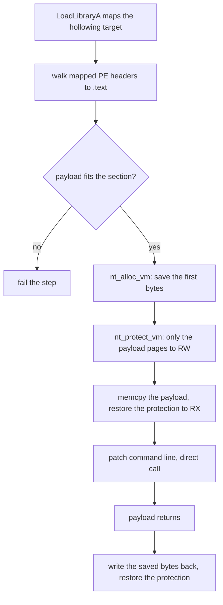

# Phantom DLL hollowing

*Overwrite a signed DLL's code section with the payload, then restore the
original bytes, so the module keeps working after the payload runs.*

## What it does

Loads a legitimate, signed DLL, saves the first bytes of its code section
(`.text`), overwrites them with the decrypted payload and calls it. When the
payload returns, the saved bytes are written back so the module's exports keep
proxying their real implementation.

The difference from `module_stomping` is the **restore**: module stomping
overwrites the section and leaves it broken; phantom DLL hollowing keeps a copy
of the overwritten bytes and puts them back once the payload has run, so the
sacrificial module is still a working, proxy-able DLL afterwards.

## How it works

### 1. Map and locate the code section

1. `LoadLibraryA` maps the hollowing target. If it is already loaded the call
   only bumps its reference count, and the module keeps whatever base it has;
   the loader (not this technique) does the mapping, the catalogue/hash
   bookkeeping and the `DllMain(DLL_PROCESS_ATTACH)` call.
2. The module's *mapped* PE headers are copied into a local buffer and walked to
   the `.text` section: `VirtualAddress` gives the section's address in the
   mapped image, `max(VirtualSize, SizeOfRawData)` its capacity. The walk is
   bounds-checked slice arithmetic; a malformed target fails the load instead of
   faulting the stub.
3. The payload's length is checked against that capacity. A payload that does not
   fit **fails the step** — it is never truncated, and it is never written past
   the section into whatever the loader mapped next.
### 2. Hollow the section and run the payload

4. The section's first `payload_len` bytes are saved into a `nt_alloc_vm`
   (`PAGE_READWRITE`) buffer. The saved copy lives outside the default heap, so
   the original module code does not sit in a private heap allocation a scanner
   can group by module.
5. Only the pages the payload occupies are made writable (`PAGE_READWRITE`
   through `nt_protect_vm`; the captured old protection is kept for step 6). The
   rest of the section keeps its protection, and the section is writable and
   non-executable during the write, so it is never RWX.
6. The payload is copied over the section's first bytes with a plain `memcpy`
   (`ptr::copy_nonoverlapping`), then the captured protection is restored —
   `.text` ships `PAGE_EXECUTE_READ`, so the section is executable and read-only
   again before the payload runs.
7. The PEB command line is repointed at the payload's configured arguments
   (`crate::patch_command_line`, shared with `reflective_loading`), and control
   is transferred with a **direct call** to the section's first byte. The
   payload's return value becomes the step's result, so the technique *returns*
   and the runtime chain can continue.
### 3. Restore the original bytes

8. Once the payload returns, the saved bytes are written back: the section is
   made writable again, the original bytes are `memcpy`d over the payload and the
   original protection is restored. The module's exports now point at real code
   again, so any code in the process that later calls one of them gets the
   original implementation.

### Decisions

- **Stomp the section's first byte, like `module_stomping`.** The classic
  phantom-DLL variant overwrites `AddressOfEntryPoint`, which puts the payload in
  the middle of the section and forces the capacity check to account for the
  entry offset. The section's first byte is page-aligned and 16-byte aligned in
  every real image, and the whole section is the natural size bound.
- **Save and restore, unlike `module_stomping`.** The sacrificial module is a
  *proxy* after the hollow, not a casualty: restoring the original bytes keeps
  its exports working, which is the point of the T1574.002 family. The cost is
  one `nt_alloc_vm` and two extra protection changes.
- **`nt_alloc_vm`, not a heap `Vec`, for the saved bytes.** A `Vec` would place
  the original module's code in the loader's default heap; a dedicated
  allocation keeps the saved copy out of the heap and on the syscall layer.
- **`memcpy`, not `nt_write_vm`.** `NtWriteVirtualMemory` on one's own process is
  a call an EDR can watch and can fail halfway; the copy needs neither.
- **Direct call, not a new thread.** A thread would make the payload's start
  address visible in thread telemetry, and it would break the “execution
  techniques return” contract used by the runtime chain.
- **Restore before executing.** Keeps the section out of the RWX state some
  scanners flag, and keeps the final protection indistinguishable from the
  module's normal one.
- **No `FlushInstructionCache`.** The x86/x64 instruction cache is coherent with
  data writes on the same core; every stub fragment also crosses a kernel
  boundary (`NtProtectVirtualMemory`) before the call.

### Payload formats

The technique runs **`format: shellcode`** only: the bytes are placed in the code
section as-is and called with a no-argument contract, exactly like
`reflective_loading`'s shellcode runner. A `pe`/`dll` payload would need a mapper
(relocations, imports, per-section protections) and `dotnet` a CLR host —
`reflective_loading` and `dotnet_hosting` do that. `plan::validate` rejects
`pe`/`dll`/`dotnet` for this technique at build time, and the fragment also
detects a PE payload at runtime (`MZ` + `PE\0\0`) and fails the step with a clear
message instead of jumping into a DOS header.

## Integration

An **Execution** step: it runs a `shellcode` payload from the loader's own
process. The payload runs from a hollowed DLL's code section, whose
original bytes are restored afterwards.

## What it evades

- The payload never touches disk: it is decrypted in memory and written into a
  module the image already maps.
- No private executable allocation and no `VirtualAlloc`/`VirtualAllocEx` for the
  *payload*, so a “fresh executable memory” heuristic has nothing new to flag.
- No child process, no remote target, no new thread.
- The pages the payload runs from belong to a Microsoft-signed module: a memory
  scan that groups executable regions by module reports the payload under the
  module's image, not under an anonymous region.
- After the payload returns, the module is byte-for-byte its original self again
  (modulo any copy-on-write private pages), so a post-execution integrity check
  of the module finds nothing out of place.

## What detects it

- **Page-protection telemetry.** `NtProtectVirtualMemory` (ETW-TI, kernel
  callbacks, userland hooks in `mode: none`) fires four times per hollow on a
  *signed module's* code pages: `RX → RW`, `RW → RX`, `RX → RW`, `RW → RX`.
  A module's `.text` becoming writable, and writable code pages appearing inside
  a loaded module, are both high-signal.
- **Image-load telemetry and module integrity checks.** `LoadLibraryA` on a
  module the process never uses is itself a signal, and anything that re-validates
  a module *while the payload runs* — comparing the mapped section against the
  file on disk, hashing `.text`, or checking for executable pages that differ
  from the module's on-disk image — sees the payload. The stomped pages are
  no longer file-backed (copy-on-write private pages inside the module's address
  range), which is the residual artifact of this technique family.
- **The saved-copy allocation.** The `nt_alloc_vm` buffer holding the original
  `.text` bytes is a private `RW` region containing executable-looking code, which
  is exactly what a “code held in non-executable memory” heuristic is looking
  for. It is a new, avoidable artifact that `module_stomping` does not have.
- **Stack and call-graph inspection.** The payload runs from the loader's own
  thread, so a stack walk shows a return address inside a module that has no
  legitimate caller on that thread.
- **In-memory scanning / YARA.** The payload's own signatures apply unchanged
  once its bytes are in the section.
- **Import-based heuristics.** `LoadLibraryA` + `GetCurrentProcess` in the import
  table of a stub that does not otherwise use those modules.

## Measurements

- Measured end to end on Windows 11 26200 (2026-10-14): packing the demo shellcode
  (`mov eax, 42; ret`) and running the artifact returns `42`, so the hollowed
  `.text` runs and the payload's return value is relayed through the step. Still
  unmeasured: the byte-for-byte restore after the payload returns, and the PE/dll
  mapper follow-up below. Numbers: `docs/measurements.md`.

## Implementation notes

- **The target is a parameter, not a constant.** The default (`wininet.dll`) is a
  Microsoft-signed module present on every SKU with a code section large enough
  for a staged payload. On a host where it is missing (some Server Core images),
  `LoadLibraryA` fails and the step reports it — pick another signed module
  (`dbghelp.dll`, `xpsservices.dll`, `iertutil.dll`, `mshtml.dll`, ...).
- **The hollowing target is obfuscated.** Its name is rebuilt at runtime by
  `render_fragment_for` (`StringsConfig`), like every other runtime string in the
  fragment, and the `.text` name is a compile-time byte pattern
  (`u64::from_le_bytes([b'.', b't', b'e', b'x', b't', 0, 0, 0])`), so no section
  name reaches `.rdata` either.
- **`LoadLibraryA` stays a Win32 import.** Loading a module is a loader entry
  point, not a kernel call the stub issues itself — the same position as
  `CreateProcessA` in `process_hollowing`. Everything kernel-facing
  (`nt_alloc_vm`, `nt_protect_vm`) goes through the syscall layer, so
  `mode: indirect` removes the `VirtualAlloc`/`VirtualProtect` imports.
- **Limitations.** The payload may not be larger than the target's `.text` and
  may not self-modify its own first bytes (the section is read-only again when it
  runs). The restore is best-effort in the same sense as any post-payload code: a
  payload that calls `ExitProcess` (or never returns) skips step 8 and the module
  is left hollowed. Hollowing a module the process actually uses — or one a
  previous step patched — corrupts or silently reverts that state.
- **Not implemented here (follow-ups).** A `pe`/`dll` mapper into the hollowed
  section (would need `resolves_imports: true` and the shared resolver), and a
  knob for the final protection (`pagerwx` for payloads that need writable code).

## References

- ired.team — *DLL Hollowing / Phantom DLL Hollowing*:
  <https://www.ired.team/offensive-security/code-injection-process-injection/dll-hollowing-and-process-doppelganging>
  (the classic write-up: map a legitimate image, overwrite its entry point with
  shellcode, and run it from inside the mapped module; this fragment stomps the
  section's first bytes and restores them afterwards).
- MITRE ATT&CK T1574.002 — *DLL Side-Loading*:
  <https://attack.mitre.org/techniques/T1574/002/>
- Microsoft Learn — *LoadLibraryA*:
  <https://learn.microsoft.com/en-us/windows/win32/api/libloaderapi/nf-libloaderapi-loadlibrarya>
  (reference-counting and “already loaded” semantics the fragment relies on).
- Microsoft Learn — *FlushInstructionCache*:
  <https://learn.microsoft.com/en-us/windows/win32/api/processthreadsapi/nf-processthreadsapi-flushinstructioncache>
  (the documented call for modified code; deliberately skipped here, see
  “Decisions”).
