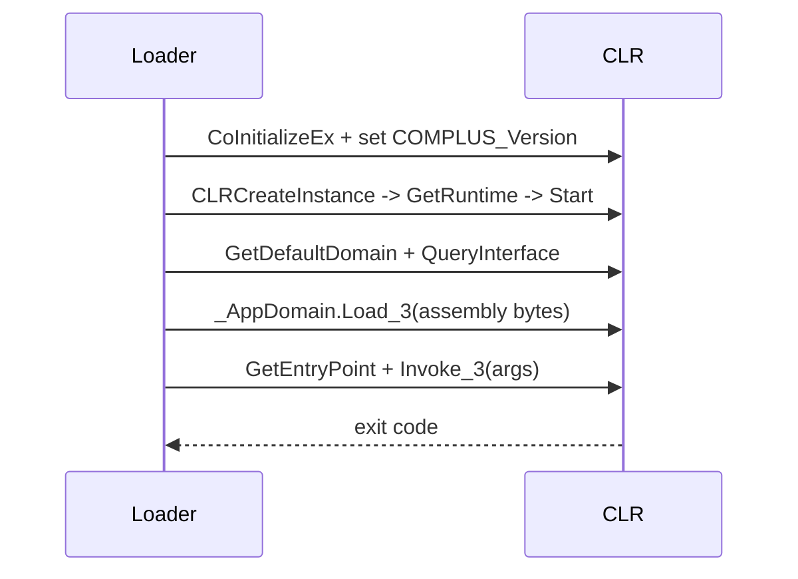

# .NET hosting

*Hosts the CLR in the stub's own process and runs a managed assembly straight
from memory, so a .NET payload never needs a file on disk.*

## Metadata

| | |
|---|---|
| **ATT&CK** | T1620 — Reflective Code Loading |
| **Stability** | Experimental |
| **Category** | Execution |
| **YAML key** | `dotnet_hosting` |
| **Capabilities** | `WindowsX64 \| WindowsX86` |

## What it does

Runs a managed (.NET) assembly from memory. The stub hosts the CLR **in its own
process** (`CLRCreateInstance` → `ICLRMetaHost` → `ICLRRuntimeInfo` →
`ICorRuntimeHost`), loads the payload's bytes as an assembly
(`_AppDomain.Load_3(byte[])`) and invokes its entry point
(`Assembly.GetEntryPoint` → `MethodInfo.Invoke_3`) with `build.payloads.<name>.args` plus
the runtime arguments as a `string[]`.

This is not reflective loading: a managed assembly's entry point is a stub that
calls `mscoree.dll!_CorExeMain`, which starts the CLR for the process's **main
module** — the packed binary — so mapping the image and jumping to its entry
point does not run the assembly (picaro used to fail there with an opaque
runtime error; the build now rejects it, see below).

## YAML parameters

None. The technique is selected by name.

## YAML example

```yaml
schema: 4
name: managed
build:
  payload:
    source: ./SharpHound.exe
    format: dotnet
    crypto:
      algo: xchacha20poly1305
      key: random
  output:
    path: ./dist/managed.exe
    arch: x86
    strip: true
    trim_paths: all
runtime:
  - technique: dotnet_hosting
```

`format: dotnet` and `technique: dotnet_hosting` imply each other: validation
rejects one without the other.

## How it works



### 1. Start the CLR

1. `CoInitializeEx(COINIT_MULTITHREADED)` — the hosting interfaces are COM
   objects. An already-initialized thread is fine.
2. `COMPLUS_Version` is set to the runtime version picaro asks for
   (`v4.0.30319`, obfuscated like every other stub literal), then
   `CLRCreateInstance(CLSID_CLRMetaHost)` → `GetRuntime(version)` →
   `GetInterface(CLSID_CorRuntimeHost)` → `Start()`.

### 2. Load the assembly

3. `GetDefaultDomain()` returns the `_AppDomain` as an `IUnknown`;
   `QueryInterface(IID__AppDomain)` turns it into the managed interface. The
   managed interfaces (`_AppDomain`, `Assembly`, `MethodInfo`) are not in the
   `windows` metadata, so the calls go through their vtable slots (45, 16 and 37
   respectively).
4. The assembly's bytes are copied into a `SAFEARRAY` of `VT_UI1` and handed to
   `_AppDomain.Load_3`, which returns the `Assembly`.

### 3. Invoke the entry point

5. The arguments become a `string[]` (`SAFEARRAY` of `VT_BSTR`), wrapped in the
   `object[]` that `Invoke_3` expects. A `Main()` without parameters rejects the
   array, so the call is retried with an empty one — the same fallback the CLR's
   own host uses.
6. The entry point's return value is relayed as the artifact's exit code when
   `Main` returns an `int` (`VT_I4`); a `void Main` yields `0`. A managed
   `Environment.Exit` ends the process directly, exactly as it would from the
   CLR's own host.

## Architectures

The hosting path is the same on both architectures (the `windows` crate exposes
`CLRCreateInstance` and the hosting interfaces for both, and the fragment carries
the 32-bit/x64 difference in `Invoke_3`'s `VARIANT` argument). The **assembly**
decides which stub it needs:

| Assembly | `arch` |
| --- | --- |
| IL-only, not `32BITREQUIRED` (Any CPU) | either |
| `COMIMAGE_FLAGS_32BITREQUIRED` | `x86` (a 32-bit CLR is required) |
| Mixed-mode (not IL-only) | the assembly's own machine |

`build` enforces that table from the CLR header: a payload that needs a 32-bit
runtime is rejected with `arch: x64`, and vice versa.

## What it evades

- The assembly never touches the disk: it is decrypted in memory and handed to
  the CLR as bytes (`Load_3`), so a file-based scan sees only the encrypted
  stub.
- The stub keeps its static profile: hosting adds the CLR's own imports
  (`mscoree.dll!CLRCreateInstance` is resolved by name, no `LoadLibrary` of
  `mscoree` at runtime), and the runtime version string is obfuscated.

## What detects it

- **The `CLRCreateInstance` import** (`mscoree.dll`) and the `mscoree` load: a
  packed artifact that hosts the CLR is visible in the import table.
- **CLR telemetry.** Starting the runtime and loading an assembly in an unusual
  process (a stub with no managed identity) is a well-known in-memory assembly
  load pattern; ETW providers (`Microsoft-Windows-DotNETRuntime`) and AMSI
  (for script-like assemblies) can observe it.
- **Behavioral analysis** of what the assembly does once it runs, which is the
  same surface as running it directly.

## Measurements

- See `docs/measurements.md`.

## Implementation notes

- The hosting runs in the stub's process, so `process_hollowing` (which runs the
  payload in *another* process) is not compatible: validation rejects the
  combination.
- The CLR version is a build-time constant (`v4.0.30319`, the .NET Framework 4.x
  runtime that ships with Windows 10/11). A machine without a CLR fails with
  "could not create the runtime host".
- `SafeArrayAccessData`/`UnaccessData` are used instead of `SafeArrayPutElement`
  for the `byte[]` (a single copy instead of a per-element call), and the
  argument `BSTR`s are handed to the array raw so the array owns them.
- The `windows` crate features the fragment needs are `Win32_System_ClrHosting`,
  `Win32_System_Com`, `Win32_System_Ole` and `Win32_System_Variant`.

## References

- MITRE ATT&CK T1620 — Reflective Code Loading.
- CLR hosting interfaces: `ICLRMetaHost`, `ICLRRuntimeInfo`, `ICorRuntimeHost`
  (the legacy v2 hosting API, the only one that loads an assembly from memory).
- `code_examples/void-loader` (`crates/mounterlib/src/execution/local_pe.rs`,
  `execute_dotnet`) — the reference implementation this fragment follows.
