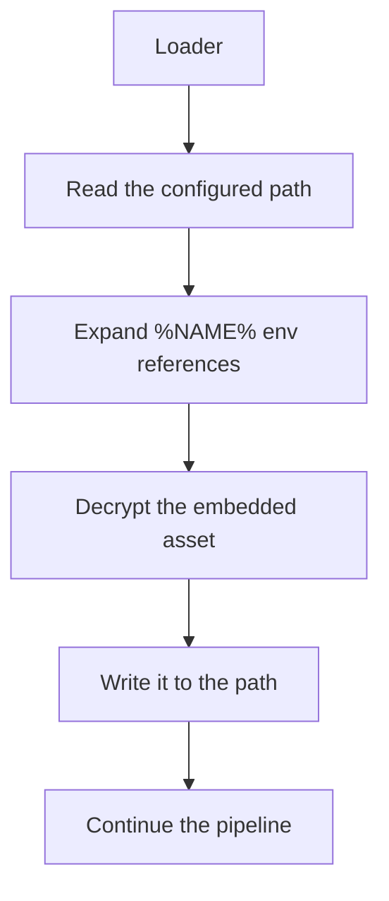

# Drop

*Writes an embedded, encrypted `format: plain` file to a path on the host,
unconditionally, before the payload runs.*

## What it does

`drop` writes an embedded file to disk as a **Preparation** step. It never runs
the payload: it decrypts a `format: plain` asset (embedded and encrypted exactly
like any payload) and writes it to the configured path. It always continues
(`Ok(true)`), so a later step still runs.

It exists to place a file the engagement needs — a document, a lure, a decoy that
a `bouncer` would otherwise only write on rejection — on the target host as part
of the loader, with no second artifact to deliver and no cleartext copy in the
binary.

## How it works

### 1. The destination

`params.path` is rebuilt at runtime through `StringsConfig`, so it never lands in
cleartext in the stub. `%NAME%` references are expanded from the environment
(`%TEMP%\\report.docx`); an unknown name is left as written. A relative path is
resolved against the process's working directory, so `TEST.docx` lands next to
where the artifact (or its host process) was started — not in a temp folder.

### 2. The asset

`params.payload` names a `build.payloads` entry with `format: plain`: raw bytes
the packer embeds and XChaCha20-encrypts like any other payload, but that no
Execution technique runs. The engine injects the ciphertext and an
`asset_bytes()` helper into the step's module; the fragment decrypts only when
the step runs and writes the bytes with `std::fs::write`.

## Integration

A **Preparation** step: the stub runs it before the Execution and it never
receives the payload. Put it anywhere before the step that needs the file. It
interacts with `bouncer`: a `bouncer` `on_reject.action: decoy` writes a file
*only* when
the gate rejects the host, while `drop` writes it *always*; use `drop` for a file
the POC must place regardless of the environment, and the `bouncer` decoy for one
that appears only on a rejected host.

## What it evades

- **A second delivery artifact.** The file travels inside the loader, so there is
  nothing else to stage or drop by hand.
- **Static keyword detection.** The path and the diagnostic are rebuilt at
  runtime; the technique adds no Win32 import (standard-library file I/O only).

## What detects it

- **The write itself.** A file appears at the configured path when the loader
  runs; filesystem monitoring or a post-run diff of the working directory sees
  it. The bytes are the decrypted asset, so a hash of the file matches the
  embedded plaintext, not anything in the binary.
- **Behavior.** A loader that writes a document and then does something with it
  is a signal; the technique only writes, it does not open or execute the file.

## Measurements

- See `docs/measurements.md`: the technique adds no import and grows the artifact
  by the encrypted asset (plus its ciphertext constants).

## Implementation notes

- The asset is an injected step-module constant (`ASSET_ENC` / `ASSET_NONCE` /
  `ASSET_KEY` / `ASSET_LEN`) plus an `asset_bytes()` helper the engine renders.
  `plan::validate` requires the decoy payload to be `format: plain`.
- The path is a required field; an empty `path` is rejected at build time.
- Only one asset per step: `params.payload` names it explicitly (it is not
  inferred), so a plan cannot accidentally drop the execution payload.
- Every runtime string (the path, the diagnostic) goes through `StringsConfig`;
  the fragment carries no string literal.

## References

- MITRE ATT&CK T1027.009 — Obfuscated Files or Information: Embedded Payloads.
