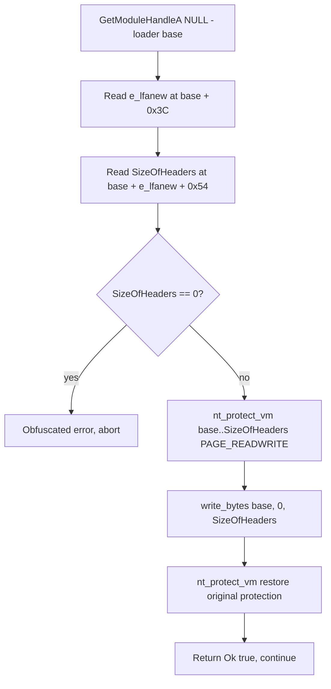

# Erase PE header

*Zeroes the loader image's in-memory PE header, so a scanner that parses PE
headers at the module base finds no DOS or NT headers to walk.*

## What it does

Zeroes the first `SizeOfHeaders` bytes of the loader's own mapped image: the
`IMAGE_DOS_HEADER`, the `IMAGE_NT_HEADERS` (signature, `IMAGE_FILE_HEADER` and
`IMAGE_OPTIONAL_HEADER`) and the section table. After it runs, `base` still
points at a committed, mapped image, but `*(u16*)base` is `0x0000` instead of
`0x5A4D` (`MZ`), `e_lfanew` is zero, `RtlImageNtHeader(base)` / `e_lfanew`-based
lookups return `NULL`, and the section table is gone.

It never runs the payload and takes no payload argument: it only rewrites process
state, which is why it is a **Preparation**. It is `Experimental` because
removing the header removes the loader's own map of itself (see *Implementation
notes*); treat it as a last-step finishing move, not a free win.

## How it works



### 1. Locate the header

1. `GetModuleHandleA(PCSTR::null())` returns the main module's base — the
   loader's own image, already mapped. It is a loader entry point, not a kernel
   call, so it stays a plain Win32 import (like `LoadLibraryA` elsewhere).
2. `e_lfanew` is the `u32` at `base + 0x3C`, the last field of the DOS header;
   it points at the `PE\0\0` signature.
3. `SizeOfHeaders` is the `u32` at `base + e_lfanew + 0x54`. That 0x54 is the
   NT header prefix (4-byte signature + 20-byte `IMAGE_FILE_HEADER`) plus `0x3C`
   into the optional header. `SizeOfHeaders` is at the *same* offset in PE32 and
   PE32+ (the `ImageBase` width difference sits earlier, at optional-header
   offset 24/28, so the fields after it realign), so one read works for both
   stubs.

### 2. Zero it

4. `nt_protect_vm` makes the `[base, base + SizeOfHeaders)` range
   `PAGE_READWRITE`. Unlike `unhook_ntdll`, no code executes inside the range, so
   a plain RW window is enough; there is no RWX dance.
5. `core::ptr::write_bytes(base as *mut u8, 0, SizeOfHeaders)` zeroes the DOS
   header, the NT headers and the section table in one call.
6. A second `nt_protect_vm` restores the original protection, so the header
   pages are not left writable. A failed protect or restore is a loud
   obfuscated error, never a silent skip.

Both protection changes go through the syscall layer (`nt_protect_vm`), so
`build.stub.syscalls.mode: indirect` removes the `VirtualProtectEx` import; the
kernel still sees the event.

## Integration

A **Preparation**, and the *last* one: place it after every other preparation
that reads the loader's header and immediately before the Execution step. In the
example plan it is the step just before `reflective_loading`:

```yaml
runtime:
  - technique: erase_pe_header
  - technique: reflective_loading
```

It is declared **conflicting with `sleep_obfuscation`** (see *Implementation
notes*), so a plan that selects both is rejected. `plan::validate`'s order
advisories do not cover this pair; the conflict list is what stops it.

## What it evades

- **PE-header-based memory scanners.** A scanner that finds modules by walking
  the PEB and then validating `MZ`/`PE\0\0` at the base, or by calling
  `RtlImageNtHeader` / `RtlImageDirectoryEntryToData` on a candidate region,
  gets nothing back for the loader image — the header is zero.
- **Module dumps and header-based forensics.** A dump that reconstructs the
  image from its headers, or reads the section table to size and name regions,
  cannot rebuild this module from memory.
- **Signature engines that key on the DOS/NT header bytes** of the running image
  rather than on disk.
- It is *not* kernel invisibility and *not* full memory invisibility: the mapped
  sections are still there and still executable; only the catalogue at the base
  is gone.

## What detects it

- **The header pages becoming writable.** `nt_protect_vm` on a page mapped from
  an image section is an image-tampering signal; the kernel sees the
  `NtProtectVirtualMemory` call (ETW-TI reports it) and the `write_bytes` that
  follows. `mode: indirect` hides the userland stub, not the kernel event.
- **A missing header.** A scanner that expects `MZ` at the image base and finds
  zeroes flags a manually modified image — that is itself a strong signal, and
  some EDRs alert on it rather than simply skipping the module.
- **Private/committed vs. image pages.** The pages still carry image-backed
  metadata (`MEM_MAPPED` / image type), so a scanner that validates by page type
  rather than by header still sees an image at that base.
- **Anything that then fails.** A live integrity check, a stack walk, or a
  `RtlLookupFunctionEntry` against the loader's now-empty data directories can
  surface the tampering indirectly (see *Implementation notes*).

## Measurements

- Measured end to end on Windows 11 26200 (2026-10-14): the header at the loader's
  image base loses both signatures (`MZ` and `PE\0\0`) while the process keeps
  running and a following Execution step (`reflective_loading`) still runs, so the
  "keep it last among the preparations" rule holds. Numbers:
  `docs/measurements.md`.

## Implementation notes

### It removes the loader's own map of itself

The PE header is what the loader's own process uses to answer questions about
the module:

- **SEH and stack unwinding.** `RtlLookupFunctionEntry` reads the exception
  directory (data directory index 3, in `.pdata`) through the optional header's
  data directory. With the header zeroed, unwinding cannot find the loader's
  unwind info, so a crash or a `panic!` in the loader can no longer unwind
  cleanly. That is why the technique runs last, before only the Execution step.
- **`RtlImageDirectoryEntryToData`-style lookups.** The base-relocation, import,
  resource and TLS directories all live in the optional header. Any step after
  this one that resolves an export or directory through the loader's own header
  gets `NULL`.
- Steps that use their own statically imported functions, call the payload, or
  read *another* module's header are unaffected — the payload's own header and
  other modules' headers are untouched.

### Conflict with `sleep_obfuscation`

`sleep_obfuscation` fetches `GetModuleHandleA(PCSTR::null())` and then reads
`SizeOfImage` (optional-header offset `0x38`) out of the loader's header to size
the region it encrypts. With the header zeroed first, `SizeOfImage` reads `0`
and the step fails. The two are therefore declared mutually exclusive
(`DEF.conflicts`); in a plan that wants both, run the header erase *after* the
last sleep, or drop one.

### The offsets, precisely

| Field | Where | Value |
| --- | --- | --- |
| `e_lfanew` | `base + 0x3C` (`u32`) | offset of `PE\0\0` |
| `SizeOfHeaders` | `base + e_lfanew + 0x54` (`u32`) | 0x54 = 4 (`signature`) + 20 (`FILE_HEADER`) + 0x3C (optional-header field) |

`SizeOfHeaders` is at optional-header offset `0x3C` for both PE32 and PE32+;
`e_lfanew + 0x54` is the whole sum. The `e_lfanew` read is direct and unchecked
because the base comes from the loader itself, which is a valid PE by
construction; only `SizeOfHeaders == 0` (the offsets are not a mapped PE) is
refused, with an obfuscated diagnostic.

### No RWX window, and every string obfuscated

The header is data, never executed, so `PAGE_READWRITE` is correct here and the
protection is restored before the step returns. All four diagnostics go through
`MESSAGES` / `StringsConfig::obfuscate` in `render_fragment`, and the debug
trace uses `crate::tech_dbg!("erase_pe_header", ...)`, so no diagnostic text and
no technique keyword reaches the artifact's strings. `GetModuleHandleA` stays a
Win32 import; only the protection change goes through the syscall layer.

## References

- Microsoft — *PE Format* (`IMAGE_DOS_HEADER`, `IMAGE_NT_HEADERS`,
  `IMAGE_OPTIONAL_HEADER`):
  <https://learn.microsoft.com/en-us/windows/win32/debug/pe-format>
- MITRE ATT&CK T1027 — Obfuscated Files or Information.
