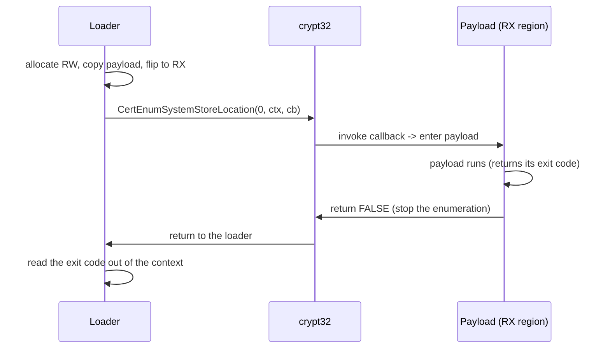

# Callback execution

*Run the payload as the callback of a legitimate Windows enumeration API, so it
is entered from a call the system makes itself instead of a new thread.*

## Metadata

| | |
|---|---|
| **ATT&CK** | T1106 (Native API), T1620 (Reflective Code Loading) |
| **Stability** | Stable |
| **Category** | Execution |
| **YAML key** | `execution_callbacks` |
| **Introduced in** | v0.1.0 (parallel technique batch, schema 6) |

MITRE documents this exact shape under **T1106**: its procedure examples for
BOOKWORM, PUBLOAD, CLAIMLOADER and TONESHELL describe running shellcode "through
the callback function" of a legitimate API (`EnumChildWindows`,
`EnumSystemLanguageGroupsA`, `EnumSystemLocalesA`, `EnumFontsW`, ...). **T1620**
covers the other half — the payload is executed from an in-process allocation
that never existed on disk. **T1055** (the skeleton's placeholder) is *not*
used: no other process is touched, and the sub-techniques cover TLS callbacks
and window procedures, not enumeration callbacks.

## What it does

Runs the decrypted payload as the callback of a legitimate Windows enumeration
API in the current process, so the code is entered from a call the system makes
itself instead of from a dedicated thread.

## YAML parameters

| Parameter | Type | Required | Default | Description |
|-----------|------|----------|---------|-------------|
| `payload` | string | no | the only declared payload | Name of the payload in `build.payloads` to run |

The payload must be `format: shellcode`: the callback is entered as flat
position-independent code. `plan::validate` rejects any other format at build
time, and the fragment additionally refuses a payload that looks like a PE image
at run time (see "Implementation notes").

## YAML example

```yaml
build:
  payloads:
    implant:
      source: ./payload.bin
      format: shellcode
runtime:
  - technique: execution_callbacks
    params:
      payload: implant
```

## How it works



### 1. Stage the payload region

1. Allocate the payload region with `NtAllocateVirtualMemory` (through the
   syscall layer's `nt_alloc_vm` helper) as
   `MEM_COMMIT | MEM_RESERVE` + `PAGE_READWRITE`.
2. Copy the decrypted payload into it and flip the region to
   `PAGE_EXECUTE_READ` with `nt_protect_vm`, so **no RWX page is ever live**.
3. Resolve `crypt32.dll!CertEnumSystemStoreLocation` dynamically
   (`LoadLibraryA` + `GetProcAddress`; both names are rebuilt at runtime from
   obfuscated bytes).
### 2. Run the payload through the enumeration

4. Call it with `dwFlags = 0`, a pointer to a small context
   (`CallbackContext`: the payload's entry point, a ran-once flag, the exit-code
   slot) and the module's own callback function. The system enumerates the
   system certificate store locations and invokes the callback for the first one
   (`CurrentUser`).
5. The callback enters the payload (`fn() -> u32` in the RX region), records the
   return value in the context and returns `FALSE`.
6. `FALSE` stops the enumeration; the API returns to the loader, which reads the
   payload's exit code out of the context and returns it to the step runner.

The payload therefore runs on the loader's own thread, inside a crypt32 frame,
with no `CreateThread`/`NtCreateThreadEx` anywhere in the chain — the two frames
below the payload are `CertEnumSystemStoreLocation` and the callback wrapper.

### Why a wrapper instead of pointing the API at the payload

The classic PoC (`CertEnumSystemStoreLocation(0, NULL, (PFN)shellcode)`) makes
the shellcode *be* the callback. Two problems with that here:

- the enumeration continues while the callback returns non-zero, so a shellcode
  whose exit code is not `0` is invoked again for the next store location — the
  payload would run several times;
- the payload's return value would double as the enumeration's
  continue/stop flag, and the loader would have no exit code to report to the
  schema-6 step runner.

A compiled wrapper in the module also keeps the **callback address inside a
mapped image** (the loader's `.text`) instead of in an unbacked private
allocation: the anomaly an EDR sees is "an RX private region is entered", not
"a private region is registered as a system callback".

### Candidate callbacks

| API | Library | Needs | Callback count | Notes |
|-----|---------|-------|----------------|-------|
| `CertEnumSystemStoreLocation` | crypt32 | nothing | 8 store locations, 1 with the early stop | **Used.** No handle, no window, no UI; deterministic list of locations |
| `CertEnumSystemStore` / `CertEnumPhysicalStore` | crypt32 | a store location / a store name | per store | Same shape, one more argument to satisfy |
| `EnumDesktopsW` | user32 | `GetProcessWindowStation()` | per desktop | Works in Session 0 (the service window station has a desktop), but adds a user32 import and a handle to carry |
| `EnumDesktopWindows` / `EnumWindows` | user32 | an interactive desktop with windows | per window | **Not used:** a Session 0 service desktop has no windows, so the callback never fires and the payload never runs |
| `CreateTimerQueueTimer` | kernel32 | a timer queue | one per timer | Already used by `sleep_obfuscation`; it is a *thread* (the timer dispatch thread), so it is not "no new thread" |

Cert32's enumeration is the only candidate that (a) runs in any process,
including a service without a window station, and (b) has a fixed, documented
set of callbacks, so the payload is guaranteed to be invoked exactly once.

## What it evades

- **No thread is created for the payload.** `CreateThread`,
  `NtCreateThreadEx`, `QueueUserAPC` and friends never appear: the payload runs
  on the thread that called the enumeration. Thread-creation telemetry (kernel
  `PsSetCreateThreadNotifyRoutine`, ETW, `NtCreateThreadEx` hooks) sees nothing.
- **No RWX allocation**: the payload region is written as read+write and only
  then made read+execute, so the "private RWX region" signature never exists.
- **No cross-process write**: everything happens inside the loader's own
  process, so there is no `WriteProcessMemory`-shaped telemetry.
- **Entry point is a system-API frame**: a naive stack walk that stops at the
  first module it recognizes below the payload sees `crypt32.dll`'s enumeration,
  not a loader frame.
- **The callback API is not imported.** The names (`crypt32.dll`,
  `CertEnumSystemStoreLocation`) are rebuilt at runtime from obfuscated bytes, so
  neither appears in the binary's `.rdata` nor in the IAT.

## What detects it

- **Userland hooks on the enumeration itself.** EDRs commonly hook crypt32's
  certificate enumeration (it is a known callback-execution primitive) and
  flag a callback pointer that does not belong to a loaded image — the payload
  region is not in `PEB->Ldr`, so a *deep* stack walk reaches an unbacked
  region one frame under a module address.
- **`ETW-TI` / kernel telemetry** on the allocation: a private
  `PAGE_EXECUTE_READ` region that was written and then executed
  (`NtAllocateVirtualMemory` → `NtProtectVirtualMemory` → execution) is the
  canonical "in-memory code" sequence, whichever API starts it.
- **Static**: in `syscalls.mode: none` the stub imports
  `VirtualAllocEx`/`VirtualProtectEx` (the helpers' Win32 mapping) and
  `LoadLibraryA`/`GetProcAddress`; with `mode: indirect` only the latter pair
  remains. The libraries the stub does not use are not in the IAT at all.
- **Static (diagnostics)**: every error message is obfuscated — `MESSAGES` in
  `mod.rs` feeds `render_fragment_for`, which rebuilds each one at run time — so
  no diagnostic text and no technique keyword reaches `.rdata`.

## Measurements

- Static baseline: `docs/measurements.md` (add a section for the artifact built
  from `code_examples/execution_callbacks/smoke.yaml`; the fragment's IAT
  footprint with `syscalls.mode: none` is `VirtualAllocEx`, `VirtualProtectEx`,
  `LoadLibraryA` and `GetProcAddress` plus the runtime's own imports).
- API behaviour measured on `x86_64-pc-windows-msvc`, Windows 10.0.26200
  (scratch probes, `code_examples/execution_callbacks/probe1.rs` and
  `probe2.rs`):
  - `CertEnumSystemStoreLocation(0, NULL, cb)` invokes the callback **8 times**
    (`CurrentUser`, `LocalMachine`, `CurrentService`, `Services`, `Users`,
    `CurrentUserGroupPolicy`, `LocalMachineGroupPolicy`,
    `LocalMachineEnterprise`) and returns `TRUE`;
  - a callback that returns `FALSE` on its first call is invoked **once**, and
    the outer call returns `FALSE` — that return value is the "the callback
    stopped the enumeration" signal, **not** an error, which is why the fragment
    ignores it;
  - the `pvArg` pointer is forwarded to the callback, and a compiled
    `extern "system" fn() -> u32` called from inside the callback returns its
    value (`42`) to the loader after the enumeration returns — the exit-code
    plumbing works end to end.

## Implementation notes

- **Only `format: shellcode` can run.** `plan::validate` rejects a
  `pe`/`dll`/`dotnet` payload for `execution_callbacks` at build time, and
  `execute_payload` additionally rejects a payload that looks like a PE image
  (`MZ` + a valid `PE\0\0` at `e_lfanew`) with a clear diagnostic instead of
  jumping into a DOS header.
- The fragment declares its own copies of `PFN_CERT_ENUM_SYSTEM_STORE_LOCATION`
  and `CertEnumSystemStoreLocation` (`extern "system"` = stdcall on x86, where
  the callee pops the arguments, so the argument lists must match exactly) —
  crypt32's declarations are not in the `windows` feature set the stub links, and
  a static import would put the API's name in the IAT.
- The region is leaked on purpose (the payload may have spawned work that
  outlives the enumeration call), the same lifetime rule the shellcode runner of
  `reflective_loading` follows.
- `patch_command_line()` runs first, so shellcode that reads the PEB command line
  sees `<exe> <yaml args> <runtime args>`.
- The enumerated location string and the other arguments are ignored: the
  callback signature takes all four parameters so the ABI is right, and the
  payload gets no arguments (shellcode with a `fn() -> u32` contract).
- The technique is arch-neutral (`x64` and `x86`): the enumeration, the
  read+write → read+execute flip and the callback ABI are the same on both. Both
  stubs compile and both were run end to end (`code_examples/execution_callbacks/`
  `smoke.yaml` and `smoke-x86.yaml`; each returns the payload's exit code).
- If the enumeration never invokes the callback, the step fails with a
  diagnostic instead of reporting a fabricated exit code.

## References

- MITRE ATT&CK T1106 — Native API. Its procedure examples (BOOKWORM, PUBLOAD,
  CLAIMLOADER, TONESHELL, Hancitor) document "running shellcode through the
  callback function" of a legitimate API:
  <https://attack.mitre.org/techniques/T1106/>
- MITRE ATT&CK T1620 — Reflective Code Loading:
  <https://attack.mitre.org/techniques/T1620/>
- Microsoft, `CertEnumSystemStoreLocation`:
  <https://learn.microsoft.com/en-us/windows/win32/api/wincrypt/nf-wincrypt-certenumsystemstorelocation>
- Microsoft, `PFN_CERT_ENUM_SYSTEM_STORE_LOCATION`:
  <https://learn.microsoft.com/en-us/windows/win32/api/wincrypt/nc-wincrypt-pfn_cert_enum_system_store_location>
- `aahmad097/AlternativeShellcodeExec` — the reference catalogue of
  callback-based shellcode execution (~50 APIs, `CertEnumSystemStoreLocation`
  among them): <https://github.com/aahmad097/AlternativeShellcodeExec>

Local copies of the fetched pages, the probe sources and the raw measurement
output: `code_examples/execution_callbacks/` (`NOTES.md`, `refs/`).
