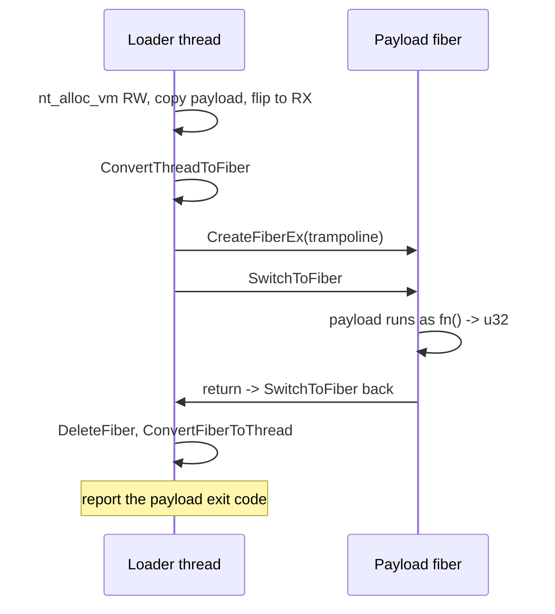

# Fiber execution

*Run the payload on a fiber of the loader's own thread, so it never owns a
thread, control returns to the loader, and the step stays chainable.*

## Metadata

| | |
|---|---|
| **ATT&CK** | T1055 (Process Injection) — ATT&CK has no fiber-specific sub-technique (T1055.001–T1055.015 cover DLL injection, APC, TLS, hollowing, VDSO hijacking, …); scheduling the payload on a fiber of the loader's own thread is a self-injection variant, so the parent is the precise mapping. |
| **Stability** | Stable |
| **Category** | Execution |
| **YAML key** | `fibers` |
| **Introduced in** | unreleased (fiber-execution suite) |

## What it does

Runs the decrypted payload on a fiber created in the loader's own process, so
the payload never owns a thread: control returns to the loader when the payload
returns, and the step stays chainable. The payload needs no external process,
no `CreateProcess` and no new thread.

## YAML parameters

| Parameter | Type | Required | Default | Description |
|-----------|------|----------|---------|-------------|
| `payload` | string | no | the only declared payload (required with two or more) | Name of the payload in `build.payloads` to run |

## YAML example

```yaml
build:
  payloads:
    implant:
      source: ./beacon.bin
      format: shellcode
runtime:
  - technique: fibers
    params:
      payload: implant
```

## Payload format

`fibers` runs `format: shellcode` only. Raw code needs no mapping, no imports
and no relocations — exactly what a fiber start routine gets — so the bytes are
copied once into an executable region and the fiber starts there. A
`pe`/`dll`/`dotnet` payload needs a mapper (imports, relocations, TLS, a managed
runtime), which is `reflective_loading`'s job. `plan::validate` rejects the
combination at build time, and the fragment additionally refuses such a payload
with a clear error instead of jumping into a file header.

## How it works



### 1. Stage the payload region

1. Copy the decrypted payload into a private region (`nt_alloc_vm`,
   `PAGE_READWRITE`). The region is dedicated, not the buffer's own heap pages:
   the loader's fiber state is a heap allocation too, and the two can share a
   page — making that page RX breaks the fiber switch (measured, see the
   implementation notes).
### 2. Schedule the payload fiber

2. Convert the calling thread to a fiber (`ConvertThreadToFiber`): only a fiber
   can schedule another fiber.
3. Create the payload fiber (`CreateFiberEx`) with `payload_fiber` — a Rust
   trampoline — as its start routine and a context (payload address, loader
   fiber, exit-code slot) as its parameter.
4. Make the region executable (`nt_protect_vm`, `PAGE_EXECUTE_READ`).
5. `SwitchToFiber` to the payload fiber. The trampoline enters the payload as
   `extern "system" fn() -> u32` (no arguments, exit code in `eax`/`rax`), the
   same contract `reflective_loading` gives shellcode.
### 3. Return to the loader and clean up

6. When the payload returns, the trampoline stores its exit code and schedules
   the loader's fiber again (`SwitchToFiber`) — it never *returns*, because a
   returning fiber function makes the current thread exit.
7. The loader deletes the payload fiber (`DeleteFiber`, safe: it is suspended
   inside its switch back), converts the thread back (`ConvertFiberToThread`,
   after the last fiber call) and reports the payload's exit code.

## What it evades

- **No thread is created.** `CreateFiberEx` is a kernel32/kernelbase routine —
  a fiber is a user-mode stack and context, not a thread object. There is no
  `CreateThread`/`NtCreateThreadEx` call, so thread-creation telemetry
  (ETW thread-start events, kernel thread-notify callbacks, thread enumeration)
  sees nothing.
- **No RWX and no thread creation in the memory telemetry.** The payload region
  is created RW and only then flipped to RX (W^X): it is never
  writable-and-executable, and the reflective-shellcode-runner's
  `CreateThread`/`GetExitCodeThread` pair is absent.
- **The payload bytes never touch disk** (the stub decrypts them in memory).
- **No executable heap.** The region is private memory that is only ever RW and
  then RX — never writable-and-executable — and the heap that holds the
  loader's fiber state and the decrypted buffer is never made executable.

## What detects it

- **Userland API hooks.** The technique is one kernel32 call chain —
  `ConvertThreadToFiber` → `CreateFiberEx` → `SwitchToFiber` (→ `DeleteFiber`,
  `ConvertFiberToThread`). EDRs hook these fiber APIs; `syscalls.mode: indirect`
  cannot hide them, because they are not syscalls.
- **The static IAT.** The artifact imports `ConvertThreadToFiber`,
  `CreateFiberEx`, `SwitchToFiber`, `DeleteFiber`, `ConvertFiberToThread` (plus
  `GetCurrentProcess`). That import block is the technique's static signature —
  see *Static footprint* below.
- **ETW-TI / kernel callbacks.** The `nt_alloc_vm`/`nt_protect_vm` pair that
  creates the region and flips it to `PAGE_EXECUTE_READ` surfaces in
  `Microsoft-Windows-Threat-Intelligence`; switching the syscall layer to
  `mode: indirect` removes the Win32 imports but not the syscalls themselves.
- **Unbacked executable memory.** The region is private and not backed by a
  file; scanners that hunt unbacked/private executable memory (PE-sieve-style)
  and YARA rules over the in-memory payload find it the same way they find it on
  disk. The decrypted payload also stays in the stub's heap (the runner does not
  wipe it).
- **The payload's own behavior** once it runs — the fiber option changes where
  the code runs, not what it does.
- Detection that only watches for new threads sees nothing; that is the point
  of the technique, so the detection has to come from the API/memory side.

Unlike `reflective_loading`, the payload shares the loader's thread: an
`ExitThread`/`ExitProcess` from the payload ends the loader as well.

## Measurements

A static and runtime baseline is recorded in `docs/measurements.md`. What was
measured on this branch:

### Static footprint (measured)

Two artifacts built from the same 6-byte shellcode payload
(`examples/payloads/demo_shellcode.bin`), audited with `picaro audit --json`
(the artifacts themselves are never executed):

| | `fibers` | `reflective_loading` (shellcode runner) |
|---|---|---|
| file size | 380 416 B | 379 392 B |
| imports only this one has | `ConvertThreadToFiber`, `CreateFiberEx`, `SwitchToFiber`, `DeleteFiber`, `ConvertFiberToThread`, `VirtualProtectEx` | `CreateThread`, `GetExitCodeThread` |

Read as a delta against the reflective shellcode runner (the closest sibling:
also in-process, also no PE mapping):

- **No thread.** `CreateThread` and `GetExitCodeThread` are gone; the payload
  runs on a fiber of the loader's own thread.
- **The fiber entry points are the technique's static signature** and cannot be
  hidden — they are kernel32 routines, not syscalls. `VirtualProtectEx` appears
  only with `build.stub.syscalls.mode: none`; with `mode: indirect` the
  allocation and the protection change are syscalls
  (`NtAllocateVirtualMemory`, `NtProtectVirtualMemory`) and the import
  disappears.
- Section entropy is essentially unchanged (`.text` 6.275 vs 6.273 bits/byte,
  `.rdata` 5.161 vs 5.154, `.data` 2.033 vs 2.024, `.pdata` 5.568 vs 5.553);
  the string scan finds no sensitive or technique strings and the offline
  Defender verdict is clean for both.
- The two plans, the artifacts and their audit JSON live in
  `code_examples/fibers/` (gitignored local scratch).

### Runtime checks (measured)

A standalone probe (`code_examples/fibers/harness/`, windows-rs bindings, a
`mov eax, 42; ret` "payload") verified on a real Windows host:

- the payload's `eax` returns as the step's exit code (42) and the loader
  resumes after the switch back;
- a second `fibers` run on the same thread works — `ConvertFiberToThread`
  leaves the thread convertible again, which is what makes a chain of `fibers`
  steps work;
- a fiber function that returns **ends the process silently** (exit code 0,
  no resume) — the trampoline's explicit switch back is required, not a
  stylistic choice;
- protecting the decrypted buffer's own heap pages **hangs the switch** when the
  loader's fiber state shares the page (reproduced by forcing the collision).

The generated stub also compiles for **i686**
(`compiles_a_fibers_stub_for_i686`), so the technique's `requires` list is
honest: the fragment is arch-neutral (`extern "system"` is stdcall on x86, the
shape `PFIBER_START_ROUTINE` uses).

With `build.stub.debug: true` the loader logs
`payload mapped at 0x... (... bytes), scheduling the payload fiber` and
`the payload fiber returned <code>`. The packed artifact was then run end to end
(`code_examples/fibers/smoke.yaml`): it runs the demo shellcode and relays the
payload's exit code (`42`).

## Implementation notes

- **Trampoline ABIs.** The fiber start routine is
  `unsafe extern "system" fn(*mut c_void)` (the `PFIBER_START_ROUTINE` shape);
  the payload is entered as `unsafe extern "system" fn() -> u32`, the same
  contract as `reflective_loading`'s shellcode runner (`extern "system"` is
  stdcall on x86, matching `WINAPI`). No argument is passed: a payload that
  expects its own configuration block is out of scope, because the YAML has no
  way to describe one.
- **The region is not in-place, and that was measured.** The first design
  protected the decrypted buffer's own pages. A standalone probe
  (`code_examples/fibers/harness/`) showed the loader's fiber state and a small
  payload buffer landing 32 bytes apart in the same heap page: making that page
  RX is fatal, because `SwitchToFiber` saves the loader's context into the
  fiber state — the process hangs in the switch (reproduced by forcing the
  collision). A dedicated region removes the sharing by construction.
- **The region is intentionally leaked**, like `reflective_loading`'s shellcode
  region: the payload may have spawned work that keeps running from its own
  image after its entry point returned, and the stub has no
  `NtFreeVirtualMemory` helper (`nt_free_vm`) to release it. A payload that
  writes to its own image is out of scope (the region is RX).
- **A payload that never returns never gives the thread back.** An endless
  loop hangs the stub; `ExitThread`/`ExitProcess` kills it. There is no timeout
  to enforce — while the payload runs, it owns the loader's thread. This is why
  the fragment passes the command line (`patch_command_line`) first, like
  `reflective_loading`, and why a payload that manipulates fibers itself is
  unsupported.
- **Fiber functions that return kill the thread.** Verified with the probe: the
  process ended silently (exit code 0) right after the fiber function returned
  without switching back. The trampoline therefore switches back explicitly, and
  the loader deletes the payload fiber while it is suspended at that switch.
- **Thread state is restored.** The thread is converted back with
  `ConvertFiberToThread` after `DeleteFiber` (documented: no fiber call may
  follow the conversion), so a later `fibers` step in the same chain starts
  from a plain thread again. If the thread is *already* a fiber when the step
  runs (a foreign stub converted it), `ConvertThreadToFiber` fails and the step
  returns a clear error: windows-rs exposes no `GetCurrentFiber` (`FiberData`
  lives in the TEB and would need hand-written assembly), and without that
  handle the payload fiber could never schedule the loader again.
- **`FIBER_FLAG_FLOAT_SWITCH`** is set on `CreateFiberEx` so the payload's
  floating-point state is switched on x86 (on x64 it is part of the fiber
  context); without it a payload using the x87 stack would corrupt the loader's
  state. Like `reflective_loading`'s thread, the fiber starts with a fresh FP
  state.
- **Command line.** `patch_command_line()` repoints the PEB (and kernelbase's
  cached pointer) at `<exe> <yaml args> <runtime args>` before the payload runs,
  so shellcode reading `GetCommandLineW` sees `build.payloads.<name>.args` — the
  same behavior as `reflective_loading`.
- **Every runtime string goes through `StringsConfig`**: the error messages are
  rebuilt from obfuscated bytes at render time, and the format guard's message
  is obfuscated too (dead code for a shellcode payload).
- **Why a copy.** The region is dedicated, not the buffer's own heap pages:
  see the measured hazard above. One consequence is that the payload cannot
  write to its own image (the region is RX); another is that the decrypted
  buffer stays in the stub's heap untouched, since the technique reads it once
  to make the copy.
- Nothing of the payload's own state (fiber-local storage, fibers it creates
  itself) is cleaned up; only the loader's fibers and the thread conversion are.
- Fiber creation is not a syscall, so this technique cannot be made
  import-free: `ConvertThreadToFiber`, `CreateFiberEx`, `SwitchToFiber`,
  `DeleteFiber` and `ConvertFiberToThread` will always be visible in the IAT.

## References

- ired.team, *Shellcode Execution through Fibers* —
  <https://www.ired.team/offensive-security/code-injection-process-injection/executing-shellcode-with-createfiber>
  (local copy: `code_examples/fibers/refs/ired-team-fibers.md`).
- Microsoft Learn, *Using Fibers* —
  <https://learn.microsoft.com/en-us/windows/win32/procthread/using-fibers>
  (the sample states that a returning fiber function exits the current thread;
  local copy: `code_examples/fibers/refs/msdn-using-fibers.md`).
- Microsoft Learn, *CreateFiberEx* and *FiberProc* —
  <https://learn.microsoft.com/en-us/windows/win32/api/winbase/nf-winbase-createfiberex>,
  <https://learn.microsoft.com/en-us/windows/win32/api/winbase/nc-winbase-pfiber_start_routine>.
- Microsoft Learn, *ConvertThreadToFiber* / *ConvertFiberToThread* /
  *SwitchToFiber* (conversion requirements and cleanup order) —
  <https://learn.microsoft.com/en-us/windows/win32/api/winbase/nf-winbase-convertthreadtofiber>,
  <https://learn.microsoft.com/en-us/windows/win32/api/winbase/nf-winbase-convertfibertothread>,
  <https://learn.microsoft.com/en-us/windows/win32/api/winbase/nf-winbase-switchtofiber>.
- MITRE ATT&CK T1055, *Process Injection* (sub-technique list; no fiber
  sub-technique) — <https://attack.mitre.org/techniques/T1055/>.
