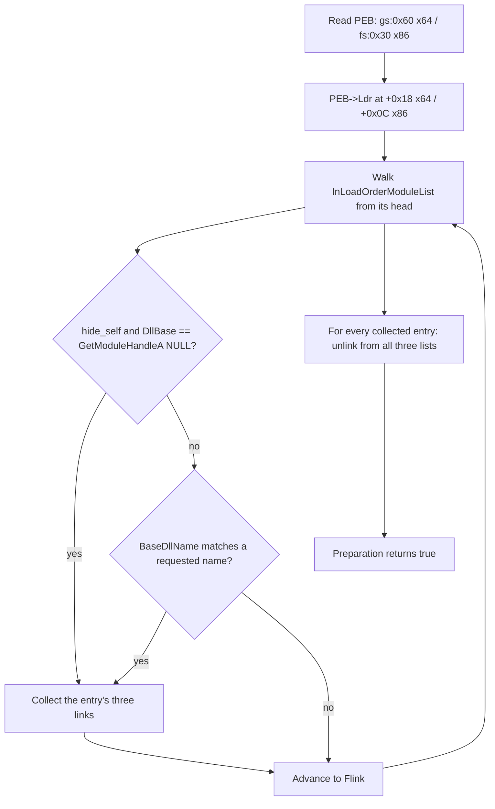

# Hide module

*Unlinks a module from the PEB's three loader lists, so userland PEB walkers can
no longer enumerate it while its code and data stay mapped.*

## What it does

Removes one or more modules — and, by default, the running image itself — from
the three doubly-linked lists the Windows loader keeps in `PEB->Ldr`
(`InLoadOrderModuleList`, `InMemoryOrderModuleList`,
`InInitOrderModuleList`). The module's memory is untouched: its code, data and
export table stay where the loader mapped them, and any pointer already resolved
into them keeps working. Only the loader's bookkeeping stops mentioning the
module, so a walk of `PEB->Ldr` — what `EnumProcessModules`, `GetModuleHandleA`
and `GetProcAddress` by name are built on — no longer finds it.

It is a **Preparation** technique: it edits the current process's own loader
metadata and never runs the payload. It applies to the process the loader is
running in — the host's, in a `kind: dll` build, and the stub's own in every
other build.

## How it works

### 1. Walk the loader lists

1. Reads the PEB (`gs:[0x60]` on x64, `fs:[0x30]` on x86) and follows `Ldr`
   (`0x18` on x64, `0x0C` on x86) to the `PEB_LDR_DATA`.
2. Walks the **InLoadOrderModuleList** (`0x10` on x64, `0x0C` on x86). Its
   `Flink` points straight at an `LDR_DATA_TABLE_ENTRY`'s `InLoadOrderLinks`,
   which is that entry's offset 0 — so each `Flink` is an entry base. The walk
   stops when `Flink` returns to the list head (and is capped defensively).
3. For each entry it reads `DllBase` (`0x30` on x64, `0x18` on x86) and the
   `BaseDllName` `UNICODE_STRING` (`0x58` on x64, `0x2C` on x86): `Length` in
   bytes, then `Length / 2` UTF-16 code units from `Buffer`.

### 2. Match and unlink

4. An entry matches when `hide_self` is set and its `DllBase` equals
   `GetModuleHandleA(NULL)` (the running image), or when its `BaseDllName`
   equals (ASCII case-insensitively) one of the requested `modules`.
5. Every matched entry is collected first, then unlinked from all three lists by
   the standard `LIST_ENTRY` removal
   (`(*(*link).Flink).Blink = (*link).Blink; (*(*link).Blink).Flink = (*link).Flink`).
   Collecting before unlinking matters: a list must not be walked while it is
   being modified.
6. A name listed in `modules` that the process does not have is an error — the
   plan asked for something impossible. `hide_self` is best effort; a failure to
   find the running image does not stop the step. Either way a Preparation
   returns `Ok(true)`, so the chain continues.

## Integration

A **Preparation** step: it belongs in `runtime:` *before* the Execution and never
receives the payload. Place it late among the preparations — after any step that
resolves something by name — but before the Execution step and before any
payload code that walks the loader lists. It pairs naturally with the in-process
runners (`reflective_loading`, `fibers`, `module_stomping`): hiding the loader's
own image is what makes an in-memory payload stop looking like it lives inside
a freshly mapped anonymous region with a DLL behind it.

Do **not** name a system module (`ntdll`, `kernel32`, `kernelbase`). Unlinking
one removes it from the lists that the loader itself and countless libraries
walk at runtime, and any later step (or the payload) that resolves an export by
name through those lists will no longer find it. The same warning applies to any
module a later step or the payload resolves by name: after this step, it is
invisible to a name lookup even though its code still runs.

## What it evades

- **Userland PEB walkers.** `EnumProcessModules` / `EnumProcessModulesEx`,
  `GetModuleHandleA` / `GetModuleHandleW` by name, `GetProcAddress` by name, and
  any hand-rolled walk of `PEB->Ldr` see one fewer module. A scanner that looks
  for the loader's own module by walking the lists finds nothing.
- **Name-based module triage.** Tools that ask "which modules are loaded here?"
  through the loader lists (a common in-process EDR/telemetry pattern) come up
  short.

## What detects it

- **Kernel-backed enumerations.** `CreateToolhelp32Snapshot(TH32CS_SNAPMODULE)` /
  `Module32FirstW` / `Module32NextW`, `NtQueryVirtualMemory`, and the loaded
  module list the kernel keeps independently do **not** read `PEB->Ldr`; they
  still report the module. The gap between "the PEB walk" and "the ToolHelp
  walk" is itself a strong indicator.
- **`GetModuleHandleA(NULL)` keeps working.** The PEB's `ImageBaseAddress` is a
  separate field and is left untouched, so a check that only asks for the main
  image's base still succeeds.
- **Stale links.** The unlink leaves the removed entry's own `Flink`/`Blink`
  pointing at its former neighbours; a scan that reads the raw entry (via a
  still-live pointer) can still walk back into the list, and the orphaned
  `LIST_ENTRY` bytes are a forensic artifact.
- **Memory-region mismatch.** `VirtualQuery` on the payload's memory with no
  owning module in the loader list is exactly the shape of a manually mapped
  image.

## Measurements

- Measured end to end on Windows 11 26200 (2026-10-14): after the step, a payload
  running in the same process finds the loader invisible to the userland module
  enumerator (`K32EnumProcessModules`) while its in-memory header stays intact and
  the chain keeps running. The walk found four modules and matched the self entry,
  and **two** of its three links were removed — see the note below. Numbers:
  `docs/measurements.md`.

## Implementation notes

- Each link is removed only when both of its neighbours point back at the entry
  (the standard integrity test). **Measured:** on Windows 11 26200 the main image
  is not a member of the initialization-order list — its
  `InInitializationOrderLinks` are null — so an unguarded unlink writes through a
  null pointer and takes the process down. `InLoadOrderLinks` at entry +0,
  `InMemoryOrderLinks` at +0x10 (x64) / +0x08 (x86), `InInitOrderLinks` at +0x20
  (x64) / +0x10 (x86).
- The list heads are `InLoadOrderModuleList` at `PEB_LDR_DATA` +0x10 (x64) /
  +0x0C (x86), `InMemoryOrderModuleList` at +0x20 / +0x14, and
  `InInitOrderModuleList` at +0x30 / +0x1C. `Flink` is at +0 and `Blink` at
  +8 (x64) / +4 (x86) within every `LIST_ENTRY`; the removal uses
  `size_of::<usize>()` for the `Blink` offset, so one implementation serves both
  widths.
- The PEB read (`gs:[0x60]` / `fs:[0x30]`) is the same approach as
  `engine/args.rs`; each step is its own module, so the helper is a local copy
  rather than a shared one.
- No syscall-layer helper is needed (`syscalls: []`): the unlink is a plain
  memory store into the process's own read-write loader lists.
  `GetModuleHandleA` is a loader entry point, not a kernel call the stub issues.
- The module names are per-build strings and always go through
  `StringsConfig::obfuscate`, as does every diagnostic; nothing the step uses at
  runtime appears in cleartext in the artifact's `.rdata`.

## References

- MITRE ATT&CK T1014 — Rootkit: the userland module/loader-list hiding primitive.
- Microsoft, `PEB_LDR_DATA` / `LDR_DATA_TABLE_ENTRY` and the loader's three
  module lists; `EnumProcessModules`, `GetModuleHandleA`,
  `CreateToolhelp32Snapshot`.
- Offensive Windows-internals literature on unlinking a module from the PEB
  loader lists (a standard "module hiding" step).
