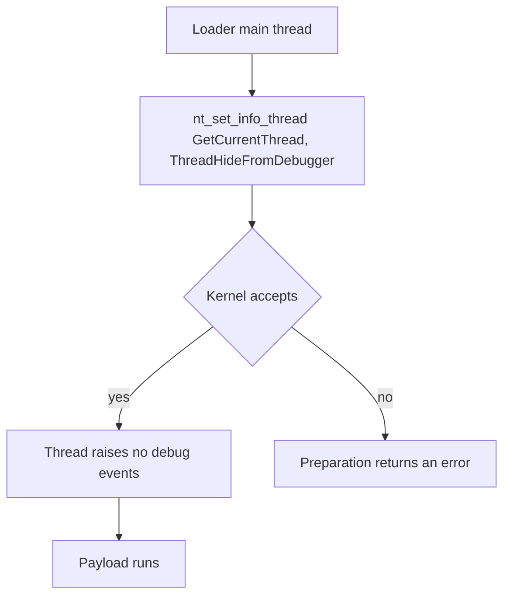

# Hide thread from debugger

*Sets `ThreadHideFromDebugger` on the loader's main thread, so its debug events
stop reaching any debugger attached to the process.*

## What it does

Calls `NtSetInformationThread(GetCurrentThread(), ThreadHideFromDebugger, …)`
(class `0x11`) through the syscall layer. The current thread is marked hidden
from any debugger: from then on it raises no debug events. It does not run the
payload; it only modifies thread state, which is why it is a Preparation
technique.

## How it works

### 1. Mark the thread hidden

1. Take the current thread's pseudo-handle (`GetCurrentThread()`, `-2`).
2. Call `nt_set_info_thread` with the `ThreadHideFromDebugger` class (`0x11`), a
   null information block and size 0 — `NtSetInformationThread` in `mode: none`,
   the gadget in `mode: indirect`.

### 2. Effect

3. The kernel sets the thread's `HideFromDebugger` flag. From then on the thread
   produces no debug events: a breakpoint or exception on it never reaches the
   debugger, so the debugger can no longer single-step or break on that thread.
   Measured on Windows 11 26200 (see below), the *session* is not torn down by
   the call itself — x64dbg keeps its session and still reports the process's
   exit code — what disappears is the thread's event stream.

## Integration

A **Preparation** step: the stub runs it before the Execution and it never
receives the payload. It pairs with `anti_debug`: `anti_debug` *detects* a
debugger, this one blinds it. Place it early, before the payload runs, and any
time after `anti_debug` if both are used.

It covers only the **thread that runs it** (the loader's main thread). A debugger
watching another thread of the process is unaffected; hiding every thread needs
`OpenThread` on each, which is a separate technique.

## What it evades

- A debugger attached to the loader's process: it can no longer see any debug
  event (breakpoint, exception) raised by the main thread.
- Debug-event-driven analysis of that thread (some sandboxes and analysts attach a
  debugger first).

## What detects it

- The `ThreadHideFromDebugger` flag is readable: a debugger or an EDR can query
  the thread's information class and see the flag set.
- The `NtSetInformationThread` call in the process's timeline (no kernel32
  wrapper is involved, so a hook on `SetThreadInformation` sees nothing).
- A debugger that loses the main thread's event stream while the process keeps
  running is itself a signal.

## Measurements

- Measured 2026-10-14 (Windows 11 26200, Defender real-time off).
  - **The Win32 wrapper rejects the class**: `SetThreadInformation(h, 0x11, …)`
    fails with `ERROR_INVALID_PARAMETER` (`0x57`) for a null/1/4/8-byte
    information block, while `NtSetInformationThread(h, 0x11, null, 0)` returns
    `STATUS_SUCCESS`. That is why the fragment calls the native API through the
    syscall layer.
  - **The event stream is the measured effect.** With an `int3` in the payload
    (reflectively loaded on the loader's main thread), the control build's
    breakpoint is seen by the debugger and the hidden build's is not:
    - x64dbg (headless): control logs the breakpoint
      (`Last chance exception … (80000003, EXCEPTION_BREAKPOINT)`); hidden build
      logs no exception at all and reports the process's
      `0x80000003 (STATUS_BREAKPOINT)` exit — the breakpoint went straight to the
      process as unhandled.
    - the local child-following debugger (`DEBUG_PROCESS`): control logs
      `BREAKPOINT seen at 0x1400011c8`; hidden build receives **no event at all**
      (no breakpoint, no exit) — the debug port goes silent for that thread.
  - Without a debugger both builds behave identically (the `int3` kills the
    process as unhandled; the step itself is inert). The e2e
    (`hide_thread_from_debugger_is_inert_without_a_debugger`) asserts the step
    completes and the chain still reaches the payload.

## Implementation notes

- The call goes through the syscall layer (`syscalls: ["NtSetInformationThread"]`):
  kernel32's `SetThreadInformation` does not support the class (measured), and a
  kernel-facing call belongs behind `nt_*` so `mode: indirect` routes it through
  the gadget too.
- The class constant is a plain `i32` (`0x11`): the `windows` binding defines the
  `THREAD_INFORMATION_CLASS` enum but not this member.
- The current thread's pseudo-handle (`-2`) is accepted, the same handle
  `anti_debug` passes to `nt_get_context_thread`.
- x86 and x64: the call and its class value are architecture-neutral.

## References

- Microsoft, `NtSetInformationThread` / `THREADINFOCLASS.ThreadHideFromDebugger`.
- MITRE ATT&CK T1622 — Debugger Evasion.
