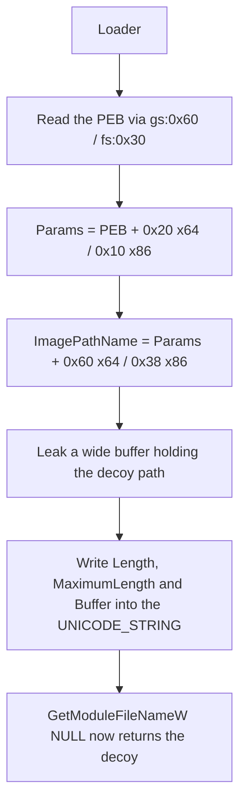

# Image path spoofing

*Repoints the process's PEB `ImagePathName` at a decoy path, so
`GetModuleFileNameW(NULL)` and the other PEB readers report a signed system binary
instead of the real artifact.*

## What it does

Rewrites `PEB->ProcessParameters->ImagePathName` — the `UNICODE_STRING` in the
process parameters that most userland path readers use — so it points at a decoy
path. After this step, `GetModuleFileNameW(NULL)` (and `GetModuleFileNameA`, and
anything else that reads the PEB) returns the decoy, not the artifact on disk.

It does not run the payload; it only modifies process state, which is why it is a
Preparation technique. It does **not** touch `CommandLine` (the `args` feature
owns that) and it does **not** change what the kernel knows about the image — see
*What detects it*.

## How it works

### 1. Build the decoy buffer

1. Encode the decoy path (`params.path`, rebuilt at runtime from `strings`) as
   UTF-16 and append a terminating NUL.
2. `Vec::leak` it, so the buffer stays alive for the rest of the process — the
   PEB keeps a raw pointer to it.

### 2. Repoint the `UNICODE_STRING`

3. Read the PEB (`mov rax, gs:[0x60]` on x64, `fs:[0x30]` on x86).
4. Follow `PEB->ProcessParameters` (offset `0x20` x64, `0x10` x86) to the
   `RTL_USER_PROCESS_PARAMETERS`.
5. At the `ImagePathName` offset (`0x60` x64, `0x38` x86) write the new `Length`
   (`chars * 2`), `MaximumLength` (`chars * 2 + 2`) and `Buffer` pointer. The
   `Buffer` field is at `+0x08` of the `UNICODE_STRING` on x64 and `+0x04` on x86
   (the 8-byte pointer is padded on x64, not on x86).

Because only the `UNICODE_STRING` fields are rewritten, the decoy may be longer
than the original path: the buffer is our own allocation, not the original one.

## Integration

A **Preparation** step: the stub runs it before the Execution and it never
receives the payload. Place it **after** any step that needs the real path
(`self_deletion`, and `timestomping` without an explicit `target`): those resolve
`GetModuleFileNameW(NULL)` at run time and would otherwise act on the decoy.
`plan::validate` warns about a `timestomping`/`self_deletion` that follows it.

`self_deletion` and this technique are declared conflicting. The step does not
interact with the memory/telemetry steps (`unhook_ntdll`, `patch_*`,
`process_mitigations`): they do not read the image path.

## What it evades

- Userland checks that read the process path straight out of the PEB
  (`PEB->ProcessParameters->ImagePathName`): hand-rolled PEB parsers and the
  triage tooling built on them.
- Naive triage that trusts the reported image path over the on-disk artifact.

  **Not** `GetModuleFileNameW`/`A` with a null module: on Windows 11 26200 it
  resolves the main module through the loader list and keeps reporting the real
  path (measured — see `docs/measurements.md`).

## What detects it

- **Kernel-side queries are not fooled.** `QueryFullProcessImageNameW` and
  `NtQueryInformationProcess` are answered from the kernel's view of the image,
  not the PEB, so an EDR that uses them reads the real path.
- A comparison between the PEB `ImagePathName` and the `CommandLine`'s first token
  (which this technique leaves alone) sees the mismatch.
- Reading `ImagePathName`'s `Buffer` pointer and finding it outside the process
  parameters' original allocation.

## Measurements

- Measured end to end on Windows 11 26200 (2026-10-14): after the step, a payload
  running in the same process reads the decoy out of
  `PEB->ProcessParameters->ImagePathName` and the chain keeps running.
  **`GetModuleFileNameW(NULL)` is not fooled** on this build: it resolves the main
  module through the loader list, not through this field, so it keeps reporting
  the real artifact path. What the technique changes is what a PEB parser reads.
  Numbers: `docs/measurements.md`.

## Implementation notes

- The spoof is a plain store into the process's read-write PEB/process-parameters
  block, so no `Nt*` call is involved and `syscalls` is empty.
- The PEB and process-parameters offsets match the `args` feature's
  (`engine/args.rs`); this fragment keeps its own copy of `current_peb` because
  each step is its own module.
- The decoy buffer is leaked on purpose; it must outlive the call.
- x86 and x64: both offsets and the PEB access are arch-specific but handled.
- In a `kind: dll` build the PEB is the **host's** (`python.exe`, `java.exe`, …),
  so the host would report the decoy path; `plan::validate` warns about this.

## References

- The PEB `ProcessParameters->ImagePathName` masquerading technique (process
  spoofing via the PEB).
- MITRE ATT&CK T1036.005 — Masquerading: Match Legitimate Name or Location.
