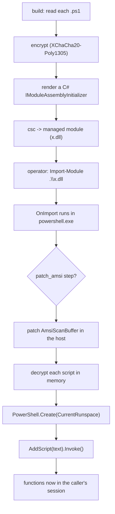

# Import PowerShell module

*Ships a `.ps1` tool as a managed PowerShell binary module whose `Import-Module` injects its functions into the operator's session — the script is never on disk in the clear.*

## What it does

An **Execution** technique for a `build.output.kind: psmodule` build. The
artifact is a managed `.NET` assembly (not the native Rust stub): `Import-Module
.\x.dll` loads it and its `IModuleAssemblyInitializer.OnImport` runs in the
**caller's** `powershell.exe`, decrypts the embedded `.ps1` in memory and injects
it into the importing runspace, so the tool's functions appear in the operator's
session (`Get-DomainUser`, `Invoke-AllChecks`, ...). It accepts only
`format: powershell` payloads.

## How it works

### 1. Build time

1. Each `import_powermodule` payload (a `.ps1`) is read, encrypted with
   XChaCha20-Poly1305 and its ciphertext/key/nonce baked into a generated C#
   module as hex constants.
2. The module implements `IModuleAssemblyInitializer`; if the runtime declares
   `patch_amsi`, its `OnImport` first patches the host's `AmsiScanBuffer` (the two
   names are XOR-scrambled in the assembly).
3. `csc` compiles the module to a managed `.dll`, which is signed and shipped.

### 2. Run time

1. `Import-Module` loads the module and PowerShell calls `OnImport()`.
2. It decrypts each script (the packer's XChaCha20, ported to C# — .NET has no
   XChaCha20) and injects it with
   `PowerShell.Create(RunspaceMode.CurrentRunspace).AddScript(text).Invoke()`, so
   the functions land in the importing runspace.
3. The plaintext buffers are cleared after each injection.

## Integration

A `kind: psmodule` build's runtime is **restricted**: only `patch_amsi` (the
host's AMSI patch) and `import_powermodule` (one per script) are accepted;
everything else is rejected, because a module runs inside the operator's
`powershell.exe`, not a loader process of its own. The order in `runtime:` is the
injection order (Plan C: several tools in one import).

## What it evades

- **No script on disk in the clear.** The `.ps1` is ciphertext inside the module;
  the dll is on disk, but the script is not.
- **Application whitelisting**: only `powershell.exe` runs; the tool arrives as a
  module it imports, and the plaintext signatures of the tool are never on disk.

## What detects it

- **The module file itself.** Unlike `powershell_hosting`, the `.dll` is on disk,
  so its metadata (the AMSI strings are scrambled, but the .NET type names and
  `System.Management.Automation` are necessarily present) is scannable. A lab
  signature over the module is the first report.
- **`Import-Module` of an unsigned/unknown module**: `output.sign` (an unsigned
  module beside a signed host is loud) is the mitigation.
- **AMSI / script block logging** in the host: the `patch_amsi` step is what
  keeps the injected script from being flagged; with invocation logging on, ETW
  still sees the blocks.

## Measurements

- See `docs/measurements.md`.

## Implementation notes

- Built by `engine::managed::build_module`; it reuses the packer's XChaCha20
  (ported to C#) and the `csc` + `System.Management.Automation` discovery of
  `format: powershell`.
- The Rust `stub_fragment.rs` is a placeholder: this technique is rendered in C#,
  and the fragment exists only so the registry entry and the compile guardrail are
  well-formed. `plan::validate` rejects the technique outside a psmodule build.
- `resources` (icon/VERSIONINFO/manifest) are not embedded into a managed module
  yet.

## References

- `IModuleAssemblyInitializer` and the PowerShell module API — Microsoft Learn.
- `RunspaceMode.CurrentRunspace` — injecting into the importing runspace.
