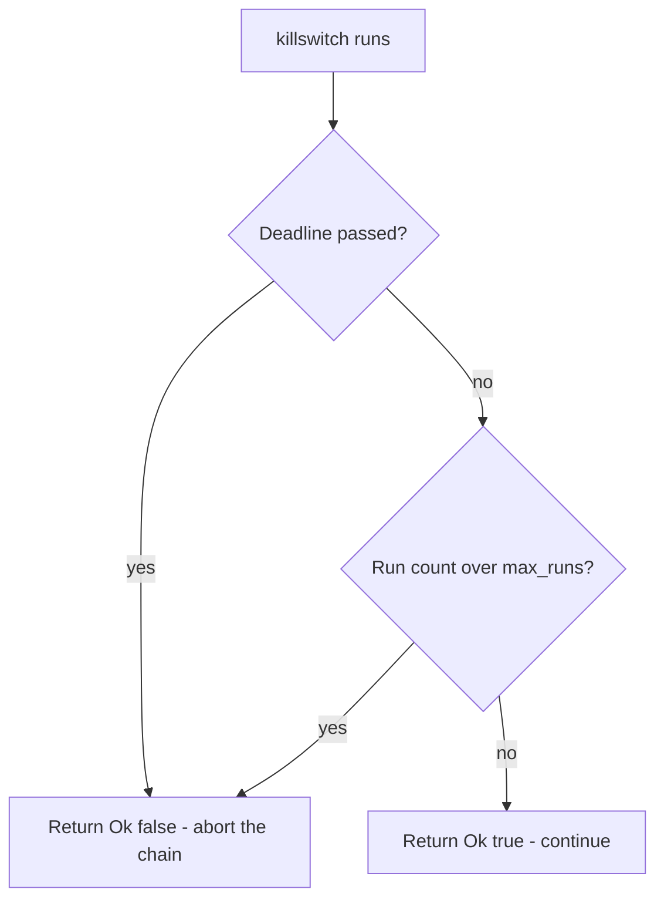

# Killswitch

*Aborts the chain once a configured deadline has passed or a stored run count
is exceeded, so a build can be time- or use-limited.*

## What it does

`killswitch` runs as a Preparation step *before* the payload executes. It
evaluates two independent conditions and, when either trips, returns
`Ok(false)` to abort the chain so the payload never runs. It is a killswitch for
the chain, not a destructive one: nothing is deleted or wiped (`self_deletion`
covers that). ATT&CK files this family under [Execution Guardrails
(T1480)](https://attack.mitre.org/techniques/T1480/).

- **Deadline** (`expire_on`): the loader refuses to run once the system clock
  is past a given ISO date (`YYYY-MM-DD`).
- **Run count** (`max_runs`): the loader persists a counter and refuses to run
  once it has executed more than a given number of times.

With neither field set the technique is a no-op (it always continues). Both
gates are deliberately self-contained: the deadline needs only the system
clock, and the counter needs only the standard library's file I/O.

## How it works

The fragment exposes `killswitch() -> Result<bool, String>`:

### 1. Deadline check

1. **Deadline** — the current date is derived from
   `std::time::SystemTime::now()` (seconds since the Unix epoch are converted
   to a `(year, month, day)` triple with Hinnant's `civil_from_days` algorithm,
   then rendered as `YYYY-MM-DD`). The two date strings are compared
   lexicographically, which is exact for fixed-width ISO dates. If the current
   date sorts after the deadline, the gate returns `Ok(false)`.

### 2. Run-count check

2. **Run count** — the counter is a single integer stored as plain text in a
   file under `std::env::temp_dir()` (the file name is the `run_key`). On each
   run the gate reads the current value (a missing file is the first run, so it
   starts at zero), increments it, writes it back, and returns the incremented
   count. If that count exceeds `max_runs`, the gate returns `Ok(false)`.

A check that cannot be evaluated — the clock is before the epoch, or the
counter file cannot be read, parsed or written — is an `Err`, not a silent
pass, so the chain stops with a diagnostic instead of guessing.

## Integration

A **Preparation** step: the stub runs it before the Execution and it never
receives the payload. Place it earlier in `runtime:` than the Execution step. Once the deadline has passed or the run count is exceeded it aborts
the chain, so the payload does not run out of scope.

## What it evades

- **Runtime tripwires.** The gate is invisible at rest: no registry value, no
  scheduled task, no service, no embedded cleartext date or path. All of the
  deadline, the counter file name and the diagnostics are rebuilt at runtime
  through the packer's string-obfuscation strategy (`build.stub.strings`), so
  none of them reach `.rdata` in cleartext.
- **Static keyword detection.** The fragment introduces no new Win32 imports
  (it is standard-library-only), so the artifact's import table gains no
  telltale registry or date APIs, and the gate adds no technique keyword to
  the binary.

## What detects it

- **The counter file.** A plain-text counter file in the user's temporary
  directory is a forensic artifact: its name (the `run_key`, `runs` by
  default), its single-integer content and its monotonic growth all stand out
  under filesystem analysis. It is not hidden, locked or signed.
- **Behavior.** A loader that silently exits after a fixed number of runs, or
  after a specific date, is itself a signal that a killswitch is present — the
  gate trades a narrower operational window for a smaller trail.

## Measurements

- The fragment is standard-library-only (system clock + file I/O), so a
  `killswitch` build adds no new import-table entry; the deadline, the counter
  file name and every diagnostic are rebuilt at run time and do not appear in
  `.rdata` (enforced by
  `render_fragment_has_no_placeholders_or_sensitive_literals`).
- A host runtime pass over the two gates (deadline trips past `expire_on`;
  counter aborts past `max_runs`) has not been run on its own. The gates are
  self-contained (clock and file I/O only), so the main risk is environmental,
  not logical.

## Implementation notes

- The counter lives in a file rather than the Windows registry. The
  `Win32_System_Registry` feature is not enabled, and enabling it would add
  imports and coupling for no benefit: a file under `std::env::temp_dir()` is
  per-user, persists across runs, and needs no new dependency or feature.
  `run_key` keeps its original "registry value name" wording in the schema but
  is used as the file name at runtime.
- Date conversion is dependency-free. Hinnant's `civil_from_days` is exact for
  the whole proleptic Gregorian calendar and avoids pulling in `chrono` or
  `time`. The `YYYY-MM-DD` string is assembled with byte arithmetic so no
  format string literal is stored.
- The counter is only ever incremented (`saturating_add`), so an adversary who
  deletes the file only resets it to zero — which aborts sooner, never later.
- Every runtime string (deadline, file name, diagnostics) goes through
  `StringsConfig::obfuscate` via a `MESSAGES` placeholder table, so the
  fragment itself carries no string literals.

## References

- MITRE ATT&CK: [Execution Guardrails (T1480)](https://attack.mitre.org/techniques/T1480/)
- Howard Hinnant, `chrono`-compatible date algorithms
  ([`civil_from_days`](https://howardhinnant.github.io/date_algorithms.html))
