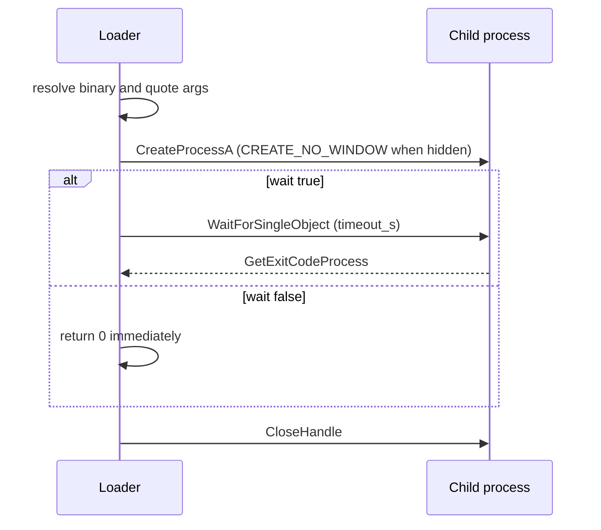

# Living off the land

*Launches a signed system binary or arbitrary command with attacker-chosen
arguments, so the action runs under a trusted LOLBin instead of a dropped tool.*

## What it does

Launches a process — a signed Microsoft binary or any command — from the generated stub.

The intended use is a LOLBin: a signed, already-present system executable
(`certutil.exe`, `rundll32.exe`, `mshta.exe`, ...) is started with attacker
arguments, so the work happens under a trusted binary instead of a dropped
payload. It is a Control technique: it does not decrypt, map or run the payload,
it only orchestrates the chain.

## How it works

### 1. Resolve the binary and build the command line

1. Resolve `binary`: a bare name is joined to `%SystemRoot%\System32`; anything
   containing `\` or `/` is used verbatim.
2. Build the command line: the executable is quoted, then every argument.

### 2. Launch the process

3. `CreateProcessA` with the creation flags from `window` (`CREATE_NO_WINDOW`
   when hidden) and an empty environment block, so the child gets the parent's
   environment.

### 3. Wait and clean up

4. When `wait` is `true`, `WaitForSingleObject` (with `timeout_s * 1000` ms, or
   `INFINITE` when `0`) and `GetExitCodeProcess` return the child's exit code.
   When `false`, the handles are closed and the stage returns `0` immediately.
5. Both process handles are closed.

## Integration

A **Control** step: it orchestrates the chain and returns control when it
finishes, so the steps around it keep running. It launches a command (usually a signed system binary) as part of
the chain.

## What it evades

- Static inspection of a dropped tool: the binary is a signed system file, so
  the action does not add an attacker-controlled artifact to disk.
- Signature/allow-list controls that trust Microsoft-signed binaries (the
  T1218 premise). The effectiveness depends entirely on the chosen LOLBin and
  its own detection state.

## What detects it

- Command-line telemetry (`4688`/Sysmon `1`) for the launched binary and its
  arguments. A LOLBin with an unusual parent, URL or output path is the primary
  signal.
- EDR rules per LOLBin (e.g. `certutil -urlcache`, `rundll32` with an
  unexpected DLL, `mshta` with a remote URL).
- `CreateProcessA` itself is a statically visible import of the stub.

## Measurements

- The fragment imports `CreateProcessA`, `GetExitCodeProcess`,
  `WaitForSingleObject` and `CloseHandle`. The binary, every argument and the
  launch's own fixed strings (`SystemRoot`, `System32`, the `C:\Windows`
  fallback) are rebuilt at run time (XOR/stack) and do not appear in `.rdata`
  (enforced by `render_fragment_obfuscates_the_launch_fixed_strings`).
- A host runtime pass (launch a LOLBin and relay its exit code) has not been run
  for this technique on its own; the launch logic is the same shape as
  `ppid_spoofing`, which is measured end to end. See `docs/measurements.md`.

## Implementation notes

- The fragment shares its `resolve_binary`/`quote_arg` helpers with
  `ppid_spoofing` (same launch shape, different process-tree outcome); both
  obfuscate the launch's fixed strings through `StringsConfig`.
- `binary`, every element of `args`, and the launch's own fixed strings
  (`SystemRoot`, `System32`, the `C:\Windows` fallback) go through
  `StringsConfig` at render time, so none of them appears in cleartext in the
  generated stub.
- `wait: false` is fire-and-forget: the child is not terminated and its exit
  code is never read. `timeout_s` only bounds a waiting stage; on timeout the
  child keeps running and its current exit code (`STILL_ACTIVE`) is returned.
- `CreateProcessA` stays Win32: launching a process is a loader entry point, not
  a syscall the stub issues through the indirect-syscall layer.

## References

- MITRE ATT&CK T1218 — System Binary Proxy Execution.
- MITRE ATT&CK T1105 — Ingress Tool Transfer (e.g. `certutil -urlcache`).
