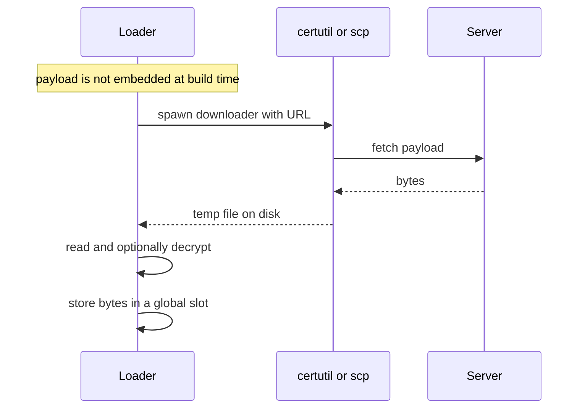

# Network stager

*Fetches the payload over the network at run time instead of embedding it, so
nothing of it ships in the artifact and the operator can rotate it freely.*

## What it does

Fetches a payload over the network at **run time** instead of embedding it in the
artifact. The step downloads the bytes, optionally decrypts them, and hands them
to the next Execution step, which runs them exactly as it would an embedded
payload.

## How it works

### 1. Build time: leave the payload out

1. The build detects that `implant` is named by a `network_stager` step, so it is
   **not** embedded (`include_bytes!`) or encrypted — nothing of it ships in the
   artifact.

### 2. Run time: fetch and decrypt

2. At run time the stager runs a downloader (`certutil` or `scp`) into a temp
   file, waits (with a timeout), reads the bytes and (optionally) decrypts them
   with XChaCha20-Poly1305.

### 3. Hand off to the next step

3. The bytes are stored in a process-global slot; the next Execution step reads
   that slot instead of decrypting an embedded payload.

## Integration

A **Control** step: it orchestrates the chain and returns control when it
finishes, so the steps around it keep running. It fetches the payload at run time and hands it to the following
Execution step.

## What it evades

- **The payload never ships in the artifact**, so there is no embedded ciphertext
  for a scanner to entropy-test or signature-match; the operator can rotate the
  payload without rebuilding.
- **Living off the land**: the fetch rides a signed Microsoft binary (`certutil`)
  or `scp`, matching normal admin traffic rather than a custom socket client.
- The URL, credentials and key/nonce are obfuscated through `StringsConfig`.

## What detects it

- The child process (`certutil`/`curl`/`scp`/`powershell`/`bitsadmin`) and its
  command line are observable by EDR and are themselves a LOLBin-detection
  signal. Many EDRs block `certutil -urlcache` downloads outright (an `access
  denied` on the spawn); the `downloader` parameter exists to switch to one the
  host allows. The robust answer is an in-process fetch (WinHTTP), which never
  spawns a child — see `docs/design/network-stager.md`.
- The artifact gains no static network imports (the fetch is a subprocess), but
  the runtime download is a network connection an NDR/EDR can see.
- A temp file is written to disk between download and execution (an in-memory
  transport such as WinHTTP would avoid it — see `docs/design/network-stager.md`).

## Measurements

Not yet measured: the transport is a subprocess download and runtime
verification on a live network is pending. See `docs/measurements.md`.

## Implementation notes

- **Transport is decided at build time** from the URL scheme, so the fragment
  never parses a scheme at run time and carries no scheme literals.
- The `scp://` transport is **not runtime-verified** (no SSH host available) and
  requires a passwordless key; see the design doc.
- A staged payload cannot be validated at build time (there are no bytes to
  inspect), so `build.payloads.<name>.sha256` is not enforced here.

## References

- `docs/design/network-stager.md` — the full design, phases and open questions.
- `src/engine/steps.rs` — the runner wiring (`take_staged_payload`).
- `src/engine/stager.rs` — the shared slot and staged decryption.
