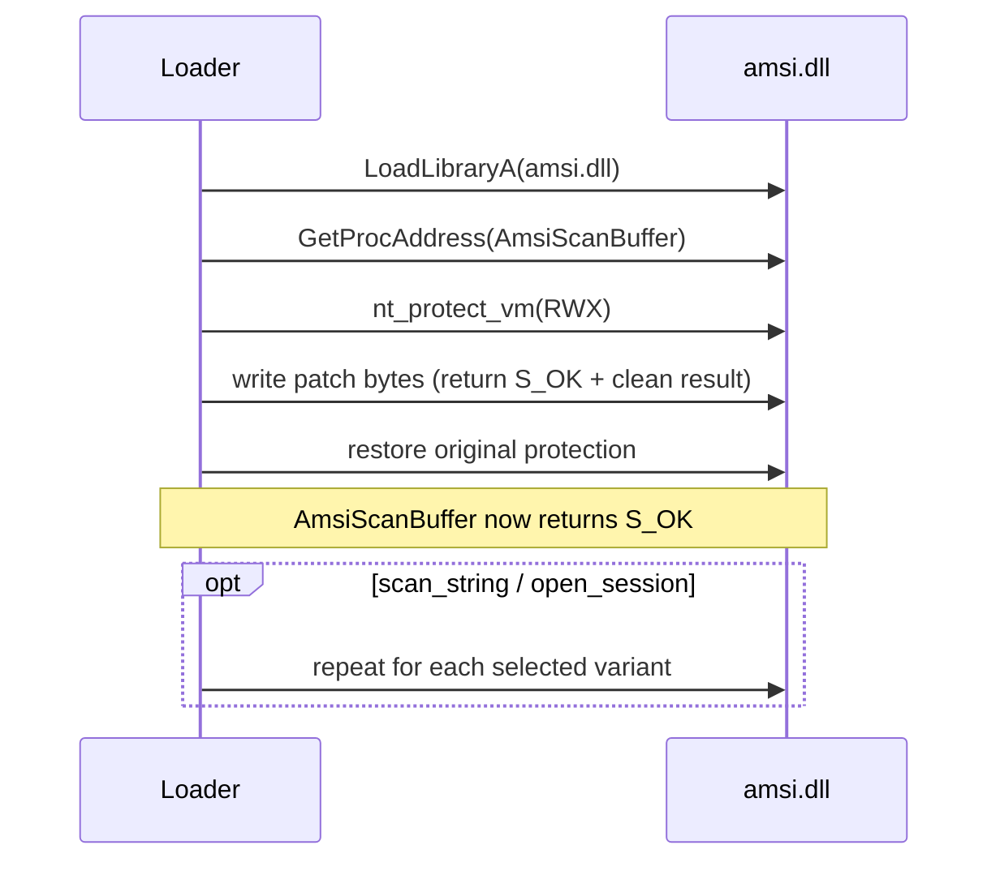

# AMSI patch

*Patches the AMSI scan exports in the current process so every scan returns
clean, disabling in-process AMSI inspection of scripts and .NET content.*

## What it does

Patches the AMSI scan exports in the current process so they always return
`S_OK` (clean), disabling AMSI for any code that invokes them in-process:
PowerShell, WMI, VBScript, JScript, and .NET assembly loading. It does not run
the payload; it only modifies process state, which is why it is a Preparation
technique.

Three exports are covered — one always, two best effort (see Parameters):

- `AmsiScanBuffer` — the buffer scan (always patched).
- `AmsiScanString` — the string-entry scan some hosts use instead of a buffer.
- `AmsiOpenSession` — the session opener; a caller that opens a session first is
  handed a null one instead of a real handle.

## Parameters

| Field | Default | Meaning |
| --- | --- | --- |
| `scan_string` | `true` | Also patch `AmsiScanString` (best effort). |
| `open_session` | `true` | Also patch `AmsiOpenSession` (best effort). |

Only `AmsiScanBuffer` is load-bearing: if it cannot be resolved or made writable
the preparation fails. The other two are best effort, because not every
`amsi.dll` exports them.

## How it works

### 1. Resolve the target export

1. Load `amsi.dll` (`LoadLibraryA`, a no-op if already loaded).
2. Resolve the export with `GetProcAddress`.

### 2. Overwrite the prologue

3. Make the patch bytes writable (`nt_protect_vm` → `PAGE_EXECUTE_READWRITE`).
4. Write the patch (below), which also stores the caller's out-parameter.
5. Restore the original page protection.

Each patch is longer than a bare `ret`: besides returning `S_OK` it also writes
the caller's out-parameter, so a caller that *reads* it sees `AMSI_RESULT_CLEAN`
(0) instead of uninitialized memory. `System.Management.Automation` reads that
parameter on every script it compiles, so the shorter `sub eax, eax; ret` alone
leaves the scan result non-deterministic.

| Export | x64 | x86 | Out-parameter |
| --- | --- | --- | --- |
| `AmsiScanBuffer` | `29 C0` / `4C 8B 54 24 30` / `41 89 02` / `C3` | `31 C0` / `8B 54 24 18` / `89 02` / `C2 18 00` | 6th argument |
| `AmsiScanString` | `29 C0` / `4C 8B 54 24 28` / `41 89 02` / `C3` | `31 C0` / `8B 54 24 14` / `89 02` / `C2 14 00` | 5th argument |
| `AmsiOpenSession` | `29 C0` / `89 02` / `C3` | `31 C0` / `8B 54 24 08` / `89 02` / `C2 08 00` | 2nd argument |

`AmsiOpenSession` stores a null session; that is harmless because the scan
exports are patched too, so the session is never dereferenced.

If `amsi.dll` cannot be loaded or `AmsiScanBuffer` resolved, the preparation
returns a clear error and the pipeline fails with a useful message.

## The managed path (`AmsiUtils`)

The native patch covers the process that runs the loader. When the plan hosts
the PowerShell engine itself — `powershell_hosting`, or a `kind: psmodule`
`import_powermodule` build that runs inside the operator's `powershell.exe` — a
`patch_amsi` step also emits a **managed** bypass into the generated C# launcher /
module: it resolves `System.Management.Automation.AmsiUtils.amsiInitFailed` by
reflection and sets it to `true`. PowerShell's own `ScanContent` checks that flag
before it calls into `amsi.dll`, so the scan path returns before the native
function is reached. The two reflection names are XOR-scrambled at build time, so
neither reaches the managed assembly's metadata in cleartext. It is best effort:
a reflection failure leaves the native patch in place.

## Integration

A **Preparation** step: the stub runs it before the Execution and it never
receives the payload. Place it earlier in `runtime:` than the Execution step.
`plan::validate` warns when `powershell_hosting` runs without one.

## What it evades

- AMSI scanning of scripts and .NET assemblies **in the current process**.
- For a hosted PowerShell engine, the managed `AmsiUtils` bypass short-circuits
  PowerShell's own scan entry before the native call.

## What detects it

- Hooks on `NtProtectVirtualMemory` targeting `PAGE_EXECUTE_READWRITE` over
  `amsi.dll`.
- ETW-TI (`Microsoft-Windows-Threat-Intelligence`) on suspicious memory writes.
- Memory scanning / YARA looking for the patch bytes at the start of the scan
  exports (`29 C0 ...` / `B8 57 00 07 80 C3`). Signatures vary per EDR.
- Reflective access to `AmsiUtils.amsiInitFailed` (a managed-bypass tell).
- AMSI event log entries if the patch is applied only partially or too late.

## Measurements

- Measured on the measurement host (2026-10-11, `docs/measurements.md`): a
  `patch_amsi` + `powershell_hosting` artifact runs a script that invokes AMSI.
  The patch was corrected while investigating — it now returns `S_OK` **and**
  writes `AMSI_RESULT_CLEAN` (`0`) to the caller's out-parameter, which is what
  `System.Management.Automation` reads on every script (the old `sub eax, eax;
  ret` left it uninitialized). With real-time protection **on** the patched
  artifact ran the script ~2 times in 3; a **Defender-off** host (the intended
  environment) is stable.
- Still unmeasured: a *detection-bypass* number (a script AMSI flags, blocked
  with the patch off and allowed with it on). The lab host's AMSI provider is
  inert with real-time protection off, so that comparison needs an
  AMSI-active host; the same gap is recorded for `hardware_breakpoints`.

## Implementation notes

- The buffer-scan patch `29 C0 ... C3` is chosen because it is the shortest valid
  stub that also writes the out-parameter. An alternative returns
  `E_INVALIDARG` (`B8 57 00 07 80 C3`); the shorter form is preferred.
- Only affects the current process. If the payload runs in another process
  (e.g. process hollowing), that process's AMSI is not patched here; doing so
  will require a parameter on the corresponding execution technique.
- `amsi.dll` and every export name are reconstructed at runtime through
  `StringsConfig` (`render_fragment`), so they never appear in cleartext in
  `.rdata`. The page protection change goes through the syscall layer's
  `nt_protect_vm`, so `mode: indirect` removes the `VirtualProtect` import;
  `LoadLibraryA`/`GetProcAddress` stay Win32 (as in every technique).
- The managed bypass lives in `engine::managed` and is emitted only when the
  plan declares a `patch_amsi` step (see the launcher and module C# templates).

## References

- AMSI bypass / patch techniques (e.g. the classic `AmsiScanBuffer` byte patch).
- MITRE ATT&CK T1562.001 — Impair Defenses: Disable or Modify Tools.
