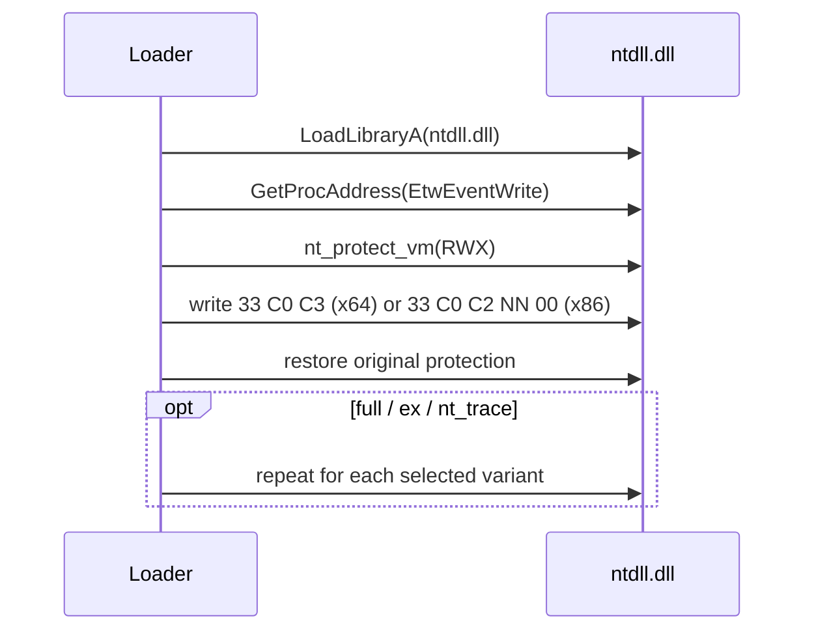

# ETW patch

*Overwrites the prologue of ntdll's ETW event-writing exports so no Event
Tracing for Windows events are emitted from the process.*

## What it does

Overwrites the prologue of the ETW event-writing exports in the current process
so no Event Tracing for Windows events are emitted from it. It does not run the
payload; it only modifies process state, which is why it is a Preparation
technique. Blinding ETW complements `patch_amsi`: AMSI gates script and .NET
content before it runs, ETW is the telemetry channel that reports what ran.

Four exports are covered — one always, three best effort (see Parameters):

- `EtwEventWrite` — the base writer (always patched).
- `EtwEventWriteFull` — the variant most script and .NET telemetry calls.
- `EtwEventWriteEx` — the extended writer.
- `NtTraceEvent` — the native export the user-mode writers funnel through on the
  way into the kernel. The widest single cut: it also catches providers that
  bypass the `Etw*` wrappers.

## Parameters

| Field | Default | Meaning |
| --- | --- | --- |
| `full` | `true` | Also patch `EtwEventWriteFull` (best effort). |
| `ex` | `true` | Also patch `EtwEventWriteEx` (best effort). |
| `nt_trace` | `true` | Also patch `NtTraceEvent` (best effort). |

Only `EtwEventWrite` is load-bearing: if it cannot be resolved or made writable
the preparation fails. Each optional variant is best effort, because not every
Windows build exports every variant and a missing secondary export must not
discard a working main patch.

## How it works

### 1. Resolve the export

1. Load `ntdll.dll` (`LoadLibraryA`, a no-op if already loaded).
2. Resolve the export with `GetProcAddress`.

### 2. Overwrite the prologue

3. Make the patch bytes writable (`nt_protect_vm` → `PAGE_EXECUTE_READWRITE`):
   three bytes on x64, five on x86.
4. Write `xor eax, eax` then `ret` (`33 C0 C3`): return `STATUS_SUCCESS` (0)
   without writing an event. On x86 the exports are `stdcall`, so the `ret`
   carries the argument-byte count (`ret imm16`, `C2 NN 00`, five bytes) and the
   callee pops the caller's arguments: `0x14` for `EtwEventWrite` (`@20`),
   `0x20` for `EtwEventWriteFull` (`@32`), `0x28` for `EtwEventWriteEx` (`@40`)
   and `0x10` for `NtTraceEvent` (`@16`). A bare `ret` would leave those bytes
   on the stack and corrupt the frame after the first event.
5. Restore the original page protection.

### 3. Optionally patch the other variants

6. `full`, `ex` and `nt_trace` each repeat steps 1–2 for their export. These are
   best effort: a missing variant is logged and ignored.

If the main export cannot be resolved (or the page cannot be made writable), the
preparation returns a clear error and the pipeline fails with a useful message.

## Integration

A **Preparation** step: the stub runs it before the Execution and it never
receives the payload. Place it earlier in `runtime:` than the Execution step.

## What it evades

- ETW-based telemetry consumed in-process, e.g. `.NET`/PowerShell script-block
  logging, WMI activity and other providers that write through `ntdll`'s
  event-writing exports.
- EDR user-mode sensors that hook these exports (the overwrite also removes the
  hook's first bytes).

## What detects it

- Hooks on `VirtualProtect`/`NtProtectVirtualMemory` over `PAGE_EXECUTE_READWRITE`
  targeting `ntdll`'s code section.
- ETW-TI (`Microsoft-Windows-Threat-Intelligence`, kernel-side) on suspicious
  memory writes to `ntdll`.
- Memory integrity checks / periodic re-reads of the event-writing exports,
  which find the `33 C0 C3` (x64) or `33 C0 C2 NN 00` (x86) prologue.
- Kernel callbacks (`PsSetCreateProcessNotifyRoutineEx`, etc.) are unaffected:
  this blinds user-mode events, not kernel telemetry.

## Measurements

- See `docs/measurements.md`.

## Implementation notes

- `33 C0 C3` (`xor eax, eax; ret`) is used instead of a bare `ret` (`C3`): the
  export returns a `ULONG` NTSTATUS, and a bare `ret` would leak whatever was in
  EAX. On x64, writing EAX zero-extends to RAX, so `33 C0` clears the full
  64-bit return register.
- On x86 the exports are `stdcall`, so the patch is `33 C0 C2 NN 00`
  (`xor eax, eax; ret imm16`, five bytes) and `NN` is the export's `@N`
  decoration — the argument bytes the callee must pop. Verified with `nm` on
  `libwinapi_ntdll.a`: `_EtwEventWrite@20` (`ret 0x14`),
  `_EtwEventWriteFull@32` (`ret 0x20`), `_EtwEventWriteEx@40` (`ret 0x28`) and
  `_NtTraceEvent@16` (`ret 0x10`). A bare `ret` leaves 20, 32, 40 or 16 bytes on
  the caller's stack, corrupting the frame after the first event.
- The page protection covers exactly the bytes written: `patch.len()` is three
  on x64 and five on x86, so neither build protects more or less than it
  overwrites.
- `NtTraceEvent` is patched exactly like the `Etw*` writers: returning
  `STATUS_SUCCESS` without writing the event record is what stops it reaching a
  consumer. It is resolved through `GetProcAddress` on the same `ntdll.dll`
  handle, so it needs no syscall-layer entry.
- Only affects the current process. If the payload runs in another process
  (e.g. process hollowing), that process's ETW exports are not patched here.
- The patch is deliberately unsynchronised. In practice `run_preparations`
  executes before the payload and before any thread the stub creates, so there
  is no concurrent reader of the bytes being rewritten.
- The DLL and every function name go through `StringsConfig`
  (`Params::render_fragment`), so `ntdll.dll`, `EtwEventWrite`,
  `EtwEventWriteFull`, `EtwEventWriteEx` and `NtTraceEvent` never appear in
  cleartext in `.rdata`. The page protection change goes through the syscall
  layer's `nt_protect_vm`, so `mode: indirect` removes the `VirtualProtect`
  import.
- The function names are resolved dynamically through `GetProcAddress`, so
  they never reach the import table. `ntdll.dll` may still appear in the binary
  through the `windows` crate graph; the audit blanks import-table name strings,
  so it is not reported as a leaked literal.

## References

- Classic ETW patching (`EtwEventWrite` → `ret`) used by C2 frameworks.
- MITRE ATT&CK T1562.006 — Impair Defenses: Indicator Blocking.
