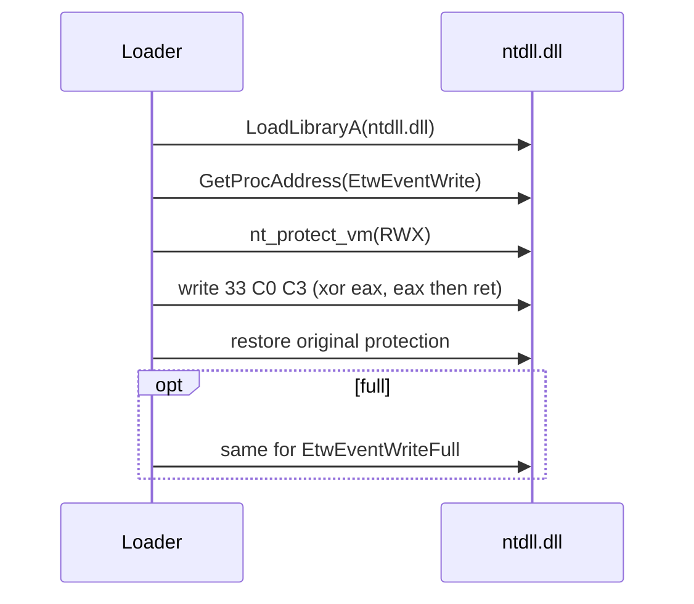

# ETW patch

*Overwrites the prologue of ntdll's ETW event-writing exports so no Event
Tracing for Windows events are emitted from the process.*

## What it does

Overwrites the prologue of the ETW event-writing exports in the current process
so no Event Tracing for Windows events are emitted from it. It does not run the
payload; it only modifies process state, which is why it is a Preparation
technique. Blinding ETW complements `patch_amsi`: AMSI gates script and .NET
content before it runs, ETW is the telemetry channel that reports what ran.

## How it works

### 1. Resolve the export

1. Load `ntdll.dll` (`LoadLibraryA`, a no-op if already loaded).
2. Resolve `EtwEventWrite` with `GetProcAddress`.

### 2. Overwrite the prologue

3. Make the first three bytes writable (`nt_protect_vm` →
   `PAGE_EXECUTE_READWRITE`).
4. Write `xor eax, eax; ret` (`33 C0 C3`): return `STATUS_SUCCESS` (0) without
   writing an event.
5. Restore the original page protection.

### 3. Optionally patch the Full variant

6. If `full` is `true`, repeat steps 2–5 for `EtwEventWriteFull`. This second
   patch is best effort: some builds do not export the Full variant, and a
   missing secondary export must not discard a working main patch.

If the main export cannot be resolved (or the page cannot be made writable), the
preparation returns a clear error and the pipeline fails with a useful message.

## Integration

A **Preparation** step: the stub runs it before the Execution and it never
receives the payload. Place it earlier in `runtime:` than the Execution step.

## What it evades

- ETW-based telemetry consumed in-process, e.g. `.NET`/PowerShell script-block
  logging, WMI activity and other providers that write through `ntdll`'s
  event-writing exports.
- EDR user-mode sensors that hook these exports (the overwrite also removes the
  hook's first bytes).

## What detects it

- Hooks on `VirtualProtect`/`NtProtectVirtualMemory` over `PAGE_EXECUTE_READWRITE`
  targeting `ntdll`'s code section.
- ETW-TI (`Microsoft-Windows-Threat-Intelligence`, kernel-side) on suspicious
  memory writes to `ntdll`.
- Memory integrity checks / periodic re-reads of the event-writing exports,
  which find the `33 C0 C3` prologue.
- Kernel callbacks (`PsSetCreateProcessNotifyRoutineEx`, etc.) are unaffected:
  this blinds user-mode events, not kernel telemetry.

## Measurements

- See `docs/measurements.md`.

## Implementation notes

- `33 C0 C3` (`xor eax, eax; ret`) is used instead of a bare `ret` (`C3`): the
  export returns a `ULONG` NTSTATUS, and a bare `ret` would leak whatever was in
  EAX. On x64, writing EAX zero-extends to RAX, so `33 C0` clears the full
  64-bit return register.
- Only affects the current process. If the payload runs in another process
  (e.g. process hollowing), that process's ETW exports are not patched here.
- The patch is deliberately unsynchronised. In practice `run_preparations`
  executes before the payload and before any thread the stub creates, so there
  is no concurrent reader of the bytes being rewritten.
- The DLL and function names go through `StringsConfig`
  (`Params::render_fragment`), so `ntdll.dll`, `EtwEventWrite` and
  `EtwEventWriteFull` never appear in cleartext in `.rdata`. The page
  protection change goes through the syscall layer's `nt_protect_vm`, so
  `mode: indirect` removes the `VirtualProtect` import.
- The function names are resolved dynamically through `GetProcAddress`, so
  they never reach the import table. `ntdll.dll` may still appear in the binary
  through the `windows` crate graph; the audit blanks import-table name strings,
  so it is not reported as a leaked literal.

## References

- Classic ETW patching (`EtwEventWrite` → `ret`) used by C2 frameworks.
- MITRE ATT&CK T1562.006 — Impair Defenses: Indicator Blocking.
