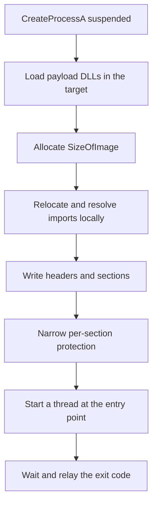

# PE injection

*Maps a full PE into a suspended host process and runs it on a thread of its
own, leaving the host's original signed image intact instead of hollowing it.*

## What it does

Maps a full PE image into a freshly created, suspended process and starts it at
its entry point on a thread of its own, **without unmapping the target's
original image**. The payload is a second image in private memory; the target
keeps its own module, its own thread (parked at the `CREATE_SUSPENDED` start),
and its own loaded DLLs. The stub waits for the payload to finish and relays its
exit code, so the step is chainable.

## How it works

### 1. Create the target and load its DLLs

1. `CreateProcessA(target, CREATE_SUSPENDED)`. The target's own thread is
   **never resumed**: the payload runs on the thread created in step 8, which
   is what distinguishes this from process hollowing (which reuses that thread).
2. Load every DLL the payload imports in the target, each with a remote thread
   that calls `LoadLibraryA` (`NtCreateThreadEx` through the syscall layer).
   The thread's exit status is the returned module handle; it is compared with
   the base the same DLL got in the loader, because the addresses written in
   step 5 are only valid when the two agree.

### 2. Map the payload image

3. Allocate `SizeOfImage` bytes in the target, passing the payload's preferred
   base as a hint. When the address is taken the allocator returns another
   base; the relocations below cover that case.
4. Apply base relocations when the image moved, then resolve the payload's
   imports into its IAT **locally** (the shared `$IMPORTS_BLOCK$` resolver).
   Any failure aborts before a single byte reaches the target, so the payload
   never starts with a half-filled IAT.
5. Write the headers and every section.
6. Narrow the protection of each region: headers read-only, executable sections
   `PAGE_EXECUTE_READ`, writable data `PAGE_READWRITE`. The allocation is
   read-write while the image is written and only then narrowed — **no page is
   ever RWX**.

### 3. Run it and relay the result

7. Start the payload on a thread of its own. Without a TLS directory the thread
   runs the entry point directly; with one it first runs a small target-resident
   prologue that sets the thread's TLS slot and runs the payload's
   `DLL_PROCESS_ATTACH` callbacks before jumping to the entry point (the start
   routine returns into `RtlExitUserThread`, so an entry point that returns
   still ends its thread cleanly).
8. Wait for the thread and relay the exit code: a full PE executable's entry
   point calls `ExitProcess`, so the *process* exit status is the payload's
   code. When only the thread ended (its entry point returned), the thread's
   return value is relayed instead and the target keeps running.

### Import resolution

The walk over the payload's import descriptors is shared with process hollowing
and reflective loading (`src/engine/imports.rs`, injected as
`$IMPORTS_BLOCK$`): every thunk becomes a `LoadLibraryA` + `GetProcAddress`
address written into the payload's IAT slot, in the loader's process. Windows
assigns system DLLs one base per boot, so an address resolved here is valid in
the target as long as the target has the same DLL mapped — step 2 guarantees
exactly that, and the base comparison is the proof. API set names
(`api-ms-win-*`) are virtual and resolve through the loader's API set schema
(with a family-based fallback for the CRT contracts).

### Payload arguments

The command line handed to `CreateProcessA` comes from the shared
`$ARGS_BLOCK$` helper (`build.payloads.<name>.args` plus the operator's
runtime args) and is `<target exe name> <payload args>`: token 0 is the
executable name, never an argument. The payload can read it with
`GetCommandLineW`/`GetCommandLineA`, exactly as under process hollowing.

### Difference from process hollowing

| | `process_hollowing` | `pe_injection` |
|---|---|---|
| target's original image | unmapped and replaced | untouched |
| thread that runs the payload | the target's own thread, redirected | a new thread started at the entry point |
| `PEB->ImageBaseAddress` | points at the payload | still points at the target's image |
| target identity | the payload *is* the target module | payload is a second, unbacked image |

Because the original image stays in place, an image-integrity check on the
target's main module does not see the replacement hollowing causes. The price
is that the payload does **not** become the target's main module: its
`GetModuleHandleA(NULL)`/`GetModuleFileNameA(NULL)` calls still describe the
target, and payloads that locate themselves through the PEB misbehave.

## Integration

An **Execution** step: it runs a `pe` payload from the loader's own
process. It maps the image into a freshly created suspended process.

## What it evades

- The payload never touches disk in cleartext (it is embedded encrypted in the
  stub and mapped from memory).
- The target keeps its own signed image, so checks that compare the main module
  against the file on disk do not fire.
- The process tree shows a legitimate process, not the payload.

## What detects it

- **Kernel callbacks** (`ObRegisterCallbacks` / process-creation callbacks) see
  the cross-process allocation, the write of an `MZ` header into private memory
  and the new thread — while the process is still suspended.
- **ETW-TI** (`Microsoft-Windows-Threat-Intelligence`) reports the remote
  writes and `NtCreateThreadEx` in a suspended, signed process.
- **Memory scanning** finds a second PE image in private memory with no backing
  file (an `MZ`/`PE` pair not in `PEB->Ldr`), and a running thread in a process
  whose main thread never left its start.
- **Userland hooks** on `VirtualAllocEx`/`WriteProcessMemory`/
  `CreateRemoteThread` catch the technique in `syscalls.mode: none`.
- **Static (diagnostics)**: every message the fragment can emit is obfuscated —
  `MESSAGES` in `mod.rs` feeds `render_fragment_for`, which rebuilds each one at
  runtime — so no diagnostic text, and no technique keyword such as `loader`,
  reaches the stub's `.rdata`.

## Architectures

`pe_injection` supports `x64` and `x86`, and the payload must match the stub's
architecture (enforced at build time). The parser reads the optional header
magic and takes the PE32/PE32+ `ImageBase` offset, data-directory offset and
IAT slot width from it; `EXPECTED_MACHINE` is the runtime backstop. The x86
path differs only in the 4-byte IAT slots and the smaller
`THREAD_BASIC_INFORMATION`/`PROCESS_BASIC_INFORMATION` layouts, plus the x86
prologue's stack-argument callback convention. Runtime verification is x64-only
(plain and TLS-callback payloads, 2026-10-14); the x86 path is compile-verified
(`compiles_a_pe_injection_stub_for_i686`).

## Measurements

- Batch-2 numbers (2026-09-28, minimal `pe` payload): the payload's own exit code
  (`42`) comes back through the stub on x64 and x86. See `docs/measurements.md`.
- **The TLS path is green** (measured 2026-10-14, Windows 11 26200, Defender
  real-time off). Two root causes were fixed in sequence: the prologue wrote the
  TLS slot with `TlsSetValue` (`TEB->TlsSlots`, not the array a CRT reads) and
  the emulated callback call was issued from a stack pointer whose 16-byte phase
  made the callback run with `rsp % 16 == 0` — the chain stayed off by eight
  until a `movaps` of a frame local faulted (`0xC0000005` at address `-1`,
  diagnosed under a debugger: the live bytes at `rip` were
  `movaps [rbp+0x170], xmm0` with `rbp % 16 == 8`). With both fixes the payload's
  callback writes its marker before the entry point, and
  `packs_and_runs_a_pe_injected_payload(_with_tls_callbacks)` are green.
  Numbers: `docs/measurements.md`.

## Implementation notes

- **A payload that raises a native exception cannot unwind on x64.** The mapped
  image's unwind tables are not registered and it is not in the loader list, so
  a raise/catch inside the payload has no frame data to walk (shared with
  `reflective_loading`/`process_hollowing`; `docs/x86.md`).
- **No `NtUnmapViewOfSection`.** The technique requests none, and
  `DEF.syscalls` deliberately omits `NtResumeThread`, `NtSuspendThread`,
  `NtGetContextThread`, `NtSetContextThread`, `NtReadVirtualMemory` and
  `NtUnmapViewOfSection`: nothing reads or redirects the target's own thread,
  and the image is never read back.
- **The target's thread stays parked.** A failure after `CreateProcessA` leaves
  the suspended target behind: the syscall layer has no `NtTerminateProcess`
  helper, so closing the handle is the best effort available.
- **The payload's TLS is provisioned via a target-resident prologue.** The
  payload runs on a loader-created native thread, so its own `.tls` directory
  (if it has one) is not materialized by the loader. The fragment reserves a
  `TlsAlloc` index in the target, publishes `_tls_index`, allocates the `.tls`
  template, and writes a small prologue + null-terminated callback array into a
  private execute-read page. The payload thread runs that prologue first: it
  writes the thread's `ThreadLocalStoragePointer` slot for the payload's index
  (the array a CRT reads — *not* `TlsSetValue`'s `TlsSlots`), runs each relocated
  callback with `DLL_PROCESS_ATTACH`, and jumps to the entry point. The callback
  loop runs under `sub rsp, 8`: a thread start routine is entered with
  `rsp % 16 == 8`, so a `call` from that state (without the adjustment) enters
  the callback with `rsp % 16 == 0` and every frame it builds is off by eight
  until a `movaps` faults (measured; see `docs/measurements.md`).
- **The payload must end the process.** A payload whose entry point *returns*
  ends only its thread; the loader relays the thread's return value and the
  target remains alive with its main thread still parked. Only a payload that
  calls `ExitProcess` (every normal `mainCRTStartup` does) produces a process
  exit code.
- **`timeout_ms` turns a hang into an error.** A hung payload would otherwise
  block the whole chain; with a non-zero timeout the wait fails, the stub
  reports it and the target is left behind (see above).
- **Never RWX**: the image is allocated `PAGE_READWRITE`, written and then
  narrowed per section.
- Import resolution is shared with the other execution techniques
  (`src/engine/imports.rs`); the fragment only supplies an RVA→file-offset
  mapper.
- `CreateProcessA`, `GetModuleHandleA`/`GetProcAddress`/`LoadLibraryA` stay
  Win32 imports: they are loader entry points, not syscalls the stub issues
  itself.
- Import resolution is gated on `NtCreateThreadEx` for the remote DLL loads and
  on `NtQueryInformationThread` to read each load's result — the fragment
  verifies the module base instead of assuming the load succeeded.

## References

- MITRE ATT&CK T1055.002 — Process Injection: Portable Executable Injection.
- ired.team, *PE Injection: Executing PEs inside Remote Processes*.
- Microsoft, *PE Format — Base Relocations* (DIR64/HIGHLOW).
