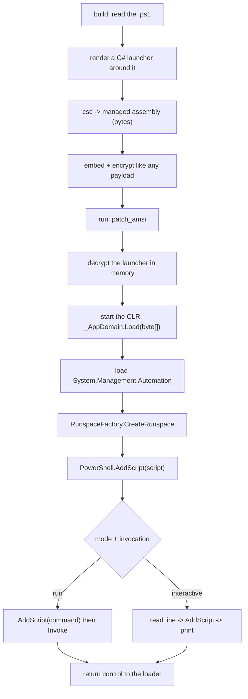

# PowerShell hosting

*Runs a `.ps1` payload in the loader's own process by hosting Windows PowerShell 5.1 on the CLR, so the script never touches disk and never spawns `powershell.exe`.*

## What it does

An **Execution** technique. It runs a `format: powershell` payload — a `.ps1`
script — in the loader's own process, without a child `powershell.exe`, without
`-EncodedCommand` and without a temporary file. This is the `powerpick` shape:
the process hosts the engine, not the other way round.

A `.ps1` is text, so it cannot be mapped as code. The packer closes the gap at
build time: it compiles a small managed launcher around the script
(`src/engine/managed.rs`) and the technique hosts **that** managed assembly on
the CLR, exactly as `dotnet_hosting` hosts a `format: dotnet` payload. The
script text only ever exists inside the encrypted launcher image, in memory.

## How it works



### 1. Build time — the script becomes a managed assembly

1. The packer reads the `.ps1` as UTF-8 text and validates it is non-empty.
2. It renders a C# launcher that embeds the script as a verbatim string, hosts
   `System.Management.Automation`, and drives it with `PowerShell.Create()` /
   `AddScript()` / `Invoke()` in a private `Runspace`.
3. It compiles the launcher with the .NET Framework compiler (`csc.exe`) against
   Windows PowerShell's `System.Management.Automation.dll`.
4. The resulting **managed assembly bytes** are embedded and encrypted exactly
   like any other payload; the `.ps1` never reaches the stub in cleartext.

### 2. Run time — the CLR hosts the engine

1. The stub decrypts the launcher and starts the CLR in its own process
   (`CLRCreateInstance` → `ICorRuntimeHost` → `_AppDomain.Load(byte[])`), the
   same path `dotnet_hosting` uses. Loading from `byte[]` keeps the launcher in
   memory.
2. The launcher opens a runspace, runs the script (defining its functions) and
   then runs the configured invocation in the **same** runspace, so a function
   the script defines is callable (`command: Invoke-AllChecks`).
3. `mode: interactive` leaves a prompt instead of running one invocation.

### 3. The invocation is a run-time value

`command` is only a baked default. The operator's own command-line arguments
override it (`command_mode: override`, the default) or append to it
(`command_mode: join`), so one artifact runs whatever is typed:

```text
powerup.picaro.exe "Get-DomainUser -Identity admin"   # override
powerup.picaro.exe -Verbose                           # join -> "Invoke-AllChecks -Verbose"
powerup.picaro.exe                                    # no args -> the baked default
```

## Integration

An Execution step, so it belongs after the Preparations that shape the process.
`patch_amsi` is required in practice: the engine scans `AddScript` content
through `AmsiScanBuffer`, so the script would be detected without it. `patch_etw`
is recommended (script block logging travels over ETW). The step returns control
to the loader (it is **not** terminal), so a step such as `self_deletion` may
follow it. It accepts only `format: powershell` payloads.

## What it evades

- **No `powershell.exe` and no command line.** There is no child process and no
  Base64 blob on a command line; the engine runs in the loader's process.
- **No script on disk.** The `.ps1` is embedded encrypted and only ever exists
  decrypted in memory; `AddScript` is handed the text directly.
- **Signature scanning of the file.** A disk signature on `PowerUp.ps1` never
  applies: there is no file to scan. AMSI (which scans the in-memory text) is
  neutralised by `patch_amsi`, and under the common script-block-logging policy
  (invocation logging off) a block is only logged when AMSI flags it — so the
  patch also suppresses the 4104.

## What detects it

- **The engine loaded outside `powershell.exe`.** Module-load telemetry flags a
  process that loaded `System.Management.Automation.dll` and is not PowerShell.
  This is the signature trade of `powerpick`-style hosting (see the technique
  design note); injecting into a real `powershell.exe` is the fix and is out of
  scope for now.
- **Script block logging with invocation logging on.** Every block is logged
  over ETW regardless of AMSI; `patch_etw` blunts that path but must be measured
  against a policy-configured host.
- **The .NET runtime loading at all.** Starting the CLR from a small native
  loader is itself an anomaly (the same one `dotnet_hosting` carries).

## Measurements

- See `docs/measurements.md`.

## Implementation notes

- The technique reuses `dotnet_hosting`'s stub fragment (`include_str!`), so the
  two cannot drift. The difference is entirely at **build time**: a
  `format: powershell` payload is compiled into a managed launcher before it is
  embedded.
- `csc.exe` and `System.Management.Automation.dll` are located at build time
  (`PICARO_CSC` / `PICARO_PSASSEMBLY` override the search). Neither is bundled
  with the repository. On a non-Windows build host the lookup falls back to
  Mono's `mcs` and the PowerShell 5.1 SDK reference assembly
  (`Microsoft.PowerShell.5.ReferenceAssemblies`); the Docker image ships both,
  so a container build works out of the box.
- Interactive output uses each result's `ToString()`; rich objects are not
  formatted with `Out-String` yet.
- The launcher patches nothing itself: AMSI is patched by the `patch_amsi` step,
  in the loader's process, before the CLR starts.
- **Host sensitivity.** With Defender's real-time protection enabled, the AMSI
  patch is intermittently interfered with, so the hosted engine may not run on
  every launch; a Defender-off lab host is stable (see `docs/measurements.md`).
  Output written to a *redirected* stdout after the engine starts can also be
  lost, so a script that needs a deterministic result should write a file.

## References

- `System.Management.Automation.PowerShell` hosting API — Microsoft Learn.
- Cobalt Strike `powerpick` — the in-process PowerShell shape this models.
