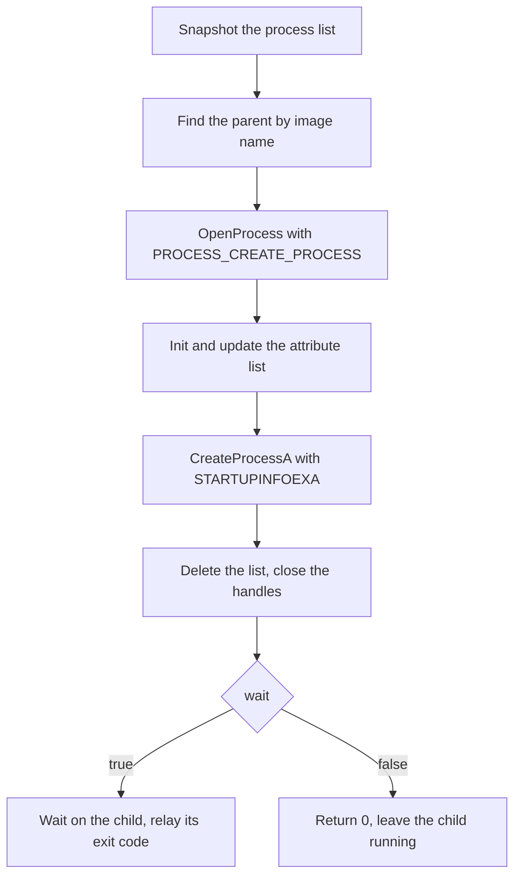

# Parent-process spoofing

*Launches a process so Windows records a chosen legitimate parent instead of the
loader, hiding the loader from the process tree.*

## Metadata

| | |
|---|---|
| **ATT&CK** | T1134.004 (Access Token Manipulation: Parent PID Spoofing) |
| **Stability** | Stable |
| **Category** | Control |
| **YAML key** | `ppid_spoofing` |
| **Introduced in** | unreleased (control-technique suite) |

## What it does

Launches the configured process so that Windows records a *different* process —
`params.parent`, by name — as its parent, instead of the loader. The process
tree (`Process Explorer`, `Win32_Process`, `Get-CimInstance`) then shows the
child under a legitimate process, and the loader is not in the chain.

It is a Control technique: it decrypts and runs no payload of its own. It
starts a process, returns that process's exit code to the chain when `wait` is
set, and nothing else.

## YAML parameters

| Parameter | Type | Required | Default | Description |
|-----------|------|----------|---------|-------------|
| `binary` | string | yes | — | Executable to launch. A bare name is resolved against `System32`; a path is used as is |
| `args` | list | no | `[]` | Arguments for the executable |
| `parent` | string | no | `explorer.exe` | Process whose PID becomes the new process's recorded parent (case-insensitive; a path is compared by its file name) |
| `wait` | bool | no | `true` | Wait for the child and relay its exit code. `false` leaves the child running and returns `0` |

## YAML example

```yaml
runtime:
  - technique: ppid_spoofing
    params:
      binary: cmd.exe
      args: ["/c", "whoami"]
      parent: explorer.exe
      wait: true
```

The child's command line is built from this step's `binary` and `args`. The
payload's own `build.payloads.<name>.args` do **not** reach it: those belong to
the payload an Execution step runs, not to this control process.

## How it works



### 1. Resolve and open the spoofed parent

1. Enumerate the process list
   (`CreateToolhelp32Snapshot(TH32CS_SNAPPROCESS)` + `Process32FirstW`/
   `Process32NextW`) and take the first entry whose executable name matches
   `parent`, case-insensitively. A configured path is reduced to its file name.
2. `OpenProcess(PROCESS_CREATE_PROCESS, FALSE, pid)`. The right is required by
   the attribute below, and it is also what the chosen parent has to grant:
   higher-integrity or protected parents (e.g. `lsass.exe`) fail here.

### 2. Attach the parent to the attribute list

3. Build the attribute list:
   `InitializeProcThreadAttributeList(NULL, 1, 0, &size)` to size it (this call
   "fails" by design and only reports `size`), allocate a pointer-aligned
   buffer, then initialize it.
4. `UpdateProcThreadAttribute(list, 0, PROC_THREAD_ATTRIBUTE_PARENT_PROCESS,
   &parent_handle, sizeof(HANDLE), NULL, NULL)`. The value is a pointer to a
   **handle**, and the list stores that pointer, so the handle must stay alive
   until `DeleteProcThreadAttributeList` — see the implementation notes.

### 3. Launch the child and relay its exit code

5. `CreateProcessA` with `EXTENDED_STARTUPINFO_PRESENT` and a `STARTUPINFOEXA`
   whose `cb` is `sizeof(STARTUPINFOEXA)` and whose `lpAttributeList` is the
   list. `CREATE_NO_WINDOW` is always set: a console window would give the child
   away, and GUI processes ignore the flag.
6. Delete the attribute list, close the parent handle and the child's thread
   handle. With `wait: true`, wait on the child (`INFINITE`) and return its exit
   code; with `wait: false`, return `0` and leave the child running.

## What it evades

- Process-tree heuristics that flag a loader — or an Office document — spawning
  a command interpreter or a LOLBin. The child appears under a process that has
  no malware association, and the loader is absent from the parent chain.
- Naive "who is the parent of this suspicious process?" pivots in an analyst's
  tooling, because the recorded parent is the spoofed one.
- Note that the *inherited* properties really do come from the chosen parent
  (token, handles, device map, affinity, quotas, job objects), as the Windows
  documentation states. That is why a higher-privilege parent is interesting for
  elevation, and why it is a strong tell when it has no business spawning the
  child.

## What detects it

- **Kernel callbacks and ETW still have the truth.** The attribute list is
  visible to `PsSetCreateProcessNotifyRoutineEx`: `ExtendedInfo->ParentProcessId`
  is the spoofed PID, while the callback's own process context is the real
  creator. The same mismatch shows up as
  `Microsoft-Windows-Kernel-Process` event 1 (`ParentProcessId` field vs the
  event's own execution PID), in Sysmon (`ParentProcessGuid` vs the creator) and
  in Security 4688 (`Creator Process ID` vs `New Process ID`). MITRE's analytic
  for T1134.004 is exactly this lineage mismatch across ETW/4688/Sysmon.
- **An implausible pair.** `explorer.exe` spawning `cmd.exe` is normal;
  `explorer.exe` spawning `cmd.exe /c whoami` with no desktop interaction, or a
  server process with no logon session spawning a shell, is not.
- **The `PROCESS_CREATE_PROCESS` open itself.** An EDR that records process
  handle opens sees the loader opening the parent with that access right, an
  unusual operation for an ordinary program.
- The child's command line remains visible in the process list; a suspicious
  command line under a legitimate parent is still suspicious.

## Measurements

- See `docs/measurements.md`: the child's exit code is relayed and the recorded
  parent was verified from PowerShell to be the configured process, not the
  loader. The static signature the technique adds is its imports
  (`CreateToolhelp32Snapshot`, `Process32*W`, `OpenProcess`,
  `InitializeProcThreadAttributeList`, `UpdateProcThreadAttribute`,
  `DeleteProcThreadAttributeList`, `CreateProcessA`, `GetExitCodeProcess`,
  `WaitForSingleObject`), not the strings — those are all obfuscated.

## Implementation notes

- **The lifetime bug to avoid.** `UpdateProcThreadAttribute` stores the
  *address* of the parent handle in the list, and the docs require that value to
  remain valid until the list is deleted. The fragment therefore keeps the
  handle in a named local that outlives `CreateProcessA` and closes it only
  afterwards; taking `&OpenProcess(..)` as a temporary (or closing the handle
  right after the update) yields a handle the kernel may have already recycled.
  The attribute-list buffer has the same lifetime and is allocated in `usize`
  units, because the opaque list contains pointers and a `Vec<u8>` is not
  guaranteed to be pointer-aligned.
- **First match wins.** Several processes can share a name (`svchost.exe`,
  `chrome.exe`); the first entry in the snapshot is used. That is deterministic
  and as unremarkable as any other instance.
- **Return semantics.** `wait: true` returns the child's exit code, which the
  stub records as the step's result (`last = code`) and the chain continues
  with. `wait: false` returns `0`: the loader no longer owns the child's
  lifetime and there is no code to relay.
- **Pure Win32, no syscall layer.** `CreateProcessA` and the attribute-list API
  are loader entry points, not kernel calls the stub issues, so
  `TechniqueDef::syscalls` is empty (same reasoning as `living_off_the_land`).
- **No runtime string literals.** The binary, its arguments, the parent's name
  and every diagnostic go through `StringsConfig`; so do the launch's own fixed
  strings (`SystemRoot`, `System32`, the `C:\Windows` fallback), so none of them
  appears in the artifact in cleartext.
- **Failure modes** are reported, never panicked: no binary / no parent
  configured, snapshot failure, parent not found (the message names it),
  `OpenProcess` denied, attribute-list sizing/initialization failure,
  `UpdateProcThreadAttribute` failure and `CreateProcessA` failure (with the
  Win32 error and the command line).
- **Not done by design:** choosing *which* same-named parent (all matches are
  equivalent for this purpose), and a timeout on `wait: true` (use
  `wait: false`, or a `sleep` step in the chain, if the child must not be waited
  on indefinitely).

## References

- MITRE ATT&CK T1134.004 — Access Token Manipulation: Parent PID Spoofing.
- Microsoft Learn — `UpdateProcThreadAttribute` (`PROC_THREAD_ATTRIBUTE_PARENT_PROCESS`:
  a handle with `PROCESS_CREATE_PROCESS`; `lpValue` must persist until the list
  is deleted).
- Microsoft Learn — `InitializeProcThreadAttributeList` (the first call fails by
  design and returns the required size).
- ired.team — "Parent Process ID (PPID) Spoofing" and its ETW detection section
  (`Microsoft-Windows-Kernel-Process`, event 1: `ParentProcessId` vs the event's
  execution PID).
- Working notes and sources: `code_examples/ppid_spoofing/NOTES.md` and
  `code_examples/ppid_spoofing/refs/`.
