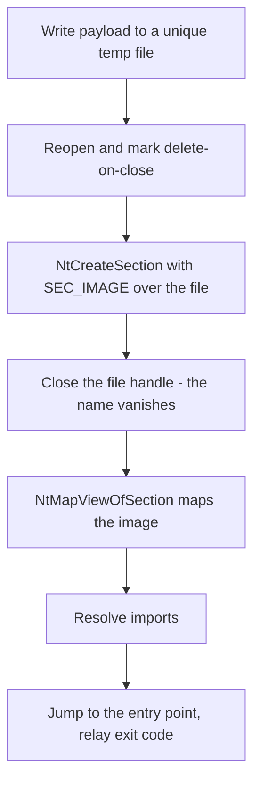

# Process ghosting

*Runs the payload from a delete-on-close temporary file mapped as an **image**
section, so the mapped image outlives the file name and executes with no
on-disk backing.*

## What it does

Runs the decrypted payload with no backing file on disk. The payload is written
to a unique temp file that is immediately marked delete-on-close, turned into an
image section, and mapped into the current process; the file handle is then
closed so the file's name disappears while the section keeps the image alive.
The kernel maps the image by RVA and applies its base relocations, the loader
resolves the payload's imports, and the payload's entry point runs in the
loader's process.

## How it works

### 1. Stage the payload as a file

1. Writes the decrypted payload to a unique file under the process temp
   directory.
2. Re-opens it with `CreateFileW` (`FILE_READ_DATA | DELETE`, sharing
   `FILE_SHARE_READ | FILE_SHARE_WRITE | FILE_SHARE_DELETE`) and marks it
   delete-on-close with `SetFileInformationByHandle` + `FileDispositionInfo`
   (`DeleteFile = true`).

### 2. Turn it into an image section

3. Creates the section with `NtCreateSection` and `SEC_IMAGE` over the ghosted
   file (`PAGE_READONLY` protection; the per-section protections come from the
   image headers). The kernel reads the payload's headers here and records it as
   an image, not as a plain data section.
4. Closes the file handle. The delete-on-close disposition takes effect — the
   file's name disappears — but the section keeps the image's pages alive.
5. Maps the section into the current process with `NtMapViewOfSection`
   (`PAGE_READWRITE`, so the IAT can be patched in place). The returned view is a
   real image: sections at their RVAs, classes and protections from the headers,
   base relocations already applied for the base the kernel picked.

### 3. Run the mapped image

6. Validates the mapped headers (every offset — `e_lfanew`, the header block,
   `SizeOfImage`, the entry point — is checked against the view before use),
   resolves the payload's imports through the shared resolver
   (`crate::patch_imports`), and jumps to the entry point, relaying its exit
   code.

## Integration

An **Execution** step: it runs a `pe` payload from the loader's own process. It
maps the image from a delete-on-close file, so there is no backing file on disk.

## What it evades

- **Fileless execution**: by the time the entry point runs, the payload has no
  file name on disk — a scanner that walks the temp directory sees nothing to
  inspect.
- **No private executable allocation**: the image lives in a file-backed image
  section, not in a freshly committed private region the way manual mapping
  allocates it. The pages belong to a section object, so a scan that looks for
  private `RX`/`RWX` regions has nothing to flag at the loaded base.
- **Per-section protections**: the mapping takes its protections from the image
  headers (`.text` executable, `.data` writable), so the loaded image does not
  stand out as a single whole-view RWX region.

## What detects it

- **The temp file exists transiently on disk** between the write and the handle
  close, so a file-system monitor (or a minifilter) can still catch the write and
  the delete-on-close disposition.
- **The delete-on-close / `FileDispositionInfo` pattern** is itself a known
  process-ghosting tell, as is an image section over a file that no longer has a
  name.
- **The image's headers** are still in the mapping, so a scan that walks mapped
  images by hand finds an `MZ`/`PE` pair at a base with no backing file.
- **Import resolution** rewrites the IAT with freshly resolved pointers, and the
  affected pages are made writable while that happens.

## Measurements

- Measured on Windows 11 (x64, 2026-11-20): the technique **runs**. The payload
  was mapped from its image section after the temp file's name disappeared, wrote
  its marker file and returned its exit code through the loader. The earlier
  data-section design never got that far: a delete-pending file refuses a
  writable mapping, and a read-only data mapping keeps file offsets, which is why
  the section has to be an *image* section.
- Not measured: the x86 build, payloads that register TLS callbacks (an image
  section mapped by hand does not initialize TLS), and payloads that raise a
  native exception (their unwind tables are not registered, the same limitation
  reflective loading documents).

## Implementation notes

- **`NtCreateSection`/`NtMapViewOfSection`, not `CreateFileMappingW`.** Win32
  has no way to create an image section: `CreateFileMappingW` takes
  `SEC_COMMIT`/`SEC_RESERVE`, not `SEC_IMAGE`. Both calls are ntdll exports from
  the windows-rs WDK bindings, called directly rather than through the indirect
  syscall layer, so `DEF.syscalls` is empty and the fragment is identical for
  `syscalls.mode: none` and `indirect`.
- **The kernel does the mapping work.** `SEC_IMAGE` means the memory manager
  maps the sections by RVA and applies the base relocations for whatever base it
  picks, so the fragment carries no relocation walk of its own. What the kernel
  does *not* do is resolve import names: the payload's imports are resolved and
  written into its IAT by the shared resolver.
- **Bounds checks on the mapped view.** `SizeOfImage` has to match the view
  size, `e_lfanew` plus the NT headers has to fit inside it, and the entry point
  has to land inside the image; the checks run once, before any helper indexes
  into the mapping.
- **PE only.** The fragment is a PE mapper; `plan::validate` rejects
  `shellcode`/`dll`/`dotnet` payloads for this technique.
- **Runs in-process and returns.** The entry point is called on the loader's
  thread and its exit code is relayed, so the technique is chainable in a
  schema-6 `runtime:` list. The mapping is deliberately left in place: the
  payload's code, data and imports live in it for as long as the process runs.

## References

- Elastic Security Labs, "Process Ghosting: A New Executable Image Tampering
  Attack" (Gabriel Landau, 2021).
- MITRE ATT&CK, "Process Injection: Process Doppelgänging" (T1055.012).
- Microsoft, `NtCreateSection` and `NtMapViewOfSection` (`ntifs.h`),
  `SetFileInformationByHandle` and `FILE_DISPOSITION_INFO` (`winbase.h`).
