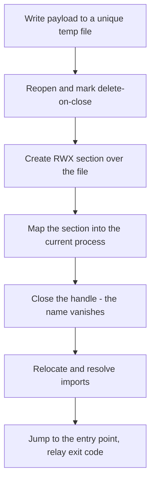

# Process ghosting

*Runs the payload from a delete-on-close temporary file mapped as a section, so
the mapped image outlives the file name and executes with no on-disk backing.*

## Metadata

| | |
|---|---|
| **ATT&CK** | T1055.012 |
| **Stability** | experimental |
| **Category** | Execution |
| **YAML key** | `process_ghosting` |
| **Payload format** | `pe` only |
| **Verification** | compile-verified only (runtime verification pending) |

## What it does

Runs the decrypted payload with no backing file on disk. The payload is
written to a unique temp file that is immediately marked delete-on-close,
turned into a section, and mapped into the current process; the file handle is
then closed so the file's name disappears while the section keeps the bytes
alive. The mapped image is relocated, its imports are resolved, and its entry
point runs in the loader's process.

## YAML parameters

| Parameter | Type   | Required | Default | Description                                             |
|-----------|--------|----------|---------|---------------------------------------------------------|
| `payload` | string | no       | (auto)  | Name of the payload in `build.payloads`. Optional when exactly one payload is declared. |

## YAML example

```yaml
runtime:
  - technique: process_ghosting
```

With an explicit payload (required when more than one payload is declared):

```yaml
build:
  payloads:
    implant:
      source: implant.exe
      format: pe
runtime:
  - technique: process_ghosting
    params:
      payload: implant
```

## How it works



### 1. Stage the payload as a file

1. Writes the decrypted payload to a unique file under the process temp
   directory.
2. Re-opens it with `CreateFileW` (`FILE_READ_DATA | FILE_WRITE_DATA | DELETE`,
   sharing `FILE_SHARE_READ | FILE_SHARE_WRITE | FILE_SHARE_DELETE`) and marks
   it delete-on-close with `SetFileInformationByHandle` +
   `FileDispositionInfo` (`DeleteFile = true`).

### 2. Map it while the name disappears

3. Creates a `PAGE_EXECUTE_READWRITE` section over the file
   (`CreateFileMappingW`) and maps it into the current process
   (`MapViewOfFile`).
4. Closes the file handle. The delete-on-close disposition takes effect — the
   file's name disappears — but the section (and the view) keep the bytes
   alive.

### 3. Run the mapped image

5. Applies base relocations for the view's actual base, resolves the payload's
   imports through the shared resolver (`crate::patch_imports`), and jumps to
   the entry point, relaying its exit code.

## What it evades

- **Fileless execution**: by the time the entry point runs, the payload has no
  file name on disk — a scanner that walks the temp directory sees nothing to
  inspect.
- **No `VirtualAlloc`-style RWX allocation**: the image lives in a
  file-backed section, not in a freshly committed private region the way manual
  mapping allocates it.

## What detects it

- **The temp file exists transiently on disk** between the write and the
  handle close, so a file-system monitor (or a minifilter) can still catch the
  write and the delete-on-close disposition.
- **A `PAGE_EXECUTE_READWRITE` section** is a strong signal to memory scanners;
  the whole mapped view is RWX rather than per-section protected.
- **The delete-on-close / `FileDispositionInfo` pattern** is itself a known
  process-ghosting tell, as is a mapped section whose backing file has vanished.

## Measurements

- See `docs/measurements.md` (no entry yet — this technique is compile-verified
  only, pending a runtime pass on a Defender-off Windows host).

## Implementation notes

- **Win32 only, no syscalls.** The file → section → map flow uses
  `CreateFileW`, `SetFileInformationByHandle`, `CreateFileMappingW`,
  `MapViewOfFile` and `CloseHandle` directly (they are loader entry points, not
  kernel calls the stub issues), so `DEF.syscalls` is empty and the fragment is
  identical for `syscalls.mode: none` and `indirect`.
- **The mapped view is treated as an image-layout view** (`RVA == offset`), the
  same assumption reflective loading makes. A production implementation must
  confirm this against `SEC_IMAGE` versus a raw data section, and either apply
  per-section protections or expand the sections manually; the current fragment
  keeps the whole view `PAGE_EXECUTE_READWRITE`. This is the main open
  verification item.
- **PE only.** The fragment is a PE mapper; `plan::validate` rejects
  `shellcode`/`dll`/`dotnet` payloads for this technique.
- **Runs in-process and returns.** The entry point is called on the loader's
  thread and its exit code is relayed, so the technique is chainable in a
  schema-6 `runtime:` list (it is not terminal the way reflective loading of a
  PE *executable* is).

## References

- Elastic Security Labs, "Process Ghosting: A New Executable Image Tampering
  Attack" (Gabriel Landau, 2021).
- MITRE ATT&CK, "Process Injection: Process Doppelgänging" (T1055.012).
- Microsoft, `SetFileInformationByHandle` and `FILE_DISPOSITION_INFO`
  (`winbase.h`).
