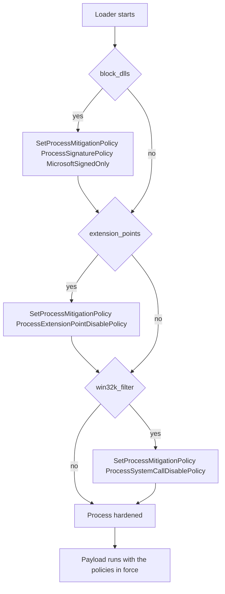

# Process mitigations

*Hardens the loader's own process with documented Windows mitigation policies so
an unsigned userland EDR DLL can no longer be mapped — and, optionally, AppInit
hooks and Win32k system calls are cut off.*

## What it does

Applies process-wide mitigation policies to the loader's own process before the
payload runs:

- **Block non-Microsoft DLLs** (`ProcessSignaturePolicy`, `MicrosoftSignedOnly`)
  — the "BlockDLLs" mitigation. Once set, the loader can no longer map a DLL that
  is not signed by Microsoft, which is exactly the shape of an EDR's userland
  hook DLL injected into the process.
- **Disable extension points** (`ProcessExtensionPointDisablePolicy`) — no
  `AppInit_DLLs`, no legacy global `SetWindowsHookEx` DLLs.
- **Block Win32k system calls** (`ProcessSystemCallDisablePolicy`, opt-in) — cuts
  the Win32k-based hooks some GUI-focused instrumentation relies on, at the cost
  of a payload that needs the GUI.

It does not run the payload; it only modifies process state, which is why it is a
Preparation technique.

## How it works

### 1. Block non-Microsoft DLLs

1. Build a `PROCESS_MITIGATION_BINARY_SIGNATURE_POLICY` with bit 0
   (`MicrosoftSignedOnly`) set.
2. Call `SetProcessMitigationPolicy(ProcessSignaturePolicy, …)`. A failure is the
   one error path: the technique's headline guarantee is the DLL block.

### 2. Disable extension points

3. Build a `PROCESS_MITIGATION_EXTENSION_POINT_DISABLE_POLICY` with bit 0
   (`DisableExtensionPoints`) set and apply it. Best effort.

### 3. Block Win32k system calls (opt-in)

4. Build a `PROCESS_MITIGATION_SYSTEM_CALL_DISABLE_POLICY` with bit 0
   (`DisableWin32kSystemCalls`) set and apply it. Best effort, and off by
   default because it breaks GUI payloads.

Each policy is a one-shot, monotonic flag: once set it cannot be unset, so the
order within the step does not matter.

## Integration

A **Preparation** step: the stub runs it before the Execution and it never
receives the payload. Place it **early** in `runtime:` — the DLL block only
affects *future* loads, so a non-Microsoft DLL the loader (or a later step)
brings in must be loaded before this step, or it is refused.

It composes with the other memory/telemetry steps: run it before `patch_amsi`
(`amsi.dll` is Microsoft-signed and still loads), `module_stomping` (a Microsoft
module) and the execution technique. A payload that itself `LoadLibraryA`s a
non-Microsoft DLL will fail under `block_dlls: true`; that is the intended
trade-off, not a bug.

In a `kind: dll` build there is no loader image of its own, so the policies apply
to the **host** process (`python.exe`, `java.exe`, …): the DLL block then stops
the host from loading a non-Microsoft module, which can break the host's own
plugins. `plan::validate` warns about this.

## What it evades

- An **unsigned userland EDR DLL** the EDR would otherwise inject into the
  process: the kernel refuses the mapping.
- `AppInit_DLLs` and legacy global-hook DLLs, a classic injection/telemetry path.
- Win32k-based userland hooks, when the opt-in flag is set.

## What detects it

- The mitigation is **process state**, readable with
  `GetProcessMitigationPolicy` / `NtQueryInformationProcess(ProcessMitigationPolicy)`:
  a freshly started process with no debugger that suddenly blocks all
  non-Microsoft DLLs is itself unusual.
- The `SetProcessMitigationPolicy` import and the accompanying policy call in the
  process's timeline.
- An EDR whose userland DLL failed to map records the refusal on its side.

## Measurements

- Measured end to end on Windows 11 26200 (2026-10-14): with the default
  `block_dlls`, a payload's `LoadLibraryW` of a locally built, unsigned DLL fails
  (`ERROR_ACCESS_DENIED`) while the same load succeeds without the step, and the
  Microsoft-signed modules the stub needs still load. Numbers:
  `docs/measurements.md`.
- **Unmeasured parameters:** `win32k_filter` (the Win32k system-call filter) and
  `extension_points` (apphelp extension rejection) are compile-verified only;
  `block_dlls` is the load-bearing one and is the measured case.

## Implementation notes

- `SetProcessMitigationPolicy` is a documented process-configuration API in
  `kernel32`, not an `Nt*` syscall stub, so it stays a direct Win32 call (the
  same category as `CreateProcessA`); the syscall layer has nothing to route, and
  `syscalls` is empty.
- The bitfield is set through the policy struct's `Flags` union member, which is
  the documented layout; no `NtSetInformationProcess` struct surgery is needed.
- The policies are monotonic: `block_dlls` cannot be turned back off once set, so
  a plan that wants to load a non-Microsoft DLL later must not enable it.
- x86 and x64: the policies and their structs are architecture-neutral.

## References

- Microsoft, *Process Mitigation Policies* (`SetProcessMitigationPolicy`).
- The "BlockDLLs" technique, popularized by Cobalt Strike's `blockdlls`.
- MITRE ATT&CK T1562.001 — Impair Defenses: Disable or Modify Tools.
