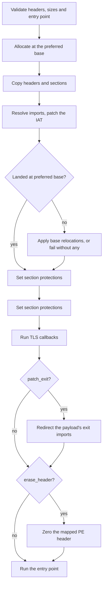

# Reflective loading

*Manually maps a PE image (or runs shellcode) into the current process, so the
payload executes from memory without touching disk or spawning a child.*

## What it does

Maps a PE image into the current process's memory (manual mapping): allocates
at the image's preferred base, copies headers and sections, resolves imports,
applies base relocations, fixes section memory protections, runs TLS callbacks
and then executes the payload's entry point on the calling thread. No external
target process is required.

For a `format: shellcode` payload there is no image to map: the decrypted bytes
are copied into an executable allocation and run on a thread instead (see
“Payload formats” below).

## How it works

### 1. Map the image

1. Validate the image: the MZ and PE signatures, the x64 magic, that the
   headers, the section table and a non-zero entry point are inside the buffer,
   and that `SizeOfHeaders` fits in both the buffer and `SizeOfImage`.
2. Allocate memory at the preferred image base (fall back to any address if it
   is taken) through `nt_alloc_vm`.
3. Copy the PE headers and each section's raw data into the allocation, checking
   both ends of every copy: the source against the buffer, the destination
   against `SizeOfImage`.

### 2. Fix it up

4. Resolve imports (`LoadLibraryA` + `GetProcAddress`), patching the import
   address table.
5. Apply base relocations if the image did not land at its preferred base. An
   image with no relocation directory (`/FIXED`) *must* land there: when it does
   not, the load fails with a diagnostic instead of running with stale absolute
   addresses.
6. Set each section's final memory protection (`nt_protect_vm`).

### 3. Run it

7. Run TLS callbacks, if present. The mapper does not provision per-thread TLS
   (see “TLS and per-thread state”).
9. Run the entry point (`DllMain` for a DLL, `mainCRTStartup`-style for an EXE)
   on the calling thread and return its exit code. With `params.patch_exit` the
   call runs on a fiber instead, so the payload's own exit hands the thread back
   (see “Exit patching”).

With `build.payloads.<name>.export` (DLLs only), step 9 changes: the entry point is
called once with `DLL_PROCESS_ATTACH` — the loader step a mapped DLL needs so
its CRT and global constructors initialize — and then the named export is called
with no arguments instead of running the entry point. The process
exits 0 once the export returns. Only *named* exports are reachable, and a
forwarded export (`DLL.Function`) is refused: its entry is a string inside the
export directory, not code.

Once the export address is resolved, the loader zeroes the decrypted payload
buffer before calling the export. That is the buffer's last read: TLS callbacks,
`DllMain`, the optional header erasure and the lookup itself need its `nt`
headers, while the resolved address points into the mapped image (the image base
plus the function RVA), not into the buffer. The buffer belongs to the stub's
caller, so it is zeroed rather than freed; without this, a blocking export
(Xenon's `DllRegisterServer` sleeps 24h) would keep the pristine decrypted DLL
in memory for its whole lifetime. Zeroing removes only that file copy: the
mapped image, the payload's heap state (Xenon's config block) and the mapped
`.rdata` remain.

A `format: dll` payload **must** set `export`: `plan::validate` rejects a mapped
DLL without one, because its `DllMain` only initializes the library (a
Picaro-packed inner DLL's `DllMain` does nothing beyond
`DisableThreadLibraryCalls`) and the chain would never run.

### 4. PE-header erasure (opt-in)

With `params.erase_header: true` the mapper zeroes the first `SizeOfHeaders`
bytes at `image_base` once the loader's own work is done — imports, relocations,
protections and TLS callbacks all ran earlier — and before any payload code runs
(`DllMain`, the named export, or the entry point). The header pages are not
covered by any section, so `fix_memory_protections` never changed them: they are
still `PAGE_READWRITE` and a plain `write_bytes` needs no protection change. The
loader reads its remaining metadata from the decrypted payload buffer and
resolves a DLL export from the export directory inside a section, so the
export/DLL path is covered as well.

The option is off by default because a payload's own startup code may read its
image's PE header — the MSVC CRT reads the subsystem from the optional header
(`__scrt_get_show_window_mode`) and the load config for the security cookie, and
`RtlImageNtHeader(GetModuleHandleW(NULL))` is a common self-inspection. Enable it
only for payloads known not to. It also only removes the *mapped* image's
header. The stub's decrypted payload buffer is zeroed on the export path after
the export lookup and before the export runs; on the entry-point path it stays
until the step returns. A whole-address-space scan can find the file copy only
on that latter path.

### 5. Exit patching (opt-in)

A normal PE executable's `mainCRTStartup` ends with `ExitProcess`, which would
end the whole stub and every step after this one. With `params.patch_exit: true`
the loader:

1. runs the payload's entry point (or the named DLL export) on a **fiber**
   created on the loader's own thread, and
2. serves the payload's `ExitProcess`, `ExitThread`, C-runtime `exit`/`_exit`
   and self-targeted `TerminateProcess` **imports** from a shim instead of the
   real exports.

On the loader's thread the shim records the code and switches back to the
loader's fiber, so the step returns that code and the chain continues. On a
thread the payload created itself (which is not a fiber) it calls `ExitThread`:
that thread ends and the process survives. Outside the payload fiber (a TLS
callback or `DllMain` that exits) the loader cannot resume its flow, so the real
`ExitProcess` runs as before.

The C-runtime pair matters for a normal C/C++ executable: `mainCRTStartup` calls
`exit`, and ucrtbase would otherwise call `ExitProcess` through *its own* IAT.
`TerminateProcess` is only intercepted when the handle names the current process;
a payload that terminates another process gets the real export.

Only the imports the payload's **own image** declares are patched. A call
resolved dynamically through `GetProcAddress`, `RtlExitUserProcess`, an import by
ordinal, an exit performed inside another loaded DLL (the Python runtime, a
runtime's own CRT) or a child process the payload spawns is not intercepted.
Because the shim skips the real exit, the payload's CRT exit handlers that would
run after that call do not run either.

`patch_exit` makes a reflective `pe` step **non-terminal**: `plan::validate`
allows it before another step, which is how two in-process executables chain.
It is rejected for `format: shellcode` (no import table to patch).

## Payload formats

The technique renders a different fragment per `build.payloads.<name>.format`:

- `pe` and `dll` map the image as above; the `is_dll` flag is read from the
  file-header characteristics.
- `shellcode` uses a runner fragment: there is no image, so the decrypted bytes
  are copied into a `PAGE_EXECUTE_READWRITE` allocation (`nt_alloc_vm`) and run
  on a thread whose entry is a `fn() -> u32`. The region is intentionally leaked,
  since the shellcode may have spawned work that outlives the wait.

`process_hollowing` cannot run these two formats; `plan::validate` requires
`reflective_loading` for them.

### Payload arguments

Before mapping, `execute_payload` calls `patch_command_line()` (shared, in
`src/engine/args.rs`, rendered as `$ARGS_BLOCK$`). The payload runs in *this*
process, so the stub's own command line has to be replaced with
`<exe> <yaml args> <runtime args>` (combined by `build.payloads.<name>.args_mode`).

Two places are updated (see `src/features/args/README.md`):

1. `PEB->ProcessParameters->CommandLine` (the `UNICODE_STRING` PEB-reading tools
   see), repointed at a new leaked UTF-16 buffer; and
2. the pointer `kernelbase` caches at process start and returns from
   `GetCommandLineW` — measured on Windows 11, patching only the PEB does **not**
   change what the payload's CRT reads. The cache is found by scanning
   `kernelbase` for the original buffer pointer, so no version-specific offset is
   hardcoded.

The line's token 0 is the executable name (the stub's own path), never an
argument, so the payload's `argv[0]` is the stub exe and the payload args start
at `argv[1]`.

## Integration

An **Execution** step: it runs a `pe`, `dll` or `shellcode` payload in-process. It is
**terminal** when the payload is a PE executable (that takes over the entry point), so
it must be the last step — unless `params.patch_exit: true`, which intercepts the
payload's exit and makes the step return. For a DLL or shellcode it returns, and
another step may follow.

## What it evades

- The payload never touches disk: it is decrypted in memory and mapped directly.
- No `CreateProcess` on the payload, no visible child process.
- No external process to hollow or inject into.

## What detects it

- **Userland hooks** on `VirtualAlloc`/`VirtualProtect` when a `PAGE_EXECUTE_*`
  region is created (RWX or RX transitions). These go through the syscall layer's
  `nt_alloc_vm`/`nt_protect_vm`, so `mode: indirect` bypasses the hooks and
  removes the Win32 imports.
- **ETW-TI** (`Microsoft-Windows-Threat-Intelligence`) for suspicious memory
  allocations.
- **Kernel callbacks** that flag executable private memory.
- **Memory scanning / YARA** over the in-memory image (the same static
  signatures that flag the file on disk apply in memory). With
  `params.erase_header: true` the mapped image's header is zeroed before any
  payload code runs, so a scan that finds a second PE image by its `MZ`/`PE`
  pair at the mapped base no longer matches; the decrypted file copy is zeroed
  early on the export path (after the export lookup, before a blocking export
  runs) and stays only on the entry-point path (see “PE-header erasure”).
- High-entropy executable regions that do not map to a loaded module.

## Architectures

The mapper is shared by `x64` and `x86`: the NT headers, the TLS directory and
the entry-point call are selected by `#[cfg]`, and the 4-byte thunks / 32-bit
IAT slots come from the shared import resolver (`src/engine/imports.rs`). On x86
the entry point is called through the x86 ABI (arguments on the stack); the
mapper never uses a register hand-off.

## TLS and per-thread state

A manually mapped image gets no TLS index: the OS never assigns one, so the
payload's `_tls_index` keeps the zero the linker left and its static-TLS reads
(`thread_local!`, `__declspec(thread)`, the CRT's own per-thread data) land in
*another* module's slot. The mapper runs the payload's `DLL_PROCESS_ATTACH`
callbacks — the loader step that initializes global state — and stops there.

Provisioning the index the obvious way (a `TlsAlloc` index written into
`ThreadLocalStoragePointer`) was implemented, measured and then removed, because
both halves of that trick are wrong for an in-process mapper:

- **The lowest free index belongs to a loaded module.** `TlsAlloc`'s counter and
  the loader's module-index counter are separate, so the first free *dynamic*
  index can be a module's *static* one: a plain process has module indices `0`
  and `1`, and its `TlsAlloc` also returns `1` (measured 2026-10-18). Here it
  returns `1` — `KERNELBASE`'s index (measured, 2026-09-27 and again 2026-10-18).
  Writing that entry replaces `KERNELBASE`'s per-thread block in the calling
  thread, and a payload that then runs UI code corrupts the heap in a release
  build: the input-method/TSF path reads and frees that block through
  `RtlFreeHeap` (measured 2026-10-17, `0xC0000374`, release only, reproducible;
  `docs/measurements.md`).
- **Skipping the collision is not enough: the loader owns the array itself.**
  The next design picked an index past every loaded module's, reserved it with
  `TlsAlloc`, built a wider private array seeded from the loader's and pointed
  `gs:[0x58]` at it. It was implemented and measured on 2026-10-18: it still
  dies. On thread exit `LdrShutdownThread` frees whatever
  `ThreadLocalStoragePointer` points at — and the entries it holds — from a heap
  private to ntdll, so an array we allocated faults reading the chunk header
  just before its base (`array - 0x10`). A plain-exe reproducer reproduces it
  deterministically; with no provisioning the same program exits cleanly.
  `ExitProcess` does not run that teardown, which is why the failure shows up on
  a thread that *returns*, not on a process that exits. No user-mode array can
  stand in for the loader's own.

Provisioning static TLS correctly needs the loader's own path — `LdrpHandleTlsData`
or the `NtSetInformationProcess` TLS class it drives — which means a module entry
in the loader's list and the loader lock. That is a feature of its own, not a
patch to this fragment. Until then:

- a payload that only needs the callbacks is unaffected (the marker payloads the
  technique is verified with are in that group);
- a **DLL/export** payload that reads a thread-local breaks, and so does a
  **PE** payload whose CRT touches per-thread state — the failure is a wrong
  value or a fault on the first access, not a silent success (measured: `tls=1`
  instead of `tls=42`, 2026-10-18);
- `build` warns when a `reflective_loading` payload carries a non-zero TLS
  template (`payload_advisories`), because that is the case the mapper cannot
  serve: the payload's thread-locals stay on `_tls_index` 0 and read and write
  the host's block, which is `8` bytes in the stub while a Rust payload's
  template is `88`. The warning fires for every Rust fixture, which is the point:
  it is a real limitation, not a rare edge;
- `DLL_THREAD_ATTACH` never fires for a thread the payload creates, either way.

## Measurements

- No dedicated baseline section, but the technique is the substrate of most of
  the measurement record: `packs_and_runs_a_reflective_payload` (marker + exit
  code, x64 and x86) and every probe-based round test (the preparation
  techniques run on top of it).
- **TLS provisioning — measured, then removed (2026-10-18, x64):** with a
  `TlsAlloc` index published into `_tls_index` and the block written into
  `ThreadLocalStoragePointer`, a Rust payload that reads its own `thread_local`
  (`examples/payloads/test_hollow_payload.rs`) wrote `tls=42` in release **and**
  in a `--debug` build; with the provisioning disabled the same payload wrote
  `tls=1`, so the check discriminates. The trace showed the index it took: `1`,
  `KERNELBASE`'s. One release run of a UI payload (a self-dismissing message box)
  was clean — exit `42`, nothing on screen (observed on the lab host) — but a
  single clean run does not clear the 2026-10-17 finding that *this exact
  condition* corrupts the heap in release with UI payloads. The provisioning is
  therefore removed again and only the callbacks remain; see “TLS and per-thread
  state” and `docs/measurements.md`.
- **TLS provisioning, the collision-free design — measured, still crashes
  (2026-10-18, x64, Docker image rustc 1.98.1 with the faithful stub config):**
  the index-past-every-module design built into `dist/poc_faithful_fix.exe`
  exits on an access violation before the box appears, under the same stub
  configuration that runs a no-provisioning build cleanly. The decisive
  measurement is a plain-exe reproducer (`build/tls_repro.exe`, scratch, not
  shipped): installing a wider array on a thread and letting the thread return
  faults in `LdrShutdownThread` reading `array - 0x10`, while the same program
  with no provisioning exits `42`. Restoring the loader's array just before the
  thread returns survives, which pins the free on the loader's own teardown and
  rules the array replacement out as a fix.
- **Exit patching — measured (2026-10-27, x64, lab host):**
  `patch_exit_chains_two_executable_payloads` builds a two-step chain, both
  steps `reflective_loading` of a minimal `no_std` PE whose entry point writes a
  marker and calls `ExitProcess` (first `7`, second `9`). Both markers reached
  stdout, in order, and the process exited `9`: the first payload's
  `ExitProcess` was intercepted and the chain continued. Without the patch the
  process would have ended `7` inside the first step (the pre-existing
  behavior). The payloads are `no_std` on purpose: a `std` payload has static
  TLS, which the mapper cannot provision, so its `thread_local` writes alias the
  stub's TLS (the known limitation above) — that is orthogonal to this feature
  and would make the second step's own `set_stage_args` observe a corrupted
  borrow flag.
- **Compile-verified only:** the header/section/entry-point guards, the
  no-relocations refusal and the forwarded-export refusal have no live run yet —
  they are covered by `compiles_reflective_loading_stub_for_every_format` (x64,
  three formats), `compiles_a_reflective_stub_for_i686` and the unit tests over
  the rendered fragment.
- **Unmeasured caveat:** a payload that raises a *native exception* on x64 cannot
  unwind through its own frames — the mapped image's unwind tables are never
  registered with `RtlAddFunctionTable` and the image is not in the loader list
  (see `docs/x86.md` for the x86/x64 difference). A payload that only returns or
  calls `ExitProcess` is unaffected. See `docs/measurements.md`.

## Implementation notes

- **The mapped PE header can be erased (opt-in).** `params.erase_header: true`
  zeroes the first `SizeOfHeaders` bytes at the mapped base after the loader's
  fixups and before any payload code runs. It is opt-in because startup code
  that reads its own header (the MSVC CRT, self-inspection) can break, and it
  does not cover the decrypted payload buffer (zeroed only on the export path,
  after the export lookup).
- **A payload that raises a native exception cannot unwind on x64.** The mapped
  image's unwind tables (`IMAGE_DIRECTORY_ENTRY_EXCEPTION`) are not registered
  with `RtlAddFunctionTable` and the image is absent from the loader list, so a
  raise/catch inside the payload has no frame data to walk; a payload that only
  returns (or calls `ExitProcess`) is unaffected. `docs/x86.md` has the x86/x64
  difference; registering the tables is a separate feature.
- The mapped PE's entry point runs on the calling thread and its return value
  is captured directly; the `shellcode` runner is the one that needs a thread.
  Without `patch_exit` a payload that calls `ExitProcess` terminates the whole
  stub process (and its thread). With it, the payload runs on a fiber of the same
  thread and the intercepted exit returns to the loader; the fiber is then
  deleted, which abandons whatever the payload left on its stack.
- **Chaining after a payload with static TLS is still unsafe.** `patch_exit`
  makes the *control flow* return, not the payload's TLS. The mapper cannot
  provision the payload's `_tls_index`, so a payload with a TLS template keeps
  writing into another module's block — including the stub's own thread-local
  state — after it started. The packer warns about a non-empty TLS template; for
  a chained `patch_exit` step prefer a payload without one (the live test uses a
  `no_std` PE).
- Payload arguments are rewritten into the PEB and `kernelbase`'s cached
  command-line pointer before the payload runs, so the payload's `argv` is what
  the operator configured (`build.payloads.<name>.args` + runtime args).
- Allocation and page protection go through the syscall layer
  (`nt_alloc_vm`/`nt_protect_vm`); the `shellcode` runner's `CreateThread` stays
  Win32 — the technique's syscall requirements (`NtAllocateVirtualMemory`,
  `NtProtectVirtualMemory`) include no thread call, so the layer renders no
  `nt_create_thread_ex` helper here.
- **A `/FIXED` payload is refused when it has to move.** The mapper allocates at
  the image's preferred base and only falls back to any address for an image that
  can be fixed up. A payload without a relocation directory that did not land at
  its preferred base fails the load with a diagnostic (and the build prints a
  warning: the plan is valid, the run just depends on the base being free).
- **The mapper is bounds-checked against the image it is given.** The headers,
  the section table, `SizeOfHeaders`/`SizeOfImage`, each section's source and
  destination, every relocation block header (checked to fit in the directory
  before it is read) and every fixup target (`page RVA + offset + width` against
  `SizeOfImage`), the TLS directory, its callback array and each callback
  address, the entry point and every table the export lookup walks are validated
  before they are followed. A relocation directory that ends without a zero
  terminator (legal, and common: `kernel32.dll`'s ends exactly at `Size`) is
  walked only up to its declared end. A malformed payload is a clean error, not
  an out-of-bounds read or a panic.
- **A forwarded export is refused, not followed.** The payload's own export table
  is read directly, so an entry that points back inside the export directory (a
  forwarder string) is reported instead of being called as code. Exports by
  ordinal only are not reachable either: the lookup walks the name table.
- **The mapper does not provision TLS.** `run_tls_callbacks` runs the payload's
  `DLL_PROCESS_ATTACH` callbacks only; `TlsAlloc` and the
  `ThreadLocalStoragePointer` write were removed after the 2026-10-17
  measurement (release-only heap corruption in UI payloads — see “TLS and
  per-thread state”). A unit test asserts the fragment does not reintroduce
  them.

## References

- MITRE ATT&CK T1620 — Reflective Code Loading.
- Manual mapping / reflective DLL injection papers (Stephen Fewer, Hasherezade).
