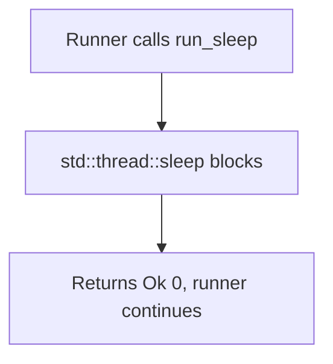

# Sleep

*Waits a fixed number of milliseconds before the pipeline continues, so a plan
can pace its steps or delay the final exit.*

## What it does

Waits for a fixed duration before the pipeline continues.

A Control technique: it neither modifies the current process state nor runs the
payload. It exists so a multi-step plan can pace its chain — a deliberate delay
between two steps, or a final delay before the process exits.

## How it works

1. The generated runner calls `run_sleep()` for the step.
2. `std::thread::sleep(Duration::from_millis(ms))` blocks the current thread.
3. It returns `Ok(0)`; the runner continues with the next step.

## Integration

A **Control** step: it orchestrates the chain and returns control when it
finishes, so the steps around it keep running. It pauses the chain for `ms` milliseconds between the steps around it.

## What it evades

- Nothing in a static sense: the fragment adds a constant and one call, and no
  literal. A pause can lower a purely time-correlation heuristic (two events
  landing within milliseconds of each other), but it hides no artifact and
  defeats no scanner.

## What detects it

- Nothing specific to the pause itself. A long, unexplained sleep is only a
  hunting signal when correlated with other behavior (an idle process with a
  suspended thread, a suspicious child launched minutes after the parent).

## Measurements

- Not applicable: the fragment has no sensitive literal and adds no import, so
  there is nothing new to measure. See `docs/measurements.md` for the technique
  baseline.

## Implementation notes

- `ms` is substituted textually into the fragment (`$MS$` → the number), so the
  generated stub carries no runtime string for it.
- The duration is a plain `u64`; no validation is performed. A value of `0`
  yields a no-op sleep.
- For sleep *obfuscation* (encrypting the image during a timer-driven wait) use
  the `sleep_obfuscation` preparation technique instead; this one only waits.

## References

- MITRE ATT&CK T1497 — Virtualization/Sandbox Evasion.
