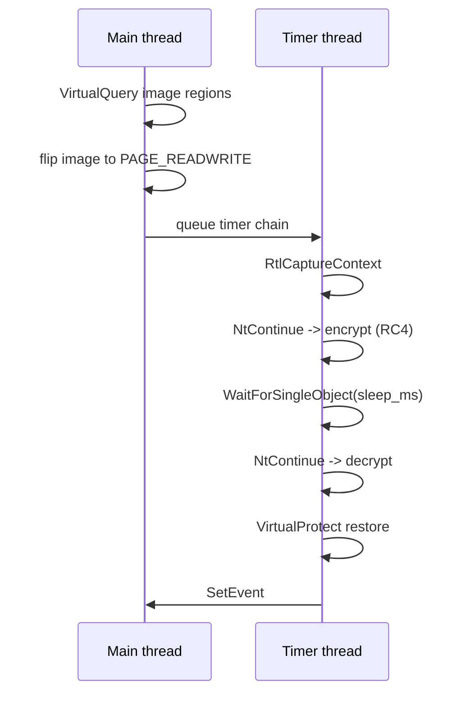

# Sleep obfuscation

*Encrypts the process's executable image for the duration of a sleep, so a
memory scan during the sleep sees RC4 ciphertext instead of the payload.*

## What it does

Encrypts the executable image region of the current process for the duration
of a sleep, so a memory scanner that inspects the process *during* the sleep
sees RC4 ciphertext instead of the payload bytes it would signature-match
against. When the sleep ends, the image is decrypted and restored to its
original protections, and the pipeline continues (the Execution technique then
runs the payload normally).

This phase ships the **ekko** variant (timer queue + ROP chain + `NtContinue`),
which is the canonical, best-documented sleep-obfuscation technique. `foliage`
(APC-based) and `cronos` (waitable timers) are recognized by the parser but
rejected with a "not implemented yet" error; they arrive in later phases.

## How it works

### 1. Prepare the image and capture the context

The ekko sequence (all on `CreateTimerQueueTimer` timers flagged
`WT_EXECUTEINTIMERTHREAD`, so every step runs on the timer thread outside the
encrypted image):

1. `VirtualQuery` walks `image_base .. image_base + SizeOfImage` and records
   every committed run with its original protection.
2. The image is flipped `PAGE_READWRITE` (once, on the calling thread).
3. A timer runs `RtlCaptureContext` to capture a *timer-thread* context. The
   capture point matters: `RtlCaptureContext` stores `Rsp` just past the
   return address the timer dispatch left on that stack.
4. The captured context is copied into one continuation context per step. Each
   step sets `Rip` to the target function, the argument registers (`Rcx`,
   `Rdx`, `R8`, `R9`) to its parameters, and `Rsp = captured.Rsp - 8`, so when
   the target returns, its `ret` lands on the dispatch's return address and
   the hijacked timer thread unwinds cleanly (the ROP chain is the sequence of
   timer callbacks, each entering through `NtContinue`).

### 2. Run the timer-queue ROP chain

5. The chain, queued with staggered due times:
   1. `SystemFunction032` (RC4, resolved from `advapi32`) encrypts the image
      in ≤ 64 KB chunks. Its data parameter is a `struct ustring` whose
      `Length` is a `DWORD` (u32), so a single call could cover the whole
      image; the fragment splits it anyway as a per-call safety margin. The
      key is the first 16 bytes of the per-build XChaCha key.
   2. `WaitForSingleObject(NtCurrentProcess(), sleep_ms)` performs the real
      sleep on the hijacked thread.
   3. `SystemFunction032` decrypts the same chunks, scheduled to fire **after**
      the sleep (the original PoC let them fire during it; that is its
      best-known flaw).
   4. `VirtualProtect` restores each run to its original protection.
   5. `SetEvent` wakes the main thread.
6. The main thread waits on the event the whole time; no code executes from
   the image while it is encrypted. The queue is deleted and the technique
   returns.

All API and DLL names (`NtContinue`, `RtlCaptureContext`, `SystemFunction032`,
the timer-queue family, …) are resolved at runtime and obfuscated through
`StringsConfig`, so none of them reaches the import table.

## Integration

A **Preparation** step: the stub runs it before the Execution and it never
receives the payload. Place it earlier in `runtime:` than the Execution step. It encrypts the image region for the duration of the sleep and
restores it afterwards.

The mechanism lives in the shared `sleep_runtime` block, not in the step. The
`Sleep` API hook (`build.stub.api_resolution.hooks.sleep`) calls the same
`ekko_sleep` over the **mapped payload** instead of the loader image, so a
payload that sleeps is concealed without a `runtime:` step. A buildable example
is `examples/plans/sleep-hook.yaml`; see `docs/design/api-resolution.md` section
13 and `docs/measurements.md`.

## What it evades

- **Memory scans during the sleep.** An EDR that walks the process's
  executable regions while the implant sleeps finds RC4 ciphertext (and,
  during the crypto steps, `RW` pages) instead of payload signatures. The
  payload itself is only ever mapped/executed *after* the sleep completes.

## What detects it

- **Timer callbacks (ETW)**: a thread pool repeatedly entering
  `NtContinue` from `CreateTimerQueueTimer` callbacks is a well-known ekko
  signature.
- **ROP chain anomalies**: call stacks that return into the timer dispatch
  instead of a normal caller, and thread contexts whose `Rsp` does not match
  the executing function's frame.
- **`NtContinue` origin**: threads resuming at addresses like
  `VirtualProtect`/`SetEvent` straight from `NtContinue`.
- **RW during the crypto steps**: the image pages flip `RX → RW` (visible to
  `VirtualQuery`/`NtQueryVirtualMemory` watchers) for the duration of the
  encryption and decryption passes.
- **RC4 key reuse across chunks**: **measured false** (2026-10-14). The chunks
  do *not* share keystream bytes: the first chunk of a run is plain `RC4(key)`
  (verified byte-for-byte against the build key, see Measurements), and every
  later chunk uses a *different* key state — consistent with
  `SystemFunction032` destroying the key buffer between calls (the API's
  documented behaviour; the mutation itself is not reproduced from the build
  key by the obvious S-box/keystream candidates, nor is the stream simply
  continued). What remains true: one 16-byte key seeds every call, so the
  *image* is protected by RC4 only.
- **The RC4 key sits in the heap** in cleartext during the whole sleep.
- **Wall-clock overhead**: every concealed sleep pays the ROP chain's timer
  steps, so `Sleep(ms)` takes longer than `ms` (measured ~217 ms for a 140 KB
  image with the current constants; see Measurements).

## Measurements

- **Measured 2026-10-14 (Windows 11 26200, Defender real-time off)** with a
  passive sampler outside the process (`code_examples/`, scratch): it spawns the
  artifact, walks the loader image (`base + SizeOfImage`) with `VirtualQueryEx`
  every 250 ms and reports, per sample, how many 4 KiB pages differ from the
  first sample and how many are `PAGE_READWRITE`. `sleep_ms: 6000`, image
  872 KiB / 218 pages / 5 committed runs / 17 chunks:

| t | changed pages | protect histogram | state |
|---|---|---|---|
| 0.02 s | 0 | `0x02=82 0x04=2 0x20=134` | baseline (before the step) |
| 0.28 s | 17 | `0x04=21 0x08=197` | encryption start: the flip is `WRITECOPY`, each chunk's write makes its pages `RW` |
| 1.04 s – 7.07 s | **218 / 218** | `0x04=218` | the whole image is RC4 ciphertext and writable — the 6.04 s plateau matches `sleep_ms` |
| 7.32 s–7.83 s | 154 → 83 → 13 | `0x04=218` | decryption pass (chunk by chunk) |
| 8.08 s | **0 / 218** | `0x02=71 0x04=13 0x20=134` | byte-exact restore (this sample catches the tail of the protection restore) |
| 8.55 s+ | 1 (loader state) | `0x02=82 0x04=2 0x20=134` | protections exactly at baseline again; the one page is the loader's own subsequent work |

The `MZ` page itself is ciphertext in the window (`4d 5a 90 00 …` → `7f e0 a4
c5 …`). The **control** (the plain `sleep` technique, same 6 s) kept 0/218 pages
changed with the baseline histogram for the whole window, so the signal is the
technique and not the sampler.

- **The cipher is RC4 with the per-build key**: the 16-byte key is recovered
  from the generated stub (the `$SLEEP_KEY_DEF$` literal, xor-obfuscated) and
  `RC4(key)` over the first chunk (65 520 bytes) reproduces the observed
  `plain ^ cipher` keystream byte-for-byte. Later chunks use a different key
  state (see the detection note above).
- The e2e `sleep_obfuscation_sleeps_and_still_runs_the_payload` asserts what
  needs no observer: the wait really takes `sleep_ms` and the chain reaches the
  payload afterwards.
- **2026-10-23 — tuning**: the shared runtime now uses 1 MiB chunks and a 10 ms
  stagger (20 ms first step) instead of 64 KiB / 50 ms / 100 ms. The table above
  was measured with the old constants; the plateau is still `sleep_ms`, but the
  transitions are faster. On a 140 KB mapped payload the hook went from ~1086 ms
  of overhead to ~217 ms for `Sleep(2500)` (`docs/measurements.md`).

## Implementation notes

- **Variant**: ekko only. The module structure (variant enum + one fragment)
  is ready for foliage and cronos.
- **Timing option C (demo)**: the technique performs one encrypted sleep of
  `sleep_ms` and returns; the payload then runs once, after the sleep. The
  operational form — encrypting *during the payload's own sleeps* — is the
  `hooks.sleep` API proxy, which calls the same runtime with the mapped payload
  region and the payload's requested duration.
- **One shared runtime**: the ekko chain, its RC4 key and its diagnostics live in
  `src/engine/templates/sleep_runtime.rs.tpl`, rendered once into `mod
  sleep_runtime`; this step is a thin adapter that resolves the loader image.
- **Region scope**: the step encrypts the whole loader image
  (`image_base + SizeOfImage`), the original Ekko region. The hook instead uses
  the region `reflective_loading` records for the mapped payload, which is the
  operational target; the payload's heap and thread stacks are outside both.
- **Chunking and timing**: `CHUNK` is 1 MiB (the `ustring` length is 32-bit) and
  `STEP` is 10 ms, just under the ~15.6 ms timer granularity, so a multi-megabyte
  image pays tens of steps, not hundreds.
- **CONTEXT alignment**: windows-rs 0.58 exposes the x64 `CONTEXT` with the
  correct field offsets but only 8-byte alignment; the fragment wraps it in
  `#[repr(align(16))]` (same workaround as the `Get/SetThreadContext`
  fragments). No layout divergence beyond that was found.
- **Stable-Rust ROP**: no `global_asm!` is needed. The "chain" is the timer
  queue itself: each step is an independent `NtContinue` continuation context
  (a plain struct copy with `Rip`/`Rsp`/argument registers patched), queued
  with staggered due times. Function pointers are transmuted to the callback
  ABI.
- **`SystemFunction032` is dynamic**: it resolves from `advapi32` at runtime;
  if resolution fails, the stub reports a clear error and aborts the sleep (a
  pure ChaCha20 fallback in the stub is possible but not needed — the crate is
  already linked).
- **`SystemFunction032` takes a `struct ustring`, not a `UNICODE_STRING`**: its
  `Length`/`MaximumLength` fields are `DWORD`s (u32). Modeling them as the
  `USHORT`s of a `UNICODE_STRING` truncates the image and smears the two `u16`
  halves of each length into one garbage `u32` (this was the original bug).
- **The sleep is real**: the delay step is `WaitForSingleObject` on a timer
  thread; `std::thread::sleep` cannot be used (it would block the calling
  thread, which must stay parked in the event wait).
- **Cleanup guard**: the completion event and the timer queue are owned by
  `EkkoCleanup`. Every early return cancels the pending chain, waits for an
  in-flight callback with `DeleteTimerQueueEx(..., INVALID_HANDLE_VALUE)` and
  closes both handles exactly once; the success path does the same explicitly.
  A `CreateTimerQueueTimer` failure after the first step has already fired can
  still cancel the decrypt/restore steps and leave the image encrypted (rare:
  the first step is due 20 ms after the capture while the chain is queued in
  microseconds).

## References

- Original Ekko technique and paper: C5pider, <https://github.com/Cracked5pider/Ekko>
- MDSec Nighthawk study that first documented the mechanism: Austin Hudson,
  <https://suspicious.actor/2022/05/05/mdsec-nighthawk-study.html>
- Rust port used as reference material (reimplemented, not copied):
  memN0ps, <https://github.com/memN0ps/ekko-rs>
- RustRedOps sleep-obfuscation material:
  <https://github.com/joaoviictorti/RustRedOps>
