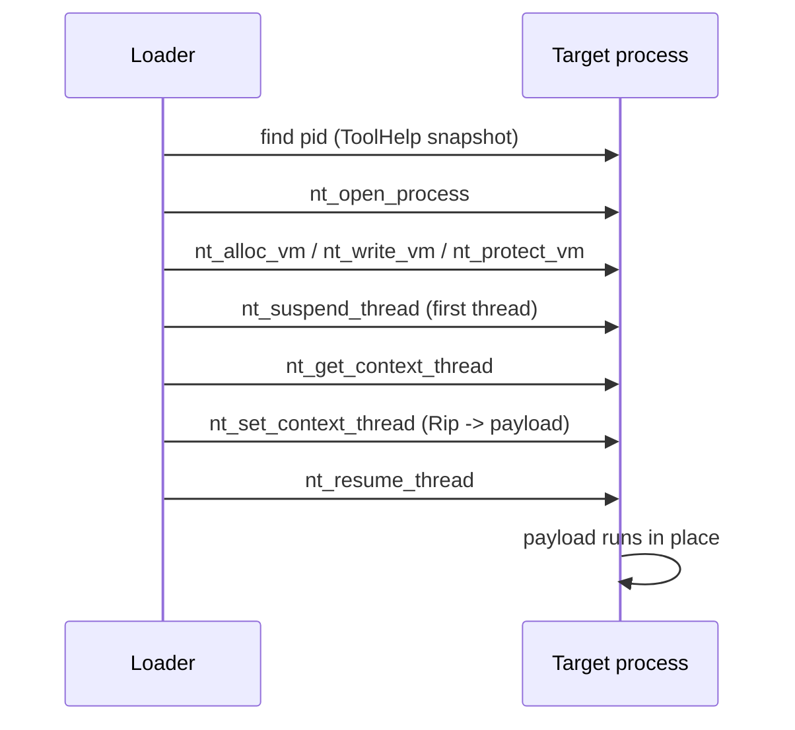

# Thread hijacking

*Redirects an already-running thread into the payload, so no thread is ever
created and the heavily instrumented NtCreateThreadEx path is avoided.*

## What it does

Takes over a thread that already exists in a running process: suspends it,
points its instruction pointer at the payload and resumes it. No thread is
created, so the `CreateRemoteThread`/`NtCreateThreadEx` path — the part of the
kernel interface every EDR instruments — is never used.

The payload must be position-independent code, and it should not return: under
the default `dedicated_stack: true` a `ret` reads a null return address and takes
the target down. The exception is deliberate — a cooperative payload that
returns exactly once is supported with `dedicated_stack: false` (see *The stack
question* below).

## How it works

### 1. Find and open the target

1. **Find the target.** With `pid` set it is used directly; otherwise a ToolHelp
   process snapshot is walked for the first running image whose name matches
   `target` (compared by base name, so a full path works too).
2. **Open it** with `nt_open_process` (`PROCESS_VM_OPERATION |
   PROCESS_VM_WRITE | PROCESS_QUERY_INFORMATION | SYNCHRONIZE`).

### 2. Place the payload

3. **Place the payload**, exactly as the other injection techniques do:
   `nt_alloc_vm` a `PAGE_READWRITE` region (never RWX), `nt_write_vm` the
   payload into it, `nt_protect_vm` it to read+execute. All of this happens
   *before* any thread is touched, so the window in which the target is frozen
   stays as short as possible.

### 3. Redirect a thread

4. **Pick a thread.** A ToolHelp thread snapshot is walked for the first thread
   owned by the target pid.
5. **Redirect it.** `nt_suspend_thread`, `nt_get_context_thread`,
   `Rip`/`Eip` = payload (and `Rsp`/`Esp` = the private stack, when
   `dedicated_stack` is on), `nt_set_context_thread`, `nt_resume_thread`.

### The stack question

`dedicated_stack: true` (the default) reserves *and commits* a fresh 1 MB stack
in the target
and points the thread at it. The pointer handed to the payload is the slot a
`ret` reads, it holds zero, and it sits where a `call` would have left it
(`rsp % 16 == 8`, which the x64 ABI expects at a function's first instruction) —
`smoke-align-probe.yaml` in `code_examples/thread_hijacking/` checks that from
inside the target. The payload therefore cannot corrupt the frames the target
thread was suspended in, and it has no caller to return to: a payload that
returns jumps to address zero and takes the target down with `0xC0000005`, which
is what `smoke-ret-stack.yaml` measures. Real payloads (beacons, stagers) do not
return, so the trade is the right way round by default.

`dedicated_stack: false` leaves `Rsp`/`Esp` alone. The payload then runs on the
target thread's live stack: a *cooperative* payload that returns exactly once
pops the return address the suspended frame would have used, lands in its
caller, and the target carries on — `smoke-ret-no-stack.yaml` shows the target
alive afterwards with the same threads it had before. A payload that uses more
stack than the suspended frame had left corrupts the target.

### Return value and `wait_ms`

The payload runs in another process, so the loader cannot read the payload's own
exit code. `wait_ms` bounds how long the loader waits for the *target* to exit:

| Situation | Returned code |
|-----------|---------------|
| `wait_ms: 0` | `259` (`STILL_ACTIVE`) — the target was not observed |
| The target exited inside the window | The target's exit status |
| The window expired | `259` (`STILL_ACTIVE`) |
| A step failed | `Err`, which the loader reports and applies `on_fail` to (the builtin default prints the message and exits `1`) |

A crashing target does not signal immediately: Windows Error Reporting holds the
process while it collects the report (`WerFault.exe` started ~1.2 s after the
fault; the process object signalled at ~3.3 s in the runs below). A `wait_ms`
shorter than that reports `259` even though the payload certainly ran — treat
`STILL_ACTIVE` as "not observed", never as "did not run".

## Integration

An **Execution** step: it runs a `shellcode` payload from the loader's own
process. The payload runs by redirecting a thread that already
exists in the target process.

## What it evades

- **Thread-creation telemetry.** `NtCreateThreadEx`/`CreateRemoteThread` are
  instrumented by every EDR and by kernel callbacks
  (`PsSetCreateThreadNotifyRoutine`); this technique never calls them. The
  only kernel-side trace is a *suspend*/*resume* pair on an existing thread.
- **Static thread-creation imports.** A loader that only creates threads still
  imports `CreateRemoteThread`/`NtCreateThreadEx`; neither appears in the
  artifact's IAT (`picaro audit`, see Measurements).
- **`RWX` scanning.** The payload region is `PAGE_READWRITE` until it is
  complete, then `PAGE_EXECUTE_READ`.
- **Win32 wrapper telemetry, with `syscalls.mode: indirect`.** The
  technique's syscall list (`NtOpenProcess`, `NtSuspendThread`,
  `NtGetContextThread`, `NtSetContextThread`, …) is what makes the indirect mode
  meaningful here: the suspend/context/resume calls then leave the IAT
  altogether. The mode is a *loader* setting, not a technique parameter — see
  `docs/features/ref/syscalls.md`.

## What detects it

- **`SetThreadContext` telemetry.** `NtSetContextThread` on a thread the caller
  does not own is a strong, well-known signal; EDRs that hook it (or the
  user-mode `SetThreadContext`) see the exact redirection.
- **Thread suspension outliers.** A suspend on a thread of a *different*
  process, followed by an immediate resume, is unusual outside debuggers.
- **Unbacked executable memory.** The payload region is private, committed,
  executable and backed by no module on disk — the same signature every
  in-memory loader has. It is what `unhook_ntdll`/`sleep_obfuscation` exist to
  blur, not to remove.
- **Private memory at the target.** With `dedicated_stack: true` the target also
  gains a 1 MB private, read-write, fully committed region: double the
  anomalous footprint in a process that had none.
- **Cross-process handles.** `nt_open_process` with `PROCESS_VM_WRITE` on
  another process is visible to handle-based telemetry.
- **Stack inspection at the target.** With `dedicated_stack: true` the first
  frames of the hijacked thread point into private memory instead of into
  the thread's original call chain.
- **The crash artefact.** A payload that faults leaves an `Application Error`
  (id 1000) record naming the target with `ModuleName = unknown` and a fault
  offset inside private, unbacked memory — an unusual combination for an editor
  or a ping. The smoke tests manufacture it on purpose.

## Measurements

Measured on the packing host (`x86_64-pc-windows-msvc`, release stub, Windows 11
26100) against `ping.exe -t 127.0.0.1`, with the plans in
`code_examples/thread_hijacking/` and its `run_case.ps1` harness. "Observed gone"
is the moment the target's process object signalled, i.e. when the
`NtWaitForSingleObject` inside the loader returned; the harness baseline
(`cmd /c exit 0`) is ~120–170 ms on this host.

| Plan | Payload | `dedicated_stack` | `wait_ms` | Loader's exit status | Target |
|------|---------|-------------------|-----------|----------------------|--------|
| `smoke.yaml` | `ud2` | `true` | 4000 | `0xC000001D` | died, `0xC000001D` |
| `smoke-no-stack.yaml` | `ud2` | `false` | 4000 | `0xC000001D` | died, `0xC000001D` |
| `smoke-ret-stack.yaml` | `mov eax,42; ret` | `true` | 4000 | `0xC0000005` | died, fault at address `0x0` |
| `smoke-ret-no-stack.yaml` | `mov eax,42; ret` | `false` | 3000 | `259` (`STILL_ACTIVE`) | alive, 5 threads before and 5 after |
| `smoke-fire-and-forget.yaml` | `mov eax,42; ret` | `false` | 0 | `259` (`STILL_ACTIVE`) | alive, 6 threads before and 6 after |
| `smoke-align-probe.yaml` | `rsp` alignment probe | `true` | 5000 | `0xC000001D` (fault at payload `+0x0b`) | died |
| `smoke-indirect.yaml` | `ud2` | `true` | 5000 | `0xC000001D` | died |
| `smoke-target-path.yaml` | `ud2` | `false` | 5000 | `0xC000001D` | died |

The relayed status is the target's, bit for bit, in every crashing row.

- **Threads created in the target: 0.** Measured with the two plans whose
  payload leaves the target alive: `smoke-fire-and-forget.yaml` (`wait_ms: 0`)
  ran the same six thread ids before and after the hijack, and
  `smoke-ret-no-stack.yaml` counted 5 before and 5 after. A control run with no
  hijack over the same window shows the same stability, so a dropped thread would
  have been visible (ping's own helper threads do drop later — see
  `code_examples/thread_hijacking/NOTES.md`, which is why the window matters).
- **Wall clock.** The non-crashing rows resolve at `wait_ms` + ~130 ms; the
  crashing ones at 2.6–3.6 s regardless of `wait_ms` (Error Reporting, above);
  `smoke-fire-and-forget.yaml` at 171–232 ms total.
- **Faulting address.** The `Application Error` record names the payload:
  `ud2` faults at payload base + `0x0`, `mov eax,42; ret` on a private stack at
  absolute `0x0` (the null return slot), and the alignment probe at base +
  `0x0b`, which is its `ud2`. `ModuleName` is `unknown` in all three: the thread
  died in private memory, not in a module.
- **Footprint (`picaro audit`).** `syscalls.mode: none`: 105 imported functions,
  with `VirtualAllocEx` and `WriteProcessMemory` flagged as suspicious.
  `mode: indirect`: 100 functions, "IAT looks minimal" — `VirtualAllocEx`,
  `WriteProcessMemory`, `VirtualProtectEx`, `SuspendThread`, `ResumeThread` and
  `WaitForSingleObject` are all gone. `OpenThread`,
  `GetExitCodeProcess` and the ToolHelp calls remain in both modes: the
  documented exceptions. Both artifacts report `sensitive 0`,
  `technique names 0`, `paths 0`.

## Implementation notes

- Every message and the target name go through `StringsConfig`; the fragment
  carries no runtime literal (the `tech_dbg!` format strings are the usual
  debug-only exception, compiled out unless `build.stub.debug: true`). `audit`
  reports no sensitive, technique-name or path strings for the artifacts above.
- The private stack's entry pointer is the null return slot itself, and it is
  8 bytes below the 16-byte-aligned top — what a `call` leaves. Both halves were
  wrong until this was measured: the null was written 8 bytes *below* the pointer
  the thread was given (so the guard only held because freshly committed pages
  are zero-filled), and the payload was entered 8 bytes off the ABI's alignment.
  `smoke-align-probe.yaml` is the regression test: it answers `0xC000001D`
  (the `ud2` arm) with the fix and answered `0x80000003` (the `int3` arm) before
  it; the fault offsets name the exact instruction in both cases.
- The `CONTEXT` is 16-byte aligned through a `#[repr(align(16))]` wrapper: x64
  `Get`/`SetThreadContext` fault on a misaligned context (the `windows` binding
  only guarantees 8).
- A failure after the suspend resumes the thread before returning, so a failed
  hijack does not leave the target frozen for good.
- Thread selection is "the first thread the snapshot returns", deliberately: the
  gentler choice — a thread parked in a wait, whose stack already holds a return
  address into a wait loop — means parsing per-thread wait reasons out of
  `SystemProcessInformation`, a large structure whose layout drifts between
  Windows versions (the waiting-thread-hijacking reference in
  `code_examples/thread_hijacking/refs/` does exactly that, and pays for it with
  a return-address validation step). See The stack question above for what the
  choice costs a *returning* payload with `dedicated_stack: false`.
- Position-independent payloads only: the payload has no imports resolved for it
  and no image mapped, exactly like the other `format: shellcode` techniques.

## References

- MITRE ATT&CK T1055.003 — Process Injection: Thread Execution Hijacking.
- Microsoft, `SetThreadContext` / `GetThreadContext` / `SuspendThread` /
  `ResumeThread` (Win32 API reference).
- MITRE ATT&CK T1106 — Native API (the `nt_open_process`/`nt_suspend_thread`
  path the technique takes instead of the Win32 wrappers).
- `joaoviictorti/RustRedOps`, `Thread-Hijacking/{Remote,Local}` — the same
  `Rip` rewrite in Rust with `windows-rs`, and the source of the 16-byte
  `CONTEXT` wrapper. It leaves the stack alone, makes the payload region RWX and
  waits on the *thread* without a bound.
- `hasherezade/waiting_thread_hijacking` (Check Point Research, *Waiting Thread
  Hijacking*, 2025) — a hijack that never calls `SetThreadContext`: it overwrites
  the return address of a *waiting* thread and stages a jump back inside the
  payload region, so the target keeps running. The closest thing to a
  "restore the context" variant of this technique.
- Local copies and a per-reference comparison:
  `code_examples/thread_hijacking/refs/NOTES.md`.
