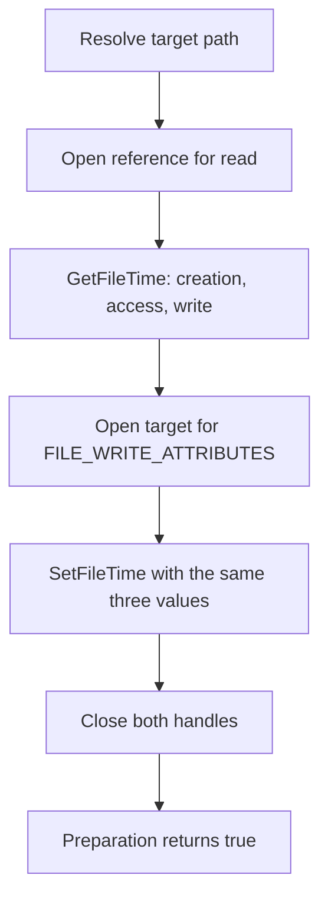

# Timestomping

*Copies a legitimate reference file's timestamps onto the artifact, so it looks
as old as the reference rather than freshly dropped.*

## Metadata

| | |
|---|---|
| **ATT&CK** | T1070.006 |
| **Stability** | Stable |
| **Category** | Preparation |
| **YAML key** | `timestomping` |

## What it does

Copies the creation, last-access and last-write timestamps of a legitimate
reference file onto a target file. By default the target is the running
artifact's own image, so the packed loader looks like it has been sitting on
disk as long as the reference (for example a system DLL) rather than from the
moment it was dropped.

## YAML parameters

| Parameter | Type | Required | Default | Description |
|-----------|------|----------|---------|-------------|
| `reference` | string | yes | — | Legitimate file whose creation, last-access and last-write times are copied |
| `target` | string | no | the running artifact's own image path | File to write the timestamps onto |

## YAML example

```yaml
runtime:
  - technique: timestomping
    params:
      reference: "C:\\Windows\\System32\\kernel32.dll"
  - technique: reflective_loading
    params:
      payload: main
```

## How it works



### 1. Read the reference timestamps

1. Resolves the target path: `params.target` when it is set, otherwise the
   running image's path (`std::env::current_exe()`). Nothing about the target is
   embedded in the stub when the default is used.
2. Opens the reference with `CreateFileW` for `FILE_GENERIC_READ`, sharing
   `FILE_SHARE_READ | FILE_SHARE_WRITE | FILE_SHARE_DELETE`, and reads its three
   `FILETIME` values with `GetFileTime`.

### 2. Apply them to the target

3. Opens the target with `FILE_WRITE_ATTRIBUTES` (the same share mode) and
   writes the three values with `SetFileTime`.
4. Closes both handles. A preparation returns `Ok(true)`, so the chain
   continues; a failure on any step returns `Err` and stops the chain before the
   payload runs.

The reference and (when configured) the target path are obfuscated at pack time
through `StringsConfig`, and every diagnostic is rebuilt at run time from
obfuscated bytes, so none of them appears in the artifact's `.rdata`.

## What it evades

- **Age-based triage.** An artifact whose creation time is two weeks old (not
  seconds old) does not stand out in a directory listing or in a "recently
  created files" sweep.
- **Timeline correlation.** The artifact's write time lines up with the
  reference's, so it does not anchor an incident timeline the way a fresh
  drop time does.
- **Automated age heuristics.** Rules that flag files modified within the last
  N minutes stop matching once the times are aligned to an old reference.

## What detects it

- **The metadata change itself.** `SetFileTime` on the running image — or on any
  file — is a deliberate, and therefore notable, act when it is tied to process
  execution.
- **Mismatched indicators.** The `$MFT`/`$STANDARD_INFORMATION` timestamps may
  still differ from `$FILE_NAME` and USN journal entries, which `SetFileTime`
  does not rewrite. A forensic comparison of the two attribute sets reveals the
  stomp.
- **Unchanged artifacts.** Only the three timestamps move; size, content,
  location and creation-*change* history are untouched, so the file can still be
  correlated by other means.
- **A default target.** Stomping the *running* image is itself suspicious: a
  legitimate program does not rewrite its own on-disk timestamps after launch.

## Measurements

Measured on the packing host (`x86_64-pc-windows-msvc`, release stub): the step
succeeds against a reference such as `C:\Windows\System32\kernel32.dll`, and the
target's creation, last-access and last-write times match the reference's after
the step runs. The reference path and (when set) the target path do not appear
in the artifact's `.rdata` or in `picaro audit`'s sensitive-literal report.

## Implementation notes

- The target path defaults to the running image and is therefore read from the
  process, never embedded; the *reference* path is a per-build string and always
  goes through `StringsConfig`, as does the target path when one is configured.
- `GetFileTime`/`SetFileTime` read and write the raw 64-bit `FILETIME` values
  verbatim; there is no rounding or local-time conversion, so the copy is exact.
- Both handles are opened with `FILE_SHARE_READ | FILE_SHARE_WRITE |
  FILE_SHARE_DELETE`, which is what lets the reference be read and the target be
  opened for attributes even when they are in use.
- No syscall-layer helpers are needed (`syscalls: []`): the Win32 file APIs are
  loader entry points, not kernel calls the stub issues through the indirect
  syscall trampoline.

## References

- MITRE ATT&CK T1070.006 — Indicator Removal: Timestomp.
- Microsoft, `GetFileTime` / `SetFileTime` and `FILE_BASIC_INFO`
  (`SetFileInformationByHandle`), the native timestamps these functions move.
- Microsoft, `$STANDARD_INFORMATION` vs `$FILE_NAME` attribute sets, the
  `$MFT`-level discrepancy that survives a `SetFileTime` stomp.
