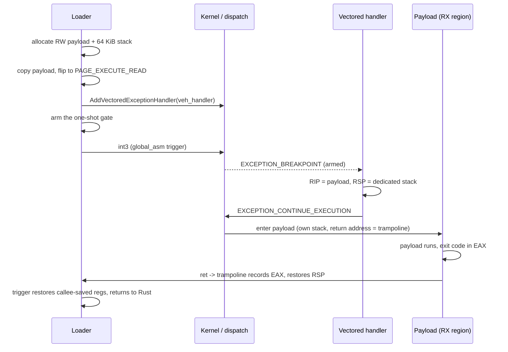

# Vectored-exception execution

*Enter the payload by redirecting a breakpoint through a vectored exception
handler, on the loader's own thread and a dedicated stack.*

## What it does

Stages the payload in a private read+execute region and runs it without creating
a thread and without calling a payload-shaped API. The loader registers a
vectored exception handler, raises a breakpoint on its own thread, and the
handler swaps the exception context's `Rip` for the payload and its `Rsp` for a
dedicated stack. A small assembly trampoline returns to the loader when the
payload's entry point returns, so the step is *returning* and the rest of the
`runtime:` chain still runs.

## How it works

### 1. Stage the payload and the stack

1. Allocate the payload region with `NtAllocateVirtualMemory` (through the
   syscall layer's `nt_alloc_vm`) as `MEM_COMMIT | MEM_RESERVE` +
   `PAGE_READWRITE`.
2. Copy the decrypted payload into it and flip it to `PAGE_EXECUTE_READ`, so no
   RWX page is ever live.
3. Allocate a second 64 KiB `PAGE_READWRITE` region for the payload's stack. The
   payload does not use the loader's stack, which keeps the exception-dispatch
   frames out of its backtrace and gives it a clean call frame.

### 2. Install the handler and raise the breakpoint

4. Register `veh_handler` with `AddVectoredExceptionHandler(1, ...)`.
5. Set a one-shot `ARMED` gate and execute the trigger, a `global_asm!` function
   that preserves every callee-saved register and executes `int3`.
6. The dispatcher delivers `EXCEPTION_BREAKPOINT` to the handler. Anything else,
   or a breakpoint raised while the gate is closed, is passed to the next
   handler (`EXCEPTION_CONTINUE_SEARCH`).

### 3. Redirect and run

7. The handler writes a return address to the trampoline at the top of the
   dedicated stack, publishes the loader's `Rsp` and the resume address, sets
   `Rip` to the payload and returns `EXCEPTION_CONTINUE_EXECUTION`.
8. The payload enters as `extern "system" fn() -> u32` with `Rsp % 16 == 8` and
   32 bytes of shadow space, exactly as a normal x64 call.
9. When it returns, the trampoline records `EAX`, switches `Rsp` back to the
   loader and jumps to the instruction after `int3`. The trigger restores the
   callee-saved registers and returns to Rust.

If the handler never redirected the breakpoint, the step fails with a
diagnostic instead of reporting a fabricated exit code.

## Integration

An **Execution** step for `format: shellcode` only, in the current process. It is
the in-process alternative to the thread-creating runners; a plan that wants a
different process should use `process_hollowing`, `early_bird` or `pe_injection`.
It combines with the preparations (`patch_amsi`, `patch_etw`, `unhook_ntdll`) and
with `sleep_obfuscation` like any other Execution step.

## What it evades

- **Thread-creation telemetry.** `CreateThread`, `NtCreateThreadEx`,
  `QueueUserAPC` and friends never appear; the payload runs on the calling
  thread.
- **RWX allocation.** The payload is written RW and only then flipped to RX, so
  the classic private-RWX signature never exists.
- **Cross-process write telemetry.** Everything happens in the loader's own
  process; there is no `WriteProcessMemory`-shaped event.
- **A naïve stack walk below the payload.** The payload runs on its own stack,
  so the exception-dispatch frames are not part of its backtrace.
- **Callback-API signatures.** No enumeration or callback API is imported for
  the entry; the trigger is a bare `int3`.

## What detects it

- **Vectored-handler registration.** A user-mode handler that redirects a
  breakpoint to a private RX region is a known execution primitive; EDRs can
  enumerate or hook `AddVectoredExceptionHandler` and inspect the handler.
- **Unexpected `EXCEPTION_BREAKPOINT`.** A debugger attached to the process
  receives the breakpoint first; `anti_debug` should run before this step.
- **Allocation → protect → execute.** The `NtAllocateVirtualMemory` →
  `NtProtectVirtualMemory` → execution sequence is the canonical in-memory-code
  signal, whichever technique starts it.
- **Stack and memory origin.** The return address inside the payload points at
  the private RX region, not at a loaded image; a deep stack walk still sees
  that frame.
- **Static.** With `syscalls.mode: none` the stub imports the Win32 memory APIs;
  with `mode: indirect` only `AddVectoredExceptionHandler` /
  `RemoveVectoredExceptionHandler` remain as the technique's static signature.

## Measurements

Measured on the lab host (Windows x64, Defender real-time protection off) on
2026-10-24, with `mode: indirect` + `resolver: api_hash` and the 6-byte fixture
`examples/payloads/demo_shellcode.bin` (`mov eax, 42; ret`):

- The debug build traced `handler registered`, `trigger returned: ran=1,
  result=42` and `the payload returned 42`; the process exited `42`.
- The release-style artifact built by `packs_and_runs_a_veh_execution_payload`
  exited `42`, proving the exit code came back through the handler and the
  trampoline rather than from the loader.
- Numbers: `docs/measurements.md`. The state stays `Experimental` until the
  technique is exercised with a payload that calls Win32 APIs (the fixture only
  returns) and its dedicated-stack size is measured under a real workload.

## Implementation notes

- **x64 only.** The handler rewrites the AMD64 `CONTEXT` (`Rip`/`Rsp`) and the
  trigger/trampoline are x64 assembly. The x86 form needs a 32-bit context and a
  `ret N`-shaped return; it is future work, so `requires` is `windows-x64`.
- **Callee-saved state is protected.** The trigger saves and restores
  `rbx`/`rbp`/`rsi`/`rdi`/`r12`–`r15` around the `int3`, so a payload that
  clobbers them does not corrupt the loader. The payload only has to return
  through `ret` with the dedicated stack balanced.
- **Process-global statics.** `ENTRY`, `STACK_TOP`, `SAVED_RSP`, `RESUME`,
  `RESULT`, `RAN` and `ARMED` are per-process, so two `veh_execution` steps
  driven concurrently from two threads would race. The builtin techniques are
  single-threaded.
- **A breakpoint's `CONTEXT.Rip` points at the `int3`.** Unlike a single-step
  trap (where it points after the instruction), `EXCEPTION_BREAKPOINT` hands the
  handler the address of the `int3` itself. The trigger's `int3` is one byte, so
  the resume address stored for the trampoline is `Rip + 1`; using `Rip`
  directly sends the payload's return straight back into the breakpoint and
  kills the process with `STATUS_BREAKPOINT` (0x80000003).
- **One-shot gate.** `ARMED` is cleared by the handler before the redirect, so
  a breakpoint the payload raises later is passed to the normal dispatch chain
  instead of being redirected to the payload again.
- **Unique assembly symbols.** The trampoline and the trigger are global
  `global_asm!` symbols with a per-render suffix, so two `veh_execution` steps in
  one stub do not collide.
- **The payload region and its stack are leaked on purpose**, like the other
  in-process runners: the payload may keep running after its entry point
  returns, and the stub has no free helper to release them safely.
- Every diagnostic goes through `StringsConfig`; the technique emits no
  cleartext message. The region and stack allocations go through `nt_alloc_vm` /
  `nt_protect_vm`, so `mode: indirect` keeps the Win32 memory imports out of the
  stub.

## References

- MITRE ATT&CK T1106 — Native API: <https://attack.mitre.org/techniques/T1106/>
- MITRE ATT&CK T1620 — Reflective Code Loading:
  <https://attack.mitre.org/techniques/T1620/>
- Microsoft, vectored exception handling:
  <https://learn.microsoft.com/en-us/windows/win32/debug/vectored-exception-handling>
- Microsoft, `AddVectoredExceptionHandler`:
  <https://learn.microsoft.com/en-us/windows/win32/api/errhandlingapi/nf-errhandlingapi-addvectoredexceptionhandler>
